# Our Castle

[](https://github.com/alejandro-publius/our-castle/actions/workflows/release-checks.yml?query=branch%3Amain)
[](https://github.com/alejandro-publius/our-castle/actions/workflows/codeql.yml?query=branch%3Amain)
[](https://github.com/alejandro-publius/our-castle/actions/workflows/container.yml?query=branch%3Amain)

**Families build castles. Neighbors build something together.**

Decide what the family can afford together, compare complete kits and adjust the plan when an expense changes. A living pixel woodland turns shared progress into new places to explore. Keep the village, open the Manor, cross the rivers to the Keep, and reach the Royal Citadel, Rosewind Palace and two storybook towers. Nine districts, a campsite that grows with the shared goal, short deed cards, family avatars, roaming guests and changing light sit beside one compact household journal.

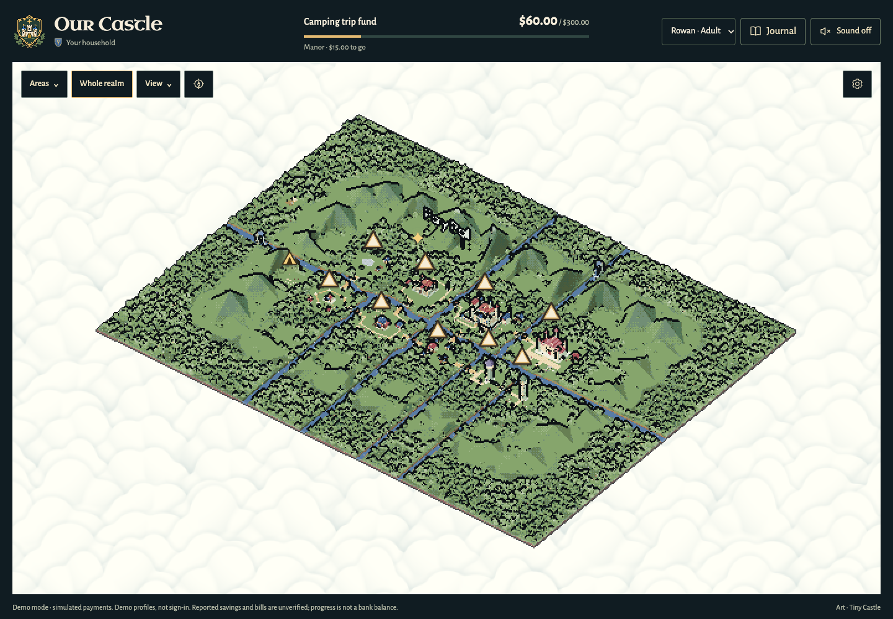

The illustrated journal has four chapters—House, Plan, Contribute and Ledger—with an original pixel crest and castle illustration. Family heraldry stays personal. [See the journal and brand design](docs/JOURNAL-DESIGN.md).

[Architecture diagram](#architecture-at-a-glance) · [Payment sequence](docs/ARCHITECTURE.md#payment-states) · [Life of a held contribution](#hold-first-then-release-in-steps)

## At a glance

| | |
| --- | --- |
| **Run it** | One command, no keys and no account: [`npm run demo -- --village-fund`](#try-it-locally) on Node.js 22.16+, or the same demo [in a container](#try-it-locally). The families, shops and prices are invented and the payments are simulated. |
| **Checked on every change** | [Ten hosted jobs](.github/workflows/release-checks.yml): 791 unit tests on Node 22.16, 24 and 26, the Rust solver's own tests, and 126 browser tests across desktop and a 390 px phone, from a suite of 428. |
| **Money rules tested past the cases anyone wrote down** | Every run plays 260 [seeded random histories](docs/PAYMENT-HOLDS.md#random-histories): holds, releases in steps, returns, lost answers, repeated deliveries, and [five families sharing one fund](docs/VILLAGE-FUNDS.md#random-histories). After every step the ledger must equal what the fake PayPal really took, and no family may be shown another's private amounts. They found two gaps in the hold path; both are closed. |
| **PayPal** | Orders v2 and Payments v2 through the pinned Server SDK: pay at once, or hold first (authorize, capture in up to three steps, void, reauthorize). Sandbox only: the code has no path to live endpoints. |
| **Adults decide; AI never moves money** | The server records each adult decision before PayPal is asked, counts a capture only if it matches that decision, and counts it once. The planner, the photo reader and the steward can read and propose; none can pay or approve, and an AI-proposed schedule is stored only if it equals the server's own arithmetic. [Nine money rules, each with the test that fails if you break it](docs/JUDGE-HANDOFF.md#money-rules-and-the-tests-that-hold-them). |
| **A solver in Rust** | Complete kits are searched in exact integer cents by a bounded native solver, which the server checks against a JavaScript reference: equal on [403 cases](docs/VALIDATION.md). |
| **What is real and what is not** | [What is verified](#what-is-verified) separates the hosted checks, the fake-provider evidence and the few live sandbox results. |

The source is **public on GitHub**. It includes:
- family choices, schedules and shopping within the family's limits;
- a kit list from typed text or a photo, complete-kit planning and a playable family-trip example with an invented catalogue;
- an invite-only Village Exchange that connects received loans and gifts to the kit planner;
- a shared village fund, where neighboring families fund one project together, with a shared square and a read-only assistant bridge;
- adult-approved PayPal sandbox contributions with recovery and safety checks, and an opt-in **hold first** path: hold an amount, extend it once, release it in up to three steps, or return it;
- an original knight-and-dragon loading scene, time of day and weather (including Snow), opt-in music and Moss's optional tour.

Every example below starts its own fresh session. [Release status and remaining video/submission steps](docs/RELEASE-READINESS.md). For an independent code review, use the [source map and evidence guide](docs/JUDGE-HANDOFF.md#6-for-source-reviewers).

## Try it locally

Use **Node.js 22.16+**; on an older version `npm ci` stops and says which one it needs. For the focused shared-fund example:

```sh
git clone https://github.com/alejandro-publius/our-castle.git
cd our-castle
npm ci
npm run demo -- --village-fund
# Open the local URL printed in the terminal.
```

No Node.js 22.16? The same demo runs in a container, with nothing else to install:

```sh
docker build -t our-castle .
docker run --rm -p 127.0.0.1:8080:8080 our-castle     # add --family-trip for the planning example
# Open http://localhost:8080
```

It is the same keyless, in-memory demo, and it answers only as `localhost`: publishing the port does not publish the app. [A hosted job](.github/workflows/container.yml) builds the image and starts it on every change.

Five invented families have contributed **$200 toward a $400 class trip**. In the parchment fund sheet, approve **$40**, see the shared schoolhouse advance, then inspect the contribution in Records. Each family's private savings stay separate. Visit the square to see opted-in castle appearances; people appear only after joining. Everything in this runner is simulated, with no credentials or provider traffic. [One-minute route, implementation and remaining setup](docs/VILLAGE-DEMO.md).

| The fund sheet after one simulated $40 contribution | The shared square: the schoolhouse and five castles |
| --- | --- |
| 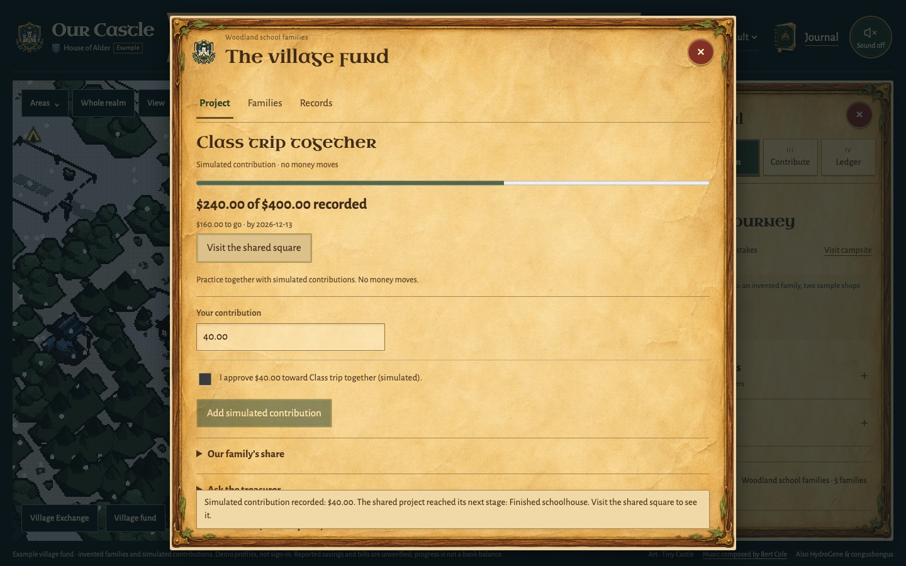 | 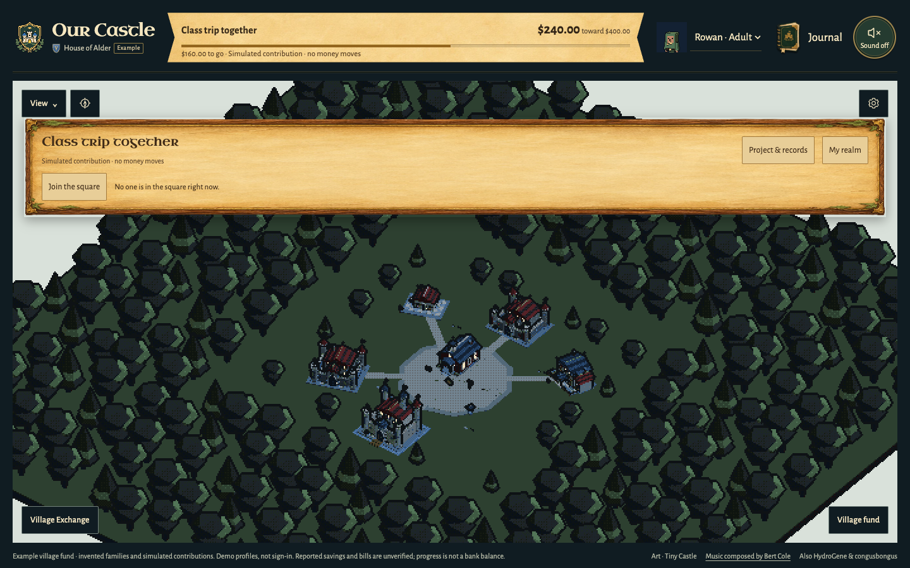 |

While a realm starts, an original knight-and-dragon scene may appear for a moment. It leaves as soon as the realm is ready, and a fast machine may never show it. [How it behaves](docs/DRAGON-LOADING.md).

The configured family app also includes recipient-bound PayPal sandbox orders, a read-only PYUSD devnet watcher, reviewed sentence-to-fund drafts and a scoped local MCP bridge. Those adapters have fake-provider evidence; a separate recipient account, devnet wallet and assistant-client setup are still needed for their real end-to-end checks. Subscription agreement tracking is disabled by default and does not import recurring charges. The earlier single-household library example remains available as `--village-story`.

For the deeper planning journey, start a separate demo with **`npm run demo -- --family-trip`**:

An invented family (Rowan, Ash and Wren), a kit list and six sample listings are ready in **Plan**. Choose **Try a one-off expense**, enter `90`, then compare complete kits. Choose the $180 kit, keep its stove and choose **Preview on map**. Change the expense to `120`: the map shows a temporary $150 smallest-change proposal that switches only the tent. The chosen $180 kit stays unchanged until you explicitly choose the repair. At `200`, no kit fits: the chosen $180 preview is $110 short, while the separate closest $150 kit is $80 short. The family, shops and prices are labelled examples; the kits, dates, shortfalls and repairs are calculated by the existing engine. [Full walkthrough, screenshots and limits](docs/FAMILY-TRIP-EXAMPLE.md).

[Selected product scope and evidence limits](docs/PRODUCT-COMPLETION.md) collects the completed features in one place. The picture below is the running example: a temporary $150 proposal beside the funded project, while the chosen $180 kit stays unchanged.

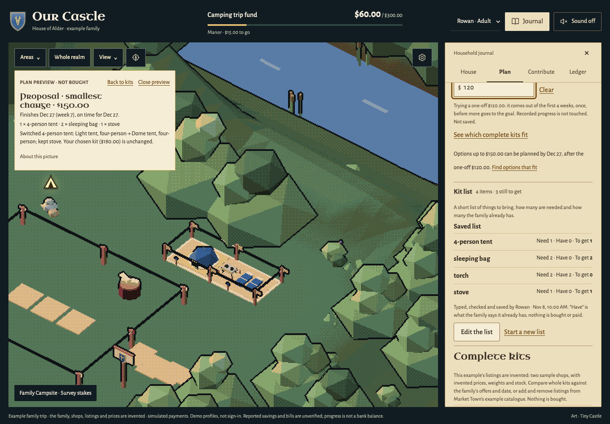

The example starts an in-memory household on an unused localhost port. It ignores `.env`, configured keys and saved records, and makes no provider call. Progress survives refresh while that process runs; closing it ends the session. Payments are simulated, plans use built-in rules, and photo reading and Cohere ordering stay off. Approval and saving a goal remain explicit.

For a blank household, run `npm run demo` without the flag. It has no catalogue; typed lists, family offers and the built-in planner still work. **Meet the Keeper**, in Journal → House (or `?tour=1`), starts Moss's optional tour. For persistent records and configured integrations, use `npm start` and [the runbook](docs/RUNBOOK.md). [Short review route](docs/JUDGE-HANDOFF.md#2-a-short-review-route).

Several people in one family, each with their own passkey? `npm run family -- --port 3200` runs the opt-in shared-family mode with invitations, adult/child permissions and live updates across open pages. Unsaved edits stay in place; an approval is cleared if its goal or sign-in changes. This runner uses simulated payments and its own database. See [shared families](docs/FAMILY-ACCESS.md).

Contributing with Rachel? [Start here](START-HERE-RACHEL.md) for one small task, a clean demo and the branch/PR workflow.

## Help a neighbor keep the trip

**Village Exchange** gives invited families a private board for an item they still need. Offer a loan or gift, accept it, then confirm the handover. In the authored example, receiving Willow's tent lowers Alder's lowest listed kit total from **$150 to $70**. A promise alone changes nothing; borrowed equipment never becomes money in the ledger.

Run **`npm run demo -- --village-exchange`** to try it in a fresh, keyless session. Open **Plan → Village Exchange**, accept Willow's offer, confirm receipt and compare what remains to buy. The same controls work between separate passkey households in the family runner. [Walkthrough, boundaries and implementation](docs/VILLAGE-EXCHANGE.md).

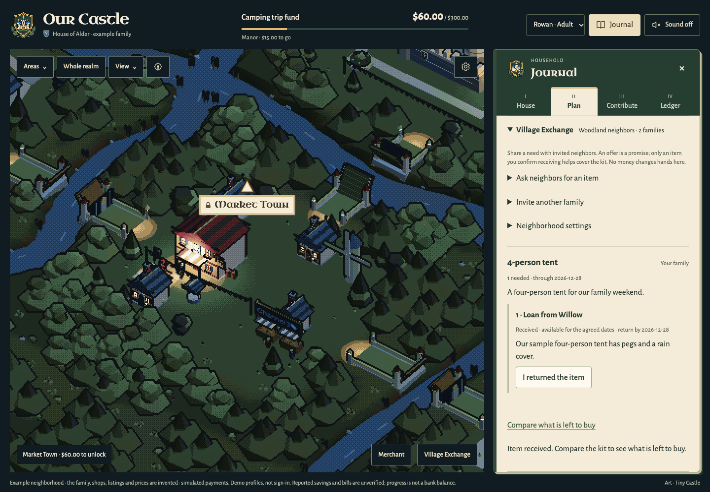

## A connected family journey

1. **House:** name the house, choose a crest and set a shared goal.
2. **Merchant → Plan:** choose **Find an item** beside Goal in Plan, or visit Market Town. Search real products within a budget. **Use as goal** creates a draft; confirm before saving. **Check schedule** tries a weekly amount/date without saving; a suggested later date only fills the form. Claude can propose a weekly schedule that the server independently checks, and the family reviews it before using it.
3. **Contribute:** an adult approves the exact amount. In sandbox mode, the server verifies the completed PayPal capture and credits once. In example mode, contributions are explicitly simulated. An adult can instead [hold the amount first](#hold-first-then-release-in-steps) and decide later.
4. **Realm → Treasury:** a milestone opens a bridge, briefly spills coins from a small gold-trimmed courtyard fountain and announces a deed. Earlier buildings remain, while the campsite reflects current goal progress; **Visit campsite** in Plan brings it into view. The Ledger shows the next area, records and a receipt on selection. Its existing read-only steward can check that order.

Searching does not buy an item. This is goal progress, not a bank balance. Reported savings, bills, gifts, simulated contributions and PayPal sandbox receipts retain their sources. Verified utility-bill rewards require a provider connection that is not present.

Small **arrow markers** reveal property names when selected or reached by keyboard. The map has another 32-unit square of land on every side, two animated waterfalls feeding the rivers, and a hidden camp with two resting knights. Four of its outer meadows hold small miniatures: a tourney field, a hay meadow, standing stones and a border watchtower. The **compass beside View** lets you drag between homes at your current close-up scale; switch it off to turn the map again. The **Sound button at the top right** enables quiet retro RPG music and board effects. Every page starts muted; the music loads only when enabled. [Soundtrack sources and licences](assets/music/README.md). After contributing, **Review the receipt** opens that contribution in Treasury, with its saved-check status and the single steward note. [Receipt walkthrough and desktop/phone captures](docs/RECEIPT-HANDOFF.md).

The walkthrough captures use isolated test households and simulated contributions:

| An area opens for the family | Treasury keeps the records |
| --- | --- |
| 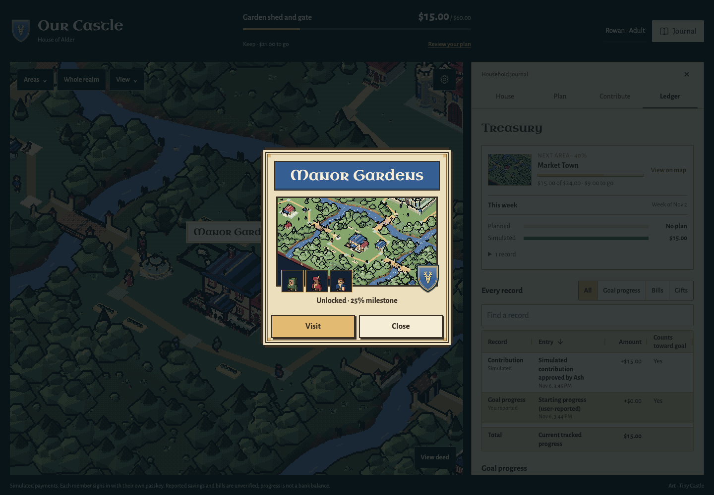 | 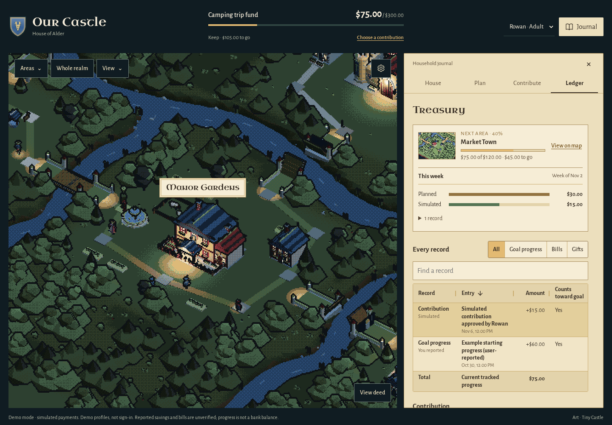 |

**World settings** change only how the map looks. Time of day follows the device clock or a chosen Day, Afternoon or Night; Weather starts in Snow and can be changed to Clear, Rain or an opt-in local report. Snow turns the ground white and the rivers icy, and brings out a sleigh that circles the realm and a decorated tree with a snowman. None of it touches a district, reward, payment or record. [Light and weather](docs/ART-DIRECTION.md) · [Wayside and meadow scenery](docs/WOODLAND-WAYSIDES.md)

| Snow: the sleigh over Rosewind Palace | A tourney field in an outer meadow |
| --- | --- |
| 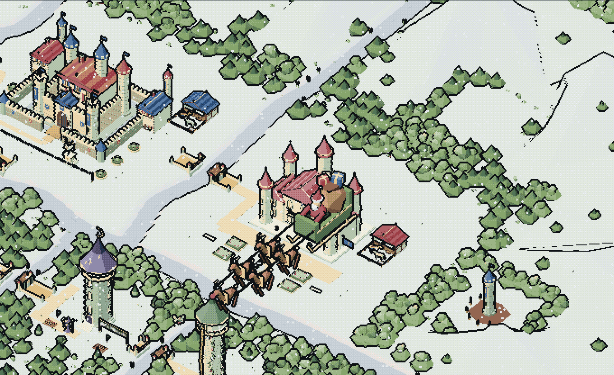 | 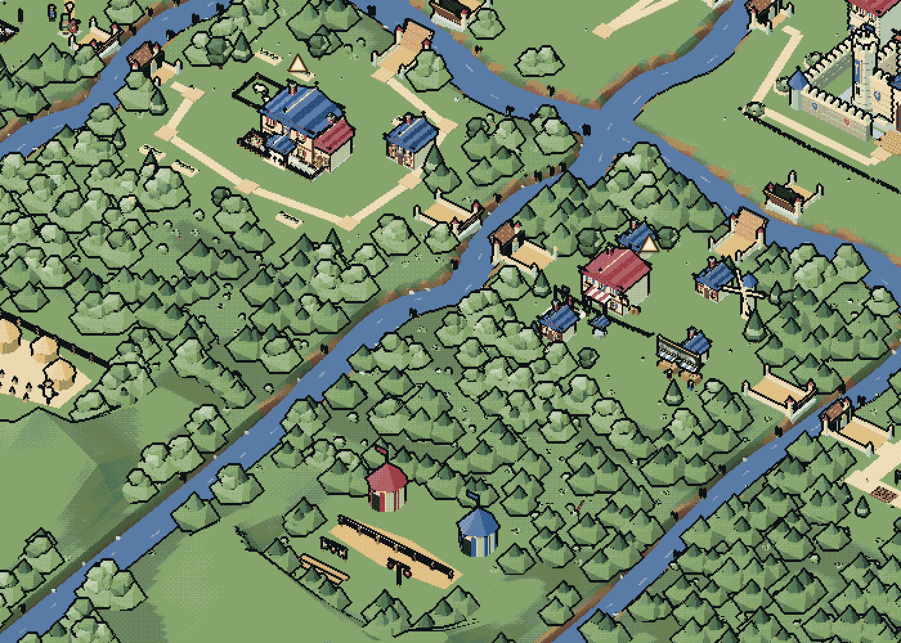 |

## Hold first, then release in steps

On **Contribute**, an adult can tick **Hold it first**. The approved amount is held and nothing counts toward the goal. Later, on that record in the **Ledger**, an adult does one of three things:

- **Release** an exact amount to the goal, all at once or in up to three steps. The last release is final, and whatever it does not take goes back to the payer.
- **Return** what is still held. A part released earlier still counts.
- **Extend** the hold once, after PayPal's three-day guarantee has ended and before the hold expires.

The record shows its money trail, for example **Held $40.00 → Released $10.00 → Released $15.00 → Returned $15.00**, and how long the guarantee lasts.

| 1. Hold it first (Contribute) | 2. Release part and keep the rest held (Ledger) |
| --- | --- |
|  |  |

After a final release of $15.00, the same record reads:


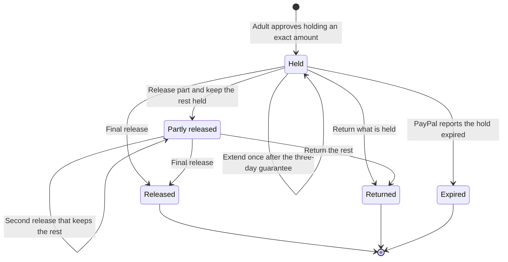

The server keeps these rules:

- **It owns every amount.** A release is at most what is still held and never more than the goal still needs. The code refuses anything larger, and so does a database rule.
- **Every decision is written down before PayPal is asked,** and only one decision can wait for PayPal at a time. The same request again is answered from the record.
- **Each release counts once.** A release decided again after an unanswered attempt reaches PayPal as the same request, so it cannot capture twice.
- **Unknown is not guessed.** If PayPal does not answer, nothing is credited until a check settles it from PayPal's own record.
- **Adults decide, and no AI is involved.**

To try it, run `npm run demo`, set up a house, tick **Hold it first** on Contribute and choose **Simulate approved hold**, then open the record in the Ledger. Extending is offered only after the three days have passed, so a short session will not reach it.

In sandbox mode the same steps use PayPal Orders v2 with intent `AUTHORIZE` and Payments v2 capture, reauthorize and void through the pinned Server SDK. **Every check of this path so far uses a fake PayPal or example mode. No real sandbox hold, extension, capture or void has been made.** [Rules, timing and evidence](docs/PAYMENT-HOLDS.md)

## Decide on a purchase together

In **Plan → Family choices**, shortlist up to three Market Town items, let each adult offer their own comfortable weekly amount, and let family members express a preference. Try an unexpected expense to see which item still fits the date and how much later the others finish. Choosing an item opens a goal draft for explicit review. **Save goal and propose this schedule** proposes the dated weeks it previews, keeping the expense and each adult's share, and **Use this plan** puts them in use. **Find options that fit** searches Market Town within the family's planning limit for its date, with optional must-haves from the catalog's own lists. It suggests only items the catalog confirms, and keeps why one was chosen.

These features are in the source and the saved Mac apps. Adding live catalogue items needs Channel3; the separate family-trip example supplies invented listings. Without either catalogue, adults' offers and the current goal can still be compared. The capture uses invented tents and fake provider responses. [Walkthrough, worked example and research](docs/FAMILY-CHOICES.md).


**Plan → Kit list** keeps a short checklist of things to bring for the goal: each item, how many are needed and how many the family already has. An adult types or pastes it, which needs no key, or reads a photo of a written list with OpenAI (optional, with its own server key). Either way the result is a draft the adult checks before **Save this list**. It moves no money and changes no goal or plan. [How it works, privacy and limits](docs/KIT-LIST.md).

**Complete kits** then compares whole kits for that list against the family's own offers, one-off amount and date.
- An adult adds up to three Market Town listings for each item still to get, with their own count of items per listing. Listings come from Market Town, so this needs Channel3, or the [family-trip example](docs/FAMILY-TRIP-EXAMPLE.md) and its invented catalogue.
- Up to three different kits that fit are shown: lowest listed total, lower listed weight, fewest shops. When none fits, the closest one is shown with its shortfall.
- Kept lines stay fixed, and the smallest change comes first when a larger one-off makes the chosen kit late.
- A reviewed kit can become the goal, with its family schedule proposed in the same save.
- The search over that small pool runs in a compact Rust solver (`solver/`) once it is built with `npm run solver:build`. A checkout without Rust uses the built-in JavaScript reference solver, which gives the same answers. The server checks every answer either way.
- An optional Cohere Rerank key, of its own, orders the kits that fit by a preference. Only public listing titles and shops are sent.

[How it works and its limits](docs/KIT-PLANNER.md).

| 1. Type the list and check it (phone) | 2. Add listings for each item still to get (phone) |
| --- | --- |
|  | 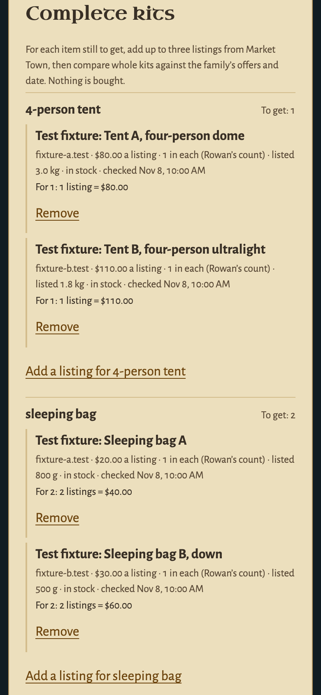 |

| 3. Compare complete kits that fit (desktop) | 4. The smallest change after a larger one-off (desktop) |
| --- | --- |
| 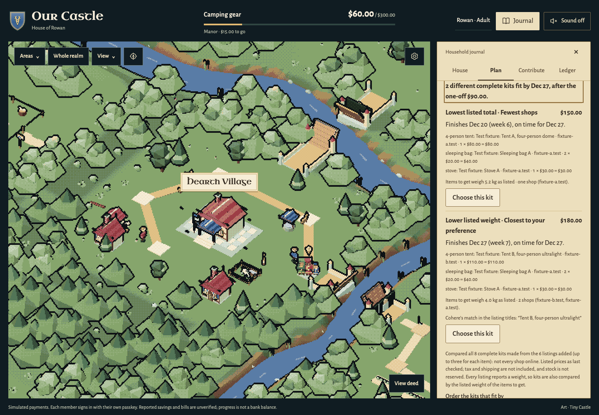 | 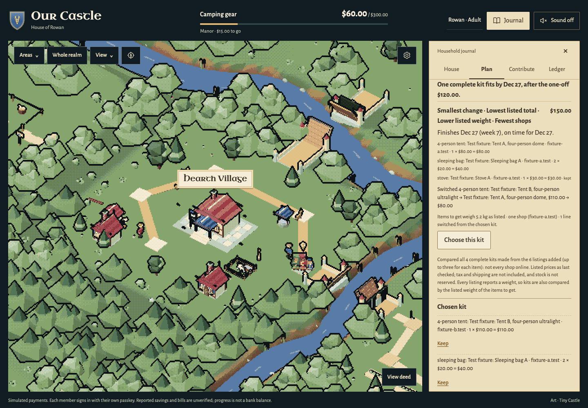 |

These are test captures. The family (Rowan, Ash and Wren) is invented, and the "Test fixture" listings come from two invented shops through a fake catalog; the Cohere order comes from a fake transport. They are not live catalog results, and the default demo installs no catalog. `npm run demo -- --family-trip` runs the same decision in the page with its own invented listings: [playable family-trip example](docs/FAMILY-TRIP-EXAMPLE.md).

## Three sponsor integrations

| Tool | In the game | Implementation and evidence |
| --- | --- | --- |
| **Channel3** | Market Town merchant (up to three results, refresh, cheaper choices, explicit goal draft) and the listings an adult adds to the kit list | Server-side API and budget checks; changed offers expire stale drafts. The listings feed the complete-kit planner: the solver compares whole kits within the family's limit on Channel3's listed price and weight, and a kit can be saved only while every chosen listing was confirmed in the last half hour. One real desktop search is separate from the fake-catalogue freshness, journey and kit-planner checks. [Merchant](docs/CHANNEL3-MERCHANT.md) · [Kit planner](docs/KIT-PLANNER.md) |
| **AG Grid / AG Studio** | Illustrated Treasury milestone, weekly plan, records and receipts in parchment | Studio 3.1 live data preserves the report; Grid 36.3 keeps selection and filters. The Agent Framework manages the existing steward through a scoped custom runner, with cancellation and cleanup. [Details](docs/TREASURY.md) |
| **APIMatic** | Behind the scenes | Official generated PayPal Server SDK 2.5.0 and eight installed, discovery-verified Codex context skills; real SDK serialization/auth/retry tests with fake transport, plus documented capture-recovery/read fixes. [Details](docs/APIMATIC-CODEX.md) |

In the game itself, each journal chapter says in one line which of these tools does its work in that session (or what stands in for it in a keyless example), with a link that takes the map to that maker's sign in the woodland.

PayPal JavaScript SDK v6 handles the browser session; Server SDK Orders v2/Payments v2 handle sandbox operations, including the hold-first calls (authorize, reauthorize, capture and void). PayPal Agent Toolkit enables only scoped read tools. Anthropic Claude (`claude-opus-5-5`) supplies runtime planning/steward answers; it cannot authorize, capture or refund a payment. Postman provides guarded walkthroughs.

## Architecture at a glance

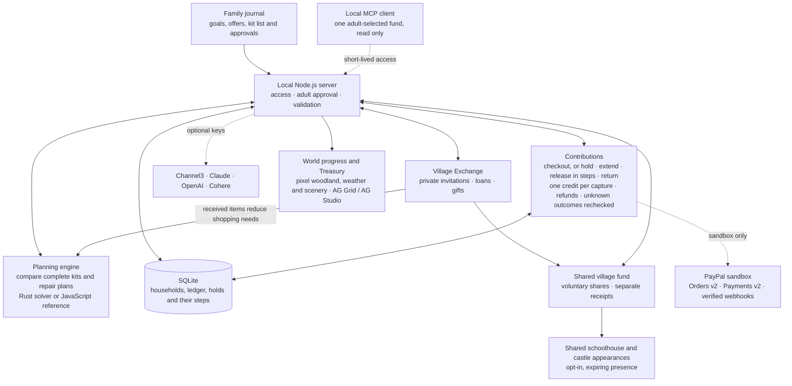

The family reviews a plan before saving it and approves each contribution explicitly. The default example uses simulated payments and built-in planning rules; the dotted edges are integrations that need configuration. The kit solver uses the JavaScript reference when no Rust build is present.

[Detailed architecture and sandbox payment sequence](docs/ARCHITECTURE.md) · [Held contributions](docs/PAYMENT-HOLDS.md) · [Receipt handoff](docs/RECEIPT-HANDOFF.md) · [Kit planning](docs/KIT-PLANNER.md)

## What is verified

- **Required release checks:** the [workflow](.github/workflows/release-checks.yml) has ten jobs. It runs the source guard and unit suite on Node 22.16.0, 24 and 26; builds and tests the pinned Rust solver; and exercises the release, shared-village and native-kit journeys on desktop and 390 px phone. Each PR records its exact tested head and results. [Current changes and actual checks](docs/VALIDATION.md).
- **Current release:** the shared village and loading scene ([#82](https://github.com/alejandro-publius/our-castle/pull/82)), hold-first contributions ([#83](https://github.com/alejandro-publius/our-castle/pull/83)), the entry copy ([#84](https://github.com/alejandro-publius/our-castle/pull/84)) and the hold extension with stepped releases ([#85](https://github.com/alejandro-publius/our-castle/pull/85)) each passed all ten jobs on their reviewed head before merging, and `main` passed all ten again after each merge. For #85 those are [run 42961844750](https://github.com/alejandro-publius/our-castle/actions/runs/42961844750) (777 unit results on Node 26 with 776 passes and one existing skip) and [run 42964411136](https://github.com/alejandro-publius/our-castle/actions/runs/42964411136) on `main` at `fb65357`. These are fake-provider checks.
- **Since then (November 11–12):** a pre-flight of the hold path against the PayPal SDK and PayPal's published rules, which found and fixed two gaps ([#92](https://github.com/alejandro-publius/our-castle/pull/92)); seeded random histories of holds and of the village fund ([#93](https://github.com/alejandro-publius/our-castle/pull/93), [#96](https://github.com/alejandro-publius/our-castle/pull/96), [#97](https://github.com/alejandro-publius/our-castle/pull/97)); a browser walk of the owner's sandbox runbook against a fake PayPal ([#95](https://github.com/alejandro-publius/our-castle/pull/95)); first-run polish; and the container and CodeQL workflows. `main` passed all ten release jobs after them at `e5fa792` ([run 43115840077](https://github.com/alejandro-publius/our-castle/actions/runs/43115840077)) and `1d670e4` ([run 43166313398](https://github.com/alejandro-publius/our-castle/actions/runs/43166313398)). [What each change established](docs/VALIDATION.md#pre-flight-random-histories-and-first-run-polish--november-1112-2026). These are fake-provider checks too.
- **Hold first:** 60 unit cases (27 scenarios, each run against both PayPal adapters with the transport replaced, and six more), [seeded random histories](docs/PAYMENT-HOLDS.md#random-histories) against the fake PayPal, a browser walk of the owner's sandbox runbook against that fake, and one example-mode browser journey. Deliberate breaks of each server rule were caught by those cases. No real sandbox hold exists yet. [Details](docs/VALIDATION.md#hold-extension-and-stepped-releases--november-10-2026)
- **Earlier integrated release:** [PR #60 run 42696659169](https://github.com/alejandro-publius/our-castle/actions/runs/42696659169) passed all five jobs: 556 unit passes and one existing skip per Node version, nine Rust tests per build, 45 release-browser passes with three designed skips, and two native-kit journey passes. These are fake-provider checks of that earlier head, separate from live evidence below.
- **Feature checks:** each change's unit and browser checks are recorded in [VALIDATION.md](docs/VALIDATION.md). The development feature suites use fake transports. The separate live synthetic OpenAI check is listed below.
- **Historical live sandbox:** hosted buyer approval, $15 capture, single credit, replay/mismatch checks, matching PayPal order and refund. [Original report](docs/LIVE-VERIFICATION.md)
- **Historical live AI:** feasible and impossible plans, ledger reading and PayPal transaction listing. [Original report](docs/LIVE-VERIFICATION-AI.md)
- **One live OpenAI check:** the production photo adapter read one synthetic packing-list image correctly. This is a single adapter check, not a real-photo accuracy benchmark or a human usability test. [Image, result and limits](docs/VALIDATION.md#one-live-openai-synthetic-photo--november-9-2026).
- **One live Cohere check:** on November 10 one request through the ordering adapter returned an ordering. That shows the connection works; whether the ordering is good has not been evaluated. [Release readiness](docs/RELEASE-READINESS.md)
- **The owner's saved Mac apps** at http://localhost:3010 and http://localhost:3021 were upgraded on November 10 to `a56170a` (database schema 18) with their original records preserved. They stay on that runtime until the owner asks for another upgrade, so they do not yet run the hold extension, stepped releases, meadow scenery or Snow.
- **Earlier public clone:** an anonymous clone, install, source guard and ten journey/phone checks passed for an earlier build, using the actual isolated `npm run demo` command. [Recording and scope](docs/demos/current-review/sources/public-demo-capture.json)
- **Historical in-app sandbox result** (preserved 3021 rehearsal, release `4082df5`): an owner-completed $15 contribution, one credit from $60 reported to $75, village/Manor open, and an actual same-order `get_order` with server reconciliation `match`. A model compatibility fix passed 10 focused tests. It predates this source and does not validate the newer features. [Evidence and recording limits](docs/IN-APP-SANDBOX-VERIFICATION.md)

No hackathon entry has been submitted. The existing [2:42 review cut](docs/demos/current-review/our-castle-current-review-cut.mp4) has narration, measured captions, editable sources and an explicit unfilmed checkout insert. It predates subsequent visual/interface changes and is not the final submitted video. [Release readiness](docs/RELEASE-READINESS.md) · [Entry copy](docs/SUBMISSION-DRAFT.md) · [Shot list](docs/SUBMISSION-SHOTLIST.md).

## Real PayPal sandbox and AI

Provider credentials belong only in the server-side, ignored `.env`, following [the runbook](docs/RUNBOOK.md#real-paypal-sandbox-and-ai):

- PayPal **sandbox** REST app: `PAYPAL_CLIENT_ID` / `PAYPAL_CLIENT_SECRET`.
- Anthropic runtime key: `AI_API_KEY` (`npm run set-ai-key` stores it privately).
- Channel3 merchant: `CHANNEL3_API_KEY`.
- AG Studio: your own `AG_STUDIO_LICENSE_KEY`. No key is bundled; the owner's trial is evaluation-only, not a production licence.
- Reading a photo of a kit list (optional): `KIT_OPENAI_API_KEY`, its own key, never `OPENAI_API_KEY`. [Kit list](docs/KIT-LIST.md)
- Ordering complete kits by a preference (optional): `KIT_COHERE_API_KEY`, its own key. [Complete kits](docs/KIT-PLANNER.md)

Every comparison, typed list and plan works without the last two. [All optional settings](docs/RUNBOOK.md#merchant-and-treasury-settings)

Live PayPal endpoints are unsupported. The default server binds to localhost. Owner records and keys are not distributed. No hosted real-money or authenticated multi-family service is claimed.

## Development

```sh
npm run check        # copied-art hashes, original palette/renderer wiring, JS syntax
npm run test:unit    # isolated databases and provider doubles
npm run test:e2e     # Playwright desktop/phone emulation, own example server
npm run solver:build # optional: the compiled Rust kit solver (Rust 1.99.1 via rustup, locked crates)
npm run solver:test  # the solver's own Rust tests
```

Without the Rust build, the server uses the built-in JavaScript reference solver. The hosted checks build the Rust solver and require it, and compare it with the reference.

Provider tests and `verify:live` are explicit, potentially paid operations; they are not part of ordinary source checks. [Postman guards and commands](docs/RUNBOOK.md#postman) · [Architecture](docs/ARCHITECTURE.md) · [Family-flow review](docs/FAMILY-FLOW-REVIEW.md) · [Sponsor briefs and award scope](docs/AWARD-STRATEGY.md)

## Art and licences

Original Tiny Castle / Crown & Dust assets, the 90-colour palette and pixel renderer are preserved. Hollybrook Open and Nightshoal supplied general inspiration; their art/source is not bundled. The application code is MIT; original artwork, fonts, third-party code and commercial Studio terms retain their separate [notices](NOTICE.md). Public source availability does not grant a general Tiny Castle brand/art licence.

The old “Our House” name remains only in preserved references and the owner's unchanged local folder path.
