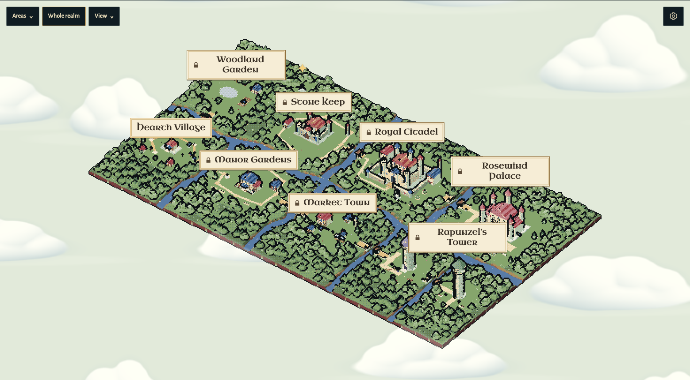

# Our Castle

**One family goal, a realm you build together.**

A living pixel woodland turns shared progress into new places to explore. Keep the village, open the Manor, cross the rivers to the Keep, and reach the Royal Citadel, Rosewind Palace and two storybook towers. Nine districts, short deed cards, family avatars, roaming guests and changing light sit beside one compact household journal.



The reviewed build is on GitHub main. The repository is **still private**: the connected integration can push but GitHub denied its visibility change. [Exact release status and remaining action](docs/RELEASE-READINESS.md#github-publication-result).

## Try it locally

Use **Node.js 22.16+** (verified on Node 26):

```sh
git clone https://github.com/alejandro-publius/our-castle.git
cd our-castle
npm ci
npm start
# http://localhost:3010/
```

A fresh checkout without a `.env` runs simulated payments and a rules-based planner. Its labels distinguish that mode from real sandbox/AI integrations. Records persist in local SQLite. [Isolated run and review route](docs/JUDGE-HANDOFF.md#1-run-it) · [Detailed runbook](docs/RUNBOOK.md)

## A connected family journey

1. **House:** name the house, choose a crest and set a shared goal.
2. **Merchant → Plan:** search real products within a budget. **Use as goal** creates a draft; confirm before saving. Claude can propose a weekly schedule that the server independently checks.
3. **Contribute:** an adult approves the exact amount. In sandbox mode, the server verifies the completed PayPal capture and credits once. In example mode, contributions are explicitly simulated.
4. **Realm → Treasury:** a milestone opens a bridge and announces a deed. Earlier buildings remain. The Ledger shows the next area, records and a receipt on selection. Its existing read-only steward can check that order.

Searching does not buy an item. This is goal progress, not a bank balance. Reported savings, bills, gifts, simulated contributions and PayPal sandbox receipts retain their sources. Verified utility-bill rewards require a provider connection that is not present.

## Three sponsor integrations

| Tool | In the game | Implementation and evidence |
| --- | --- | --- |
| **Channel3** | Market Town merchant, up to three real results, explicit goal draft | Server-side API, budget and error handling; one real desktop search plus fake-provider journey checks. [Details](docs/CHANNEL3-MERCHANT.md) |
| **AG Grid / AG Studio** | Treasury milestone, records and receipts in parchment | Real Studio custom widget/data engine/theme; Agent Framework manages the existing steward through a scoped custom runner, with cancellation and cleanup. No second chat panel. [Details](docs/TREASURY.md) |
| **APIMatic** | Behind the scenes | Official generated PayPal Server SDK 2.5.0 and eight installed, discovery-verified Codex context skills; documented capture-recovery/read fixes. [Details](docs/APIMATIC-CODEX.md) |

PayPal JavaScript SDK v6 handles the browser session; Server SDK Orders v2/Payments v2 handle sandbox operations. PayPal Agent Toolkit enables only scoped read tools. Anthropic Claude (`claude-opus-5-5`) supplies runtime planning/steward answers; it cannot authorize, capture or refund a payment. Postman provides guarded walkthroughs.

## What is verified

- **Historical live sandbox:** hosted buyer approval, $15 capture, single credit, replay/mismatch checks, matching PayPal order and refund. [Original report](docs/LIVE-VERIFICATION.md)
- **Historical live AI:** feasible and impossible plans, ledger reading and PayPal transaction listing. [Original report](docs/LIVE-VERIFICATION-AI.md)
- **Current local checks:** family flow, merchant goal confirmation, world unlocks, Treasury and actual Studio framework on Chromium and Linux WebKit, with fake providers/simulated payments. [Exact runs](docs/VALIDATION.md)
- **Still outstanding:** actual in-app popup → one credit/Manor unlock → real same-order `get_order`. The prepared Mac rehearsal is blocked on device/browser access. Historical payment evidence does not close this gap.

No hackathon entry has been submitted. [Release readiness](docs/RELEASE-READINESS.md) · [Entry copy](docs/SUBMISSION-DRAFT.md) · [Current shot plan](docs/SUBMISSION-SHOTLIST.md). Existing video cuts are historical review drafts with an explicitly unfilmed insert; no new video was produced for this pass.

## Real PayPal sandbox and AI

Provider credentials belong only in the server-side, ignored `.env`, following [the runbook](docs/RUNBOOK.md#real-paypal-sandbox-and-ai):

- PayPal **sandbox** REST app: `PAYPAL_CLIENT_ID` / `PAYPAL_CLIENT_SECRET`.
- Anthropic runtime key: `AI_API_KEY` (`npm run set-ai-key` stores it privately).
- Channel3 merchant: `CHANNEL3_API_KEY`.
- AG Studio: your own `AG_STUDIO_LICENSE_KEY`. No key is bundled; the owner's trial is evaluation-only, not a production licence.

Live PayPal endpoints are unsupported. The default server binds to localhost. Owner records and keys are not distributed. No hosted real-money or authenticated multi-family service is claimed.

## Development

```sh
npm run check        # copied-art hashes, original palette/renderer wiring, JS syntax
npm run test:unit    # isolated databases and provider doubles
npm run test:e2e     # Playwright desktop/phone emulation, own example server
```

Provider tests and `verify:live` are explicit, potentially paid operations; they are not part of ordinary source checks. [Postman guards and commands](docs/RUNBOOK.md#postman) · [Architecture](docs/ARCHITECTURE.md) · [Family-flow review](docs/FAMILY-FLOW-REVIEW.md) · [Sponsor briefs and award scope](docs/AWARD-STRATEGY.md)

## Art and licences

Original Tiny Castle / Crown & Dust assets, the 90-colour palette and pixel renderer are preserved. Hollybrook Open and Nightshoal supplied general inspiration; their art/source is not bundled. The application code is MIT; original artwork, fonts, third-party code and commercial Studio terms retain their separate [notices](NOTICE.md). Public source availability does not grant a general Tiny Castle brand/art licence.

The old “Our House” name remains only in preserved references and the owner's unchanged local folder path.
