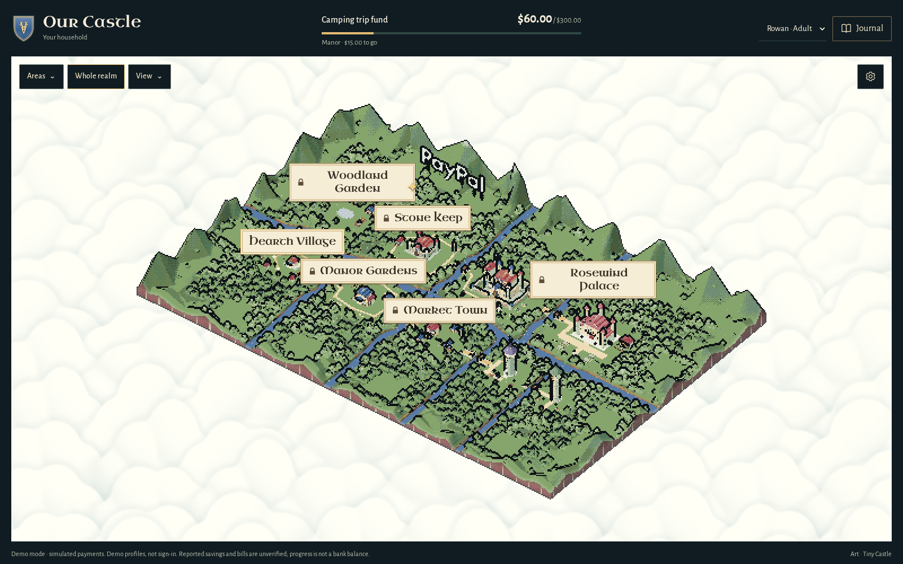
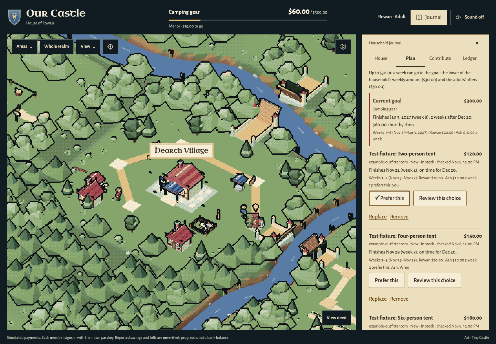
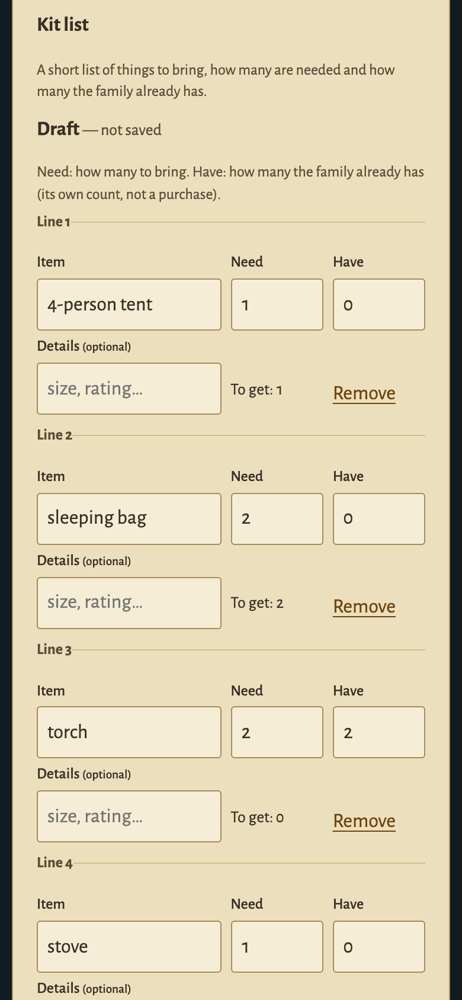

# Our Castle

**One family goal, a realm you build together.**

Decide what the family can afford together, compare complete kits and adjust the plan when an expense changes. A living pixel woodland turns shared progress into new places to explore. Keep the village, open the Manor, cross the rivers to the Keep, and reach the Royal Citadel, Rosewind Palace and two storybook towers. Nine districts, a campsite that grows with the shared goal, short deed cards, family avatars, roaming guests and changing light sit beside one compact household journal.



The source is **public on GitHub**. This source release includes the reviewed work of PRs #40–#58:
- payment recovery and safety fixes;
- opt-in music;
- Moss's optional tour;
- family choices and schedules;
- shopping within the family's limits;
- a kit list from typed text or a photo;
- complete-kit planning and a playable family-trip example with an invented catalogue.

The saved Mac apps at http://localhost:3010 and http://localhost:3021 were upgraded to `b21b2d8` (database schema 12) with their original records preserved. They remain pinned to that runtime; the new family-trip example below starts a separate fresh session. [Release status and remaining video/submission steps](docs/RELEASE-READINESS.md). For an independent code review, use the [source map and evidence guide](docs/JUDGE-HANDOFF.md#6-for-source-reviewers).

## Try it locally

Use **Node.js 22.16+**. Start with the playable family-trip example:

```sh
git clone https://github.com/alejandro-publius/our-castle.git
cd our-castle
npm ci
npm run demo -- --family-trip
# Open the local URL printed in the terminal.
```

An invented family (Rowan, Ash and Wren), a kit list and six sample listings are ready in **Plan**. Choose **Try a one-off expense**, enter `90`, then compare complete kits. Choose the $180 kit, keep its stove and choose **Preview on map**. Change the expense to `120`: the map shows a temporary $150 smallest-change proposal that switches only the tent. The chosen $180 kit stays unchanged until you explicitly choose the repair. At `200`, no kit fits: the chosen $180 preview is $110 short, while the separate closest $150 kit is $80 short. The family, shops and prices are labelled examples; the kits, dates, shortfalls and repairs are calculated by the existing engine. [Full walkthrough, screenshots and limits](docs/FAMILY-TRIP-EXAMPLE.md).

[Selected product scope and evidence limits](docs/PRODUCT-COMPLETION.md) collects the completed features in one place. The picture below is the running example: a temporary $150 proposal beside the funded project, while the chosen $180 kit stays unchanged.


The example starts an in-memory household on an unused localhost port. It ignores `.env`, configured keys and saved records, and makes no provider call. Progress survives refresh while that process runs; closing it ends the session. Payments are simulated, plans use built-in rules, and photo reading and Cohere ordering stay off. Approval and saving a goal remain explicit.

For a blank household, run `npm run demo` without the flag. It has no catalogue; typed lists, family offers and the built-in planner still work. **Meet the Keeper**, in Journal → House (or `?tour=1`), starts Moss's optional tour. For persistent records and configured integrations, use `npm start` and [the runbook](docs/RUNBOOK.md). [Short review route](docs/JUDGE-HANDOFF.md#2-a-short-review-route).

Several people in one family, each with their own passkey? `npm run family -- --port 3200` runs the opt-in shared-family mode with invitations, adult/child permissions and live updates across open pages. Unsaved edits stay in place; an approval is cleared if its goal or sign-in changes. This runner uses simulated payments and its own database. See [shared families](docs/FAMILY-ACCESS.md).

Contributing with Rachel? [Start here](START-HERE-RACHEL.md) for one small task, a clean demo and the branch/PR workflow.

## A connected family journey

1. **House:** name the house, choose a crest and set a shared goal.
2. **Merchant → Plan:** choose **Find an item** beside Goal in Plan, or visit Market Town. Search real products within a budget. **Use as goal** creates a draft; confirm before saving. **Check schedule** tries a weekly amount/date without saving; a suggested later date only fills the form. Claude can propose a weekly schedule that the server independently checks, and the family reviews it before using it.
3. **Contribute:** an adult approves the exact amount. In sandbox mode, the server verifies the completed PayPal capture and credits once. In example mode, contributions are explicitly simulated.
4. **Realm → Treasury:** a milestone opens a bridge, briefly spills coins from a small gold-trimmed courtyard fountain and announces a deed. Earlier buildings remain, while the campsite reflects current goal progress; **Visit campsite** in Plan brings it into view. The Ledger shows the next area, records and a receipt on selection. Its existing read-only steward can check that order.

Searching does not buy an item. This is goal progress, not a bank balance. Reported savings, bills, gifts, simulated contributions and PayPal sandbox receipts retain their sources. Verified utility-bill rewards require a provider connection that is not present.

The **compass beside View** lets you drag between homes at your current close-up scale; switch it off to turn the map again. The **Sound button at the top right** enables quiet retro RPG music and board effects. Every page starts muted; the music loads only when enabled. [Music source and CC0 licence](assets/music/README.md). After contributing, **Review the receipt** opens that contribution in Treasury, with its saved-check status and the single steward note. [Receipt walkthrough and desktop/phone captures](docs/RECEIPT-HANDOFF.md).

The walkthrough captures use isolated test households and simulated contributions:

| An area opens for the family | Treasury keeps the records |
| --- | --- |
|  |  |

## Decide on a purchase together

In **Plan → Family choices**, shortlist up to three Market Town items, let each adult offer their own comfortable weekly amount, and let family members express a preference. Try an unexpected expense to see which item still fits the date and how much later the others finish. Choosing an item opens a goal draft for explicit review. **Save goal and propose this schedule** proposes the dated weeks it previews, keeping the expense and each adult's share, and **Use this plan** puts them in use. **Find options that fit** searches Market Town within the family's planning limit for its date, with optional must-haves from the catalog's own lists. It suggests only items the catalog confirms, and keeps why one was chosen.

These features are in the source and the saved `b21b2d8` runtimes. Adding live catalogue items needs Channel3; the separate family-trip example supplies invented listings. Without either catalogue, adults' offers and the current goal can still be compared. The capture uses invented tents and fake provider responses. [Walkthrough, worked example and research](docs/FAMILY-CHOICES.md).



**Plan → Kit list** keeps a short checklist of things to bring for the goal: each item, how many are needed and how many the family already has. An adult types or pastes it, which needs no key, or reads a photo of a written list with OpenAI (optional, with its own server key). Either way the result is a draft the adult checks before **Save this list**. It moves no money and changes no goal or plan. [How it works, privacy and limits](docs/KIT-LIST.md).

**Complete kits** then compares whole kits for that list against the family's own offers, one-off amount and date.
- An adult adds up to three Market Town listings for each item still to get, with their own count of items per listing. Listings come from Market Town, so this needs Channel3, or the [family-trip example](docs/FAMILY-TRIP-EXAMPLE.md) and its invented catalogue.
- Up to three different kits that fit are shown: lowest listed total, lower listed weight, fewest shops. When none fits, the closest one is shown with its shortfall.
- Kept lines stay fixed, and the smallest change comes first when a larger one-off makes the chosen kit late.
- A reviewed kit can become the goal, with its family schedule proposed in the same save.
- The search over that small pool runs in a compact Rust solver (`solver/`) once it is built with `npm run solver:build`. A checkout without Rust uses the built-in JavaScript reference solver, which gives the same answers. The server checks every answer either way.
- An optional Cohere Rerank key, of its own, orders the kits that fit by a preference. Only public listing titles and shops are sent.

[How it works and its limits](docs/KIT-PLANNER.md).

| 1. Type the list and check it (phone) | 2. Add listings for each item still to get (phone) |
| --- | --- |
|  |  |

| 3. Compare complete kits that fit (desktop) | 4. The smallest change after a larger one-off (desktop) |
| --- | --- |
|  |  |

These are test captures. The family (Rowan, Ash and Wren) is invented, and the "Test fixture" listings come from two invented shops through a fake catalog; the Cohere order comes from a fake transport. They are not live catalog results, and the default demo installs no catalog. `npm run demo -- --family-trip` runs the same decision in the page with its own invented listings: [playable family-trip example](docs/FAMILY-TRIP-EXAMPLE.md).

## Three sponsor integrations

| Tool | In the game | Implementation and evidence |
| --- | --- | --- |
| **Channel3** | Market Town merchant, up to three results, refresh, cheaper choices and explicit goal draft | Server-side API and budget checks; changed offers expire stale drafts. One real desktop search is separate from fake-provider freshness/journey checks. [Details](docs/CHANNEL3-MERCHANT.md) |
| **AG Grid / AG Studio** | Illustrated Treasury milestone, weekly plan, records and receipts in parchment | Studio 3.1 live data preserves the report; Grid 36.3 keeps selection and filters. The Agent Framework manages the existing steward through a scoped custom runner, with cancellation and cleanup. [Details](docs/TREASURY.md) |
| **APIMatic** | Behind the scenes | Official generated PayPal Server SDK 2.5.0 and eight installed, discovery-verified Codex context skills; real SDK serialization/auth/retry tests with fake transport, plus documented capture-recovery/read fixes. [Details](docs/APIMATIC-CODEX.md) |

PayPal JavaScript SDK v6 handles the browser session; Server SDK Orders v2/Payments v2 handle sandbox operations. PayPal Agent Toolkit enables only scoped read tools. Anthropic Claude (`claude-opus-5-5`) supplies runtime planning/steward answers; it cannot authorize, capture or refund a payment. Postman provides guarded walkthroughs.

## What is verified

- **Required release checks:** the [workflow](.github/workflows/release-checks.yml) runs the source guard and unit suite on Node 22.16.0, 24 and 26; builds and tests the pinned Rust solver; and exercises the release and native-kit journeys on desktop and 390 px phone. Each PR records its exact tested head and results. [Current changes and actual checks](docs/VALIDATION.md).
- **Earlier integrated release:** [PR #60 run 42696659169](https://github.com/alejandro-publius/our-castle/actions/runs/42696659169) passed all five jobs: 556 unit passes and one existing skip per Node version, nine Rust tests per build, 45 release-browser passes with three designed skips, and two native-kit journey passes. These are fake-provider checks of that earlier head, separate from live evidence below.
- **Feature checks:** each change's unit and browser checks are recorded in [VALIDATION.md](docs/VALIDATION.md). The development feature suites use fake transports. The separate live synthetic OpenAI check is listed below.
- **Historical live sandbox:** hosted buyer approval, $15 capture, single credit, replay/mismatch checks, matching PayPal order and refund. [Original report](docs/LIVE-VERIFICATION.md)
- **Historical live AI:** feasible and impossible plans, ledger reading and PayPal transaction listing. [Original report](docs/LIVE-VERIFICATION-AI.md)
- **One live OpenAI check:** the production photo adapter read one synthetic packing-list image correctly. This is a single adapter check, not a real-photo accuracy benchmark or a human usability test. [Image, result and limits](docs/VALIDATION.md#one-live-openai-synthetic-photo--november-9-2026). Cohere live ranking remains untested.
- **Earlier public clone:** an anonymous clone, install, source guard and ten journey/phone checks passed for an earlier build, using the actual isolated `npm run demo` command. [Recording and scope](docs/demos/current-review/sources/public-demo-capture.json)
- **Historical in-app sandbox result** (preserved 3021 rehearsal, release `4082df5`): an owner-completed $15 contribution, one credit from $60 reported to $75, village/Manor open, and an actual same-order `get_order` with server reconciliation `match`. A model compatibility fix passed 10 focused tests. It predates this source and does not validate the newer features. [Evidence and recording limits](docs/IN-APP-SANDBOX-VERIFICATION.md)

No hackathon entry has been submitted. The existing [2:42 review cut](docs/demos/current-review/our-castle-current-review-cut.mp4) has narration, measured captions, editable sources and an explicit unfilmed checkout insert. It predates subsequent visual/interface changes and is not the final submitted video. [Release readiness](docs/RELEASE-READINESS.md) · [Entry copy](docs/SUBMISSION-DRAFT.md) · [Shot list](docs/SUBMISSION-SHOTLIST.md).

## Real PayPal sandbox and AI

Provider credentials belong only in the server-side, ignored `.env`, following [the runbook](docs/RUNBOOK.md#real-paypal-sandbox-and-ai):

- PayPal **sandbox** REST app: `PAYPAL_CLIENT_ID` / `PAYPAL_CLIENT_SECRET`.
- Anthropic runtime key: `AI_API_KEY` (`npm run set-ai-key` stores it privately).
- Channel3 merchant: `CHANNEL3_API_KEY`.
- AG Studio: your own `AG_STUDIO_LICENSE_KEY`. No key is bundled; the owner's trial is evaluation-only, not a production licence.
- Reading a photo of a kit list (optional): `KIT_OPENAI_API_KEY`, its own key, never `OPENAI_API_KEY`. [Kit list](docs/KIT-LIST.md)
- Ordering complete kits by a preference (optional): `KIT_COHERE_API_KEY`, its own key. [Complete kits](docs/KIT-PLANNER.md)

Every comparison, typed list and plan works without the last two. [All optional settings](docs/RUNBOOK.md#merchant-and-treasury-settings)

Live PayPal endpoints are unsupported. The default server binds to localhost. Owner records and keys are not distributed. No hosted real-money or authenticated multi-family service is claimed.

## Development

```sh
npm run check        # copied-art hashes, original palette/renderer wiring, JS syntax
npm run test:unit    # isolated databases and provider doubles
npm run test:e2e     # Playwright desktop/phone emulation, own example server
npm run solver:build # optional: the compiled Rust kit solver (Rust 1.99.1 via rustup, locked crates)
npm run solver:test  # the solver's own Rust tests
```

Without the Rust build, the server uses the built-in JavaScript reference solver. The hosted checks build the Rust solver and require it, and compare it with the reference.

Provider tests and `verify:live` are explicit, potentially paid operations; they are not part of ordinary source checks. [Postman guards and commands](docs/RUNBOOK.md#postman) · [Architecture](docs/ARCHITECTURE.md) · [Family-flow review](docs/FAMILY-FLOW-REVIEW.md) · [Sponsor briefs and award scope](docs/AWARD-STRATEGY.md)

## Art and licences

Original Tiny Castle / Crown & Dust assets, the 90-colour palette and pixel renderer are preserved. Hollybrook Open and Nightshoal supplied general inspiration; their art/source is not bundled. The application code is MIT; original artwork, fonts, third-party code and commercial Studio terms retain their separate [notices](NOTICE.md). Public source availability does not grant a general Tiny Castle brand/art licence.

The old “Our House” name remains only in preserved references and the owner's unchanged local folder path.
