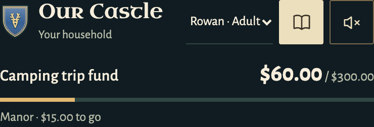

# Optional realm music

[Welcome to the Item Shop](https://opengameart.org/content/welcome-to-the-item-shop) by **congusbongus** is published under [CC0 1.0](https://creativecommons.org/publicdomain/zero/1.0/). The artist describes it as an original 16-bit RPG town/shop track made with BambooTracker. It is not Nintendo or Pokémon music and does not imply endorsement.

The bundled MP3 is converted from the original Ogg for browser compatibility. Source URLs, conversion and SHA-256 hashes are in [provenance.json](provenance.json). CC0 permits redistribution and adaptation, including commercial use; this voluntary credit preserves provenance. The owner’s artwork retains its separate existing licence.

Playback is optional: every page starts with Sound off. The file is requested only after the Sound button is enabled, loops quietly, and pauses when the page is hidden. Sound effects use the existing Web Audio synthesis. No player library, remote streaming service or runtime audio API is required.

## Sound control

The existing woodland header supplies the visual reference: speaker icon at the far right, a Sound off/on label on desktop, and a 44 px icon target on narrow screens. Initial-state captures use isolated example data.

[Capture source hashes and check scope](../../docs/screenshots/music-sources.json).
