# Architecture

A modular Node application (built-in `node:http` and `node:sqlite`) serves a framework-free browser app. The server uses the official Anthropic SDK and PayPal Server SDK/Agent Toolkit; the browser loads AG Grid Community and AG Studio for the Treasury. Optional family access uses passkeys. The board renders through the original pixel pipeline; the server owns every financial fact.

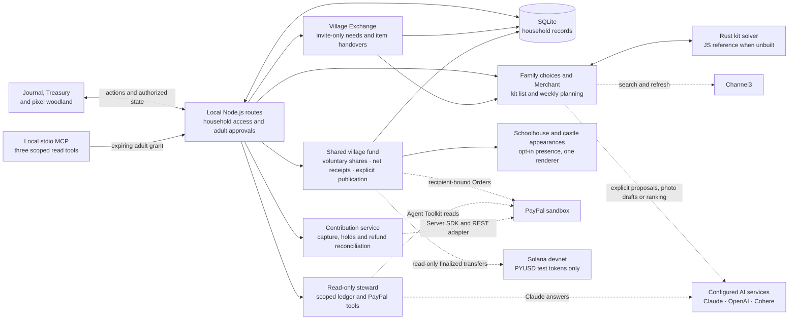

Solid arrows show the main local control/data paths; dotted arrows show configured provider calls. Household writes stay behind the server's route and service checks. In family mode, the live stream carries household-change notices and each page fetches its authorized state; it does not broadcast other families' records. The separate example runner uses simulated payments, built-in planning rules and, with `--family-trip`, an invented catalogue.

The complete-kit planner derives a budget from the family's offers and deadline, then asks the solver to compare a bounded pool of listings and quantities still needed. It checks the returned kits against the family's schedule again. Rust is used when built; the JavaScript reference is selected when the native build is absent. A native failure is reported rather than silently switched to the reference. OpenAI returns an editable photo draft; Cohere can reorder only already-eligible kits. Neither service can save a goal or authorize a payment.

| Diagram area | Source |
| --- | --- |
| Routes, access, state and updates | [app.mjs](../server/app.mjs), [access](../server/access/index.mjs), [view.mjs](../server/view.mjs), [live.mjs](../server/live.mjs) |
| Family decisions and kits | [family-choices.mjs](../server/family-choices.mjs), [kit planner](../server/kit/planner.mjs), [solver bridge](../server/kit/solver.mjs), [Rust solver](../solver/) |
| Optional AI | [weekly planner](../server/planner/index.mjs), [photo reader](../server/kit/reader.mjs), [kit ordering](../server/kit/rerank.mjs), [steward](../server/steward/index.mjs) |
| Neighbor item sharing | [exchange service](../server/exchange/index.mjs), [available shared items](../server/exchange/stock.mjs), [journal](../src/app/village-exchange.js) |
| Contributions and storage | [contributions.mjs](../server/payments/contributions.mjs), [db.mjs](../server/db.mjs) |
| Shared funds and recipients | [village](../server/village/index.mjs), [HTTP composition](../server/village-http.mjs), [recipient-bound payments](../server/payments/village-payments.mjs), [devnet watcher](../server/vault/index.mjs) |
| Village assistance and presence | [reviewed drafts](../server/planner/village-draft.mjs), [record treasurer](../server/steward/village-treasurer.mjs), [MCP capabilities](../server/mcp/capabilities.mjs), [temporary presence](../server/village-presence.mjs) |
| Treasury and world | [treasury.js](../src/app/treasury.js), [ledger-grid.js](../src/app/ledger-grid.js), [board-scene.js](../src/world/board-scene.js) |

`src/core/rules.js` is shared by both sides and has no DOM, Three.js or Node dependency, so tiers, board position, milestone cents and money parsing are tested directly in Node.

## Data model (SQLite)

| Table | Purpose |
| --- | --- |
| `households`, `members` | Household and adult/child member records. Example personas are not authentication; the opt-in family runner resolves members from passkey sessions. |
| `goals` | One active goal: target cents, currency, target date, chosen weekly amount. |
| `ledger_entries` | Goal-progress ledger. `kind` + `effect` are enforced by a CHECK constraint: starting progress and contributions +1, refunds −1, bills and gifts 0. `source_ref` is unique (one row per capture or refund). |
| `payment_orders` | Server-created orders with the expected household, goal, approver, amount and currency, plus a unique client request id. |
| `payment_captures`, `payment_refunds` | Provider ids (primary keys), status, whether credited, refunded cents. |
| `payment_holds`, `payment_hold_steps` | A held contribution: its current authorization, held and released totals, guarantee end and one extension; and every adult decision on it (extend, release, return), written before PayPal is asked. A CHECK refuses a release larger than what is still held. |
| `webhook_events` | Processed webhook event ids (deduplication). |
| `plans` | Proposed/accepted/superseded plans with their inputs, the arithmetic basis and the validated plan JSON. |
| `achievements` | Tier keepsakes (`tier:1..3`) and habit gardens (`garden:1..4`), unique per goal. |
| `accounts`, `passkeys`, `memberships`, `sessions`, `invitations`, `auth_challenges`, `audit_events` | Passkey identity, household access, expiring sessions and access history. |
| `goal_items`, `family_choices`, `family_offers`, `family_preferences` | Reviewed products, household shortlists, adults' weekly offers and members' preferences. |
| `kit_lists`, `kit_candidates`, `kit_selections`, `goal_kits` | Versioned quantities, product evidence, kept choices and an explicitly adopted complete kit. |
| `order_checks`, `deferred_refunds` | Saved receipt comparisons and verified refunds received before their capture is known. |
| `exchange_circles`, `exchange_members`, `exchange_invites` | Private neighborhood membership and hashed, expiring, single-use invitations. |
| `exchange_requests`, `exchange_offers` | Explicitly shared kit needs and item handover state; no financial credit. |
| `exchange_profiles` | Private-by-default worldwide item-discovery preferences and stable family display references. |
| `village_funds`, `village_shares`, `village_receipts`, `village_presentations` | One rail per shared project, voluntary own-family commitments, immutable net-accounting events and consented castle appearance. Separate from private savings. |
| `village_payment_intents` | Immutable approved amount/recipient, private payer identity, nullable public attribution, durable order recovery and reservation. |
| `village_vault_watches`, `village_vault_accounts`, `village_vault_events`, `village_vault_issues` | Finalized devnet baseline/cursor, watched token accounts, instruction-level deduplication and unsupported evidence retained for review. No keys or outgoing transaction tools. |
| `village_subscriptions` | Disabled-by-default finite recurring agreements and checked status; no recurring-charge accounting. |

Example mode and sandbox mode use different database files (`data/our-castle-example.sqlite`, `data/our-castle-sandbox.sqlite`), so simulated entries can never mix with PayPal-confirmed ones.

Current tracked progress = Σ effect × amount over the goal's ledger rows. Board position = ⌊progress × 20 ÷ target⌋, clamped to 0–20. Tiers are reached at 25%, 60% and 100% (milestone cents rounded up). The built home shows the highest tier ever reached (a keepsake); the travelers and amounts always show current progress.

## Payment states

This sequence shows a new sandbox contribution and its receipt handoff. Example contributions use the same local accounting boundaries with explicitly simulated outcomes and no PayPal call.

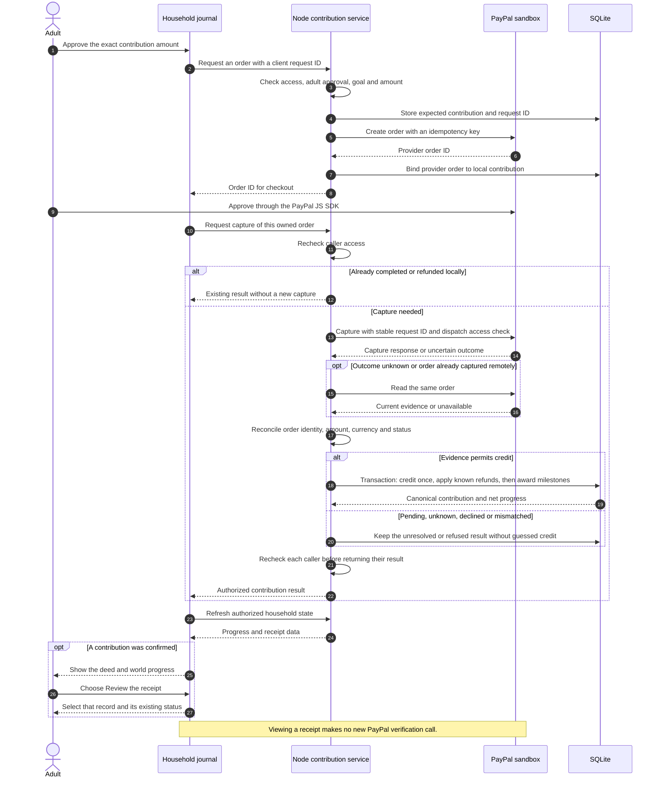

Crediting happens in one SQLite transaction: insert/upgrade the capture row, insert the unique ledger row, apply already-known verified refunds, then award tiers from the net progress. A late completion cannot erase an earlier refund. A first-seen partial refund needs validated refund details before the remaining contribution is credited. A second capture call for the same order returns `already_completed` without calling PayPal; concurrent calls share one in-flight capture, with access checked separately for each caller; `ORDER_ALREADY_CAPTURED` reconciles through `GET /v2/checkout/orders/{id}`.

Webhooks are processed only when `PAYPAL_WEBHOOK_ID` is set and PayPal's `verify-webhook-signature` returns `SUCCESS`. Capture events are matched through the server's own order id mapping; refund events through the refund's `up` link to the capture.

### Held contributions

A contribution can instead be held first: the order is created with intent `AUTHORIZE`, and nothing is credited until an adult releases an exact amount. Example mode has the same hold, labelled as simulated.

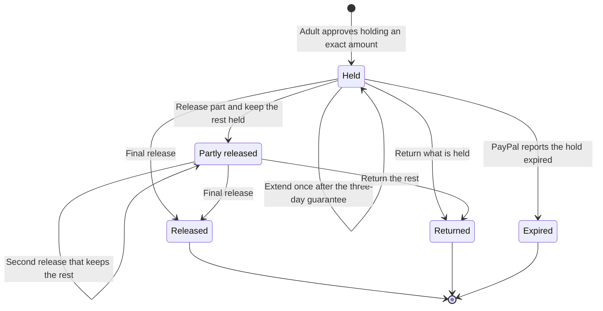

Each decision is a row in `payment_hold_steps`, written before PayPal is asked, and only one can wait for PayPal at a time. A release is a capture of the current authorization (not final when the rest is kept); it is credited through the same single-credit transaction as any capture, and only if it matches the release under way in amount, currency and contribution reference. An extension is a reauthorization for exactly the held amount; PayPal answers with a new authorization, which later captures and a return use. A release decided again after an unanswered attempt carries the same `PayPal-Request-Id`, so it cannot capture twice. An unanswered decision is settled by an explicit check from PayPal's own order, never guessed. All of this has fake-provider and example-mode evidence only. [Rules, timing and evidence](PAYMENT-HOLDS.md)

Ordinary receipt selection reads existing records. An explicit **Check with PayPal** fetches the same order and may reconcile its capture/refunds; a steward lookup reports what it found but cannot capture, refund or alter contribution credit. A closed checkout window alone establishes no payment outcome. See [the receipt handoff](RECEIPT-HANDOFF.md).

## PayPal adapters

`createContributionService` talks to PayPal through one small interface (`createOrder`, `captureOrder`, `getOrder`, `refundCapture`, `verifyWebhookSignature`, `generateClientToken`, and for held contributions `authorizeOrder`, `getAuthorization`, `captureAuthorization`, `reauthorizeAuthorization`, `voidAuthorization`). At runtime it is `server/payments/paypal-sdk-client.mjs`, built on PayPal's official Server SDK (`OrdersController`, `PaymentsController`, fixed to `Environment.Sandbox`). The adapter passes `paypalRequestId` and `prefer: return=representation`, and hands the service PayPal's raw REST JSON from the SDK response body. It maps the SDK's `ApiError` to PayPal issue names (for example `ORDER_ALREADY_CAPTURED` and `INSTRUMENT_DECLINED`). Webhook signature verification and browser client tokens are not in the Server SDK, so those two calls use `server/payments/paypal-client.mjs`, a minimal REST client with the same sandbox-only base URL. The payment test suite runs every scenario against both adapters.

## AI planner

1. The server computes a deterministic **basis** from the household's inputs: remaining cents, the weekly dates before the target date, the maximum reachable amount, planned total, shortfall, required weekly amount, a feasible alternative date and milestone targets.
2. With an `AI_API_KEY`, `server/planner/anthropic-provider.mjs` calls `claude-opus-5-5` through the official SDK with structured output (`output_config.format` JSON schema), `effort: medium`, and server-side refusal fallback (`fallbacks: "default"`). The prompt contains only the household's inputs, the basis and the list of dollar figures the prose may cite.
3. `server/planner/validate.mjs` checks the response: shape, exactly one entry per date, whole nonnegative cents within the chosen weekly amount, totals equal to the planned amount, truthful feasibility and shortfall claims, and no dollar figure that is not derived from the inputs. Invalid output is never stored; the household sees the reasons and can choose the labeled rules-based plan.
4. Household edits are re-validated and stored as a new "household-edited" plan with server-written arithmetic.
5. Without a key, the same basis produces a deterministic rules plan, labeled "Example plan (built-in rules, no AI)". It passes the same validator.

The planner proposes only. Each contribution still needs an adult's explicit approval in PayPal.

## House steward (AI + PayPal Agent Toolkit, read-only)

`server/steward/index.mjs` runs a short tool loop with Claude (`effort: low`, `fallbacks: "default"`, at most six turns, assistant turns appended unchanged). The tools it can offer:

| Tool | Source | Limits |
| --- | --- | --- |
| `read_household_ledger` | Our Castle database | Goal, progress, milestones, contributions with PayPal ids and statuses; bills and gifts marked "not savings" |
| `get_order` | PayPal Agent Toolkit | Only offered in sandbox mode; `order_id` is a JSON-schema enum of this household's PayPal order ids, re-checked by the server |
| `list_transactions` | PayPal Agent Toolkit | Only offered in sandbox mode; date range is clamped to 1–31 days, then results are filtered to this household/goal’s recorded capture IDs. Only ID, status, amount and fee fields reach the model; payer data, merchant totals and unmatched rows are discarded |

`server/steward/paypal-tools.mjs` constructs `PayPalAgentToolkit` with only `orders.get` and `transactions.list` enabled and `context.sandbox: true` (the toolkit defaults to production). It refuses to start if any other tool is enabled or if the base URL is not a sandbox host. No create, capture (`pay_order`), refund, invoice or subscription tool is ever offered. The model's arguments are never passed straight to the toolkit; the server rebuilds them.

The server records what the steward actually checked. For each `get_order` it computes a deterministic reconciliation between PayPal's order and the ledger: match, needs a "Check with PayPal" refresh, differs, or unavailable. It also flags any dollar figure in the answer that does not appear in the data the steward was shown. The steward never changes the ledger; a "Check with PayPal" button runs the normal verified capture path.

## Browser

- `main.js` renders server state into four keyboard-accessible journal tabs (House, Plan, Contribute, Ledger), the quest card, the district buttons and the board status, and talks to the board only through `scene.update()` and the event bus.
- `ledger-grid.js` lazily loads AG Grid Community (served by exact path from `node_modules`), themes it with the parchment tokens through the Theming API, and falls back to a plain HTML table if it cannot load. Household-typed labels are rendered as DOM text, not HTML.
- `board-scene.js` extends the original art-preview vocabulary (MiniBuilder instancing, layered trees, antlered deer, towers) with the household travelers (two figures for family, one for solo), milestone banners in crest colors and habit gardens. It also handles camera focus on a district, zoom, turn, pan and reset. Rendering is on demand: frames run only during walks and tier rises, and reduced-motion users get instant updates.
- The connected realm has three parts:
  - `src/core/realm.js` defines its geography: nine districts in the original 228x132 interior of a 420x324 map centred at (32, 0), nine drawbridges and the twenty-step route across them. It also derives which districts and bridges are open from earned achievements, so access is a presentation of server state, never a payment decision.
  - `src/world/realm-models.js` draws the woodland: one ground heightfield with the river channels of `REALM_RIVERS` (`src/core/realm.js`) cut over a shallow water bed, an instanced forest with flat Lambert paint that is built once and kept across rebuilds, the district clearings and the bridges. Locked districts keep their colours; their bridge leaves are raised and a gate closes the crossing.
  - `src/world/estate-models.js` holds the earlier home and estate architecture. `src/world/princess-palace.js` adds the original Rosewind model; `src/world/woodland-legends.js` draws the two folklore towers and hidden sword; `REALM_LEGENDS` and `focusLegend` expose only camera inspection, independently of district access; `REALM_BOUNDS` aligns ground, forest, rivers, rain, clouds and camera framing.
- `src/core/journey.js` derives the family's one next step (and the "if the server confirms" projection in Contribute) from the saved state and the shared milestone rules. It is shared, dependency-free and never writes; the browser only switches tab and moves focus.
- `src/core/rewards.js` builds shared reward data for progression and deeds (condition, progress and evidence source for each addition) and is shared by the server and the browser. `src/core/court.js` and `src/world/court.js` define and draw the wandering royal court.
- The board lives between events: an idle loop at about 8 frames per second lowers the deer's heads to graze and flutters a few butterflies. It pauses for hidden tabs, and is off when the person prefers reduced motion. The board emits `scene:hop` and `scene:rise` on the event bus.
- `sound.js` synthesizes every cue with Web Audio: footstep taps, a confirmation chime, a tier fanfare through a generated-noise reverb, a sprout for gardens and a soft tone for declines. It is silent until the Sound toggle is pressed, and main.js routes bus events to it, so the board never calls audio directly.
- `paypal-checkout.js` loads the sandbox JS SDK v6, starts a one-time payment session with a server-created order, reports approval to the server and shows whatever the server decides.
- Test hooks: `window.__ourCastle.state`, `window.__ourCastle.scene()` (tier, position, animation and ambient counters), `window.__ourCastle.sound()` (enabled flag and recent cues), `window.__ourCastle.bus` (set `bus.log = []` to record events), `document.body.dataset.ready`.

## Security notes

- Server binds to `127.0.0.1`; requests with non-local `Host` headers are refused (DNS rebinding); state-changing requests must be JSON and same-origin.
- The app page sends a Content-Security-Policy that allows only itself and, in sandbox mode, the PayPal script/frame domains.
- Only allowlisted static paths are served; `server/`, `data/`, `.env*`, `node_modules/` (except two exact AG Grid files) and `package.json` return 404.
- Secrets come from the local `.env` (or the process environment) and are never echoed in responses or logs; only the public PayPal client id is sent to the browser.
- The PayPal Agent Toolkit pins dependencies with published advisories (see VALIDATION.md). Its OpenAI-format entry point only loads the Server SDK, axios, debug, lodash, mathjs and zod at runtime; the steward passes it only server-built arguments (a known order id, an ISO date range, a status letter), never model text.

## Access and live family updates

The diagrams below unpack the overview into the actual systems. These are modules of one Node application, not separate microservices. No Kubernetes, message broker or hosted service is implied.

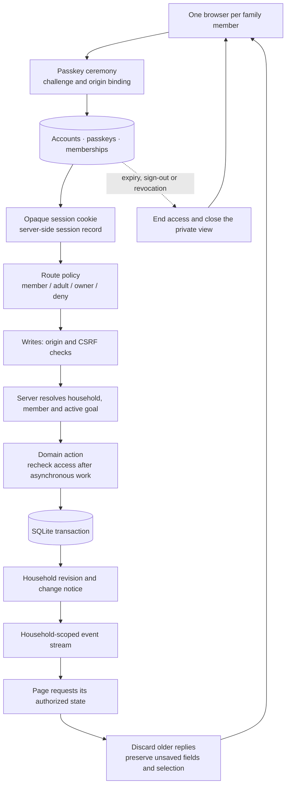

The stream sends change notices, not household records. Exchange changes notify the participating neighborhood's household streams; each page still receives only the shared board and offers it may see. An invitation to the neighborhood does **not** grant access to another family's goal, bills, members or ledger. See [family access](FAMILY-ACCESS.md) and [exchange service](../server/exchange/index.mjs).

## Kit planning and the optional AI boundary

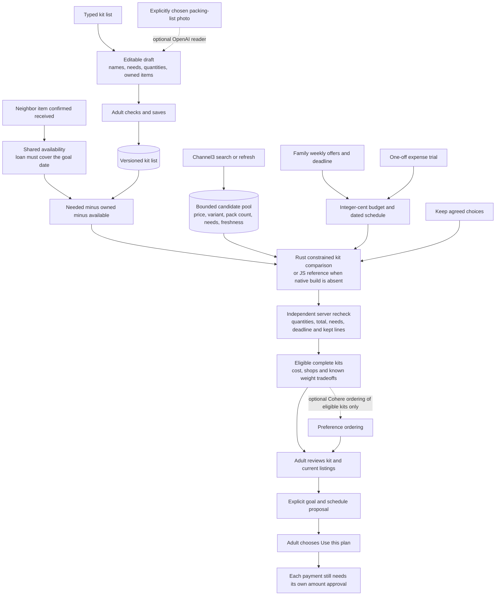

Rust is a bounded optimizer, not an AI model. The reference solver is used only when selected or when the native executable has not been built; a failing native solve is reported. Photo interpretation and ranking cannot loosen budget, quantity, date or ownership constraints. Received equipment changes what still needs buying; it does not increase financial progress. The loan's terms can become unsuitable if the family moves its goal date, in which case it stops covering that need. Changing the date or availability invalidates previous kit comparisons.

## Village Exchange lifecycle

The diagram below follows the invited-neighborhood route. The directory also allows an adult to explicitly publish open needs worldwide. Authenticated reads search only published, open requests; direct detail reads recheck publication, membership or participation. A separate profile holds the chosen display name, optional country and stable family reference. Unpublishing removes discovery access while preserving existing participants' handover records. Offer details stay between those participants. The same loan/gift lifecycle applies in either route; directory references are not payment identifiers.

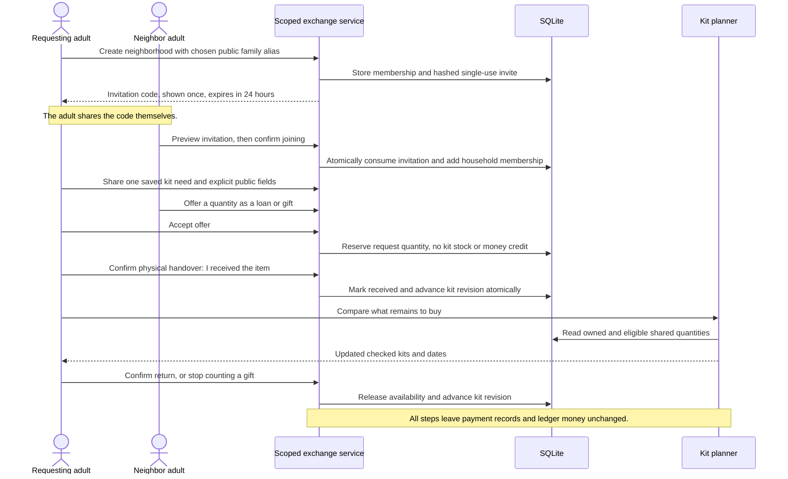

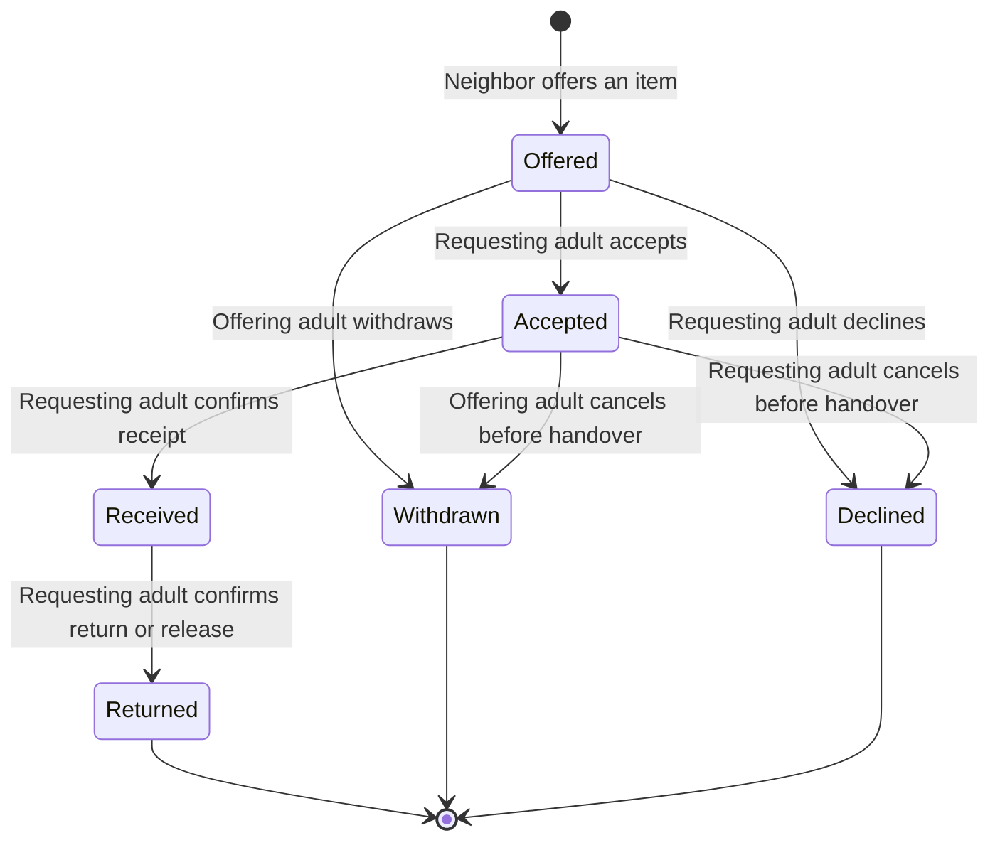

The transaction checks current kit requirements and reserved quantity before acceptance or receipt. Duplicate receipt confirmation is idempotent. No family can confirm receipt on another family's behalf. Active accepted/received items prevent removal of their kit line. Accepted items and received loans prevent either family leaving until resolved; the giver may leave after a gift is received. The founding family manages invitations; leaving removes access to the board. This is voluntary equipment coordination, not a payment marketplace, escrow, delivery service or debt exchange.

## Data relationships

This diagram groups the principal relationships rather than reproducing every column in all 33 tables. Schema 14 also adds household-owned `exchange_profiles` for directory visibility and stable family references. The ordered migrations in [db.mjs](../server/db.mjs) are authoritative.

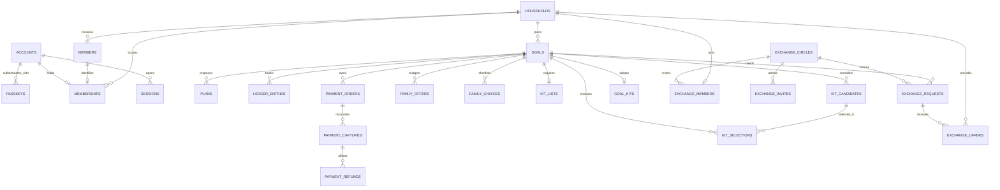

`kit_lists.items_json` holds bounded line IDs. Candidate/selection and exchange request references to those lines are validated by services, rather than SQL foreign keys into JSON. The offer lifecycle changes kit revisions; catalog changes and selections also feed the comparison token. Financial credit has its own provider-ID uniqueness constraints and never relies on an exchange state.

## World rendering and interaction

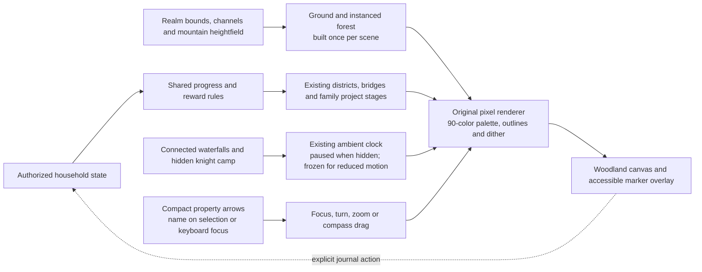

The new outer row adds 32 world units on **each** side: 356×260 becomes 420×324. The original 228×132 district interior, route waypoints and financial thresholds stay fixed. Two raised spring pools feed waterfalls whose feet are inside existing channels. The knight camp and water animation are scenery with no unlock, reward or write route. They share the existing animation lifecycle; no separate timer or animation loop is introduced.

| Waterfalls meet the existing channels | A hidden camp at night |
| --- | --- |
| 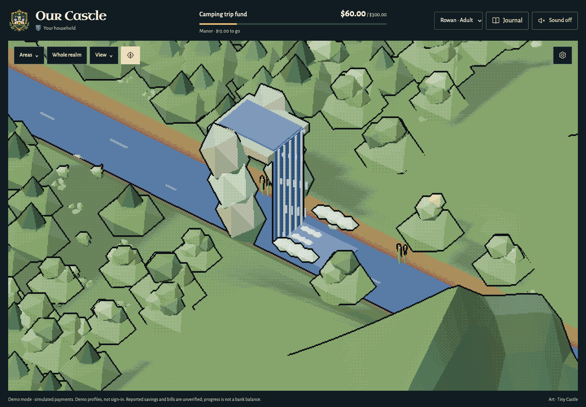 | 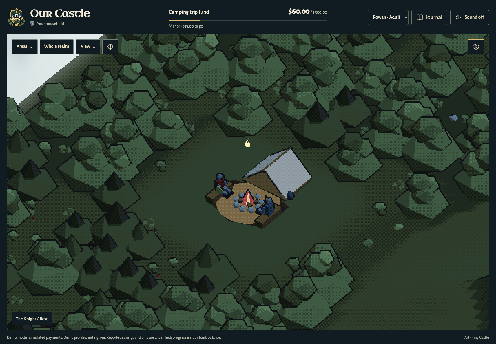 |

[Desktop/phone capture provenance](screenshots/village-exchange-sources.json). The compass reaches the added outer landscape, with its target bounded by the actual board.
