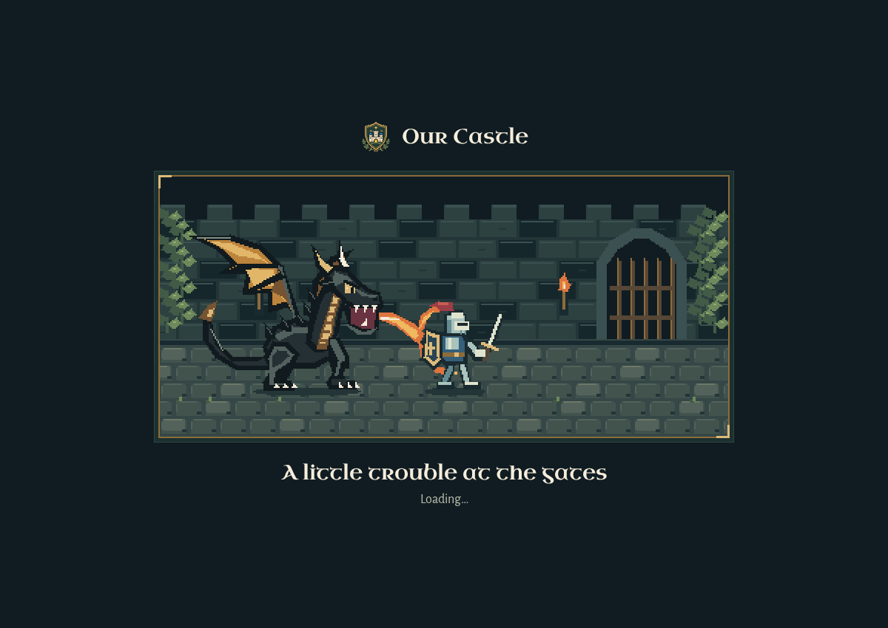
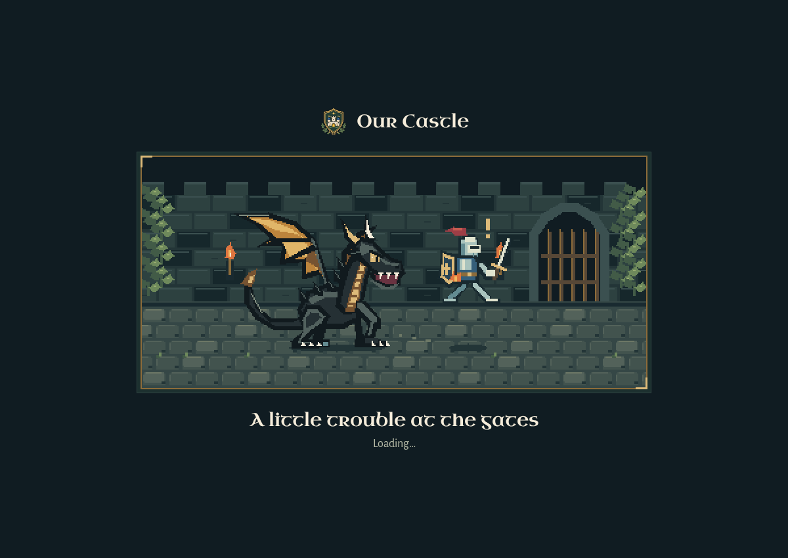

# A little trouble at the gates

The opening scene is an original pixel animation: a sword-carrying knight crosses a cobbled courtyard, a horned black dragon breathes around his back-mounted shield, and one stray ember prompts a startled hop and escape. There is no injury, combat outcome or sound.

## Reference and direction

The owner requested this scene on November 10, then supplied a full-bodied black dragon with gold-lined wings as the anatomy reference. The resulting dragon has broad ribbed wings, swept horns, an angular toothed muzzle, a long plated neck, four clawed legs and a tapering tail. It replaces the earlier small red dragon. Our Castle's woodland, silver-and-blue knight and gold crest remain the palette and framing references. The existing images stay unchanged; the new characters and courtyard are drawn from integer pixel shapes in `src/ui/dragon-chase.js`.

Refero research informed the presentation before implementation:

- [Playdate](https://play.date), “pocket-sized exuberance,” reference `1383e2df-8a27-4b20-868e-40286effd350`: crisp miniature artwork and a small amount of live text. Its bright marketing palette and typography are not used.
- [Tapbots](https://tapbots.com), “toys with a purpose,” reference `889337e0-2d2c-4980-a9b5-2bca2cb5394d`: a coherent character scene on a dark stage. Our scene uses the existing forest, stone, ivory and brass colors.

The chosen composition is one framed courtyard beneath the existing crest, with **“A little trouble at the gates”** and **“Loading…”** below it. Both the actual startup screen and the standalone viewing page use this exact copy; neither displays a preview/prototype caption. No progress percentage is invented. The scene stays secondary to entering the actual realm.

## Behavior

- Appears only if startup is still pending after 120 ms. The app's existing `body[data-ready="true"]` removes it immediately; opening a dialog also removes it so sign-in and other first-use actions remain reachable.
- There is no minimum viewing time. A 12-second limit removes the decoration even if the application module stalls; it does not declare the application ready.
- A reduced-motion preference shows a still chase. A hidden browser tab stops drawing. Finishing startup cancels drawing, timers, listeners and the observer.
- The 6.8-second chase is decorative, silent and separate from the financial state, world renderer and optional music.
- A local preview at `/src/ui/dragon-chase-preview.html` allows the full scene to be watched without slowing normal startup.

## Validation

Five focused Chromium cases were exercised at desktop 1440 × 1000 and emulated phone 390 × 844:

1. A pending session read shows a moving, silent scene; releasing the read removes the cover and restores reachable controls.
2. Reduced motion stays still, including changing the preference while loading; a failed household read still reaches the existing error message.
3. The actual family-mode sign-in dialog remains usable before boot completes.
4. A stalled application module loses the cover after 12 seconds without claiming readiness.
5. The independent preview renders chase, deflection, hop and escape, with working replay/pause controls and no horizontal overflow.

The initial run passed nine cases and exposed a phone media-event timing case: the preference could change before its event was delivered, leaving the previous frame displayed. The animation tick now also paints the still pose when the preference changes. Both affected desktop/phone cases passed after that correction. No external requests, state-writing requests, audio-file requests or page errors occurred in the passing cases. Tests use synthetic configuration and disposable in-memory example/family servers. Four lifecycle cases carry the existing `@release` tag for hosted checks.

`npm run check` passed the 47 original-file hashes, 90-color world palette, renderer wiring and JavaScript syntax; `git diff --check` passed. Raw local artifacts are under `test-results/dragon-loading/`, including `reduced-motion-check.log`. No human, physical-device, performance or live-provider evidence is implied.

After the owner's anatomy/copy correction, the affected startup and full-scene viewing cases passed on both desktop and phone (**four passes**), and the art/source guard and diff check passed again. The actual startup screenshots were inspected at 1200 × 850 and emulated 390 × 844; the reference and requested wording are reflected in both. Raw revision evidence is under `test-results/dragon-revision/`, including `browser-checks.log`.

These are fixed-frame screenshots of the actual startup screen, captured while its application module is held pending, not a recording or a claim about actual loading duration:

[Phone loading screen](evidence/dragon-loading/phone.png)

## Source boundary

This branch starts at reviewed PR #79 head `1f76ba619f87df646310573dc1a2ed64887e0896`. It adds a standalone startup module, renderer, stylesheet, preview and tests, plus ten lines in `index.html`. It does not edit Fable's first-use task files, main application logic, existing artwork, payment logic or stored data. Saved Mac demos remain on their existing source until a separate integration/activation.
