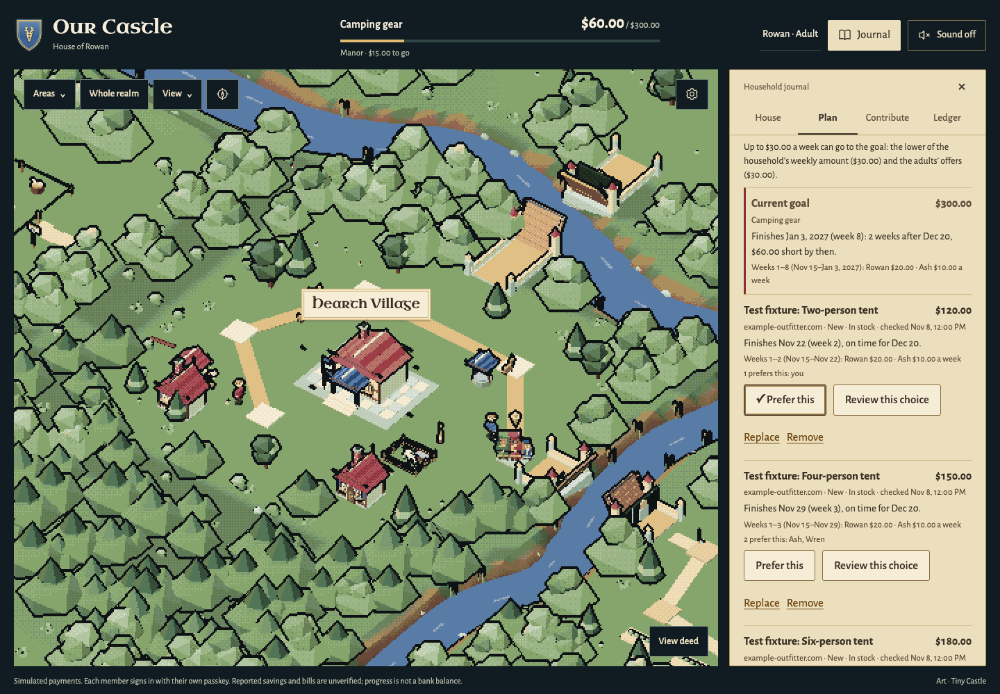
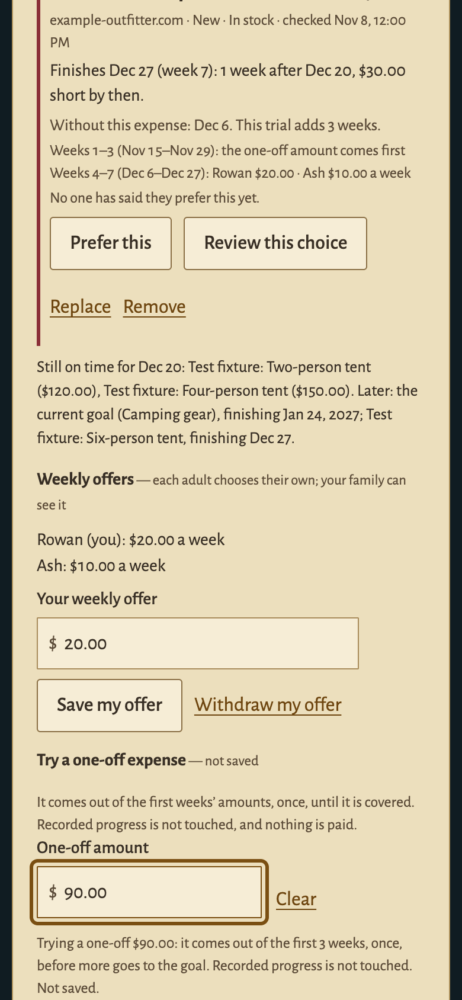

# Family choices

A family compares up to three items against the weekly amounts its adults choose to offer. Each member can express one preference. Trying an unexpected expense shows the resulting dates and which lower-priced choices still fit the goal's date.

This feature is in the source branch awaiting integration. The preserved owner and rehearsal demos have not been activated with it.

## Use it

1. Open Plan → Family choices. With Channel3 configured, choose Find an item, search in Market Town and use Add to family choices. Adults can replace or remove a choice.
2. Each adult enters and explicitly saves their own weekly offer. Offers are visible to the family, and can be withdrawn. Children can express a preference without making an offer.
3. Compare the price, finish date, deadline shortfall and each adult's weekly share. Preference counts express wishes; they never authorize a payment.
4. Try a one-off expense. It uses future weekly capacity once, beginning with the first week. Each item shows its finish with the trial and the date without it. Typing sends no request and saves nothing.
5. Review this choice fills the existing unsaved goal form. Only Save as our goal changes the goal. Changed offers, prices or goal facts require another review.

Without Channel3, the current goal can still be compared with the adults' offers. No example catalogue is silently installed. The screenshots below use invented products served by fake transport, not live retailer quotes.

## Worked example

These are synthetic figures: November 8, 2026, $60 of recorded progress, a $30 household weekly limit, adult offers of $20 and $10, and a December 20 target date. Week 1 is November 15.

| Item price | Finish with no extra expense | Finish with a one-off $90 expense | Shortfall on December 20 after the expense |
| --- | --- | --- | --- |
| $120 | November 22 | December 13 | $0 |
| $150 | November 29 | December 20 | $0 |
| $180 | December 6 | December 27 | $30 |

The expense consumes the first three $30 weeks once. The adults' offers stay unchanged. A small expense can leave the same finish date; the interface says that instead of inventing a delay.

| Comparing the options | Trying the expense on a phone |
| --- | --- |
|  |  |

[All four captures and source hashes](screenshots/family-choices-sources.json).

## How the plan is calculated

Weekly capacity is the lower of the household limit and the sum of active adults' offers. These are voluntary ceilings, not verified income or money held by the application. Each week's amount is split proportionally; whole-cent remainders use a stable member-order tie break. The final week takes only what remains, and the comparison stops at 52 weeks.

The expense is reserved from future capacity once. It is not subtracted from recorded progress, treated as a refund or deducted as a recurring bill. Listed household bills remain context.

The trial is local to that member, household and goal. An invalid amount keeps the last valid comparison visible, reports the supported range and prevents reviewing it until corrected. A valid amount or Clear restores review. Neither action makes a provider request.

Review copies a suggested total, date and weekly ceiling into a draft. The adult may edit those fields. Saving that draft does not persist the trial expense into an accepted contribution schedule; generating and accepting a plan remains a separate explicit action. The existing planner may spread payments differently from the earliest-finish comparison.

## Why this direction

- [Fidelity's 2026 Couples & Money study](https://newsroom.fidelity.com/pressreleases/fidelity--findings--most-couples-feel-confident-about-money%E2%80%94but-there-could-be-more-to-talk-about/s/3561728d-cc8f-4cbf-8c90-3090323e7708) surveyed 3,193 U.S. partnered adults; 58% reported unequal household contributions. That supports allowing individual comfortable amounts instead of assuming equal shares. It is sponsored self-report research, not validation of this app.
- [Airbnb's collaborative wishlists](https://www.airbnb.com/help/article/1236) already offer notes and voting. [YNAB Together](https://www.ynab.com/terms/ynab-together) already supports shared budgets. The feature's hypothesis is the connected choice-and-replanning loop; it does not claim those ingredients are new.
- [PayPal's 2025 Investor Day](https://s205.q4cdn.com/901458612/files/doc_downloads/transcript/PayPal-Investor-Day-2025_Full-Transcript.pdf#page=5) used shared camping costs and equipment shopping to illustrate its commerce strategy. This is relevant product context, not PayPal endorsement or proof that a described API is public.

The visual foundation stays the existing woodland and compact parchment journal. The design research adapted only comparable wishlist facts, clear own-member responses and an explicit final review from Onefinestay, SavvyCal and Airbnb. No third-party branding or artwork was copied.

## Boundaries and remaining questions

Prices retain retailer, variant, condition and last-check facts. Tax and shipping are extra. A stale or changed offer needs an explicit price check; review and save use the server's own item and comparison records.

Recorded progress is not a spendable family balance. This prototype's merchant sandbox captures do not buy the shortlisted retailer item. Who receives real funds and who completes the eventual purchase remain product decisions; no new pool, wallet or retailer payment is introduced here.

The implementation adds three planning-only tables in schema 9. Its tests use disposable databases, fake Channel3 responses, simulated payments and virtual passkeys. [Validation](VALIDATION.md) records the actual checks. No family playtest, physical-device validation or claimed improvement in family outcomes is implied.
