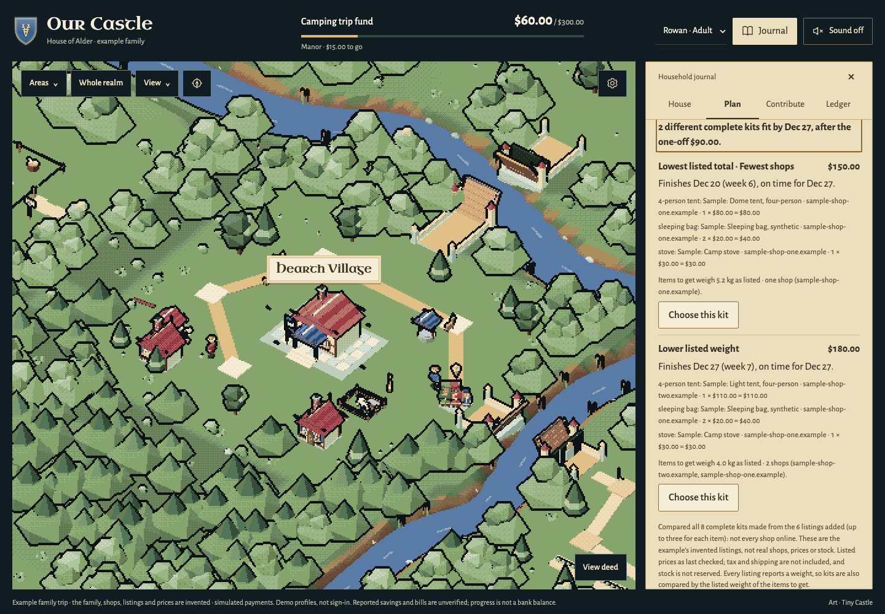
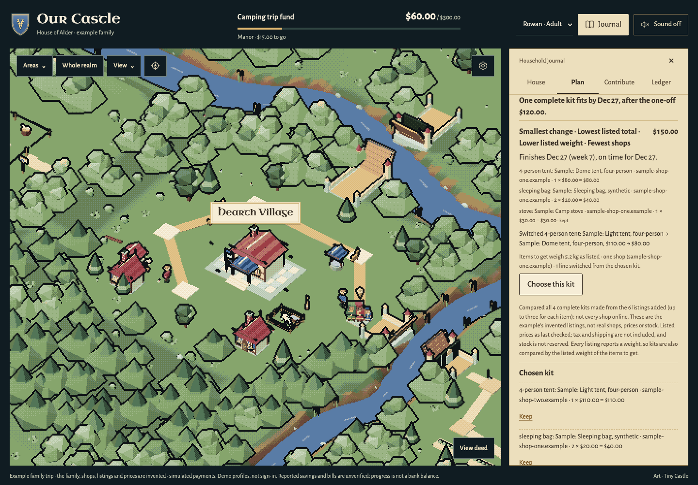
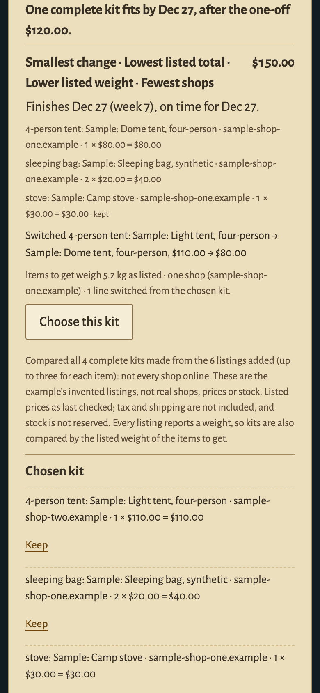

# Playable family-trip example — November 9, 2026

`npm run demo` installs no catalogue, so a visitor without a Channel3 key could not reach [complete kits](KIT-PLANNER.md): there were no listings to compare, choose or repair. This example supplies them.

```sh
npm ci
npm run demo -- --family-trip
# Open the local URL printed in the terminal.
```

It starts a fresh in-memory household on an unused localhost port, already set up as an invented family with a kit list and six invented listings. It reads no `.env`, key or saved record and contacts no provider. `npm run demo` without the flag is unchanged.

**The family, the shops, the listings and their prices are invented. Every kit, total, date, repair and shortfall is computed** by the same planner and solver the configured app uses. None of those answers is stored in the example.

## Try it

The journal opens on **Plan**. One line there says what is invented and offers **Try a one-off expense**.

1. **Try a one-off expense.** It opens Family choices and the Kit list and puts the cursor in **One-off amount**. It fills nothing in. Type `90`.
2. **See which complete kits fit**, then **Compare complete kits.** Two different kits fit: $150 (lowest listed total, one shop) and $180 (lower listed weight).
3. **Choose this kit** on the $180 kit, then **Keep** its stove.
4. **Change the one-off expense** to `120`. The comparison follows without another search.
   - The chosen $180 kit would now finish a week late, $30 short by the date.
   - The **smallest change** comes first: only the tent is switched, making $150. The kept stove stays.
5. Type `200`. No kit fits $70, and nothing is invented to fill the gap. The closest kit is shown with how late it would finish and how much short it is by the date.
6. Back at `120`: **Choose this kit**, then **Review this kit**. The Plan form shows an unsaved goal draft. **Save goal and propose this schedule** saves the goal and proposes its weeks. The schedule still needs **Use this plan**; no payment is made.
7. **Contribute:** tick the approval yourself, then **Simulate approved payment**. One simulated contribution is credited once, with its receipt.

Choose **Wren** in the profile list at the top to see what a child reads and cannot change. **Ledger → Reset the example household** starts the example again.

| Two kits fit after a $90 one-off (desktop) | The smallest change after $120 (desktop) | The same repair (390 px phone) |
| --- | --- | --- |
|  |  |  |

All three captures show invented example data: the family, both shops (`sample-shop-one.example`, `sample-shop-two.example`), all six "Sample:" listings and their prices, weights and stock. The server's day was pinned to Nov 8, 2026 for the captures, so the dates match the worked example below. [Provenance and hashes](screenshots/family-trip-sources.json).

## What is invented, and what is computed

| Invented, and labelled as such | Computed when you ask |
| --- | --- |
| Rowan and Ash (adults) and Wren (a child): example profiles, not sign-in | Which complete kits fit, and what each is best at |
| $60 reported progress, a $300 goal seven weeks after the day the example starts, $30 a week | Each kit's finish date and week |
| Weekly offers: Rowan $20, Ash $10 | The planning limit for the one-off you type |
| The list: 1 four-person tent, 2 sleeping bags, 2 torches (both at home), 1 stove | The smallest change from the chosen kit, with kept lines held |
| Six listings in two shops: tent $80 / 3 kg or $110 / 1.8 kg; sleeping bag $20 / 800 g or $30 / 500 g; stove $30 / 600 g or $35 / 300 g | The closest kit, its later finish and its shortfall when nothing fits |
| One item per listing, recorded as Rowan's count | The goal draft and its proposed weekly schedule |

The planner never infers how many items a listing gives: an adult enters it. In the example that count is part of the authored data and is recorded as Rowan's, as the page shows. The torches are already at home, so they have no listing and are never searched for.

With the worked example's day (Nov 8, 2026, goal date Dec 27):

| One-off you type | Planning limit by the date | What the planner answers |
| --- | --- | --- |
| $90 | $180 | Two kits of the 8 compared: **$150** (finishes Dec 20) and **$180** (finishes Dec 27) |
| $120, with the $180 kit chosen and its stove kept | $150 | **$150**, the smallest change: the tent switched, the stove kept. The $180 kit would finish Jan 3, $30 short by Dec 27 |
| $200 | $70 | No kit fits. The closest, $150, would finish Jan 17, three weeks late, $80 short by Dec 27 |

On any other day the dates move with it; the weeks, totals and kits are the same.

## How it is built

- **The example's data** is one file, [scripts/family-trip.mjs](../scripts/family-trip.mjs), loaded only by the demo runner. `npm start` and the family runner never load it. It holds no kit, total, date or repair.
- **Market Town is the real merchant** ([server/merchant/channel3.mjs](../server/merchant/channel3.mjs)) over a local transport that answers from the six listings inside the same process. Its validation, short-lived drafts, half-hour freshness and six-calls-a-minute limit all apply. A review after half an hour asks for **Check price** again, as it does with Channel3.
- **The starting state is saved through the page's own services:** the house, each adult's weekly offer, the kit list and each listing. The acting member and their role are read from the household's records. A scenario in which the child offered, listed or added a listing is refused by those services, and nothing of it is saved.
- **The solver** is the compiled Rust program when it is built, otherwise the built-in reference, exactly as in the configured app.
- **Labels.** The merchant reports itself as an example catalogue, never as Channel3. The header, the footer notice, the Kit list, the results note and the goal draft say the shops, listings, prices and stock are invented. An example listing has no shop link: there is no page to visit, and nothing opens a new tab.
- **Off in the example:** reading a photo (OpenAI) and ordering by a preference (Cohere). Payments are simulated and plans use the built-in rules, with their existing labels.
- **Never combined with real records.** The example is refused on PayPal sandbox records and in shared families.

One defect was found while building it and fixed, because it erased the example's whole starting state. Saving the house or crest re-created every example member, and each member's weekly offer, the kit list and its listings were deleted with the old rows. A member who stays now keeps their row and those records; only a member who leaves is removed. The ordinary demo had the same defect for Rowan's own offer and list (reproduced), and `npm start`'s example household uses the same code.

## Checks

All checks used the example's invented data, local transports and disposable in-memory households. No provider was contacted.

- **Before the change** (`b21b2d8`, the ordinary no-key demo, reproduced first):
  - Market Town was off, a search answered "not connected", and no listing could be added.
  - **Compare complete kits** with a $90 one-off answered "incomplete" for all three items: no kit and no total. Choosing and reviewing had nothing to act on.
  - The example household had no second adult, so Ash's offer could not be made.
  - Saving the house erased Rowan's weekly offer and the kit list.
- **Unit and HTTP:** 12 new cases in [test/unit/family-trip-example.test.mjs](../test/unit/family-trip-example.test.mjs). The whole unit suite passed on Node 26 with the compiled Rust solver required: 569 tests, 568 passed, 1 existing skip.
- **Browser:** [test/e2e/family-trip.spec.mjs](../test/e2e/family-trip.spec.mjs) walks the route above through visible controls, on the desktop and the 390 px phone project, with the compiled solver. Together with the eleven existing spec files that exercise the changed page and server code, 97 checks passed and 1 was skipped by design. The reset button was checked once in the page, outside the committed tests.
- **Test sensitivity:** nineteen deliberate source changes each made at least one selected test fail, including member re-creation, false catalogue labels, pre-ticked approval and a destructive reset. These earlier probes used fake transports and empty configuration, but their runner did not load the corrected TCP preload. They are separate from the final guarded checks and are not network-isolation evidence.
- **Final transport controls.** The passing unit/browser batches and reset probe used the corrected Node TCP/fetch preload with per-process refusal checks; browser requests outside the page origin were intercepted and counted. No outside-origin request or new tab was observed in the family-trip journey. This is not an OS firewall and does not cover direct DNS, UDP or arbitrary child-process network APIs.
- **The guard and Playwright, as it happened.** The guard at first refused 58 checks in four existing files (`channel3-merchant`, `game-shell`, `journey`, `member-avatars`). Playwright's own request helper reaches the test server by the name `localhost` with its own lookup function, which the guard cannot check. These were refusals of this computer's own address by the test harness, not failures of the app.
  - They then passed (59 passed, 1 skipped by design) with the guard unchanged and a small evidence-only adapter in front of it. The adapter dials exactly-`localhost`-with-a-caller-lookup as the literal `127.0.0.1` and never calls that lookup.
  - A separate 22-check proof showed that Playwright's helper reaches a loopback server this way, while the tested non-loopback names/literals and misleading localhost prefixes remain refused before lookup. Four deliberately broken adapters were detected.
  - An interim rerun of those four files without the guard was stopped in review. It is not counted.
- **Hosted checks** run on the pull request's head, with the solver built from source. Their result is recorded on the pull request.

## Limits

- **A small authored pool.** Six listings, two per item. It shows how the planner decides; it says nothing about real prices, shops or stock.
- **No live provider.** Nothing here is a Channel3 search, an OpenAI reading or a Cohere ordering, and none was called. Tax and shipping are not included, as everywhere in the planner.
- **Simulated money.** The contribution is the existing labelled simulation. It is not a PayPal transaction.
- **Not covered.** No human playtest, physical-device, accessibility-audit or performance evidence. The phone capture is a 390 px touch-emulated browser, not a phone.
- **Words the page keeps.** Family choices still says "Market Town" for the catalogue; in the example that is the example catalogue, as the header and each result say.
- **One stored word.** If an example listing is saved as the goal by itself, the in-memory record's `provider` column holds the schema's only allowed value, `channel3`. The page and `/api/state` report "Example catalogue". No migration was added, and the example's database is never written to disk.
- **Options.** `--family-trip` is the only option the demo runner takes. Any other option stops it with a message instead of quietly starting the ordinary demo.
