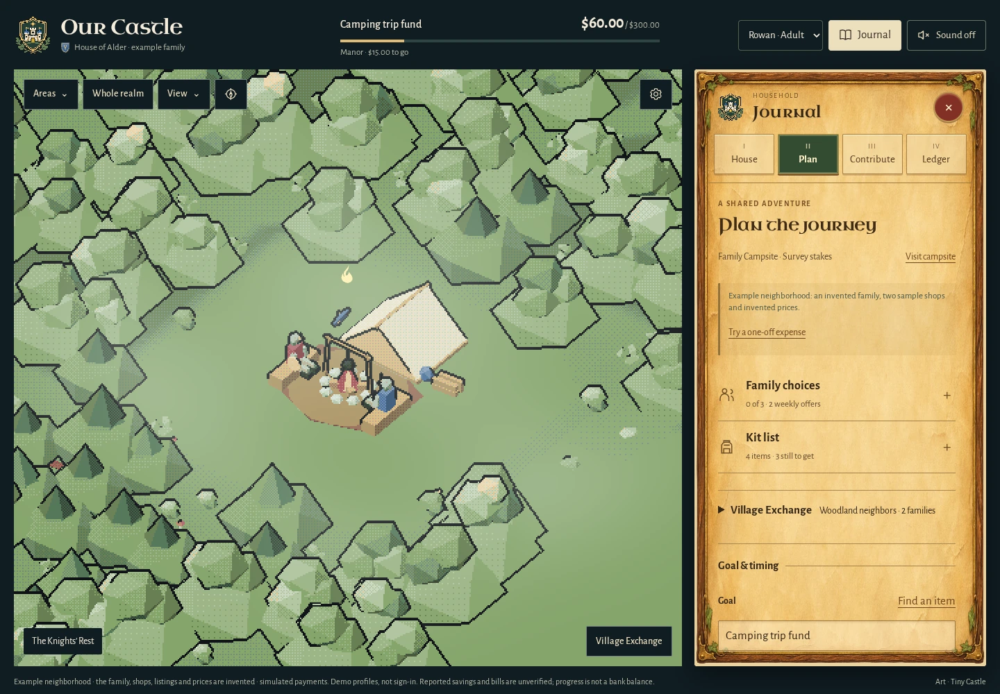
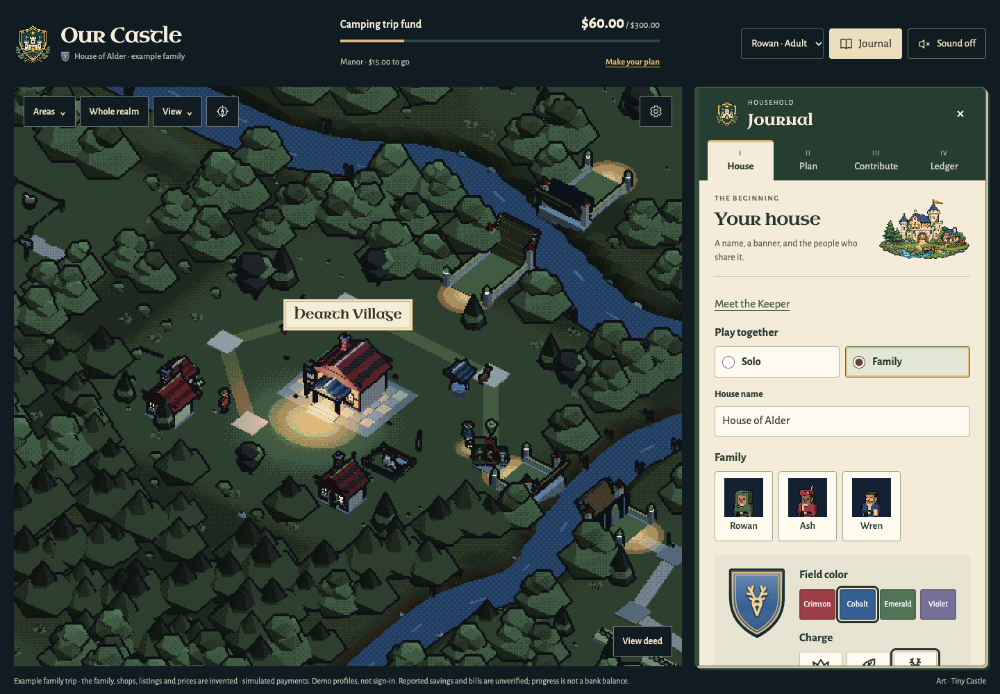
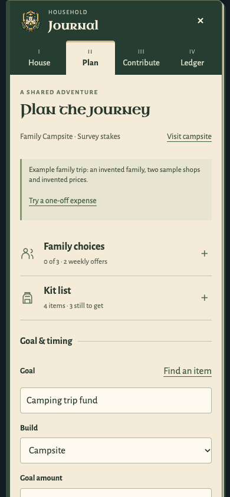

# Journal and Our Castle identity
Owner request (November 9 local): a total journal design update and new ChatGPT-generated crest / Our Castle assets. This updates the older interface handoff for the journal and brand only. The original world, renderer, palette, family heraldry choices and licences stay intact.

## Painted parchment revision

The owner subsequently supplied Recipe Shop and Hatchmaking game references and explicitly requested generated parchment, rather than the flatter forest-coloured website treatment. This revision supersedes the earlier surface treatment below.

The primary lock is the owner's illustrated game inventory: one continuous aged page, a carved frame, brass trim and ivy corners. Bounded research references are [Niccolò Miranda](https://niccolomiranda.com) for tactile paper and legible ink, and [Playdate](https://play.date) for art-led physical-object styling. Their layouts, photographs and marketing treatments are not copied.

An original OpenAI-generated blank panel is served locally as `assets/ui/parchment/woodland-panel.webp` (379,440 bytes). A nine-slice border preserves the painted corners across screen sizes; its quiet paper fills the page. The same asset skins the Journal, Exchange directory and request window. [Provenance and source/output hashes](../assets/ui/parchment/provenance.json) record the image generation and WebP encoding. Third-party game artwork was not imported.

Chapter tabs use green and gold selected states, controls use brown ink on parchment, and close buttons are red brass-rimmed medallions. All labels, inputs, records and buttons remain real HTML. Keyboard chapter navigation, 44px close targets, dirty drafts, native dialog focus and explicit sharing consent remain functional. Forced-colour mode removes the decorative image. The original world palette and renderer are preserved.

The Exchange now has a top icon rail and an illustrated selection preview beside compact request rows. Keyboard focus or pointer entry updates that preview; selecting a row still opens the full request window. On narrow phones the list gets the full width and the full detail window provides the same information.

[Current screenshots and capture record](screenshots/parchment-woodland-sources.json) accompany the affected checks in VALIDATION.md. Earlier screenshots below document the previous design.

## Earlier reference lock
Primary: the owner's woodland RPG and parchment journal, with Franco Maria Ricci's [collector's cabinet](https://francomariaricci.com) (Refero 2c3b31a4-6e28-47a0-afbd-cb22e22e34fb): a restrained printed edition, fine rules, an identity seal, modest titles and generous space around illustration.
Bounded secondary references: [komoot](https://komoot.com) (f946f035-2a1d-44a2-92ef-ad1aefb0a07a) for practical field-note grouping and compact functional controls; [Playdate](https://play.date) (1383e2df-8a27-4b20-868e-40286effd350) for original, legible miniature artwork. Their photographs, fonts, saturated marketing colours, large promotional buttons and logos are not imported.
Product pattern: [PamPam itinerary beside a map](https://refero.design/pages/ce6be046-7595-4c56-b828-ad0e145bb614), keeping the world prominent beside a scrollable journal. [TravelPerk itinerary](https://refero.design/pages/f2b28a8b-09ad-463c-9723-8eddd505b7dc) contributes a small illustration at the beginning, with a clear next action, not an illustration on every form.
The owner already granted artistic discretion and requested implementation; this is one direct-build direction within the existing art family.

| Decision | Source / role | Application |
| --- | --- | --- |
| Bound book cover and numbered chapter tabs | Printed-edition reference + existing four actions | Forest cover, ivory pages, gold selected-tab edge; no new navigation mode |
| A lighter page and finer input boundaries | Field-note usability + existing parchment | Scoped tokens; inputs remain 44px minimum and labels remain visible |
| Separate family, kit and goal/timing sections | Existing task flow + itinerary grouping | Native disclosures with summary counts and explicit expand indicators |
| Original pixel castle crest | Owner's explicit image-generator request | Product identity; personal family crest remains beside the household name and in House |
| Small castle frontispiece | Playdate art role + TravelPerk introduction | House chapter only; decorative, never shown as an earned asset |
| Uncial titles, Alegreya controls | Existing owned fonts | Smaller headings, readable controls, no external fonts |
| Preserve consent and async forms | Existing payment/planning rules | IDs, requests, approvals, dirty edits, selected receipts and focus behavior retained |

Earlier tokens: dark cover #263d32, paper #f4ecd9, input #fffaf0, ink #28382f, secondary ink #596052, rule #bfc4ad, primary action #344f3c, gold #ddba79 for trim. No gradients, dashboard tiles, nested decorative boxes or duplicated progress metrics.

Generated media: two independent OpenAI image-generator results, transparent crest and woodland castle. Original PNGs remain in ignored evidence; locally served WebP derivatives carry source/output hashes in assets/brand/our-castle/provenance.json. No other brand or game art was used as input. Generated images are illustration, not screenshots or proof of implemented buildings.

## Checks
Actual desktop/phone screenshots and affected navigation/planning checks are recorded in VALIDATION.md after verification. Generated images never replace household crest data or the 3D world. Phone tests are emulated Chromium, not physical-device evidence.

## Earlier example screens

[Capture steps, viewport sizes and hashes](screenshots/journal-sources.json). These are real app screenshots using an invented family.
