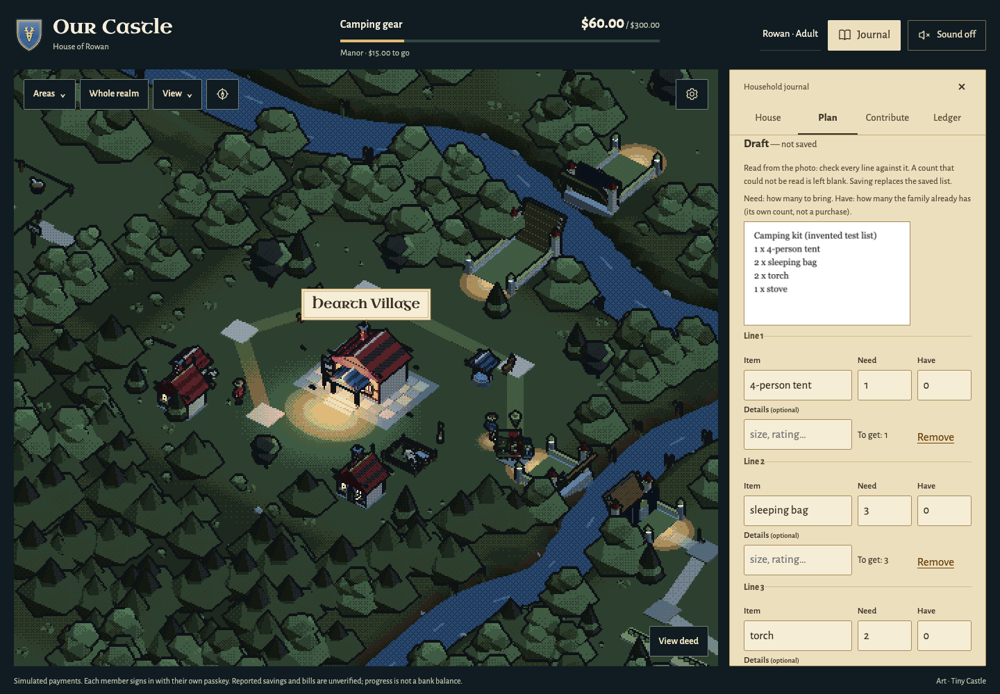
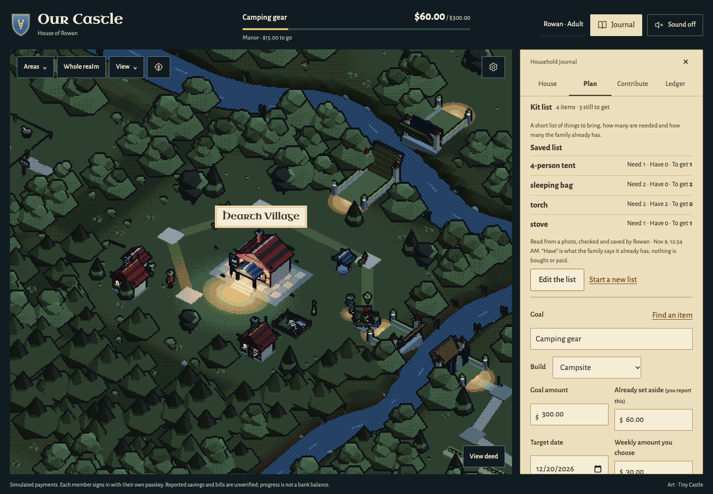
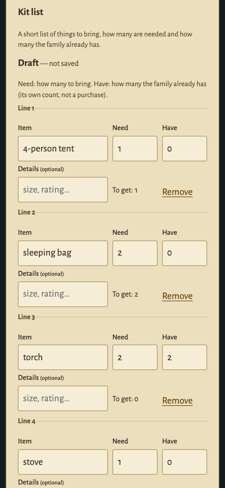
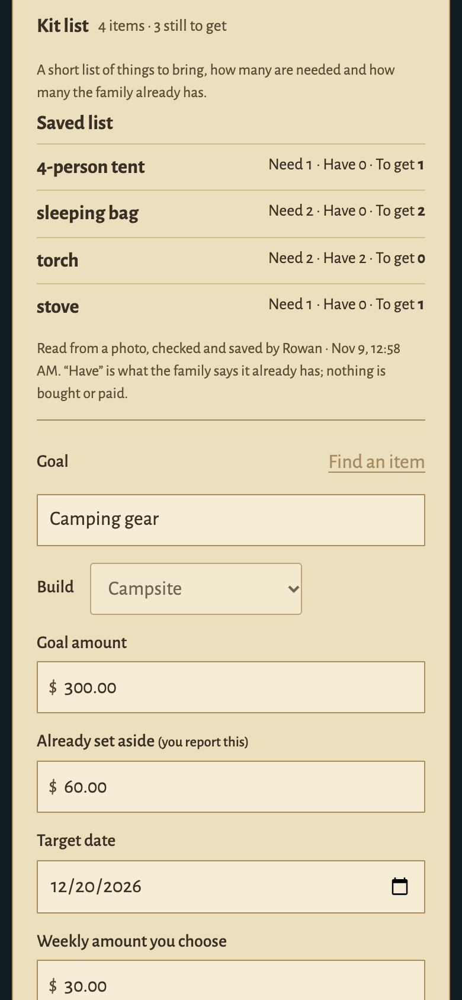

# Kit list — November 9, 2026

**Plan → Kit list** keeps a short checklist of things to bring for the family's goal, such as a camping or school kit. Each line has an item, how many are needed and how many the family already has, so everyone can see what is still to get. It is a planning list: it buys nothing, moves no money, and changes no goal, plan, offer or payment.

## What a family does

1. **An adult types or pastes the list**, one item per line or separated by `;`, then chooses **Check this list**. The page reads the text itself; nothing is sent to the server or any provider.
2. **Or, if this server has photo reading set up, chooses a photo** of a written list (PNG or JPEG). The photo is shown on the page only. **Read the photo with OpenAI** is a separate, explicit action, and its note says that it sends the photo to OpenAI.
3. **The result is a draft**, marked "not saved". The adult checks every line, against the photo when there is one:
   - the item and its optional details (a size or rating);
   - **Need**: how many to bring;
   - **Have**: how many the family already has.
   A count that was not written, or could not be read, stays blank and must be filled in. The adult can edit, add or remove a line, cancel, or go back to typing.
4. **Save this list** is the only action that writes. Every member, children included, then sees the saved list, with what is still to get. A child can read it but not change it. Another adult's open page updates live.

| The saved list (desktop) | The draft on a 390 px phone | What a child sees (phone) |
| --- | --- | --- |
|  |  |  |

All captures use invented test data: the camping list `1 x 4-person tent; 2 x sleeping bag; 2 x torch; 1 x stove`, a photo of it drawn by the test browser, and a fake OpenAI transport whose "reading" is written into the test. [Provenance and hashes](screenshots/kit-list-sources.json). They were captured at `8461902`, before review corrections [001](VALIDATION.md#kit-list-review-correction-001--november-9-2026) and [002](VALIDATION.md#kit-list-review-correction-002--november-9-2026), which change nothing they show.

**The worked example.** Two torches are already at home, so the four lines still to get are 1, 2, 0 and 1. In the photo test, the fake reading first says 3 sleeping bags and gives no stove count. The adult corrects both before saving, and the other adult, the child and a reload read exactly the corrected list.

## Rules

- **Small, explicit bounds.**
  - A saved list holds up to **8** lines. Each has a whole-number **Need from 1 to 20** and **Have from 0 to Need**.
  - Names are up to 60 characters, and details up to 120.
  - A typed or read draft may show up to 20 lines, so an over-long list is visible and can be trimmed. It is never cut short silently. Typed text over 2,000 characters or 20 lines is refused as a whole.
- **Literal parsing, never evaluation.**
  - A count is read only where it is written: `2 x torch`, `2x torch`, `2×torch`, `torch x 2` and `2 torches` all mean 2.
  - Capacity or size wording is not a count. `4-person tent`, `2 person tent`, `3 season bag` and `1 l bottle` keep the number in the name and leave Need blank.
  - `1.` or `1)` at the start of a line is list numbering. Text in a trailing bracket becomes the details.
- **Nothing is filled in.** An unknown count stays blank until the adult enters one. The same item listed twice is flagged on both lines, never merged. Every problem says what to do, and Save refuses the whole list until it is fixed.
- **"Have" is the family's own report.** It is not a purchase, an inventory check, money or a contribution.

## Photo reading (optional)

- **Off unless the server sets its own key.** The server needs `KIT_OPENAI_API_KEY`, and `KIT_OPENAI_MODEL` defaults to `gpt-6-sol`.
  - `OPENAI_API_KEY`, the planner's `AI_API_KEY` and any assistant login are never used.
  - Without the key the page says photo reading is not set up, and typing works the same. No canned or fake reading is installed.
- **Contract**, from OpenAI's docs read on November 9, 2026: [images and vision](https://developers.openai.com/api/docs/guides/images-vision), [Structured Outputs](https://developers.openai.com/api/docs/guides/structured-outputs?api-mode=responses), [Responses create](https://developers.openai.com/api/reference/resources/responses/methods/create) and the [gpt-6-sol model page](https://developers.openai.com/api/docs/models/gpt-6-sol). That page lists image input, the Responses API and Structured Outputs.
  - One `POST https://api.openai.com/v1/responses` per explicit read, carrying:
    - the photo as an `input_image` data URL, with `detail: "high"`;
    - `text.format` as a strict JSON schema (`additionalProperties: false`, every field required, null where a value may be absent);
    - `reasoning.effort: "low"` and `max_output_tokens: 4000`;
    - `store: false`.
  - No tools are offered. Redirects are refused, there is a 60-second timeout, and nothing is retried.
- **What can come back:** whether a list was readable, up to 12 lines, and whether some lines were missed. Each line has a name, a count or null, and details or null. The schema has no field for prices, people, roles, amounts, dates, payments or actions.
- **Checked again here.** A reply that fits the schema is not proof the photo was read correctly. A separate local check refuses all of these, and leaves typing available:
  - other shapes, extra fields, contradictions, oversized text, tool calls and replies over 256 KB;
  - refusals, unfinished answers (`incomplete`) and failures.
- **Errors are reported, not hidden.** Authentication, rate-limit, timeout and other provider errors say so plainly, without echoing provider text. A household may start at most 4 readings a minute.
- **Privacy.**
  - The page accepts only a chosen PNG or JPEG under 20 MB. It redraws the photo at up to 1,600 pixels a side and re-encodes it as a JPEG of at most 1.4 MB. That drops location and camera metadata.
  - The server accepts only such a data URL. Its bytes must really be a PNG or JPEG, 32–1,600 pixels a side and at most 1.4 MB. No URL, file path, SVG or HTML is accepted, and nothing is uploaded to a provider's file store or thread.
  - Only this route has a larger request limit (2 MiB). Every other route keeps 64 KiB, and a check covers every write route.
  - The photo, its base64 and the model's answer are kept in no database, log, local storage or diagnostic. The page clears them on Remove, Cancel, Save, or a change of person or goal.
  - `store: false` stops OpenAI keeping the response as application state. It is not a promise that OpenAI keeps nothing, and the photo is not read on the device. See OpenAI's [data controls](https://developers.openai.com/api/docs/guides/your-data).

## Data and access

- **Storage.** Migration 11 adds one table, `kit_lists`: one row per goal. A fresh database now has 24 tables.
  - The row holds the list's revision, who saved it and when.
  - Each line keeps a stable id, name, details, Need, Have, and whether it was typed or read from a photo.
  - No other table or row changes. Upgrading a schema-10 database keeps every earlier row unchanged.
- **Routes**, both adult-only in the fail-closed family policy:
  - `POST /api/kit/read` reads a photo. It writes nothing and moves no live revision. After OpenAI answers it rechecks the member's access, so a late reading never reaches a session that ended. It returns a short-lived reading id bound to that household, goal and adult, with no image or answer stored.
  - `PUT /api/kit` saves in one transaction, against the revision the draft started from. If someone else saved in between, the whole save is refused. The page then shows their list and asks whether to keep the draft or use the saved list. Unsaved fields survive live updates.
- **"From a photo".** A line is marked this way only with that adult's own current reading id. A reused, foreign or forged id is refused.
- **Saved fields only.** Any other field sent with a line, such as a price or role, is not stored. A second household can neither read nor change this list, nor use its reading.
- **One household, goal and person at a time.** When the person, goal or household on the page changes, the page:
  - drops typed text, a draft or a photo that was not saved, and says so when there was one;
  - clears any message about the previous list;
  - draws that one's own saved list.
- **Typing while another adult saves the first list.** Text typed, or a photo chosen, in the empty list's box stays there, with its focus. The new saved list shows above it to compare. Checking it makes a draft that says it replaces that list, and only **Save this list** does, against the revision the adult has seen. With nothing entered, the box closes.
- **Next stage.** Stage 019 can use the saved typed lines (ids, Need and Have, with the details as editable text), never a raw reading. Comparing complete kits against the family's planning limit belongs to that stage and is not implemented here.

## Checks

Fake OpenAI transport, invented data, disposable databases and family-mode servers, with non-loopback transport denied. [Validation](VALIDATION.md#kit-list-from-text-or-a-photo--november-9-2026).

## Limits

- **Accuracy.** How well any model reads a real family's photo is untested; no live call was made. The fake reading proves only what is sent, how answers are handled, and that the family corrects the draft.
- **Typed text.** The parser follows the literal rules above, so unusual wording may need a correction in the draft.
- **Have.** A family report, never verified.
- **Scope.** No human playtest, physical-device, accessibility-audit or performance evidence.
