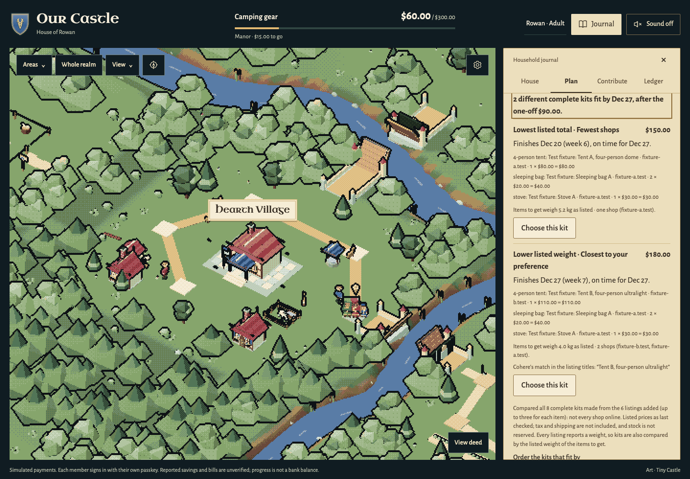
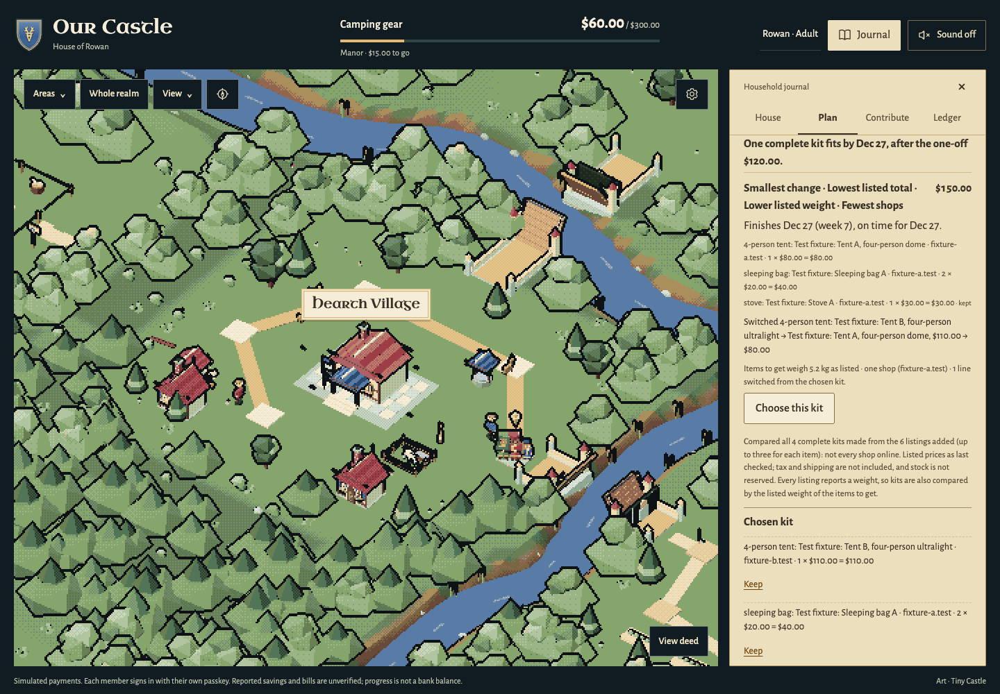
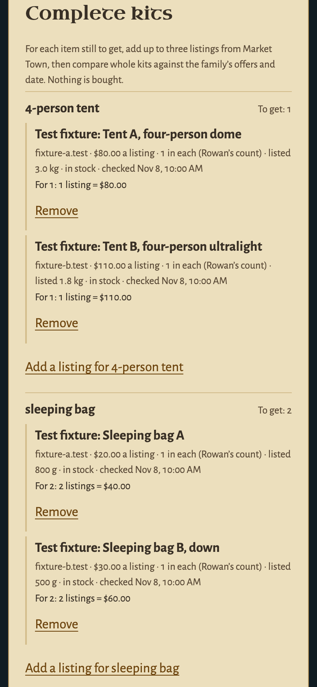
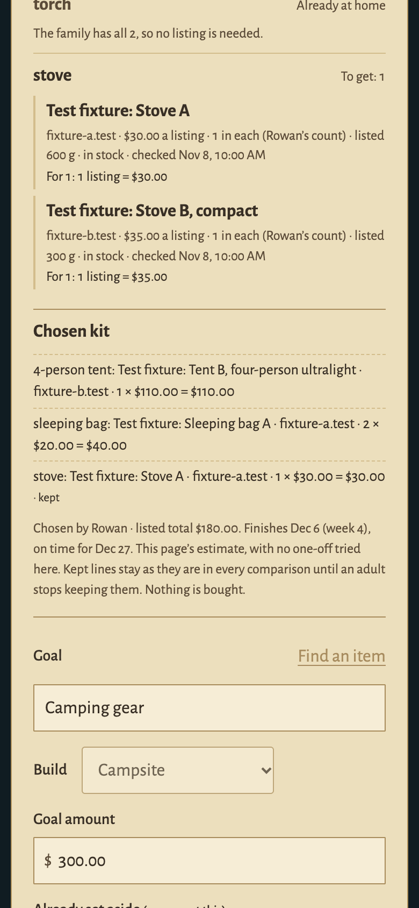

# Complete kits — November 9, 2026

**Plan → Kit list → Complete kits** compares whole kits for the things the family still needs. One cheap item per line does not prove the whole kit fits, so the planner compares complete kits against the family's own figures:
- progress already recorded;
- each adult's weekly offer and the household's weekly amount;
- the goal's date;
- the one-off amount being tried in Family choices.

It is planning only. It buys nothing, moves no money, reserves no price or stock, and changes no goal until an adult saves one.

**Try it without keys:** `npm run demo -- --family-trip` supplies six clearly invented listings and an example family to this same engine. [The playable guide](FAMILY-TRIP-EXAMPLE.md) shows the $150/$180 comparison and repair after an expense changes. The plain demo still has no catalogue.

## What a family does

1. **Listings for each item still to get.** For each line of the saved kit list with something still to get (Need minus Have), an adult chooses **Find listings for …**.
   - Market Town searches only when asked, and the adult adds up to three listings.
   - For each listing the adult enters how many of the item **one listing gives**: their own count, read from the listing. It has no default. It is never inferred from a title or a GTIN, and is recorded as that adult's count, not a catalog fact.
   - Items the family already has are skipped entirely: no search, no listing, no cost.
2. **Compare complete kits.** Every complete kit (one listing per item, bought in whole listings) is checked against the family's figures. Up to three different kits that fit are shown, each labelled with what it is best at:
   - **lowest listed total**;
   - **lower listed weight** of the items to get, only when every listing reports a weight;
   - **fewest shops**.
   - A kit that wins two of these is shown once, with both labels; nothing is invented to fill three places.
   - When no complete kit fits, the closest one is shown with what keeping it means (a later finish) and what keeping the date means (a shortfall).
   - When an item has no usable listing, the comparison names the item and shows no total. A missing item is never counted as zero.
3. **Try a one-off amount** in Family choices: a shown comparison is recomputed for it, with no catalog or model call.
4. **Order by a preference (optional).** When this server has Cohere set up, **Order with Cohere** orders the kits that fit by one preference from a fixed list (Lighter to carry, Sturdy and long-lasting, Simple to set up, Warm in cold weather). The best match is labelled, with Cohere's quoted match from the listing titles. It is a text match, not a check of quality, weight or price. When Cohere ranks none of the kits, or the ordering fails, the page says so and labels no match.
5. **Choose and keep.** **Choose this kit** saves it as the family's chosen kit. **Keep** fixes one of its lines.
   - Later comparisons hold kept lines as they are.
   - When the chosen kit no longer fits (say, a larger one-off), the **smallest change** comes first: the kit that fits with the fewest switched lines.
   - Each switched line is explained: which listing replaces which, any change in the number of listings, and the line's price before and after.
   - A kept line is never switched, and a kept listing cannot be removed until an adult stops keeping it.
   - The chosen kit's finish date is **this page's estimate**: the family's saved figures, plus only the one-off tried on this page. A child tries none and never sees an adult's trial, so two pages can show different dates for the same kit.
6. **Review and save.** **Review this kit** checks the chosen kit against fresh catalog answers and opens an unsaved goal draft in the Plan form, with the family schedule it would propose.
   - The draft holds the kit's listed total, the goal's date (or the later finish, shown as such) and the weekly amount.
   - **Save goal and propose this schedule** saves the goal, the kit as its source and the schedule proposal in one transaction.
   - **Use this plan** stays a separate decision, and every contribution keeps its own amount-specific adult PayPal approval.

Children read the listings, the chosen kit and what is kept. They cannot add, compare, choose, keep, review or save.

| Kits that fit, with a preference match (desktop) | The smallest change after a larger one-off (desktop) |
| --- | --- |
|  |  |

| Listings for each item (390 px phone) | What a child sees (phone) |
| --- | --- |
|  |  |

All captures use invented data: six test-fixture listings from two invented shops, a fake catalog, a fake Cohere order written into the test, and an invented family. [Provenance and hashes](screenshots/kit-planner-sources.json).

## Editing during a comparison or review

Every edit to the one-off amount cancels an older comparison or review on this page, even before the first comparison has appeared or after reloading a chosen kit. A late answer cannot fill the goal form using the previous amount.

An invalid amount leaves existing comparison figures visible and labelled as using the last valid amount. Choosing, map previews, preference ordering and review stay unavailable until it is corrected. A corrected amount refreshes an existing comparison; a page without a comparison waits for an explicit **Compare complete kits** or **Review this kit**. These actions do not save a goal or make a contribution.

## The worked example

This is kit-planning-acceptance-20261109.json, with invented figures:
- **The family:** $60 recorded, $30 a week (Rowan $20 + Ash $10), and the goal date Dec 27, seven weeks after Nov 8.
- **The list:** 1 tent, 2 sleeping bags, 2 torches (both at home) and 1 stove.
- **The listings:** tent A $80 (3.0 kg) or B $110 (1.8 kg); sleeping bag A $20 (800 g) or B $30 (500 g); stove A $30 (600 g) or B $35 (300 g). The A listings come from one shop, the B listings from another.

| One-off | Planning limit by Dec 27 | Kits that fit (of 8) | Shown |
| --- | --- | --- | --- |
| $90 | $180 | 5 | **$150** (A, A, A: lowest total and one shop; finishes Dec 20) and **$180** (B, A, A: lower listed weight, 4.0 kg; finishes Dec 27) |
| $120 | $150 | 1 | **$150** only. The $180 kit would finish Jan 3 at the same offers, $30 short by Dec 27. |

The smallest change follows the production-replanning example: a $160 kit with a kept $90 tent, when the limit drops to $140.
- **The repair:** switch the sleeping bags to $10 each. That makes $140, with one line switched.
- **The lowest total:** also switch the stove, making $130 with two lines switched.
- **Never offered:** the cheaper $70 tent, while the $90 tent is kept.

## Rules

- **Exact within a disclosed pool, never "cheapest online".** The pool is at most three listings per item and eight items: at most 3⁸ = 6,561 complete kits.
  - Every kit in the pool is checked.
  - The result says how many kits were compared, from how many listings.
- **Whole listings.** An item needing 3 with 2 in each listing takes 2 listings: 4 items, 1 spare. Price and listed weight count every listing bought.
- **Listed facts only.**
  - **Prices:** the listing's own price in USD; a per-unit display price is never used for a listing's total.
  - **Stock:** only a listing the catalog reports in stock is compared. That is not a reservation, and not a promise the shop can supply the quantity.
  - **Weight:** the listed weight is Channel3's documented offer `dimensions.weight`, read in exact units. An unknown weight is never zero, and kits are compared by weight only when every listing in the pool reports one.
  - **Tax and shipping** are not included. Fewer shops does not mean lower delivery costs.
- **Owned items** reduce what is still to get and nothing else: no progress, purchase or credit. A list with everything at home says that nothing remains to buy on it, and makes no zero goal.
- **Freshness.**
  - A comparison uses each listing's last checked facts and makes no catalog call.
  - Review and saving need every chosen listing confirmed by a live catalog answer: checked in the last half hour and unchanged in price, stock, variant and listed weight. Otherwise the review names each listing to check again.
  - **Check price** is one bounded catalog call per listing.
- **Call budget.** The existing Market Town limit of six catalog calls a minute is unchanged. A kit of three items to get takes three searches; a repeated search within two minutes is the cached public page. Comparing, choosing, keeping and reviewing make no catalog call.
- **What a kit is.** The goal's source becomes a typed kit record: every line's real listing, variant, count per listing, listings bought and price. It never pretends to be one catalog product. Saving a single Market Town item later clears it.

## The solver

`solver/` is a small Rust library and command, `kit-solver`, built with Rust 1.99.1 (pinned in `solver/rust-toolchain.toml`) and one dependency, `serde_json`, locked in `solver/Cargo.lock`.
- **What it does.** It enumerates every complete kit exhaustively, with checked integer cents, counts and milligrams and explicit bounds:
  - 8 lines and 3 listings a line;
  - Need 1–20 and 1–100 items per listing;
  - listing prices up to $100,000, and a planning limit up to $100,000.
- **What it returns.** The lowest total, lower weight, fewest shops and smallest change that fit, the cheapest kit whether or not it fits, the chosen kit's own figures, and up to eight lowest-total kits that fit (the set a preference may order).
- **Ties** break the same fixed way every time, ending in the choice itself. Shops are counted as each kit's actual set of shops, never a partial count.
- **Its boundary.** One JSON request on standard input (at most 64 KiB) and one JSON answer on standard output. It has no network, file, environment, identity or money authority, and sees only cents, counts, milligrams and opaque indices.
- **How the server runs it** (`server/kit/solver.mjs`):
  - the program path is fixed under the app's root, with `shell: false`, an empty environment and a fixed working folder;
  - a 2-second limit, at most two at once, and cancellation;
  - bounded output (64 KiB) and standard error (4 KiB). Standard error is counted and discarded, never kept or logged. A program that writes more is stopped then, and its answer, even a valid one, is refused;
  - every answer is checked against its request (`verifySolverAnswer`): each kit's listings, quantities, totals, weights, shops and fit are recomputed, kept lines must be unchanged, and the counts must agree.
  - The server then recomputes each shown kit's finish with the family's own arithmetic (`compareChoices`), and refuses any disagreement.
- **The reference solver** (`src/core/kit-plan.js`) is a deliberately simple JavaScript enumeration, written independently.
  - It is the oracle the tests compare the Rust solver against: the literal examples above, the retailer-set trap and 400 seeded random kits.
  - It is also the solver for a checkout without a Rust build.
  - When the Rust build is present and fails, the failure is reported and the reference is not substituted.
- **Build:** `npm run solver:build` (`cd solver && cargo build --release --locked`); `npm run solver:test`. `OUR_CASTLE_KIT_SOLVER=native` makes the server refuse to start without the build.
- **Speed:** no speed claim is made, and no Rust-versus-JavaScript timing was measured as evidence. The pool is small enough for exhaustive search either way.

## Ordering by a preference (Cohere, optional)

- **Off unless the server sets its own `KIT_COHERE_API_KEY`.** `CO_API_KEY`, `COHERE_API_KEY` and every other key are never read. `KIT_COHERE_MODEL` defaults to `rerank-v5.0-fast`.
- **Contract:** from Cohere's [Rerank reference](https://docs.cohere.com/reference/rerank) and [Rerank 5 changelog](https://docs.cohere.com/changelog/rerank-v5), read on November 9, 2026. One `POST https://api.cohere.com/v2/rerank` per explicit request, carrying:
  - `model`;
  - a fixed preference sentence as `query`;
  - up to eight kit descriptions as `documents`;
  - `top_n`, `max_tokens_per_doc: 512`;
  - `relevant_spans` (one span, threshold 0.3).
  - Redirects are refused, there is a 10-second limit, the reply is bounded to 64 KiB, and nothing is retried.
- **What is sent:** the kits that fit, as public listing titles and shop names only (`Test fixture: Tent A, four-person dome (fixture-a.test); …`). Never how many listings or items the family needs, names, members, offers, the one-off amount, dates, prices, weights, the family's own list text or a photo. The counts stay here, in the solver and on the family's page.
- **Checked here.** Every result index is in range and appears once, and every score is a finite number in [0, 1].
  - A matched span must lie inside its document, in Unicode code points, end exclusive, as the reference states. The quoted match is cut on code points.
  - Anything else is refused whole. The kits stay as they were, and the page says the ordering did not work.
  - Only kits Cohere ranked count. A reply that ranks none is a failure (`kit_rank_empty`) with no match. A reply that ranks some names Cohere's first choice and says so: "Cohere ordered 1 of the 5 lowest-total kits…".
- **Checked again before and after Cohere.** Once the solver answers, the request must still have its session, and the family's kit and figures must be the ones compared. Otherwise it is refused before any answer (even "nothing to order"), before the minute's quota, and with no Cohere call. The same check runs after Cohere answers or fails, so neither an order nor a failure is shown for figures that changed meanwhile (`kit_plan_changed`).
- **Limits on its role.** It can only order kits that already fit: it cannot add, remove or change a kit, price or date. A household may order at most six times a minute. The relevance score is not shown and is not confidence.

## Data and access

- **Migration 12** adds three tables. No earlier row or column changes; a fresh database has 27 tables.
  - `kit_candidates`: listings per line, each with the line it was added for and the adult's count per listing;
  - `kit_selections`: the chosen kit and kept lines;
  - `goal_kits`: the kit a goal was saved from.
- **Routes**, all adult-only in the fail-closed family policy:
  - `POST /api/kit/listings`, `/listings/remove` and `/listings/refresh`;
  - `POST /api/kit/compare`, `/prefer` and `/review`: read-only, with no live update;
  - `PUT /api/kit/choice` and `/keep`;
  - `POST /api/kit/adopt`.
- **Revisions.** Every request carries the kit planner's revision (the list, its listings and the chosen kit) and the family-choices revision (offers, goal, progress, day).
  - A change refuses the request, and an answer that arrives after a change is refused or ignored.
  - A listing renamed or changed on the list since it was added is not compared.
  - A schedule proposed from a kit becomes stale when one of the kit's listings changes, is removed or is repriced.
- **Other households:** a request naming another household's goal or listing is refused before any work. Listings are this server's own copies of results it showed this household.

## Checks

The checks used fake catalog and Cohere transports, invented data, disposable databases/family-mode servers, the compiled Rust solver and `.env` loading off. Their historical network preload had a documented argument-handling gap, so it does not establish complete outbound isolation. [Validation](VALIDATION.md#complete-kits-for-the-kit-list--november-9-2026), [review correction 001](VALIDATION.md#complete-kits-review-correction-001--november-9-2026) and [transport correction](VALIDATION.md#transport-isolation-correction--november-9-2026).

## Limits

- **Pool, not market.** Exact within the listings an adult added (at most three per item), not across every shop. Prices, stock and weights are as the catalog last reported them.
- **Counts per listing** are the adult's own reading of a listing. The catalog contract has no pack or item count.
- **Weight** is as listed, not measured, and only compared when every listing reports one.
- **Cohere** is a text match on titles. No quality, preference or ranking accuracy was measured; every reply here was invented.
- **Not covered.** No human playtest, physical-device, accessibility-audit or performance evidence, and no live Channel3 or Cohere call.
