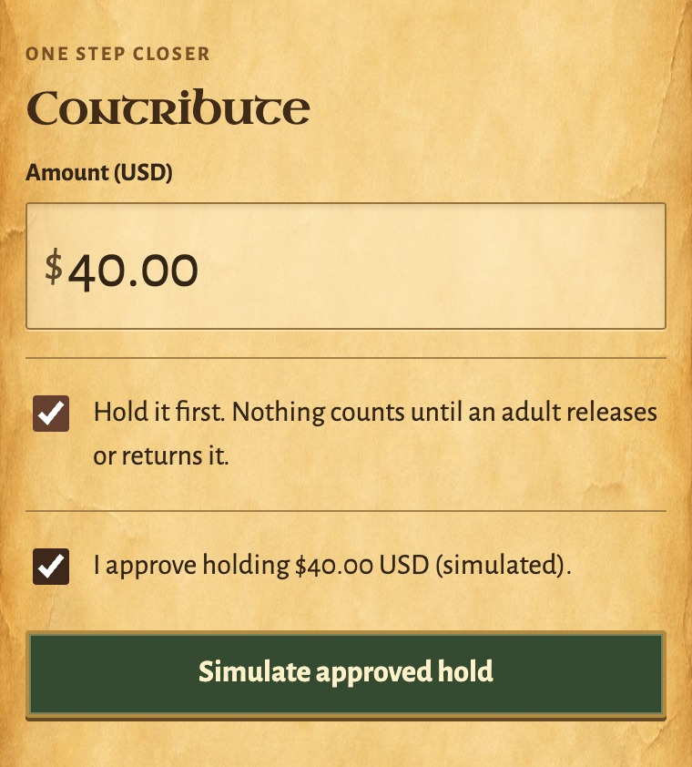
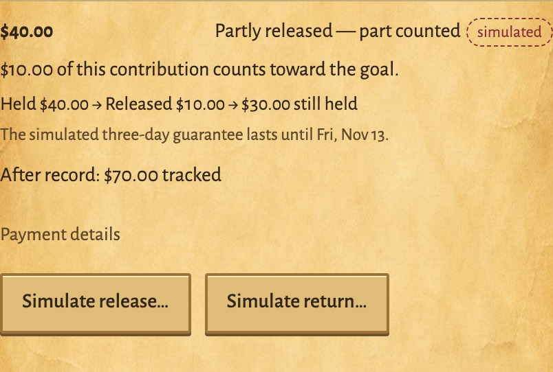
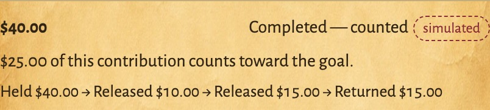
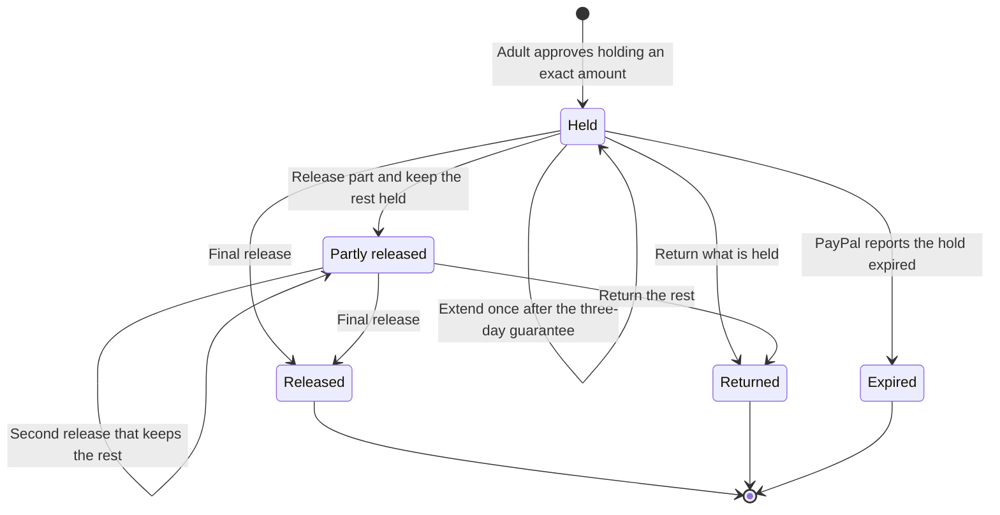

# Hold first, then release, extend or return

A contribution can be **held** before anything is taken. PayPal authorizes the adult-approved amount, nothing is credited and the world does not move. Later an adult **releases** an exact amount to the goal, in one step or up to three, or **returns** what is still held. If the decision takes longer than PayPal's three-day guarantee, an adult can **extend** the hold once. This sits beside the existing checkout, which is unchanged and is still the default.

Status: hold, release and return were merged to `main` by [#83](https://github.com/alejandro-publius/our-castle/pull/83). The extension, stepped releases and the money trail were merged by [#85](https://github.com/alejandro-publius/our-castle/pull/85) and are not in the saved Mac apps, which stay on schema 18 until the owner asks for another upgrade. Every check so far uses the fake PayPal sandbox or example mode. **No real sandbox hold, capture, reauthorization or void has been made with any of it.**

## What happens

| Step | Who | What the server does | Progress |
| --- | --- | --- | --- |
| Hold | An adult ticks **Hold it first** and approves the exact amount | Creates the order with intent `AUTHORIZE`; after the buyer approves in PayPal, authorizes it | None |
| Extend (optional, once) | An adult, after PayPal's three-day guarantee has ended | Records the decision, then reauthorizes exactly the held amount; PayPal answers with a new authorization, which later captures use | None |
| Release | An adult enters an amount up to what is still held and confirms it | Records the decision, then captures that amount. By default the capture is final and the rest goes back to the payer. With **Keep the rest held**, it is not final and the rest stays held | The released amount, once the capture is confirmed |
| Return | An adult confirms returning what is still held | Records the decision, then voids the authorization | None more; a part released earlier still counts |

A held record shows its money trail, for example **Held $40.00 → Released $10.00 → Released $15.00 → Returned $15.00**, and where it stands in PayPal's guarantee. It also offers the existing **Check with PayPal**.

| 1. Hold it first (Contribute) | 2. Release part and keep the rest held (Ledger) |
| --- | --- |
|  |  |

After a final release of $15.00:

These three are crops of a simulated hold in example mode, captured from a disposable session by [the capture script](screenshots/readme-demos-capture.mjs); [what they show and do not show](screenshots/readme-demos-sources.json). They are not PayPal evidence.

## PayPal's timing, as this server keeps it

PayPal guarantees an authorization's funds for three days (its honor period) and keeps the authorization for 29 days. After the honor period a merchant may reauthorize; the reauthorization has a new ID and a new three-day honor period, still inside the original 29 days. Sources, checked November 10, 2026: PayPal's [authorization guide](https://developer.paypal.com/docs/checkout/standard/customize/authorization/) and [reauthorize reference](https://developer.paypal.com/api/payments/v2/authorizations-reauthorize), and the `ReauthorizeRequest` description in the pinned `@paypal/paypal-server-sdk` 2.5.0.

The current web reference allows several reauthorizations after the honor period; the pinned SDK says a payment can be reauthorized once. This server takes the narrower rule: **one extension per hold**.

| On the record | Meaning | What an adult can do |
| --- | --- | --- |
| Guarantee lasts until a date | Inside the three days | Release or return |
| Guarantee ends on a date | Its last day | Release or return; extend afterwards |
| Guarantee has ended | PayPal may still capture, but no longer promises the funds | Release, return or (once, while nothing is released) extend |
| Reached its expiry | Past the authorization's expiry | Check with PayPal; nothing is guessed from the clock |

The guarantee is counted from PayPal's own authorization time. When PayPal leaves that time out, a hold placed now counts from this server's clock. A hold placed before this change is never given a guarantee date it may not have: it is learned from PayPal by an explicit check.

## Rules the server keeps

- **The server owns the amounts.** The held amount is the order's own amount. An extension asks for exactly that amount, never more. A release is recorded before PayPal is asked, is at most what is still held, and is never more than the goal still needs.
- **No release can leave a negative remaining authorization.** The code refuses it first. The database refuses it too: a hold's released total can never exceed what is held, and a release under way can never take more than is still held.
- **At most three releases, and the last is final.** Keeping the rest held requires a release to spare and at least $1.00 left to release.
- **Only a matching capture counts.** A capture is credited only if it matches the release an adult is confirming right now, in amount, currency and contribution reference. A capture of a hold with no release under way is never credited.
- **One credit per step.** Each release is credited once through the same single-credit pipeline as every other capture. Every decision is written as a step before PayPal is asked; the same request again is answered from its step, never sent as a new one.
- **Only an exact extension is used.** PayPal's answer must be a new authorization for this contribution, for exactly the held amount in the same currency. Anything else is not used, and the hold continues on its original authorization.
- **After an extension, the new authorization holds the money.** Releases capture from it. A return voids the original authorization, because PayPal refuses to void a reauthorization: its [`CANNOT_BE_VOIDED` error](https://developer.paypal.com/api/payments/v2/errors/cannot_be_voided) reads "A reauthorization cannot be voided. Please void the original parent authorization." (read November 11, 2026). Otherwise PayPal's news about the authorization it replaced changes nothing here.
- **Unknown is not guessed.** If PayPal does not answer a release, a return or an extension, nothing is credited or adopted and no other decision can start. A success answer that the SDK cannot read (its schema or its JSON parser refuses it) counts as no answer, never as a refusal: PayPal has already acted on the request. An explicit check settles a release or return from PayPal's own order, or reopens the hold when every capture PayPal lists is counted or failed and the rest is still held. For an extension, the check adopts the new authorization when PayPal lists it; asking to extend again sends PayPal the very same request (the same `PayPal-Request-Id`), so it cannot extend twice. Until then, news that the old authorization ended is not acted on, because the money may already be held under the new one.
- **A retried release can never capture twice.** A release decided again after an unanswered attempt (the same amount, from the same released total, on the same authorization) goes to PayPal with the same `PayPal-Request-Id`, so PayPal answers it with what the first attempt did. A different amount, a later step or a release after an extension is a different request.
- **Refunds wait until the hold is over.** A part released in steps can be refunded once nothing is still held.
- **Webhooks never credit a hold.** Verified authorization events record a hold, an extension or a return made elsewhere. Only a capture can add progress.
- **Adults decide, and no AI decides anything here.** Releasing, returning and extending are adult-only routes, refused for a child, another household or another goal before PayPal is asked.

## Where it lives

- `server/payments/contributions.mjs`: the hold record and its steps, `releaseHold`, `returnHold`, `extendHold`, the guarantee timing, the money trail, hold-aware capture checks and webhooks.
- `server/payments/paypal-client.mjs` and `paypal-sdk-client.mjs`: authorize an order, read an authorization, capture it (final or not), reauthorize it, void it. The SDK calls match the installed `@paypal/paypal-server-sdk` 2.5.0 signatures (`reauthorizePayment` included); the dependency pin is unchanged.
- `server/db.mjs`: schema 18 added `payment_holds`. Schema 19 adds four columns to it (released total, replaced authorization, guarantee end, extension time) and one table, `payment_hold_steps` (45 application tables). Existing rows keep every value; a hold released under schema 18 gets its one release as its released total.
- `server/steward/index.mjs`: **Check with PayPal** compares every step of a stepped release.
- `server/app.mjs`, `server/access/policy.mjs`: `POST /api/contributions/:id/release`, `/return` and `/extend`, adults only.
- `src/app/main.js`, `app.css`: the **Hold it first** option on Contribute; on the held Ledger record, the money trail, the guarantee line and the decisions.
- Example mode has the same hold, labelled as simulated, with PayPal's timing, so the flow can be shown without PayPal.

## Evidence

- `test/unit/payment-holds.test.mjs`: 60 cases. Twenty-seven run against both PayPal adapters. Beyond the original hold, release and return cases they cover: an extension only after the guarantee, once, for exactly the held amount, with later captures from the new authorization; a return of an extended hold voiding its original authorization, with the fake refusing a void of the new one as PayPal's published rule says, while earlier news of the replaced one changes nothing; an unanswered extension adopted from a check or resent as the same request, and not ended on news that the old authorization ended; refused or mismatched extensions leaving the original in place, and a refused answer never adopted later; the 29-day cap; releases in three steps, each counted once; a stray capture after a partial release; a return after a partial release; an unanswered later release settled once or reopened; a release decided again after an unanswered attempt reaching PayPal as the same request and captured once; and a declined later capture reopening the hold. Six more cover example mode, reconciliation wording, the database rule and the upgrades from schemas 17 and 18.
- Twenty-six deliberate breaks of the new rules, one at a time and under the network guard, with all 52 cases still loading and no outside connection attempted: 25 were caught on their own. The other is a backup guard (a check never takes an extension answer it already refused for a new one); it is caught when removed together with the guard it backs up. [Details](VALIDATION.md#hold-extension-and-stepped-releases--november-10-2026).
- `test/unit/paypal-sdk-transport.test.mjs`: the hold calls through the real SDK 2.5.0 serializers, with only the transport replaced. Authorize, capture (kept open and final), reauthorize, void with an empty answer, and read each send the expected path, request ID, decimal amount and `final_capture` flag; a success answer the SDK cannot read is reported as an unknown outcome. The response shapes follow PayPal's published samples and are not sandbox evidence.
- `test/e2e/payment-holds.spec.mjs`: the page in example mode. Hold $40, release $10 keeping the rest, then release $15 as the final release (the trail ends **Returned $15.00**), hold and return $15, and a child is offered no decision. Hosted runs are its result; it is not run on the loaded development Mac.

## What only the owner can establish

- **A real sandbox hold through its whole life.** One held order approved in the PayPal sandbox, left past its three-day honor period, extended, then released in two steps (one not final, then the final one); on another order, an extension and then a return.
- **Three PayPal behaviours the fake cannot show:** what the sandbox reports for the two authorizations after an extended hold is returned (the void names the original one, following PayPal's published rule; that both then read as voided is the fake's assumption); whether the order's details list the reauthorization (handled either way); and whether the sandbox refuses a reauthorization inside the honor period.
- **Hold webhooks** need a public webhook endpoint, which this project does not run.

Not built: more than one extension, payouts and invoicing.

## Random histories

`test/unit/payment-holds-random.test.mjs` runs 100 seeded random histories against the fake PayPal, twice: once with truthful order reads, and once with reads that may hide PayPal's newest capture. A history mixes holds, valid and invalid releases, returns, extensions, repeated requests, lost answers, declined captures, checks, webhook deliveries and passing days.

- **After every step:** progress equals the counted captures, each counted capture is one the fake really took for that amount, the released total never exceeds the hold, and at most one decision waits for PayPal.
- **After a final check, in both runs:** everything the fake took is counted once, and the hold ends where the fake says it did.
- **Does it bite?** Five deliberate breaks of the hold rules, one at a time, each failed it. An unchanged run passed.

It is evidence about this server's logic only. It found two limits, neither of which counted money that PayPal did not take. Both are now closed, and the test holds its final rules with no exception.

- **Closed: a declined capture read as a difference.** A capture PayPal declined stays listed on its order. A later check called that a difference although PayPal took nothing and the ledger counted nothing, and a late delivery about it while another release was under way marked the contribution as rejected. Now a check compares the rest of the order without it and says so, and a declined capture already on record is no news to a later check or delivery. Two cases in `test/unit/payment-holds.test.mjs` cover it on both PayPal adapters.
- **Closed: a lost answer followed by a stale read could leave money uncounted.** If a release's answer was lost and the next read of the order did not show that capture yet, the hold reopened, and a different decision (a return, or another amount) left the first capture taken but never counted. In seed 135 with stale reads PayPal took $15.00 and the ledger counted $5.00. Two rules close it:
  - **A check does not call off a release that PayPal's own status contradicts.** "Partly captured" with nothing counted here means a capture exists that the read does not list, so the release stays unknown until it shows.
  - **A release reopened by a check keeps a mark.** When earlier releases explain PayPal's status, the hold still reopens, but the step is remembered as unconfirmed. If PayPal lists a completed capture for exactly that amount later, it is counted as that release, once, and the hold stays as later decisions left it. Deciding the same release again is still the same PayPal request and clears the mark. A capture that matches no approved release is still never counted.
  - Evidence: two more cases in `test/unit/payment-holds.test.mjs`, each on both PayPal adapters, and one more check in an existing case. Five deliberate breaks of these rules, one at a time, each failed a case; an unchanged run passed. The random histories with stale reads now hold the same final rule as the truthful ones, over 4,000 seeds.
  - What this leaves: an unconfirmed release does not use up one of the hold's three steps unless it is later counted, so a hold could end with four counted releases, and a late one can take progress past the goal. Both need a lost answer and a stale read first, and both record what PayPal really took.
