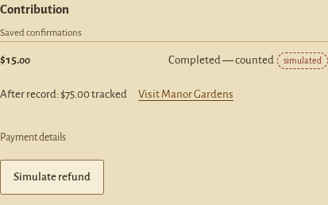
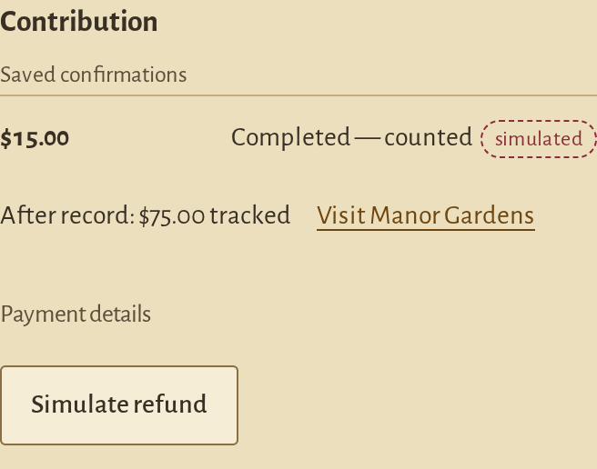

# One receipt route after a contribution

November 7, 2026. Built on the compass work in PR #30. [Release readiness](RELEASE-READINESS.md) records the reviewed commit and local activation.

**Review the receipt** now opens Treasury with that contribution selected. The selected-record section contains the existing status, saved-check history and the one existing steward note. Questions remain in their closed disclosure until requested. Reviewing a receipt makes no provider call and never manufactures a saved match.

## Behavior

- Confirmation still shows the short deed and world progress. The family chooses when to follow **Review the receipt**; the journal does not automatically cover the newly opened area.
- The link follows the contribution that completed, even if the family selected an older record in the meantime. Keyboard focus lands on its named selected-record section after the lazy grid has settled. Existing filters, searches and other navigation retain their current behavior.
- The final goal contribution uses this same route. After review, the next action becomes **Visit your castle**.
- Focusing the immediate Contribute confirmation no longer marks the Treasury receipt reviewed. Reaching that selected receipt through an existing record link or an action inside it does.
- Simulated and sandbox source labels remain distinct. A completed capture without a saved order check still says **No saved check**; later failed checks still outrank older matches. The existing status calculation is unchanged.
- The steward note is moved, not duplicated. Its existing text reflects the configured capabilities or local saved-history mode; a child still gets the existing adult-access wording.

These captures show a disposable $15 **simulated** fixture, with no PayPal transaction. The capture itself made no writes or outside requests; [source/image hashes and steps](screenshots/receipt-handoff-sources.json).

| Desktop receipt | Emulated phone receipt |
| --- | --- |
|  |  |

## Design reference and decisions

The existing [Treasury receipt](screenshots/treasury-status-phone-receipt-failed.png) is the primary target: parchment, brass focus treatment, compact source/status line and collapsed technical details. No new panel, chat, palette, artwork or dependency is introduced.

[Runey's Invoice Payment flow](https://refero.design/flows/11706) provided one interaction reference: completion retains the identity of the payment in the settled record. Only that continuity is borrowed; its drawers, typography and decorative treatment are not adopted. The owner's map-first, restrained interface controls the layout and the decision to keep the handoff explicit.

| Decision | Source | Purpose |
| --- | --- | --- |
| Use the existing Review action and selected-record section | Current Our Castle journey and Treasury | Reach the receipt in one click without another surface |
| Keep the completed contribution selected through the handoff | Runey completion/history sequence; current stable ledger IDs | Prevent an older selection from opening the wrong proof |
| Move the one existing steward note beside the receipt | Owner's request for visible boundaries and less repeated copy | Show capabilities without opening the question panel |
| Keep verification data unchanged | Existing saved-check contract | Show only actual stored outcomes and times |

## Verification

The updated journey unit test fails against the predecessor's Contribute receipt route and passes after this change. Focused browser checks cover desktop and 390 px phone navigation, final-goal receipt review, saved-check truth, zero provider work on opening records, and the configured steward note while its disclosure is closed. Provider responses and payments in these checks are fake/simulated. Final run results and captures are recorded in [VALIDATION.md](VALIDATION.md).

Human playtest and physical-device evidence remain separate. Owner apps, databases, credentials and the completed sandbox order are not used by this branch's checks.
