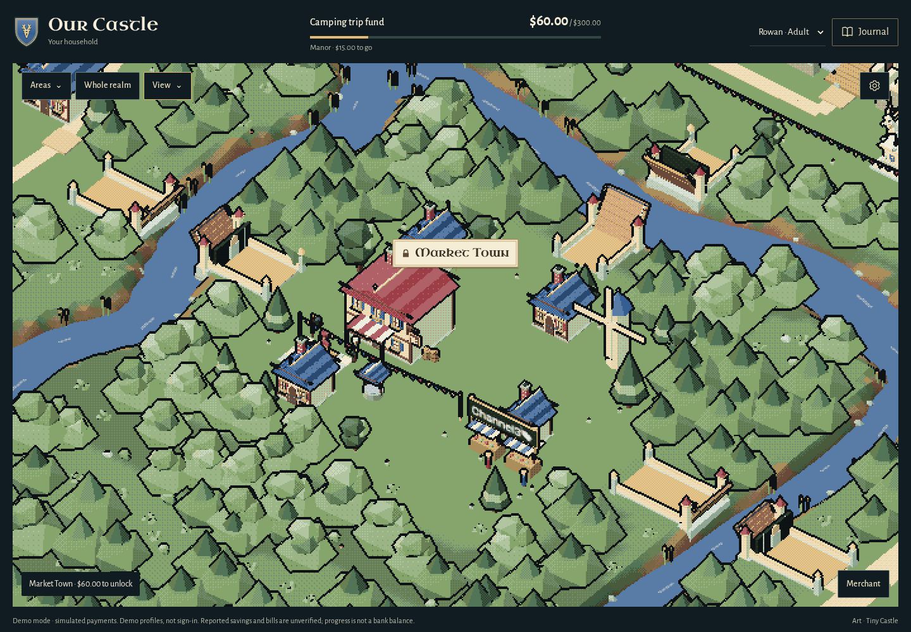
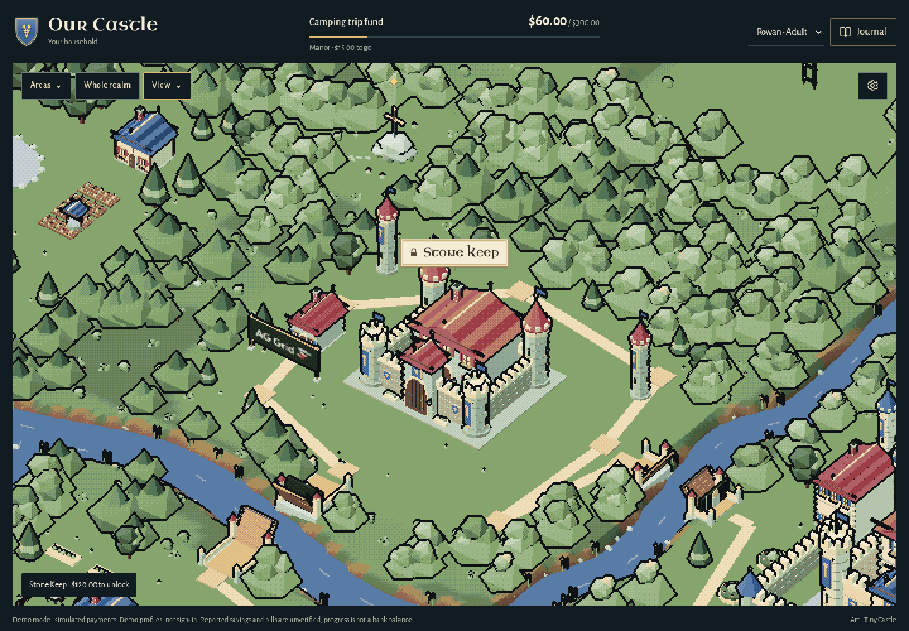
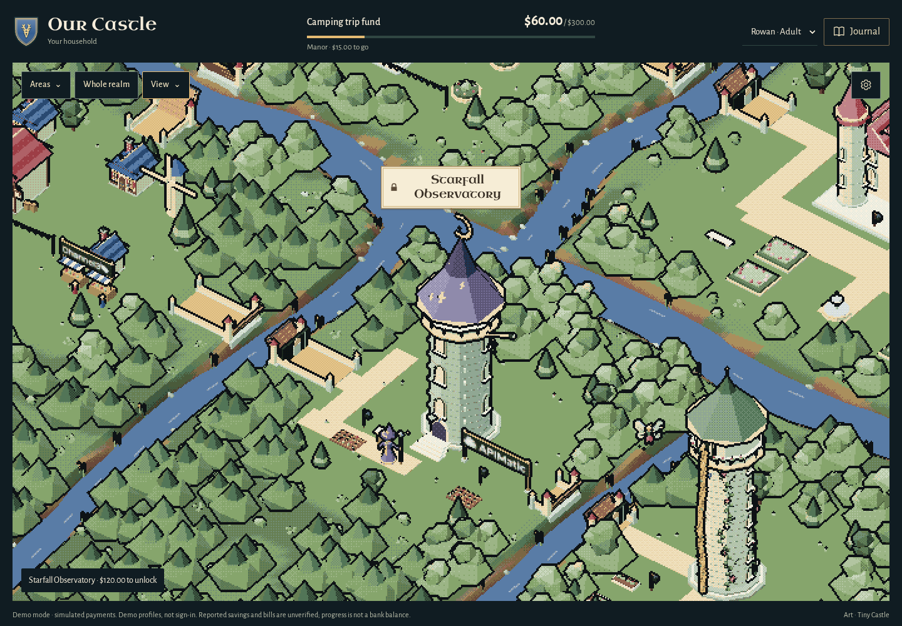
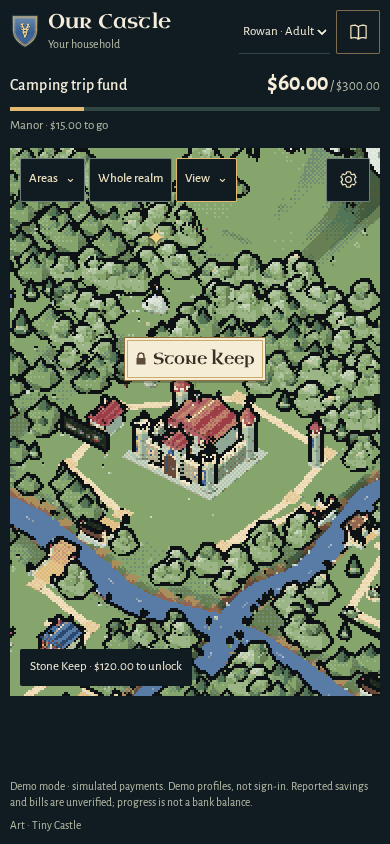

# Sponsor discoveries — November 6, 2026

## Reference lock

The existing Our Castle woodland, miniature joinery, heraldry and 90-colour rendering are the primary target. The owner's request is for small brand Easter eggs visible during a focused demo, with the landscape remaining uncluttered.

Refero research revisited [Wayfinder](https://wayfinder.nfb.ca) (style `168f20ae-b58e-4781-b9b8-46b2d9b81b5f`) for integrated environmental detail and [MekaVerse](https://themekaverse.com) (style `f5e5d282-4361-4654-aac2-c8b5cd8214b1`) for a world that carries the interface. Borrow their restraint and imagery-first hierarchy only; do not import their fonts, colours, content or artwork.

| Decision | Source / role | Implementation target |
| --- | --- | --- |
| Existing woodland remains dominant | Owner's current world and restrained-interface brief | Three small signs, no billboard row, map marker or sponsor panel |
| Signs belong to the existing buildings | Wayfinder's integrated environmental detail; current miniature models | Market stall beam, Keep treasury noticeboard, observatory study sign |
| Marks remain recognisable | Official outlined SVG files | Unmodified source files, preserved aspect ratios and clear space; never type sponsor names in a substitute font |
| Wood, brass and ink are structural accents | Existing world material roles | Current wood, gold, dark and stone colours; brand colours stay on logo artwork |
| Scenery stays cosmetic | Existing progression boundary | Visible signs do not open districts, change eligibility or enable a sponsor connection |

The three brands correspond to the existing integrations: Channel3 Merchant, AG Grid/Studio Treasury, and APIMatic PayPal context/SDK work. The existing PayPal hillside lettering stays intact. No additional sponsor integration or endorsement is implied.

Official files and exact hashes are recorded in [the asset provenance](../assets/brand/sponsors/README.md). The files load locally; no sponsor request is made by a running browser.

## Finished details

- **Channel3:** a brass-edged trade sign mounted above the two existing Market Town stalls.
- **AG Grid:** a small treasury guild noticeboard beside the Keep's stone outbuilding.
- **APIMatic:** a maker's sign beside the observatory study garden, away from the wizard and staff.

Each mark prints correctly on both faces. Geometry, textures and materials are reused through district/progress changes and disposed with the scene. The signs remain scenery whether an area is locked or open. Existing PayPal lettering, family heraldry, map markers, progression and sponsor interfaces are unchanged.

The first visual pass caught AG Grid's viewBox-only SVG loading successfully but rendering as a blank WebGL texture. Its unmodified SVG is retained; a transparent PNG rendered from it now supplies that texture. The conversion and hash are recorded with the assets.

| Market Town | Treasury |
| --- | --- |
|  |  |

| Observatory | Phone |
| --- | --- |
|  |  |

## Checks and limits

A focused Playwright review used the real local example-mode app on desktop (1440×1000) and an emulated touch phone (390×844), with reduced motion. All three marks loaded; focused district inspection, zoom, day/night and camera turning worked. No page errors, off-origin requests, API writes or horizontal overflow were observed. Goal, progress and achievements were identical before and after inspection. No payment, model or Channel3 provider was called. These are new interactive screenshots, not the historical PayPal verification footage.

`npm run check` and `git diff --check` pass. Original 47 art/runtime files and the 90-colour palette are unchanged. SVG structure/source hashes were checked for external images, fonts and scripts. Runtime loads the local original SVGs, plus the locally derived AG Grid PNG. Screenshots, source hashes and capture steps are in [sponsor-world-sources.json](screenshots/sponsor-world-sources.json); ignored working captures and the review script are under `test-results/sponsor-world/`.

The wordmarks are deliberate Easter eggs rather than primary UI: they are clearest in focused/zoomed views and can be hidden naturally by buildings at some camera angles. No full browser suite, physical phone or provider checkout was exercised for this cosmetic change. Owner apps and records were untouched. The AG Grid/Studio versions in NOTICE were corrected to the already-installed 36.3.0/3.1.0 pins; dependencies were not changed.
