# Validation

## Illustrated journal and generated identity — November 9 Pacific / November 10 UTC, 2026

The owner requested a journal redesign and original ChatGPT-generated brand assets. [Design and actual screenshots](JOURNAL-DESIGN.md) record the reference lock: a forest cover, four chapter tabs, lighter pages, explicit planning sections, and a crest/castle identity separate from saved family heraldry. Original world art, licences, renderer and palette remain unchanged.

- Existing family-trip and planning-edit browser cases: **10 passed** across desktop and 390 px phone. The complete-kit trial, repair, explicit simulated contribution and delayed-response protections still work.
- New journal navigation case: **2 passed**, desktop and phone. It checks all four tabs, keyboard selection, closing/reopening with an unsaved goal name, loaded local artwork, and unchanged state with zero writes or outside requests. Its first version incorrectly focused an inactive tab programmatically while treating it as selected; correcting the test to select House before ArrowRight fixed that harness assumption. No production navigation change was needed.
- Visual inspection: all four chapters at **1440×1000, 390×844 and 320×720**; twelve captures, no horizontal page overflow, page errors or outside requests. Phone sizes are emulated Chromium. The new PNG source assets were converted losslessly to local WebP with provenance hashes; no payment/model request generated app evidence.
- Original-art/source guard: 47 copied art/runtime files, the 90-colour palette, renderer wiring and JavaScript syntax pass. The changed HTML has unique IDs and balanced nesting.

Checks use disposable in-memory example data, no .env and local fake providers. The reviewed Node loopback preload and browser origin route restrict these checks; this is not an OS-wide network isolation or production-readiness claim. Owner apps, records and credentials are untouched. Hosted results are recorded on the pull request; this note describes local evidence only.

## Planning edits during slow replies — November 10, 2026 (UTC)

Four desktop regressions failed on `03fc881` before changing the app:
- Saving a $10 weekly offer, then typing $25 before the reply and moving focus, replaced the $25 draft with $10.
- An invalid one-off amount entered during the first kit comparison still let its older answer appear.
- An invalid amount after a comparison left **Choose this kit** and **Preview on map** enabled for the old figures.
- After reloading a chosen kit, an invalid amount entered during review still let its old $90 trial fill the goal form, changing the unsaved goal field from $300 to $150.

The page now tracks which offer edit each save/withdrawal acknowledges, preserving newer typing and naming it as unsaved. Every one-off edit invalidates an older kit comparison or review, including before the first comparison. Existing figures stay readable as the last valid amount; choice, preview, ordering and review require a valid amount. Correcting it restores the existing comparison or permits a fresh explicit review.

Checks on the final implementation:
- **16/16 browser passes**, zero failures/skips/flakes, across desktop 1440 × 1000 and Chromium's 390 × 844 touch-emulated phone (4.2 minutes): the four new cases on both viewports, plus the existing family-trip and three map-preview cases on both. The offer case also covers typing during withdrawal and an explicit subsequent save.
- **59/59 focused unit passes**, zero skips/failures: family-choice arithmetic/service, kit planner and kit preview. The original-art, palette, renderer and syntax guard passed.
- The new cases drive real browser controls and the actual disposable example server. Tests delay a real loopback response, not a substituted page controller. Explicit offer and kit-choice writes are checked separately from unchanged progress, ledger, contributions, goal and plan.
- Minimal synthetic process configuration, `.env` loading off, invented catalogue, no live app providers. Corrected Node TCP/fetch controls passed in every loaded process; browser requests outside the test origin were refused. This is not an OS-wide network guarantee or a physical-device/playtest result.

Source: `src/app/family-choices.js`, `src/app/kit-plan.js`; permanent regressions: `test/e2e/planning-edits.spec.mjs` (included in the required kit-planner job). The raw before log, after JSON report and control logs remain ignored under `test-results/planning-edits-20261109/`. Hosted results are recorded on the corresponding pull request. No server, schema, financial rules or dependency pins changed.

## Photo draft fidelity and dependency review — November 9, 2026

Implementation `7d31e6e` fixes three reproduced data-handling problems without making another provider request:

- Photo draft → **Type the list instead** → **Check this list** previously changed adult-reviewed Have values `[2, blank, 0]` into `[0, 0, 0]`. The generated text now carries visible `[have N]` / `[have ?]` annotations, and `? x` preserves an unknown Need. Counts follow their items when the text is reordered; deliberately blank fields still need correction before saving.
- Literal details such as `rated to 0 °C; warm lining` previously created an extra item, while `fits (wide) pans` moved details into the item name. A local round-trip comparison now runs before clearing anything. If the typed syntax would change a field, the exact editable draft and photo stay open with an explanation and focus on the first item.
- `-2 x torch` was treated as a bullet followed by positive 2. ASCII bullets now require a space or end of line; negative-looking text keeps Need unknown for the adult to correct.

**Actual focused checks:**

- The corrected before-fix regression run had 23 passes and four failures, all four corresponding to the new count/annotation, negative-sign or draft-retention assertions. After the fixes, 32/32 core, actual-page/minimal-DOM and reader cases passed, with no skips.
- Actual Chromium desktop 1440×1000 and touch-emulated phone 390×844: **4/4 browser cases passed**, no skips or flaky retries, including the existing three-member shared-family kit-list journey and the new reorder/blank-count/literal-details route on each size.
- The browser uses the actual reader adapter over an invented fake response. Only explicit reads and one deliberate list save occurred in the new case; payment, goal, plan, offer and choice records remained unchanged. Page errors and outside-origin requests were zero.
- The original-source/art/palette/renderer/syntax guard passed. Corrected per-process Node TCP/fetch guards recorded only their expected TEST-NET refusal controls: six in the unit run, six in the browser run and 472 in the source-check run. Every loaded process's control passed. This is not an OS firewall, arbitrary-child-process, DNS or UDP isolation claim.
- An early test-proposal import included explanatory prose, and the first browser test draft named the button incorrectly. Those harness mistakes were corrected before the final runs; neither is presented as a product defect.

All data was invented and in memory, configuration was synthetic with `.env` loading off, and no saved household, credential, paid provider, real payment or owner process was accessed or changed. The reader's model/prompt/schema is unchanged. These results improve **draft fidelity**, not evidence of handwriting, crossed-out-item or real-photo recognition accuracy; the single earlier synthetic live result remains the only live reader evidence.

The same follow-up reviewed the current lockfile and published Toolkit. **12 affected packages (11 high, one moderate) remain**; the inspected read-only OpenAI entry and locked dependency paths provided no demonstrated applicable same-major repair. No package/SDK pin was changed. [Exact advisories, paths and limits](TOOLKIT-MAINTENANCE.md#november-9-dependency-review).

Ignored raw evidence: `test-results/quality-followup-20261109/` (`before-corrected.log`, `unit-final.log`, `browser-final.log`, `browser-final-results.json`, `local-checks.json`, `source-check.log`, `review/` and `dependencies/`). The final PR records its own exact-head hosted results before integration.

## Complete-kit map preview and product completion — November 9, 2026

Source `63f7ce6` completes the worker checkpoint with a temporary map preview driven by the actual kit comparison. It keeps proposed purchases separate from funded progress and saved choices. The product route is now **compare → choose/keep → preview → change an expense → review and explicitly adopt → approve a contribution → review its receipt**. [Selected scope](PRODUCT-COMPLETION.md) and [current walkthrough](FAMILY-TRIP-EXAMPLE.md).

**Local evidence:** 16/16 new pure unit cases; 6/6 new desktop/390 px phone browser cases with the compiled Rust solver required; 2/2 existing family-trip browser cases; original-art/source/palette/renderer/syntax guard and diff check. No new case was skipped. The broader browser suite was not rerun locally. The integrating PR records exact-head hosted checks separately.

Review reproduced the large-kit layout overflow, hidden-focus return on pending Close, stale camera scale after automatic caption growth (0.01939818 versus the correctly reframed 0.02172725 in the probe), and body focus after asynchronous failure. The fixes retain the failing behaviors as regressions. Tests also distinguish the chosen $180/$110-short preview from the closest $150/$80-short alternative and prove the preview changes no saved choice, money or funded project. [Implementation, test-authoring corrections and limits](KIT-MAP-PREVIEW.md).

The guarded runs use fresh in-memory example households, a minimal no-key environment and origin-blocked browser traffic. The preload is the corrected `dcaf05bd…` Node TCP/fetch guard plus the exact-localhost adapter; it is not a general firewall. The native binary has the same `f151bd87…` SHA-256 as the earlier reviewed build, with unchanged solver sources; hosted CI rebuilds the pinned Rust source. [Capture hashes and full provenance](screenshots/kit-preview-sources.json).

Claude handed back a clean checkpoint and has no ongoing assignment. The source changes and final review were completed in the coordinating chat. Saved apps on 3010/3021, their records/configuration, the completed $15 sandbox order and the separate video preview were not changed. No live provider call, recording, human playtest, deployment or submission occurred.

## Playable family decision and final source integration — November 9, 2026

[PR #61](https://github.com/alejandro-publius/our-castle/pull/61), source `c6aa3e4` and guide/captures `a792654`, supplies the no-key catalogue missing from the ordinary demo. `npm run demo -- --family-trip` opens the existing Plan surface with an invented family, its offers, an editable kit list and six labelled sample listings. It uses the existing services and actual complete-kit/repair calculations. The ordinary blank demo remains available.

The exercised route compares $150/$180 kits after a $90 one-off, keeps the chosen stove, repairs the choice to $150 after a $120 expense by changing only the tent, and explains the real $80 shortfall at a $200 expense. Review, goal save, proposed schedule and contribution approval remain separate explicit actions. A simulated $15 contribution credits once. Child actions, external shop links, false catalogue labels and unintended financial writes are checked. [Walkthrough and three real example captures](FAMILY-TRIP-EXAMPLE.md).

The integration also includes `816a76c`: a newer failed saved check now invalidates an older displayed steward answer. It reuses the existing scope invalidation and changes no payment route, financial record or provider call. [Reproduction and narrow correction](STALE-CONFIRMATION-ANSWER.md).

**Actual local checks:**
- Family-trip unit/HTTP source: **569 results, 568 passed, one existing skip, zero failures**, Node 26.0.0 with the compiled Rust solver required. Twelve new cases cover the scenario, real computation, reset failure preservation, retained member records and configuration isolation.
- Twelve affected browser files, desktop and 390 px touch-emulated phone: **97 passed and one designed phone skip**, over two guarded batches. Eight files supplied 38 passes; the corrected four-file batch supplied 59 passes and one skip. The two new family-trip cases passed with the native solver. These were selected affected checks, not the entire browser suite.
- The page reset control was separately exercised once: **8/8 checks**, restoring the family, offers and six listings after a chosen/kept kit; no outside-origin request or page error.
- Stale-answer regression: on `e0f8816`, the desktop case failed specifically because the old answer remained visible after the failed check. With `816a76c`, **desktop and phone both passed** (30.9 seconds), while payment/ledger rows stayed identical, exactly one fake read failed, and no model/external browser request occurred. It is tagged `@release` for ongoing CI.

**Test harness correction:** the initial browser batch had 58 harness failures in four files: Playwright's Node request helper supplied a custom lookup for `localhost`, which the strict preload refused. The final retry retained the corrected preload byte-for-byte (SHA-256 `dcaf05bd9de88b7457bd68f76c50aa33a361e94adc3abf6ac7eb2da5889164ec`) and used an evidence-only adapter that rewrites only exact `localhost` with a caller lookup to literal `127.0.0.1`, dropping that lookup before the guard. A 22-check control passed, including refusal of tested non-loopback targets before lookup; four deliberately broken adapters were detected. The interim unguarded retry was stopped and is not counted. Nineteen earlier mutation probes detected deliberately broken source behavior, but their runner did not load the corrected TCP preload; they are not isolation evidence. The preload covers the tested Node TCP/fetch paths, not direct DNS, UDP or arbitrary child-process networking; browser requests are separately intercepted.

**Capture and native-build provenance:** the three images retain their actual `c6aa3e4` source hashes and invented-data labels. The local native binary was copied from the earlier reviewed `b21b2d8` build (SHA-256 `f151bd874022b56f9f3ea9790fea721b33dc12eadb4dc25cbae55ac9c437abdb`); the five solver source/config files were byte-identical. The hosted workflow builds the pinned compiler/crates afresh. The integrating PR records the exact combined head, checked merge tree and hosted results; earlier runs are not presented as tests of this combined head.

**Hosted timing correction:** the first combined run, [42708599391](https://github.com/alejandro-publius/our-castle/actions/runs/42708599391) on `278ddf3`, passed all three unit/Rust jobs and all four native-kit browser cases. Its shared release-browser job stopped at the 30-minute global limit (35 passed, one skip, one timed-out case, 13 not run). The connected desktop trace showed that the final Ledger click began 297.709 seconds into its 300-second case budget; earlier rendering, screenshots and actions had consumed the time. This was not evidence of a 300-second Ledger click hang. That connected-state test now requests reduced motion, keeping every interaction, screenshot, assertion and per-case timeout; dedicated earned-realm and gold-fountain tests retain normal-motion sequencing coverage. The same 50 `@release` cases now run in separate desktop and phone CI jobs, each with one worker, a 25-minute global limit and a 30-minute job limit. No case was skipped or removed to obtain a pass. The affected connected journey passed on desktop and phone (2/2, 59.2 seconds) with the corrected TCP guard and no failed business assertion. These are local checks, not a cross-machine performance comparison. The integrating PR records the final head and hosted results after this correction.

**Combined static review:** the source/art/palette/renderer/syntax guard and diff check passed; 365 local documentation links resolved, all three image hashes and 27 capture-source hashes matched. Listed token/private-key patterns found no matches in added text; this is a scoped check, not a general privacy guarantee.

README and the judge/runbook/award/entry/shot-plan documents now lead with the family decision and accurately separate the runnable example, configured source, saved runtime and historical live evidence. The saved 3010/3021 apps remain on `b21b2d8` with schema 12; this source integration does not restart them or touch their data. No new live provider call, payment, human playtest, physical-device claim, recording, deployment or submission occurred.

Raw ignored evidence remains in the feature checkout's `test-results/playable-family-trip-20261109/` (final, correction-001, baseline and mutation), the focused fix checkout's `test-results/stale-confirmation/`, and the integration checkout's `test-results/family-trip-release-20261109/`. [Image/source hashes](screenshots/family-trip-sources.json) are public; runtime credentials, household records and private backups are not.

## Saved Mac runtime activation — November 9, 2026

**Source:** reviewed main `b21b2d8`, implementation tree `ba265ea`. Both saved apps moved from schema 7 to 12 using a fresh locked dependency install and the compiled solver on Node **26.0.0**. This local Node version is separate from the hosted versions.

**Before activation:** consistent read-only online snapshots, fingerprints, then private-copy migration and full-startup rehearsals for each actual database. The rehearsals used synthetic configuration/fake providers with the corrected guard below: both passed with no provider attempts and their test processes cleaned up.

**Actual activation:** each role had a fresh stopped-app rollback snapshot before migration. Owner 3010 now runs PID 440 at $60/$300; rehearsal 3021 runs PID 985 at $75/$300 and retains its one completed $15 capture and credit. For both:
- all 19 original application tables, columns and typed row values match; the eight new tables are empty;
- household/goal/progress and existing provider/access modes match;
- seven served HTML/CSS/module hashes match the reviewed source;
- the native solver binary is selected (SHA-256 `f151bd874022b56f9f3ea9790fea721b33dc12eadb4dc25cbae55ac9c437abdb`);
- configuration remains unchanged since the separately authorized OpenAI key addition; Cohere is off;
- the upgrade made zero provider calls, orders, payments or refunds.

**Operator correction:** an extra SQLite sequence-equality check initially rejected 3010 after the application-table checks passed. The startup achievement insert can advance its AUTOINCREMENT counter despite adding no row. The operator also initially mistook its stopped zombie child for a running app. The corrected check accepts only this monotonic achievement-counter change and handles a zombie as stopped. 3010 resumed and passed all checks before 3021 was upgraded. No force kill or original application-row change occurred. The final counter advance is two for each role; all other sequence counters match.

Raw snapshots/reports remain private, outside the repository and web roots. [Sanitized result](evidence/runtime-activation-20261109.json) and [runbook](RUNBOOK.md#saved-mac-runtime--november-9-2026). This is local activation evidence, not a production recovery guarantee or a new PayPal verification.

## One live OpenAI synthetic photo — November 9, 2026

The owner explicitly authorized a credited key and one bounded check. Exactly **one** request used the production `server/kit/reader.mjs` adapter on `b21b2d8`, model `gpt-6-sol`, against OpenAI's Responses API. It used a strict schema, `store: false`, no retries/redirects and a 60-second limit.

The input was this invented [800 × 560 packing-list image](evidence/kit-photo-synthetic-20261109.png), SHA-256 `70cfcdc579bf72fff7db6772cae0148ce61789d6c8ffde3ed1696b21c8e3e4fe`. The answer was readable, contained no extra lines and matched all four intended names/counts:

| Item | Quantity |
| --- | --- |
| 4-person tent | 1 |
| Sleeping bag | 2 |
| Torch | 2 |
| Camping stove | 1 |

[Sanitized adapter result](evidence/kit-photo-openai-20261109.json). No saved household or app API was used for this probe, and no key, raw provider response or private record is published. No Cohere, Channel3, Anthropic or PayPal request was made by it.

**Limit:** one synthetic-image adapter integration check. It does not establish accuracy on real family photos, physical-device capture, the full browser upload path or a human playtest. Earlier feature tests below remain fake-provider evidence.

## Transport isolation correction — November 9, 2026

A ROOT review reproduced a blind spot in the scratch transport preload used for tasks 016–019 (saved family schedules, family-fit shopping, kit lists and complete kits). Node can pass a normalized argument array to `net.Socket.connect`. The old preload treated it as an options object, defaulted the missing host to localhost and could let a non-loopback target reach name lookup. A controlled `.invalid` target with a custom lookup reproduced this **before any external DNS or TCP connection**.

Those earlier checks still used disposable data, explicit synthetic configuration, no `.env` and fake providers. Their raw test outcomes stand, but **the preload does not prove complete outbound-TCP isolation**. The wording in the affected records below and the kit guides is corrected. These tests are not live-provider evidence; the new controls are not retroactive proof for every older run.

The corrected activation preload unwraps normalized arguments and covers Node net/TLS, HTTP/HTTPS and fetch before lookup. Two identical helper locations each passed **53 controls**, including 14 expected denials, with loopback IPv4/IPv6 still usable. The former version is retained as a failing control. Ten affected synthetic startup/entrypoint reruns passed with zero provider attempts. The actual private-copy rehearsals above used this corrected helper.

Helper SHA-256: `dcaf05bd9de88b7457bd68f76c50aa33a361e94adc3abf6ac7eb2da5889164ec`. Raw controls and reruns are in the ignored runtime preflight folder, under `rehearsal/net-guard-correction/`; its final manifest verifies 288 files.

**Boundary:** this is a Node transport test preload, not an operating-system sandbox. It does not intercept direct DNS calls, UDP or child-process networking. No production source or tracked test helper was changed for this correction; the affected preload lived in ignored evidence.

## Complete kits: review correction 001 — November 9, 2026

Codex's review of `1dfca06` (PR #58) reproduced five production defects, R1–R5, in the complete-kit planner. Commits on the same branch:
- `39833fe`: the five fixes, the chosen-kit wording, and a regression for each;
- the commit after it: these notes, the reframed screenshot and its provenance.

**What was wrong, and what changed:**
- **R1. Ordering went on after access or the facts changed.** `/api/kit/prefer` waited for the solver, then went on to the quota and Cohere without checking again. In the root probe, a member signed out while the solver was held: the request ended 401, but the fake ranker was still called once.
  - The route now checks the session, and the family's kit and figures, as soon as the solver answers.
  - That check comes before any answer (including "nothing to order"), the minute's quota and any Cohere call.
- **R2. A failed ordering came back for old figures.** When Cohere failed after the figures changed, the route returned 200 with the old revision. A failure is now shown with the kits only while they are still current; otherwise it is refused (`kit_plan_changed`), like a late success.
- **R3. An empty ranking was reported as a match.** `readRanking` appended every kit Cohere left out, so a reply that ranked nothing still labelled a match.
  - It now returns only the kits Cohere ranked. A reply that ranks none is a failure (`kit_rank_empty`), with no match.
  - A reply that ranks some still names Cohere's first choice. The answer says how many it ranked of how many were sent (`ordered`, `sent`), and the page then says "Cohere ordered 1 of the 5 lowest-total kits…". The sentence for a complete ranking is unchanged.
- **R4. Standard error was unbounded.** `SOLVER_LIMITS.maxErrorBytes` (4 KiB) was declared but not enforced: a program that wrote 4,097 bytes, then a valid answer, was accepted.
  - Standard error is now counted and discarded. Past the bound the program is stopped and its answer refused (`kit_solver_failed`). Nothing it wrote is kept or logged.
  - The time limit, cancellation and the two-at-once limit are unchanged.
- **R5. Counts were sent to Cohere.** Each kit description began with the family's listing count ("1 × …", "20 × …"). Descriptions are now public titles and shops only; the counts stay in the solver and on the family's page.
- **The chosen kit's date** (Codex's clarity point). Wren saw the chosen $180 kit finish Dec 6; Rowan, trying a private $90 one-off, saw Dec 27.
  - The note now ends "This page’s estimate, with no one-off tried here." or "…, after the one-off $90.00 tried here."
  - A child tries none and never sees an adult's trial. The financial arithmetic is unchanged.

**Before:** the new tests ran on `1dfca06`'s production code, with an empty production diff. The three kit unit files ran **36 tests: 23 passed and 13 failed**, on both Node 22.16.0 and 26.0.0. The failures reproduced each finding:
- **R1:**
  - a stale "nothing to order" answer came back 200, with the old revision;
  - a stale ordering, and a signed-out member's, each made one Cohere call;
  - those two calls used up quota, so a current request was refused as busy at its fifth ordering.
- **R2:** a Cohere failure after Ash changed an offer returned 200, with the old revision.
- **R3:** an empty reply came back `ok`, with five ordered and the lowest-total kit labelled the match. The adapter also padded a partial reply with unranked kits.
- **R4:** the 4,097-byte program's answer was accepted.
- **R5:** the documents began "1 × …" and "2 × …". The test of one listing against twenty showed descriptions that differed only by the count.

The two R2 cases that already held on `1dfca06` passed: a late success is refused, and a failure for current figures keeps the kits.

**After, on exactly `39833fe`.** Every check used fake catalog and Cohere transports, invented data and disposable databases, with `.env` loading off and the historical transport preload (see the [isolation correction](#transport-isolation-correction--november-9-2026)). `KIT_SOLVER_REQUIRED=1` required the compiled solver; its sources are unchanged since `dfcfa7a`, and the binary's sha256 is `79feaabe…`.
- **Unit:** `kit-solver`, `kit-planner` and `kit-rerank` passed **36/36 on Node 22.16.0 and 26.0.0** (29 tests and 7 subtests).
  - Six development runs on Node 26 also passed 36/36. They ran before one test fixture's text was updated to the new description format.
  - In all eight runs, the whole standard-error test took 0.44–0.65 seconds. Its last program would otherwise have waited out the 4-second limit.
- **Browser:** the kit journey passed **2/2**, on desktop 1440×1000 and the 390×844 phone. It now also checks:
  - that no Cohere document carries a count or other figure;
  - the sentence for a complete ranking;
  - Rowan's and Wren's page estimates;
  - that Wren's page never shows $90.00.
- **Guard:** `npm run check` passed (47 copied art/runtime files, the 90-colour palette, renderer wiring and syntax).

**Screenshots** (provenance in `docs/screenshots/kit-planner-sources.json`):
- **Unchanged:** `kit-planner-desktop-kits-compared.png`, `kit-planner-desktop-smallest-change.png` and `kit-planner-phone-listings.png` keep their `dfcfa7a` stamps. The final run on `39833fe` captured each of these views byte-identical, and none shows changed copy.
  - Of that run's ten captures, six were byte-identical to `dfcfa7a`'s.
  - The other four are uncommitted: the two child views show the new note, and the two goal drafts differ only inside the journal panel, with the same text.
- **Replaced:** `kit-planner-phone-child-chosen.png` (`c65f1c34b9b6`) is stamped on `39833fe`. It shows Wren's read-only chosen kit, centred, ending "This page’s estimate, with no one-off tried here."
  - The first recapture (`d728b32fb775`, from the final run) was top-aligned: the frame began at the kit's top rule, and two thirds of it was the goal form. The review read it as starting below the heading, so it was replaced. It is kept locally.
  - The replacement came from a capture-only copy of the `39833fe` journey spec. It ran on the phone from the worktree, with every tracked source identical to `39833fe`, and passed (1 test).
  - The copy differs only in its import paths, capture folder and centred framing. Its hash and diff are recorded.
- **Not used:** in that run, the listings view was captured at a later scroll position, with focus back on "Add a listing for stove" after the Market Town dialog closed. The committed listings image is unchanged.

**Not run locally:**
- the full unit suite;
- the 50 existing browser specs, green on `dfcfa7a` (this correction changes only kit files);
- the Rust build and tests, since the solver sources are unchanged since `dfcfa7a`.

The hosted Release checks run on the final head; the result is in the PR.

**Limits:**
- **Cohere:** every reply was invented by a fake transport. No live Cohere or Channel3 call was made, and no ranking quality was measured.
- **Partial rankings:** the "1 of the 5" sentence is covered only through the server's answer in a unit test, not in a browser.
- **Capture timing:** the listings capture helper can race with returning focus. This affects evidence framing only; no test failed.
- **Not covered:** human, physical-device, accessibility-audit or performance evidence.

**Evidence:** kept local and ignored, in `test-results/kit-planner-20261109/corrections-019/`:
- `before/` and `dev/`;
- `final-39833fe/`: unit, guard and browser logs, and captures;
- `reframe-39833fe/`: the capture-only copy, its diff, config, log and captures;
- `superseded/`;
- the two provenance scripts, with `SHA256SUMS.txt`.

## Complete kits for the kit list — November 9, 2026

Branch `claude/kit-planner`, from the reviewed PR #57 head `11fc98d` (unmerged, stacked on #56 → … → #49). Commits:
- `dfcfa7a`: the complete-kit planner, the Rust solver, the optional Cohere adapter, migration 12 and their tests;
- the commit after it: these notes, the screenshots and their provenance.

The owner asked for this product feature (task 019), after 018's reviewed kit list. No person has used it. [How it works and its limits](KIT-PLANNER.md).

**What was built:**
- **Listings per item:** for each item still to get, an adult adds up to three Market Town listings, with their own count of items per listing (`kit_candidates`, migration 12). Items already at home are skipped.
- **Comparison:** `POST /api/kit/compare` is read-only and makes no catalog or model call. It builds one bounded request from the server's records and runs the Rust solver (`solver/`) or, without a build, the reference. It checks every answer and recomputes each shown kit with the family's own arithmetic. It shows up to three distinct kits that fit, or what is missing or short.
- **Chosen kit, kept lines and the smallest change:** `kit_selections` holds the chosen kit; kept lines stay fixed, and the repair comes first when the chosen kit no longer fits.
- **Review and adoption:** `/api/kit/review` is read-only. `/api/kit/adopt` saves the goal, the kit's provenance (`goal_kits`) and the family schedule proposal in one transaction, after a fresh-catalog check of every chosen listing.
- **Preference ordering (optional):** Cohere Rerank (`server/kit/rerank.mjs`), with its own key, a fixed preference sentence and public titles only.
- **Listed weight** is read from Channel3's documented offer `dimensions.weight`, and is part of the facts 017's read-version guard protects.

**Toolchain (task-local, not installed on the Mac):**
- rustup-init 1.29.3 for aarch64-apple-darwin, from `static.rust-lang.org`, its SHA-256 matching the published `.sha256` (`63752a19…20f9f`).
- Installed with `--no-modify-path --profile minimal` into the worktree's ignored `test-results/toolchain/`, with no sudo and no profile or PATH change. rustc and cargo 1.99.1 (2026-10-13) are pinned in `solver/rust-toolchain.toml`.
- One crate dependency, `serde_json` 1.0.154 (it compiles `serde_core`, `itoa`, `memchr` and `zmij`), with every build and test `--locked`.

**Checks on `dfcfa7a`** (fake catalog and Cohere transports, invented data, disposable databases, `.env` loading off, the historical transport preload (see the [isolation correction](#transport-isolation-correction--november-9-2026))):
- **Rust:** a clean `cargo test --locked` passed 9/9, and `cargo build --release --locked` succeeded.
  - The tests cover the eight literal combinations and both one-off amounts, the retailer-set trap and the $160 → $140 repair.
  - They also cover whole listings and spares, unknown weights, the largest valid request (6,561 kits, no overflow) and every refused request.
- **Unit:** 19 files passed **191/191 on Node 22.16.0 and 26.0.0**, with `KIT_SOLVER_REQUIRED=1`, so the compiled solver had to be present.
  - **New (24 tests).**
    - `kit-solver`: the reference against the literal examples. The compiled Rust solver equals the reference on 403 cases (the three acceptance ceilings and 400 seeded random kits, over 10,000 complete kits). It also covers tampered answers refused whole and the native boundary: no shell, an empty environment, a fixed folder, timeout, crash, garbage, flood, a refusal, a wrong total, concurrency, cancellation and an oversized kit.
    - `kit-planner` (HTTP): listings with the adult's count, owned lines skipped, and one search per line.
      - The literal comparison: $150 by Dec 20 and $180 by Dec 27; at $120 only $150 fits, and the $180 kit finishes Jan 3.
      - The kept-tent repair, plus incomplete, nothing-fits and nothing-to-buy lists.
      - Fresh-catalog review, one-transaction adoption, and staleness after a price change.
      - Child, foreign-household and foreign-id refusals; late and failed solves; and hard needs from family fit.
      - Cohere ordering: only public text sent, failure kept, six a minute. Migration 11 → 12.
    - `kit-rerank`: the request, reply validation (including code-point spans), errors and config isolation.
  - **Affected (167 tests).** `kit-list`, `kit-list-page`, `family-access`, `family-choices`, `family-fit`, `family-fit-core`, `channel3-merchant`, `channel3-fit`, `merchant-freshness`, `migration-integration`, `household-snapshot`, `server`, `family-schedule`, `family-live`, `planning-revision` and `goal-projects`.
    - Five migration tests pinned step 11 and were updated for step 12.
    - The Cohere key was added to the check that no secret reaches the browser.
- **Browser:**
  - **The new journey** (`test/e2e/kit-planner.spec.mjs`, `@kit-planner`) passed **2/2** on desktop 1440×1000 and the 390×844 phone, on exactly `dfcfa7a` with the compiled solver.
    - Rowan adds two listings for each of three items, with three catalog searches and none for the torches at home.
    - At a $90 one-off, two kits are shown; an explicit Cohere ordering (one fake call) labels the $180 kit.
    - Rowan chooses that kit and keeps the stove; Ash and Wren see it live, Wren with no buttons.
    - A $120 one-off recomputes with no catalog or model call: the chosen kit would finish Jan 3, and the repair switches only the tent.
    - Rowan chooses the repair, reviews it, and saves the goal with its family schedule proposed.
    - No payment, ledger, offer or family-choice record changed, and no page error or outside request occurred.
  - **The existing specs this touches** (kit-list, family-choices, family-fit, family-schedule, Market Town, area cards and the connected journey) passed **50, with 2 designed skips and 0 failures**, on desktop and phone, on the same app sources.
- **Guard:** `npm run check` passed.
- **Snapshot rehearsal:** a fresh throwaway example server ran on port 3190, with no keys and `.env` off; it reported the Rust solver at start.
  - Steps: one simulated $15 contribution and one typed kit list.
  - `npm run snapshot` gave schema 12 · integrity ok · foreign keys ok · 27 tables · 75 pages. The server was then stopped.
- **During development, each fixed before the final runs:**
  - the shared chosen-kit lines came back in primary-key order rather than the list's order (caught by the repair test);
  - the native bridge waited for a killed program's inherited output pipe; it now settles the moment it stops a program (caught by a 5.9-second boundary test);
  - the five migration tests failed as expected at step 12;
  - the browser test expected "Jan 3" where the page rightly shows "Jan 3, 2027".

**Not run locally:** the full unit suite and the other browser specs (green at the reviewed base). The hosted Release checks run the whole selection, the Rust build and tests, and the new journey in its own job on the final head; the result is in the PR.

**Screenshots** (invented listings, fake catalog and Cohere order; full provenance in `docs/screenshots/kit-planner-sources.json`). They were captured by that final run on exactly `dfcfa7a`, with every one of the 29 recorded sources byte-identical to it, and the compiled solver's hash is recorded:
- `kit-planner-desktop-kits-compared.png` (`e8f4bf9db42d`): two kits that fit after the $90 one-off, the $180 one also the preference match;
- `kit-planner-desktop-smallest-change.png` (`d20c65343f0b`): after the $120 one-off, the repair that switches only the tent, with the kept stove;
- `kit-planner-phone-listings.png` (`25eb6cdc2920`): the listings for each item, with the adult's count per listing;
- `kit-planner-phone-child-chosen.png` (`98fefb953a3a`): the child's read-only chosen kit. Replaced in review correction 001, above.

**Limits:**
- **Pool, not market:** exact only within the listings an adult added (at most three per item). Prices, stock and weights are as the catalog last reported them.
- **Counts per listing** are the adult's reading of the listing; the catalog contract has no pack count.
- **Cohere:** every reply here was invented by a fake transport. No ranking quality or preference fit was measured, and no live Channel3 or Cohere call was made.
- **Speed:** no speed claim. The small timing figures in the raw logs are not a comparison.
- **Not covered:** human, physical-device, accessibility-audit or performance evidence.

**Evidence:** kept local and ignored, in `test-results/kit-planner-20261109/`: toolchain, cargo, unit and browser logs with commands, raw captures with `SHA256SUMS.txt`, and the schema-12 snapshot rehearsal.

## Kit list review correction 002 — November 9, 2026

Codex's review of `4642e94` found one remaining input-preservation error, F3. Correction 001 had recorded it as an unchanged limit; the root reviewer then authorized fixing it. The fix is `e6b1943`; these notes are the commit after it.

**What was wrong:**
- While the kit list was still empty, its typing box showed without being opened explicitly.
- If an adult had typed a list there, or chosen a photo, and another adult in the same household and goal saved the first list meanwhile, a live update hid the box.
- The entry stayed only in the hidden box, and **Start a new list** then erased it.

Codex reproduced this through the module, and the probe kept with correction 001's evidence recorded the same.

**The fix,** in `src/app/kit-list.js`: when such a save arrives while the box is shown with typed text or a chosen photo, the box stays open.
- **What stays:** the entry and its focus. The new saved list shows above it to compare, and **Start a new list** is not offered meanwhile.
- **What is sent:** nothing on its own. Only the adult's own **Check this list** and **Save this list** replace that list. The draft says "Saving replaces the saved list.", and the save goes through the existing revision check against the list the adult has seen.
- **Unchanged:** with nothing entered, the box closes as before. A change of household, goal or person still drops everything (correction 001).

**Regression tests:**
- **`test/unit/kit-list-page.test.mjs`** gains one test with three cases, on the same minimal DOM:
  - **typed text:** kept with its focus beside Ash's list, with nothing sent until Check and Save. The save is sent against revision 1; the box then closes and stays closed on a re-read.
  - **a chosen photo:** still shown and still readable, with nothing sent. The browser's image decoding and canvas are replaced by stand-ins in the test.
  - **nothing entered:** the box closes and the saved list's actions show, as before.
- **`test/e2e/kit-list.spec.mjs`**, the existing journey: Ash now types `2 x torch; 1 x stove` into the empty box while Rowan makes and saves the first list.
  - Ash's text and focus stay, and Rowan's list shows.
  - Ash sends nothing until Check and Save. Ash's list then replaces Rowan's for every member.
  - The rest of the journey is unchanged; the kit ends at revision 5 instead of 4.

**Before and after** (Node 22.16.0 and 26.0.0, `.env` loading off, the historical transport preload (see the [isolation correction](#transport-isolation-correction--november-9-2026))):

| Source | Page tests, on each Node version | Kit journey |
| --- | --- | --- |
| `4642e94`, with the new tests | 17 results: 14 pass, 3 fail (the typed and photo cases and their parent) | Desktop: failed at Ash's box (expected visible, received hidden) |
| The fix, `e6b1943` | 17 of 17 pass | 2/2, desktop and 390 px phone |

The failures before the fix were the reported ones: "the typing box is still shown" and "the chosen photo is still shown" were false. The nothing-entered case and every correction-001 test passed both before and after.

**Other checks:** `npm run check` passed. The full unit suite and the other Plan specs were not run locally. The hosted Release checks run the whole selection on the final head; the result is in the PR.

**Screenshots:** unchanged and still stamped at `8461902`; none of them shows this case. The extended journey's own capture of the saved list matches the committed one except for the save time.

**Limits:**
- **Photo case:** checked only in the module test, with stand-ins for image decoding. The browser journey covers typed text.
- **No notice** says that another adult saved while this adult was typing. The saved list appears above the box, and the draft's "Saving replaces the saved list." is the warning before any save.
- **Earlier limits:** the test DOM is not a browser, and the earlier kit-list limits still apply.

**Evidence:** kept local and ignored, in `test-results/kit-checklist-20261109/correction-002/`: the before, after and final logs, the guard and browser logs, commands and `SHA256SUMS.txt`.

## Kit list review correction 001 — November 9, 2026

Codex's review of PR #57 (`8461902` and `d39ae12`) found two scope-boundary errors in the page's kit list, `src/app/kit-list.js`. It reproduced both by calling the exported module with invented states over a minimal DOM. The fix is `b3f8377`; these notes are the commit after it. The [kit-list record](#kit-list-from-text-or-a-photo--november-9-2026) below is unchanged.

**What was wrong:**
- **F1:** the saved list was redrawn only when its revision, save time, the viewer's adult status or the saver's name changed. A second household's or goal's list that matched on all of these kept showing the first one's lines.
- **F2:** a change of household, goal or person dropped an open draft and photo, but left the typed text in the box. The next empty list's typing box still showed it.
- **Found while fixing F2:** a message about the previous list, such as "Saved for the family. Nothing was bought or paid.", also stayed under the next one.

**Where these can happen in the app:**
- **Only through the module:** a household keeps one goal (editing it keeps its id), and a page never shows a second household. A family sign-in reloads the page, and a state for another household or member is refused. So these were reached only by calling the module directly, as in the review:
  - F1;
  - F2's household and goal cases;
  - the leftover message, which is misleading only under another goal or household.
- **In the app:** F2's person case happens through the example persona switch, which draws the kit list for the newly chosen person (`src/app/main.js`). This path was exercised in the module test, not in a browser. The switch now also clears the previous person's message.

**The fix,** in `src/app/kit-list.js`:
- **Redraw key:** the saved list's redraw key now includes whose list it is: household, goal and person. Another list is always drawn, and an unchanged re-read of the same list still keeps its nodes and focus.
- **On a change of household, goal or person,** the page now also clears the typed text and any message about the old list.
  - It says "The draft was for another person or goal, so it was discarded. Nothing was saved." only when a draft or photo was open, or the typing box was in use.
  - Text left in the hidden box after a save is not reported as discarded.

**Regression test:** `test/unit/kit-list-page.test.mjs` runs the real page module over `test/helpers/mini-dom.mjs`, a minimal DOM built from the kit-list markup in `index.html`.
- It uses invented states and no browser, server, database or network; its one save goes to a fake transport inside the test.
- It has 5 tests with 8 subtests, 13 results in all:
  - **F1**, for another household and for another goal, each with the same line id, revision, save time and saver name;
  - **F2**, for another household and person, another goal, and another adult (the persona switch), each with and without a checked draft open;
  - **the leftover message** after a save;
  - **two same-scope checks:** an unchanged re-read keeps the drawn list and its focus, and keeps typed text and an open draft, with focus in the line being edited.

**Before and after** (Node 22.16.0 and 26.0.0, `.env` loading off, the historical transport preload (see the [isolation correction](#transport-isolation-correction--november-9-2026))):

| Source | Result on each Node version |
| --- | --- |
| `d39ae12`'s `kit-list.js`, with the final test | 13 results: 2 pass (the same-scope checks), 11 fail |
| The fix, `b3f8377` | 13 of 13 pass |

Each failure before the fix was the one reported:
- the first household's "PRIVATE TEST TENT" still shown instead of "SECOND HOUSE BAG";
- "PRIVATE FIRST FAMILY UNSAVED LIST" still in the next person's box, in all six F2 cases;
- "Saved for the family…" left under the next goal.

During development, the first version of the fix failed the leftover-message test: it reported text left in the hidden box after a save as a discarded draft. It was corrected before committing.

**Other checks on the fix:**
- **Guard:** `npm run check` passed.
- **Browser:** the existing kit-list journey passed 2/2, on desktop and the 390 px phone. It covers same-person live updates keeping focus and edits, and Escape closing the journal without losing the draft.
- **Not run locally:** the other Plan specs and the full unit suite. No other test imports the page module. The hosted Release checks run the whole selection on the final head; the result is in the PR.

**Screenshots:** they stay as captured at `8461902` and recorded in `docs/screenshots/kit-list-sources.json`, and were not recaptured or restamped. The fix changes nothing drawn for a single person. The corrected browser run's own capture of the saved list matches the committed one except for the save time. That capture is ignored, in `test-results/kit-list/`.

**Limits:**
- **The test DOM is not a browser.** It models only what the module uses, and approximates layout by the `hidden` attribute and closed `
`.
- **Unchanged, pre-existing (same person).** Suppose another adult saves a list while someone is typing into the empty list's box:
  - a live update hides the box;
  - the text is kept only in the hidden box, with no message;
  - **Start a new list** clears it.
  This correction keeps same-person behavior as it was; a throwaway probe recorded it. It was fixed afterwards, by [review correction 002](#kit-list-review-correction-002--november-9-2026).
- **Earlier limits still apply.** Everything in the kit-list record below holds: no live OpenAI call in those runs, and no human, device, accessibility-audit or performance evidence.

**Evidence:** kept local and ignored, in `test-results/kit-checklist-20261109/correction-001/`: the before, first-attempt, after and final logs, the guard and browser logs, the probe, commands and `SHA256SUMS.txt`.

## Kit list from text or a photo — November 9, 2026

Branch `claude/kit-checklist`, from the reviewed PR #56 head `afbe13f` (unmerged, stacked on #55 → #54 → … → #49). Commits:
- `8461902`: the kit list, its optional photo reader, migration 11 and their tests;
- the commit after it: these notes, the screenshots and their provenance.

The owner asked for this product feature (task 018). It is the first of two stages: this one ends at a checked, saved family checklist. Comparing complete kits against the family's planning limit is stage 019 and is not implemented here. No person has used it. [How it works, privacy and limits](KIT-LIST.md).

**What was built:**
- **Typed lists** are parsed on the page by `src/core/kit-list.js`, using literal separators and written counts only. `4-person tent` stays a name, and an unknown count stays blank until the adult fills it in.
- **Photo reading** (`server/kit/reader.mjs`) is optional and needs the server's own `KIT_OPENAI_API_KEY`. It makes one OpenAI Responses call per explicit read, with a strict schema, `store: false`, no tools, bounded output, a 60-second timeout, no redirects and no retries. An independent local check follows.
- **A draft** shows Need, Have and To get for each line, with each problem in words. Only **Save this list** writes, through `PUT /api/kit`: one revision-checked transaction into the new `kit_lists` table (migration 11).
- **The photo** is resized and re-encoded on the page, and the server checks its type, bytes and size. Only `POST /api/kit/read` accepts up to 2 MiB; every other route keeps 64 KiB. Neither the photo nor the model's answer is stored or logged.

**Checks on `8461902`** (fake OpenAI transport, invented data, disposable databases, `.env` loading off, the historical transport preload (see the [isolation correction](#transport-isolation-correction--november-9-2026))):
- **Unit:** 12 files passed **111/111 on Node 22.16.0 and 26.0.0**.
  - **New (22 tests).** `kit-list-core` (parsing and bounds), `kit-reader` (request serialization, the strict schema, refusals, unfinished, malformed and oversized answers, HTTP errors, timeout, no retry) and `kit-list` (HTTP, config, body limits and migration). The HTTP cases include:
    - the typed path, with zero model calls;
    - one fake photo read, with the misread counts corrected before saving;
    - the other adult, the child and a reload reading the same list;
    - stale revisions; a child, a spoofed member, a missing CSRF token, another household or a borrowed reading refused;
    - invalid counts and images refused before any call;
    - a refusal or no reader leaving typing available;
    - a held reading refused after access ended;
    - four photo readings a minute per household.
  - **Affected (89 tests).** `server`, `family-access`, `family-live`, `family-fit`, `family-choices`, `channel3-merchant`, `goal-projects`, `migration-integration` and `household-snapshot`. Four of these pinned the previous last migration step or table set and were updated for step 11, which they then pass. The kit key was added to the existing check that no secret reaches the browser.
- **Body limit:** every write route in the app was sent 70 kB. All returned 413 except the photo route, which also refuses more than 2 MiB.
- **Browser:** **8/8 passed** on desktop 1440×1000 and the 390×844 phone. The new journey `test/e2e/kit-list.spec.mjs` (`@release`) covers:
  - typed draft and save, then the child's read-only view;
  - a held reading dropped after the adult typed;
  - a photo draft with a misread and a blank count fixed before saving;
  - a reload;
  - another adult's edits kept through a live update behind "Keep my draft".
  It checks that only the kit list was written, made 2 fake OpenAI calls and no other provider call, and that Escape keeps closing the journal without losing the draft. The three other Plan-journal specs in the release selection (`family-choices`, `family-fit`, `family-schedule`) passed alongside it.
- **Guard:** `npm run check` passed.
- **Snapshot rehearsal:** a fresh throwaway example server (port 3189, no keys, `.env` off) saved one kit list after a simulated $15 contribution. `npm run snapshot` gave schema 11 · integrity ok · foreign keys ok · 24 tables. The server was then stopped.
- **During development:**
  - The first browser runs found three things in my own work, each fixed before the final run:
    - a wrong expectation about Escape (in the existing journal it closes the journal);
    - focus lost when an unchanged saved list was redrawn by its own live update;
    - draft rows too cramped in the 370 px journal, changed to two lines per item after inspecting the captures.
  - The four migration tests above failed as expected when step 11 was added.

**Not run locally:** the other browser specs and the full unit suite (green at the reviewed base). The hosted Release checks run the whole selection on the final head; the result is in the PR.

**Screenshots** (invented list and photo, fake OpenAI reading; full provenance in `docs/screenshots/kit-list-sources.json`). Captured by that final run on exactly `8461902`, with every one of the 15 recorded sources byte-identical to it:
- `kit-list-desktop-photo-draft.png` (`301bdb65b56d`): the draft beside its photo, with the misread 3 sleeping bags to correct;
- `kit-list-desktop-saved.png` (`3948fab72316`): the saved list after a reload, To get 1, 2, 0 and 1;
- `kit-list-phone-typed-draft.png` (`90c4bddaa314`): the typed draft with Have 2 for the torch;
- `kit-list-phone-child-saved.png` (`2a947ba9352b`): the child's read-only view.

**Limits:**
- **Accuracy:** how well any model reads a real family's photo is untested. No live OpenAI call was made in that feature run; the fake reading proves only what is sent and how answers are handled. The later [single synthetic-image adapter check](#one-live-openai-synthetic-photo--november-9-2026) is separate.
- **Typed text:** the parser follows literal rules, so unusual wording may need correcting in the draft.
- **Have:** a family report, never verified.
- **Not covered:** human, physical-device, accessibility-audit or performance evidence.

**Evidence:** kept local and ignored, in `test-results/kit-checklist-20261109/`: the development and final logs with commands, raw captures with `SHA256SUMS.txt`, and the schema-11 snapshot rehearsal (`runbook/`).

## Family fit: options that meet the family's needs by its date — November 8, 2026

Branch `claude/family-fit-search`, from the reviewed PR #55 head `9ba5e38`. That head is still unmerged, stacked on PR #54 → #53 → #52 → #51 → #50 → #49. The commits are:
- `09ee37e`: the feature-gap demonstration;
- `1ecde49`: the implementation and its tests;
- `245ee2c`: these screenshots and this note;
- `ea9463a`: review correction 001 (below), with its notes in `73655d2`;
- `4f95216`: review correction 002 (below), with its notes in the commit after it.

The owner asked for this product iteration. It is a hypothesis about better buying decisions, not evidence of demand. No person has used it.

**Review correction 001** (Codex review of `245ee2c`; fix `ea9463a`). Both findings were reproduced before any change.

- **F1 (P1).** Two simultaneous family-fit searches with the same public request (words, kind, must-haves, ceiling) shared one whole judged result. Codex observed caller B receive caller A's Dec 20 date, one-off $90.00 and draft reference, from one fake catalog call. Families on one server could therefore receive each other's private planning fields. A fit item's price check had the same pattern.
- **F1 fix.** Identical searches now share only the public catalog work: the provider call, reading its answer and recording observations. Each caller is then judged against its own need and ceiling, and keeps its own context in drafts of its own. Price checks work the same way. There is still one catalog call, and the limits, version ordering and access checks are unchanged.
- **F1 regressions**, each failing on `245ee2c` first:
  - **adapter:** simultaneous fit searches, and simultaneous price checks of one fit item. On `245ee2c` both gave caller B the context caller A sent.
  - **HTTP:** two families on one server, both with a $150.00 ceiling, searching at once through one shared catalog call. On `245ee2c` Family B's results carried Family A's Dec 20 and $90.00. Now:
    - each family gets its own date, one-off amount and finish dates (Dec 13 and Dec 20; Dec 27 and Jan 3);
    - each saved choice stores its own search;
    - no reference is shared, and Family B using a reference shown only to Family A gets 410;
    - searching writes nothing, and apart from the two explicit family choices no money, goal, item, plan, deed or offer record changes.
- **F2 (source concern).** Reproduced in the browser on desktop with actual input:
  - with two results shown, typing a lower price limit left them on screen;
  - with the catalog held, unticking "6 person" before its answer arrived still showed the two results judged for "4 or 6 person".
- **F2 fix.** In family-fit mode, changing the words, the price limit, the kind of item or a must-have clears shown results and drops a search in flight. The page then says "The search changed. Choose “Find options that fit” to see options for it." Nothing is sent until the next explicit search, and focus stays in the edited field. Outside family-fit mode the handler returns at once, so ordinary search is unchanged. The browser case covers the price limit (including focus and that no request is sent) and an accepted value; the other edits use the same handler.
- **Checks on `ea9463a`:**
  - the six affected unit files (`channel3-fit`, `family-fit`, `channel3-merchant`, `merchant-freshness`, `family-choices`, `family-fit-core`) passed 57/57 on Node 22.16.0 and 26.0.0;
  - the family-fit browser journey, now with both F2 cases, passed 2/2 on desktop and the 390 px phone;
  - `npm run check` passed.

  Other suites were green at review and were not rerun locally.
- **Screenshots.** That run re-captured all five, each byte-identical (full SHA-256) to the committed file, so they keep their `1ecde49` provenance and are not relabelled. The new message appears only after the captured steps; it is asserted by the browser case, not captured.
- **Hosted.** One Release checks run on the final head; its result is in the PR.

**Review correction 002** (Codex addendum on `ea9463a`, unchanged at `73655d2`; fix `4f95216`). Reproduced before any change.

- **F3 (P2).** A fit result rests on what the catalog reported for its item, but only the retailer, price, stock and selection could expire it. After an explicit check of the same offer reported "sleeps 2", the earlier draft still said suitable, "sleeps 4". On `73655d2`, with the fake catalog and disposable data:
  - re-adding that earlier reference made the choice "meets" again. The schedule that check had made out of date could be put in use again (409, then 200), and the goal could be saved from it;
  - an older fit search, or an older check of the fit item, answered after the newer read, still showed the item as suitable with "sleeps 4";
  - an ordinary result read before the check brought "meets" back when added to the choice. So did a slower price check answered after the choice was updated from a newer search.
- **Fix.** A newer read of an offer also replaces its catalog facts: the kind of item and each attribute's values, compared as sets.
  - A fit draft whose kind of item or must-have values it contradicts expires (410). Any other draft keeps its offer without the replaced facts.
  - An older answer cannot restore them. A fit search or fit check resting on a contradicted fact is refused (410), and an ordinary answer carries no catalog facts.
  - A family choice keeps its latest need check when a result carries no current facts.
  - Unchanged: titles, pictures, links and value order do not count, and a fact the need does not use does not expire a fit draft. Ordinary results stay usable. The shared record of reads holds public catalog facts only, never a family's need or context.
- **Regressions,** each failing on `73655d2` first:
  - four adapter cases: the addendum's case (harmless and order-only changes kept), an older fit search, an older fit-item check and an ordinary result;
  - three HTTP cases: the earlier fit reference, an ordinary result and a slower price check.
- **Checks on `4f95216`:** the eight unit files that build the merchant or use family choices passed 73/73 on Node 22.16.0 and 26.0.0, and `npm run check` passed. No page code changed, so no browser case ran locally, and the screenshots are unchanged.
- **Limits:**
  - **The newest read decides.** If Channel3's search and product detail report different facts for one item, the later-started read wins. This is untested against the live catalog.
  - **Strict expiry.** Any change to a must-have's values expires a fit draft, even when the new value is also acceptable; the family checks or searches again.
  - **Choice not rechecked.** A choice is not re-judged from a result whose facts were replaced, so it keeps its latest check until its own price check.

**The gap, shown on `9ba5e38` before any change** (invented fake catalog data, documented as a missing feature, not a broken promise):
- Ordinary search took only words and a budget the family had to work out by hand.
- It showed the first three catalog products, the cheap two-person tent first. All were "usable", none carried a capacity fact or date, and the request carried only words and price.
- No category or must-have discovery and no fit search existed: the HTTP demonstration got 404 for the category route.

**What a family can do now:**
- **Find options that fit** (Plan → Family choices, adults, with Market Town connected) opens Market Town with the planning limit for the goal's date.
- **Optional:**
  - **Find kinds of item** and **Show must-haves** fetch the catalog's own categories and that category's enumerated non-color facts, each by an explicit click;
  - the adult ticks every acceptable value, for up to two must-haves.
- **The search** inspects one page of at most twelve items and suggests at most three, lowest price first.
  - Each suggestion shows why it fits and when it would finish at the adults' offers.
  - Every other item gets one reason: a known mismatch first, then what is unknown.
  - Nothing is loosened or retried to fill the list, and fewer than three is shown as it is.
- **Add to family choices** (or **Update this family choice**) keeps why the item was chosen. Members, the goal review, the schedule proposal and the plan in use show it.
- **An explicit price check** judges the item again. One that no longer meets a must-have says so, and a schedule proposal resting on it is refused.

**Arithmetic and judgement** (`src/core/family-fit.js`: pure, deterministic, server-authoritative):
- **Ceiling:** P + max(0, N × C − R), from the same weekly arithmetic as the comparison and saved schedule (`weeklyCapacity`):
  - P is recorded progress;
  - N is the weeks to the goal's date, at most 52;
  - C is the lower of the household amount and the sum of active adults' offers;
  - R is the one-off amount, taken once from the first weeks.
  It is capped by a lower typed limit and the $100,000 bound. The page sends only R and the comparison revision; the server reads everything else from its own records.
- **No ceiling:** no offers, a $0 household amount, a date under a week away or less than $1.00 are refused plainly.
- **Kind of item:** it must be the chosen category or below it.
- **Each must-have:**
  - match: every reported value is accepted;
  - mismatch: every reported value is listed but not accepted;
  - missing;
  - unclear: mixed values, or a value the category does not list.
- **Suitable** additionally needs a usable USD price within the ceiling and in-stock from the retailer. Missing or unclear facts are unknown, never suitable. A title word is never evidence.
- **The task's example** (invented fixtures; Nov 8; $60 recorded; offers $20 + $10; Dec 20; needs 4 or 6 person):
  - a $90 one-off gives $150, suggesting the $120 and $150 tents (Dec 13, Dec 20);
  - a $120 one-off gives $120, suggesting the $120 tent (Dec 20); the two-person tent never substitutes.

**Data and access:**
- **Storage:** migration 10 adds one nullable `need_json` column to `family_choices`, a planning snapshot. No table, payment record or other column changes.
- **What the snapshot holds:** the need, what the catalog reported at the latest check, and the search's ceiling, date and one-off amount.
- **Where it comes from:** the server's judged draft only; a forged `fit` in the page's request is ignored.
- **Routes:** three new adult-only routes in the fail-closed policy:
  - `POST /api/merchant/categories`;
  - `POST /api/merchant/category`;
  - `POST /api/family-choices/fit`.
  None writes a household record. The fit route re-reads the family's figures after Channel3 answers and rechecks access. A late answer after a change is refused, not shown as current.
- **Channel3:** only the words, taxonomy values the adult chose from the catalog's lists, the ceiling and the locale are sent (see the merchant notes).

**Checks on `1ecde49`:**
- **Demonstration first:** on `9ba5e38` the HTTP case recorded the unchanged ordinary search, then failed (1 test, 1 failure: 404 on the category route).
- **`test/unit/family-fit-core.test.mjs`** (5 tests): literal expectations for:
  - the ceiling (P + max(0, N×C − R)): $150.00, $120.00, a typed $130.00, the household cap, the 52-week and amount bounds;
  - the no-ceiling outcomes and their words;
  - match, mismatch, missing and unclear, including descendant categories and title-free judgement;
  - suitable, unknown and not suitable, with the first reason ordered;
  - the stored-need sentences.
- **`test/unit/channel3-fit.test.mjs`** (4 tests):
  - bounded, sanitized category and attribute parsing, with color and empty value sets dropped;
  - the exact fit request, with the ordinary request unchanged;
  - at most twelve inspected and three shown, from one provider call with no relaxed retry;
  - catalog facts kept off the page;
  - observed-only categories and reuse of their must-have lists.
- **`test/unit/family-fit.test.mjs`** (8 tests, real HTTP, family mode over a fake transport that ignores filters, plus example mode):
  - the example flow, with exact outbound requests and nothing written;
  - every other item's reason;
  - the $120.00 one-off and a typed limit;
  - the handoff through choice, review, schedule proposal and use, with a reload and a second member, a forged page claim ignored and offers unchanged;
  - a price check losing a must-have, with the proposal then refused;
  - child, other-family, impersonation, CSRF, signed-out, stale-revision, schema and enum refusals, all before any provider call;
  - the no-ceiling refusals;
  - a late answer after an offer change refused;
  - the 9 → 10 migration on a disposable file;
  - example personas.
- **Existing tests changed only where the schema bump requires:** the migration step list, and the family-choices migration test reading the current schema length.
- **Unit runs:** the 17 new and affected unit files passed 162/162 on Node 22.16.0 and 26.0.0.
- **`test/e2e/family-fit.spec.mjs`** (`@release`), desktop 1440×1000 and 390×844 phone: 2/2 passed. Two adults and a child each use their own passkey context.
  - The limit line, explicit kind and must-have look-ups, the two suggested tents, and the six reasons.
  - Add to family choices, with every member reading why.
  - A held provider answer refused after Ash's offer change.
  - The $120.00 one-off and the updated reason.
  - Review, the schedule proposal and use, then a reload and the other adult.
  - Five catalog calls in all; no payment, steward, model or ordinary-plan request; money rows unchanged; offers back to $20.00 and $10.00.
- **Affected existing browser specs** (`channel3-merchant`, `connected-journey`, `area-cards`, `family-choices`, `family-schedule`, `family-journey`, `journey`, `plan-check`, `shared-live`) with the new spec, on `1ecde49`, desktop and phone: 113 passed, 11 designed project skips, 0 failed.
- **Guard:** `npm run check` passed: 47 copied art/runtime files, the original 90-colour palette, the renderer wiring and syntax.
- **Runbook:** the snapshot example now comes from a real rehearsal on a fresh schema-10 example database (23 tables).
- **Isolation:** every check used disposable in-memory data, empty synthetic configuration and the historical preload whose limits are now recorded in the [isolation correction](#transport-isolation-correction--november-9-2026).
- **Hosted:** one Release checks run is required on the final PR head. Its actual result is recorded in the PR, so no docs-only run is needed.

**Limits:**
- **Catalog facts:** how well real Channel3 categories expose the facts a family needs is untested. No live category, attribute set or search was called for this feature, and every taxonomy and product here is an invented fixture. A missing fact is shown as not confirmed.
- **Planning limit:** a limit, not money in hand. Offers are planning ceilings the adults chose, not income or an approval. Recorded progress is not spendable funds.
- **Prices:** Channel3 catalog prices as last checked; the retailer's price and stock may differ, and tax and shipping are extra.
- **Ranking:** only the first twelve items of one page are judged; suitable items further down are not found, and the lowest price shown first is not a quality ranking.
- **Scope:** fake providers, simulated payments, virtual passkeys and disposable data only. This is not human, device or real-provider evidence.

| Options that fit, desktop | The same search, 390 px phone | Why it was chosen, in Family choices |
| --- | --- | --- |
| 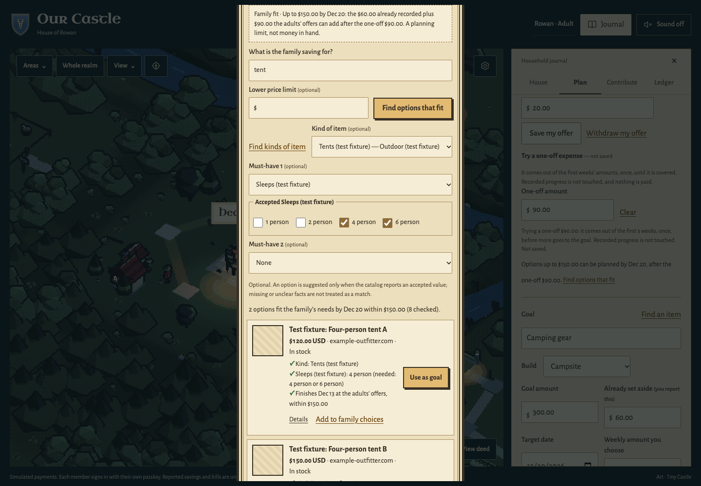 | 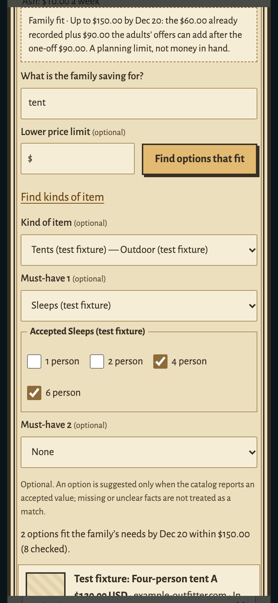 | 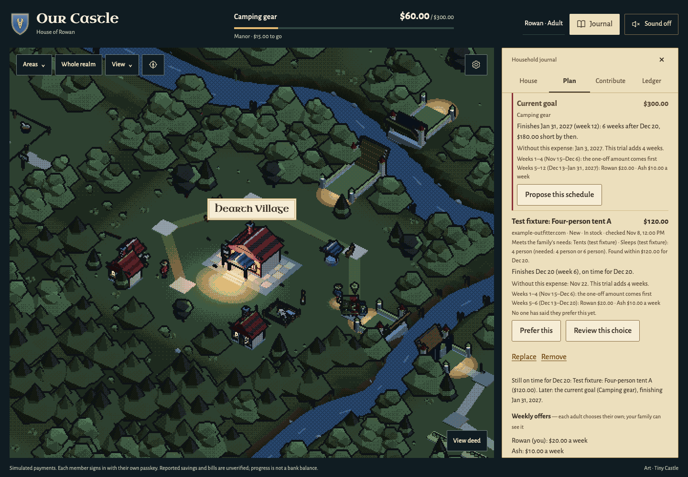 |

| The plan in use keeps the reason, desktop | The same on a 390 px phone |
| --- | --- |
| 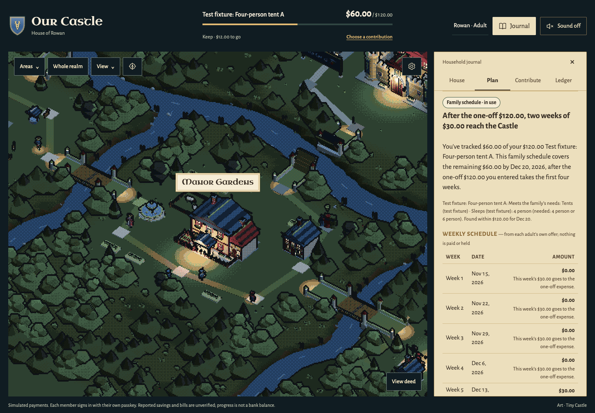 | 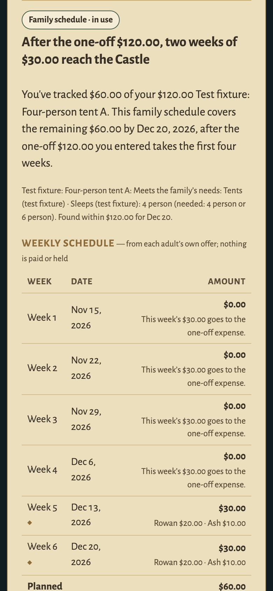 |

The captures are from the passing `@release` journey on `1ecde49`, using an invented fixture taxonomy and products over a fake Channel3 transport. Provenance, step notes and hashes, with every listed source verified against `1ecde49`, are in [family-fit-sources.json](screenshots/family-fit-sources.json).

**Evidence:** kept local and ignored, in `test-results/family-fit-search-20261108/`. It holds:
- the gap demonstration log;
- the development and final logs, with the commands;
- the raw captures with `SHA256SUMS.txt`;
- the schema-10 snapshot rehearsal output.
## Family schedule: the reviewed expense and each adult's share, saved and used — November 8, 2026

Branch `claude/family-choice-schedule`, from the reviewed PR #54 head `d0d2dda`. That head is still unmerged, stacked on PR #53 → #52 → #51 → #50 → #49. The commits are:
- `4752432`: the failing reproduction;
- `f55e1ba`: the implementation and its tests;
- the commit after it: these screenshots and this note.

The owner authorized this follow-through. It is a planning aid. No person has used it, and nothing here shows that families save more.

**The gap, reproduced on `d0d2dda` before any change:**
- **HTTP** (`test/unit/family-schedule.test.mjs` as committed in `4752432`):
  - The reviewed comparison held the one-off $90.00: weeks 1–3 went to the expense.
  - "Review this choice" said the draft allowed for it.
  - After "Save as our goal", the page's plan button and "Use this plan", the accepted weeks were `[1500, 1500, 1500, 1500, 1500, 1500]` instead of `[0, 0, 0, 3000, 3000, 3000]`.
- **Browser probe** (desktop and 390 px phone) of the same steps: $15.00 in each of the six weeks, and a next step of $15.00 on Nov 15, a week the comparison had given to the expense.

**What a family can do now:**
- **Preview.** "Review this choice" still fills the unsaved goal draft. It also lists the weeks it would propose: dates, the goal amount, the part each week gives to the one-off expense, and each adult's share. Typing a trial or reviewing writes nothing.
- **Propose.** **Save goal and propose this schedule** sends only the one-off amount and the preview's revision.
  - In one transaction, the server saves the goal through the existing goal save, recomputes every figure from its own records and stores the schedule as a proposal.
  - Any differing figure refuses the whole request, so the goal is never saved without its proposal or the other way round. An edited amount, date, weekly amount or starting report is one such figure.
  - The plain **Save as our goal** is unchanged and proposes nothing.
- **Use.** The existing **Use this plan** puts it in use. Before that it is refused, with the change named, when any of these changed: an adult's offer, a removed adult, the source choice's price after an explicit check, the goal, progress or the day.
- **Propose later.** **Propose this schedule** on the current goal makes a new proposal without changing the goal. Any one-off amount must be entered again, and an accepted schedule stays in use until another is accepted.

**Reused, not rewritten:** the next planned contribution (`planNextStep`) already skipped $0 weeks, and the Treasury already summed the accepted plan's dated amounts. Both now read the stored family weeks:
- the next positive contribution is week 4, Dec 6, $30.00;
- the Treasury plans $0.00 in an expense week and $30.00 in the week of Dec 6;
- plan milestones follow the stored amounts (the Keep on Dec 6, the Castle on Dec 20).

**Arithmetic:** `familySchedule` in `src/core/family-choices.js`. It is pure, works in whole cents and is shared with the page. It reuses the comparison's earliest-finish weeks and its proportional cent-remainder split.
- **Rows:** one per week up to the goal's date, at most 52.
- **Each week:**
  - the goal amount is at or below both the household's weekly amount and the sum of active adults' own offers;
  - no share exceeds that adult's offer;
  - the final week takes exactly what remains.
- **The one-off expense:** taken once, from the earliest weeks. It never comes out of tracked progress and is never repeated.
- **The task's example** (test data: Nov 8; $60.00 tracked; a $150.00 item; $30.00 a week; $20.00 + $10.00 offers; a $90.00 one-off; Dec 20):
  - weeks `[0, 0, 0, 3000, 3000, 3000]`, with shares `[0, 0]` for weeks 1–3 and `[2000, 1000]` for weeks 4–6;
  - $90.00 in all, finishing Dec 20.
- **The $180.00 item at Dec 20:** $30.00 short. Its review offers Dec 27, the earliest finish at the same offers, only as a draft the adult saves explicitly. No offer is raised.
- **Nothing to schedule** is refused plainly: no offers, a $0 household amount, a goal already reached, a date under a week away, or a one-off taking every week.

**Data and access:**
- **Storage:** no migration and no new table. A family schedule is an ordinary `plans` row with `source = 'rules'` (deterministic, no AI) and `plan_json.kind = 'family'`.
  - `plan_json.family`: every dated week, the shares, the offers and the one-off amount.
  - `basis_json.family`: the offers and source-choice price it rests on.
  - Existing AI, built-in and household-edited plans, their labels and the untrusted AI plan schema are unchanged. A family schedule is not edited week by week (`409 family_schedule_fixed`).
- **Routes:**
  - `POST /api/merchant/goal` gains an optional `schedule` object.
  - One new route, `POST /api/plans/family`, is adult-only in the fail-closed policy.
  - Session scope, CSRF, origin checks and the access recheck are unchanged.

**Checks on `f55e1ba`:**
- **Reproduction first:** on `d0d2dda` the HTTP test failed (1 test, 1 failure, with actual weeks `[1500 ×6]`). The browser probe failed on desktop and phone (2 failures, $15.00 in every week).
- **`test/unit/family-choices-core.test.mjs`** (16 tests, 6 new). Literal expectations for:
  - the example's dated rows: goal amounts, the expense's share of each week, and each adult's share;
  - the $180.00 item, $30.00 short with Dec 27 as its earliest finish;
  - a partly covered week, and a final $20.00 week split $13.33 + $6.67;
  - a household amount below the offers;
  - the 52-week limit;
  - every nothing-to-schedule outcome;
  - the dated lines the page shows.
- **`test/unit/family-schedule.test.mjs`** (6 HTTP tests, family mode with a fake Channel3 transport, plus one in example mode):
  - the reproduction, now passing through propose and accept, with every member reading the same weeks;
  - every money table compared row by row, and only the existing goal save's deeds;
  - the ordinary built-in plan still `[1500 ×6]`, leaving the accepted family schedule in use;
  - a reload and clock advances to Nov 15 and Dec 1: the stored plan row stays byte-identical, the Treasury plans $0.00 then $30.00, and a $30.00 contribution moves the next step to week 5;
  - child, foreign-family, impersonation, signed-out, CSRF, expired-session and invalid-amount refusals, with nothing written;
  - a refused combined save undone whole: an edited amount or date, or a different one-off amount;
  - refusals at "Use this plan" after a price check, an offer change, a removed adult, a goal edit or a contribution;
  - the nothing-to-schedule refusals, and the $180.00 choice.
- **Unit runs:** the 16 new and affected unit files passed 160/160 on Node 22.16.0 and 26.0.0.
- **`test/e2e/family-schedule.spec.mjs`** (`@release`), desktop and 390 px phone: 2/2 passed. Two adults and a child each use their own passkey context.
  - The existing shortlist, offers and $90.00 trial, with no request while typing.
  - The preview, including that an edited amount disables the combined action.
  - "Save goal and propose this schedule", the proposal arriving live on the other adult's page, and the child unable to use it.
  - "Use this plan": a suggested contribution of $30.00 and a next step of Dec 6.
  - The same weeks after a reload, and on Ash's page after the server day moves to Nov 15 (Treasury $0.00) and Dec 1 (Treasury $30.00).
  - A later proposal with no one-off amount.
  - Throughout: one provider call (the search); no payment, steward, model or ordinary-plan request; every money row unchanged.
- **Affected existing browser specs** (`channel3-merchant`, `connected-journey`, `family-choices`, `family-journey`, `plan-check`, `journey`, `shared-live`), desktop and phone: 91 passed, 9 designed viewport skips, 0 failed, on exactly the source of `f55e1ba`.
- **Guard:** `npm run check` passed: 47 copied art/runtime files, the original 90-colour palette, the renderer wiring and syntax.
- **Isolation:** every check used disposable in-memory data, empty synthetic configuration and the historical preload whose limits are now recorded in the [isolation correction](#transport-isolation-correction--november-9-2026).
- **Hosted:** one Release checks run is required on the final PR head. Its actual result is recorded in the PR, so no docs-only run is needed.

**Limits:**
- **Offers:** a family-visible planning ceiling an adult chose, not a promise, income, a held balance, a mandate or a PayPal approval. Each contribution still needs an adult's approval.
- **The one-off expense:** a planning assumption. The app does not know whether it was paid and never assumes so. An accepted schedule keeps its dates; a later proposal needs the amount entered again.
- **Ordinary plans:** built-in and AI plans still spread contributions and include no one-off amount. Choosing one later replaces nothing until it is used.
- **Prices:** Channel3 catalog prices as last checked. Tax and shipping are extra.
- **Scope:** fake providers, simulated payments, virtual passkeys and disposable data only. This is not human, device or real-provider evidence.

| Preview in the goal draft | Family schedule in use | Treasury a week later |
| --- | --- | --- |
| 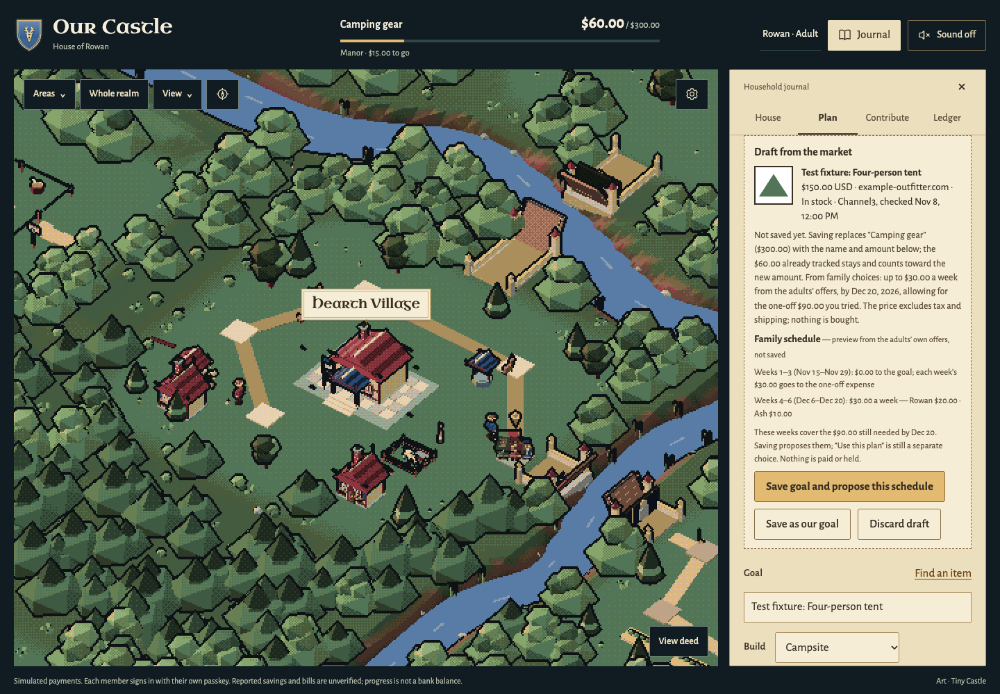 | 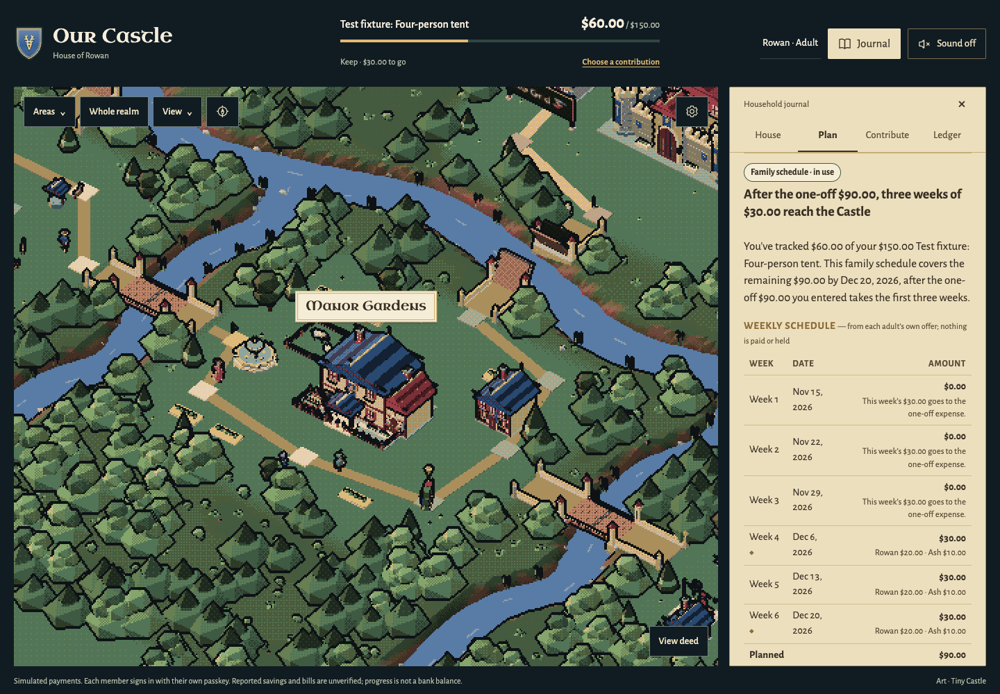 | 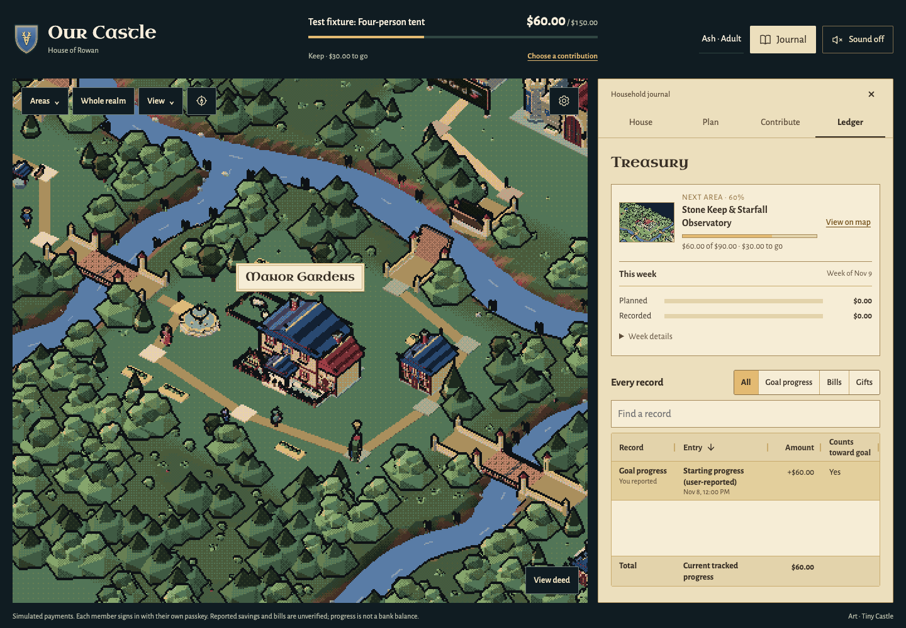 |

| Preview, 390 px phone | In use, 390 px phone |
| --- | --- |
| 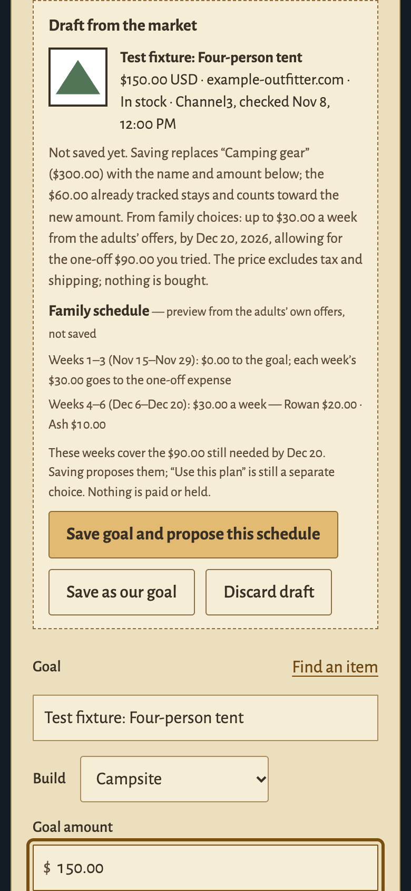 | 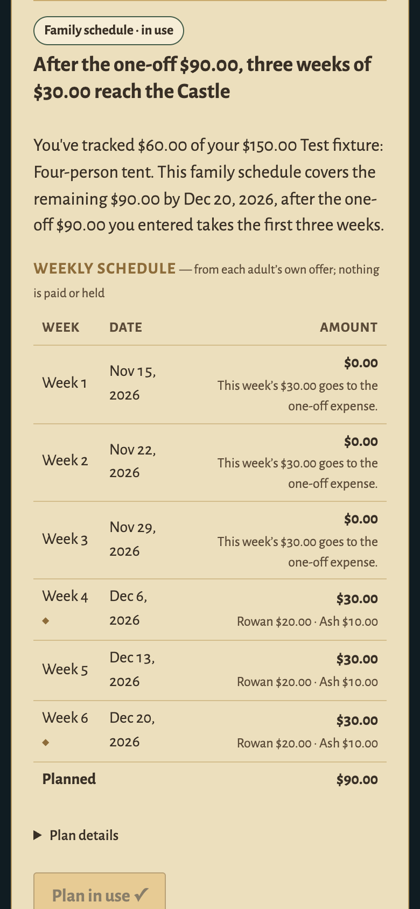 |

The captures are from the passing `@release` journey on `f55e1ba`, using invented tents over a fake Channel3 transport. Provenance, step notes and hashes, with every listed source verified against `f55e1ba`, are in [family-schedule-sources.json](screenshots/family-schedule-sources.json).

**Evidence:** kept local and ignored, in `test-results/family-choice-schedule-20261108/`. It holds the red reproduction logs and probe, the development and final logs, the raw captures with `SHA256SUMS.txt` and the commands.

## Family choices completion: visible expense tradeoffs — November 8, 2026

Codex completed the interrupted family-choice feature in a separate branch, from Claude's implementation 9f75440. The completed implementation is 53b2d49; PR #53 at 7329b8f remains the exact unmerged base. Claude's source checkout and usage-limit prompt were left untouched.

The existing comparison now keeps the finish date without the one-off expense beside the revised result. For the $150 example, it says: “Without this expense: Nov 29. This trial adds 3 weeks.” An amount above $100,000 is marked invalid, keeps the last valid preview and blocks review until corrected. The browser regression failed before this correction and passes afterwards. A second controlled browser regression reproduced an older review reopening the draft after an invalid edit; editing or clearing the trial now cancels that in-flight review.

**Final focused checks on the content committed as 53b2d49:**
- 16 unit/HTTP tests pass on Node 22.16.0 and 26.0.0: ten pure arithmetic/text cases and six family HTTP/migration cases. The route-policy consistency assertions also pass.
- The two-adult-and-child browser journey passes on desktop 1440×1000 and emulated phone 390×844: 2 passed, 0 failed, 0 skipped. It covers shared choices/offers/preferences, the $90 trial, the invalid-amount recovery, before/after text, cancelled in-flight review, stale review refusal, explicit goal save and reload.
- The original-art, palette, renderer and syntax guard passes. No full local browser suite was repeated.
- Every new app check used disposable in-memory family records and fake providers, with empty synthetic configuration and non-loopback transport denied. Comparing and typing made no requests; no payment/refund/model record changed from planning actions.
- One hosted Release checks run is required on the final PR head; its actual result is recorded in the PR, avoiding a docs-only CI rerun.

The screenshots below were refreshed from this passing journey. Their provenance records the capture-time working-tree head and verifies every changed source file against 53b2d49; no claim is made that this later commit already existed at capture time.

Local ignored evidence: test-results/family-choice-finish-20261108/ (red/green logs, hermetic test configuration and transport guard), plus test-results/family-buying-plan/ (four raw captures). [Product walkthrough and research](FAMILY-CHOICES.md).

## Family choices: offers, preferences and a one-off trial — November 8, 2026

Branch `claude/family-buying-plan`, from the reviewed PR #53 head `7329b8f` (still unmerged: PR #53 → #52 → #51 → #50 → #49). The feature and its tests are `9f75440`; the screenshots and this note follow it.

The owner authorized this direction. It is a planning aid, not evidence that families decide better or save more. No human playtest has been recorded for this feature.

**What a family can do** (Plan → Family choices; Market Town → Add to family choices):
- **Shortlist:** an adult saves up to three Market Town results.
  - The server copies its own shown draft: price, currency, retailer, condition, variant and check time. The page sends only references.
  - The same item again refreshes its line, and a full list needs an explicit replacement.
- **Offers:** each adult saves or withdraws only their own weekly amount, which the family can see. It is a ceiling that adult chose, not income, a balance or anyone else's consent.
- **Preferences:** every member, child or adult, holds one preference and can change or remove it. It is not an approval.
- **Comparison:** the current goal and each choice, with:
  - total price and earliest finish;
  - fit with the goal's date, or the shortfall by then;
  - each adult's weekly share and who prefers it.

  Feasibility and preference are separate facts, and nothing is ranked.
- **One-off trial:** an adult types an amount, and it comes out of the first weeks' amounts once, until covered. It stays on the page only: no request, no saved record, and recorded progress is untouched.
- **Review this choice:**
  - The server re-checks the comparison revision and the item's live draft, and recomputes with the trial amount.
  - It then fills the existing unsaved goal draft with the price, the weekly amount the offers allow, and a date: the goal's date, or the earliest finish if the choice is late.
  - Only **Save as our goal** changes the goal, and it verifies the same revision again.

**Arithmetic** (`src/core/family-choices.js`: pure, whole cents, shared by the server and the page):
- **Weekly capacity:** the lower of the household's weekly amount and the sum of active adult offers. The two are never added together.
- **Earliest finish at those ceilings:**
  - every week's full open amount goes to the choice, and the last week takes exactly what remains;
  - week 1 is seven days after today, and the existing 52-week limit holds.
- **Weekly split:** each week is split in proportion to the offers. Each adult first gets the whole-cent floor of their share, and leftover cents go to the largest remainders, ties to the earlier member. It is a rounding rule, not a judgement of fairness, and no share exceeds its offer.
- **One-off amount:** it comes out of capacity once, from the earliest weeks. It never comes out of recorded progress, never counts as a refund, and is never taken weekly.
- **The task's example (test data):** Nov 8, $60.00 tracked, $30.00 a week, offers of $20.00 and $10.00, and items at $120/$150/$180, with a Dec 20 date (week 6).
  - The items finish Nov 22, Nov 29 and Dec 6.
  - With a one-off $90.00 they finish in weeks 5, 6 and 7 (Dec 13, Dec 20, Dec 27), and the $180 item is $30.00 short.

**Data and access:**
- **Storage:** migration step 9 adds `family_choices`, `family_offers` and `family_preferences`, keyed to goal and member. Removing a choice removes its preferences.
- **Routes:** eight new routes, all in the fail-closed policy. Adults change choices, check prices, review, and save their own offer; any member sets their own preference.
- **Who acts:** the session's member. In example mode it is the labelled persona, which must be a member of the household.
- **Removed members:** their offers and preferences stop counting.
- **Review:** read-only, so it does not move the live revision.

**Inherited checks on `9f75440`, before the Codex completion above:**
- **`test/unit/family-choices-core.test.mjs` (8 tests):** literal example cents and dates; splits, including every total from 0 to 300 cents; zero capacity; the 52-week limit; a passed date; an uncovered one-off amount; inputs left unchanged.
- **`test/unit/family-choices.test.mjs` (6 tests):** real HTTP in family mode with a fake Channel3 transport, plus a disposable migration.
  - Own offers and own preferences, child refusals and impersonation.
  - A full shortlist and its replacement.
  - Invalid, foreign, stale and signed-out requests.
  - Draft expiry and the explicit price check, and revision checks at review and at save.
  - A removed member and example personas.
  - Schema 8 → 9 with every earlier row kept.
- **Existing tests:** changed only where the new tables require it (the access-upgrade table list and the migration sequence names).
- **Unit runs:** the new and affected unit files (14 files) passed 121/121 on Node 22.16.0 and 26.0.0.
- **`test/e2e/family-choices.spec.mjs` (`@release`), desktop and 390 px phone:** 2/2 passed. Two adults and a child each use their own passkey context.
  - Shortlist of three and offers of $20 + $10, arriving live, plus preference changes.
  - The $90 trial with zero requests and unchanged money, plan and goal records.
  - A review, then a refusal of the stale draft after another adult changes their offer, a fresh review, the explicit save and a reload.
  - One provider call (the search), and no payment, plan, steward or entry write.
- **Affected existing browser specs** (`channel3-merchant`, `plan-check`, `goal-projects`, `keeper`, `connected-journey`, `shared-live`): 65 passed, plus 7 designed viewport skips.
  - That run preceded two small page edits: the persona switch re-renders family choices, and the trial resets when the member changes.
  - `journey`, `member-avatars` and the new spec then passed on `9f75440`: 35 passed, plus 1 designed skip.
- **Guard:** `npm run check` passed.
- **Runbook:** the snapshot example comes from a real rehearsal on a fresh schema-9 database (23 tables).

**Limits:**
- **Offers:** unverified planning estimates. Bills listed in Plan stay context; nothing checks income or affordability.
- **Progress:** tracked progress is a record, not money to spend or proof an item can be bought.
- **Prices:** Channel3 catalog prices as last checked. The retailer's price and stock may differ, and tax and shipping are extra. A choice checked more than 30 minutes ago, or whose draft has expired, needs an explicit price check before review.
- **Saving a cheaper item:** the existing goal save may record milestones that already-tracked progress reaches under the new amount (an existing rule). A preview, offer or preference grants nothing.
- **Earliest finish:** it assumes each week's full open amount. After saving, the existing planner's own schedule may spread contributions evenly. *(Resolved for a reviewed choice by the family schedule in the section above; ordinary plans still spread contributions and include no one-off amount.)*
- **Scope:** fake providers and disposable data only. This is not human, device or real-provider evidence.

| Three choices, desktop | One-off $90.00, desktop | Three choices, 390 px phone | One-off $90.00, phone |
| --- | --- | --- | --- |
| 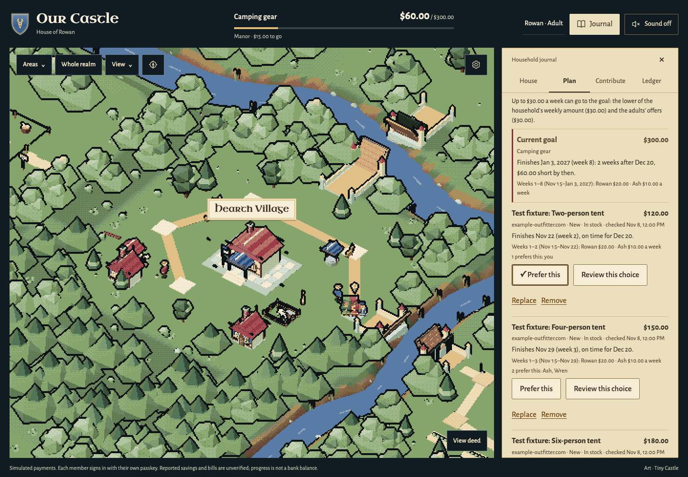 | 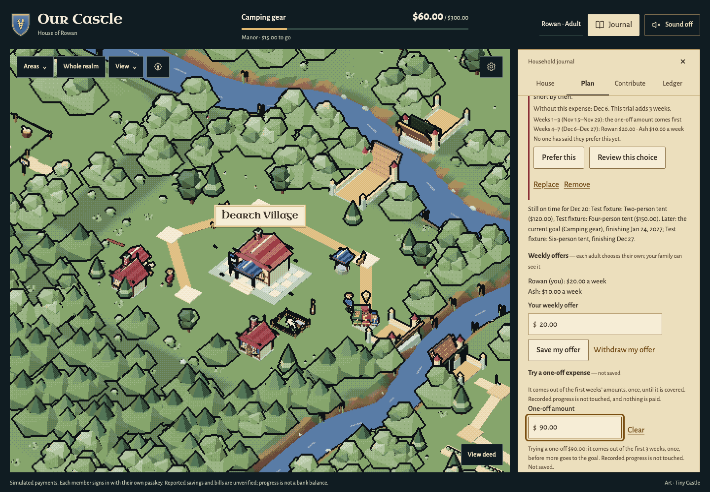 | 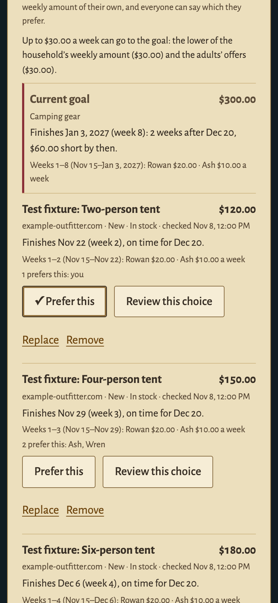 | 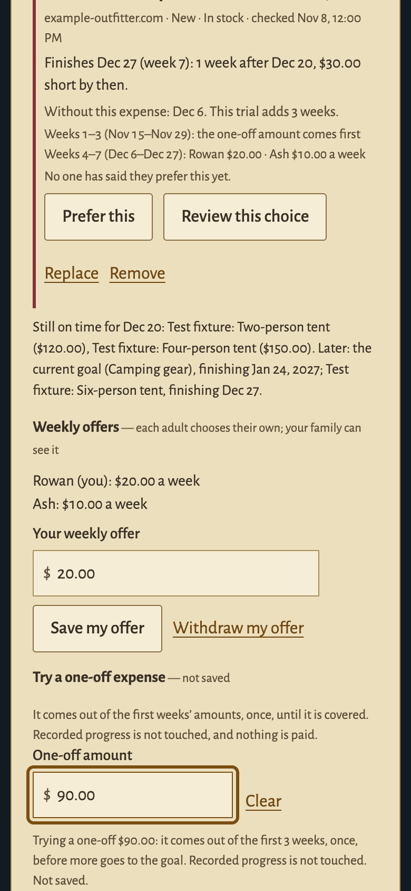 |

The refreshed captures use invented tents over a fake Channel3 transport and include the completion above. Provenance and hashes are in [family-choices-sources.json](screenshots/family-choices-sources.json).

**Evidence:** kept local and ignored, in `test-results/family-buying-plan-20261108/`. It holds the pre-commit and final logs, raw captures with `SHA256SUMS.txt`, the snapshot rehearsal, the HTTP smoke script and the commands.

## Readable contribution receipts — November 8, 2026

Branch `claude/receipt-breakdown`, from the reviewed PR #52 head `ecb6323` (still unmerged: PR #52 → #51 → #50 → #49). The implementation and tests are `a3c47a8`; the screenshots and this note follow it.

This is a feature the owner authorized, not a fix for an observed defect. Whether it helps a family understand a payment is a hypothesis. No person was asked, and nothing here measures understanding or savings.

**What a receipt now says.** The selected Ledger receipt and the Contribute receipt each add one sentence, written by the same function:
- after a $15.00 credit and a completed $5.00 refund: "$10.00 of this contribution counts toward the goal.";
- after a full refund: "All $18.00 was refunded, so none of this contribution counts toward the goal.";
- while pending or awaiting approval: "No contribution has been counted yet.";
- once declined, rejected or failed: "No contribution has been counted.";
- when the records disagree: "How much of this counts can’t be shown from the saved records."

The existing Payment details disclosure gains the recorded contribution, the completed refunds and the amount that counts toward the goal. Below them come the dated saved records:
- the order recorded, with its approver;
- each credit;
- each refund: recorded, pending, or not subtracted;
- the latest saved PayPal check, marked "before the later refund" when a refund followed it.

**What stayed the same.** The original amount, source badge, status, saved-check line, earlier checks, ids and actions are unchanged. There is no new panel, button, column, endpoint, schema, provider call or dependency.

**Source of truth** (`src/core/contribution-story.js`, pure):
- **What counts:** only ledger rows with the exact reference the server writes. That is `paypal-capture:` and `paypal-refund:`, or the `simulated-` pair. Each row must match in kind, direction, amount and currency, with exactly one row per credited capture or applied refund.
- **What never counts:** an uncredited capture, a pending or unapplied refund, reported starting progress, bills, gifts and other contributions. Each refund is subtracted once, from its reversal row.
- **No number, breakdown or timeline** in any of these cases:
  - another household, goal or currency;
  - a missing, duplicated or mismatched row;
  - a capture whose refunded total differs from its reversal rows;
  - a settled status without a credit, or a credit under an unsettled status.
- **Dates:** only from the order's creation, the ledger rows, a refund's own record and the saved check. They never come from the order's last update or from the time the receipt is opened.

**Design.**
- **Kept:** the existing receipt layout, parchment, ink, font and quiet status colors.
- **Borrowed from `task-014-design-research.json`, structure only:** PayPal's refunded-transaction hierarchy (original amount, refund and net kept apart) and Open Collective's labelled rows.
- **Behavior:** nothing opens by itself. A same-record live refresh keeps the disclosure open and its summary focused. That state is held in memory only, so a reload starts closed.

| Partial refund, desktop | Partial refund, 390 px phone | Pending, phone | Completed, desktop |
| --- | --- | --- | --- |
| 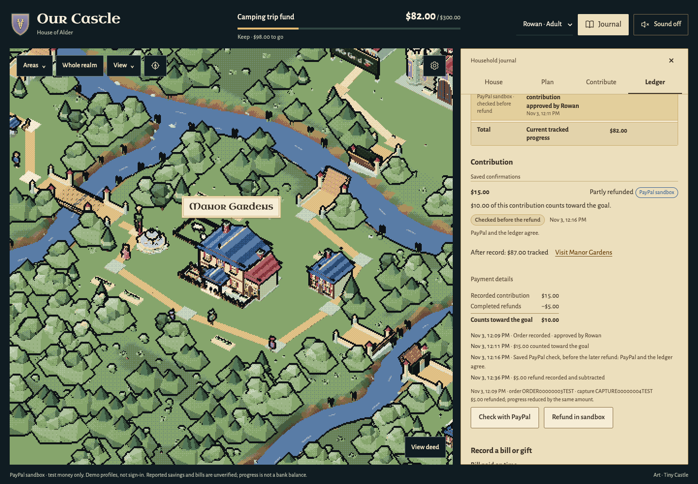 | 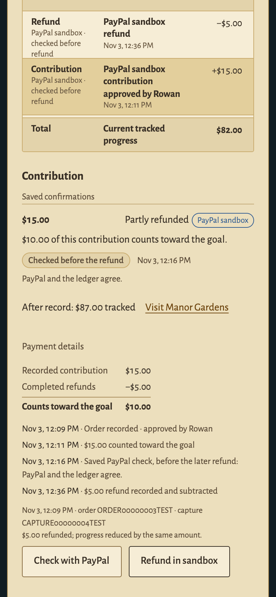 | 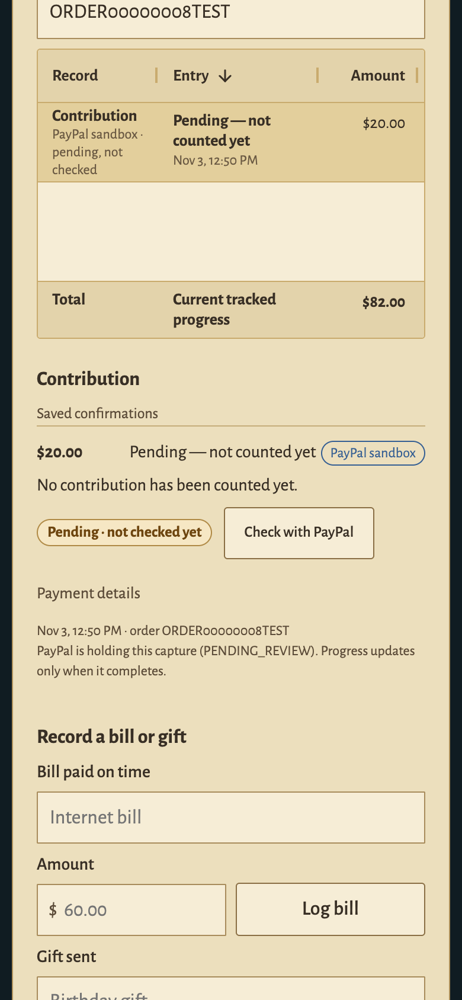 | 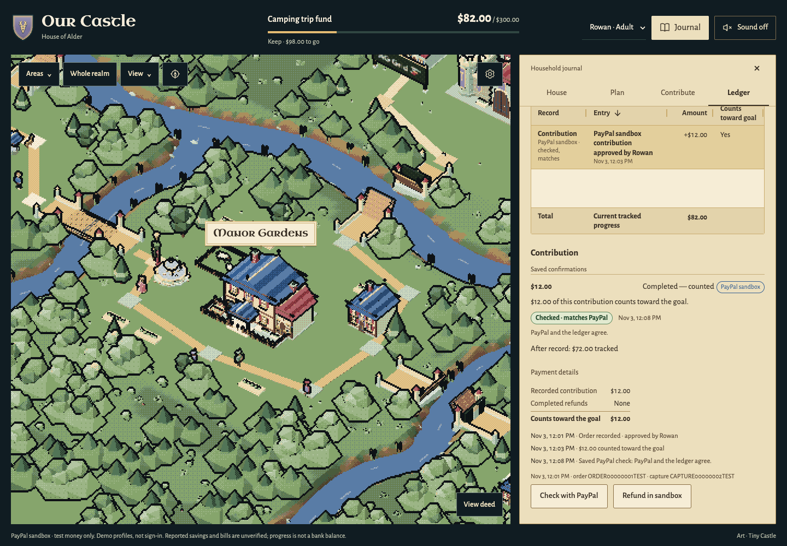 |

The captures come from a disposable fake-PayPal sandbox fixture, with no real transaction. Provenance, source hashes and image hashes are in [receipt-breakdown-sources.json](screenshots/receipt-breakdown-sources.json).

**Checks on `a3c47a8`:**
- **`test/unit/contribution-story.test.mjs`:** 8 tests, with literal expected cents. With the existing ledger-trail tests, 11/11 passed on Node 22.16.0 and 26.0.0. They cover:
  - completed and never-credited contributions;
  - a $15.00 − $5.00 = $10.00 partial refund, a full refund and a pending refund;
  - simulated records, exact identity and scope;
  - 25 malformed or conflicting inputs;
  - history times, including a check saved before a refund;
  - inputs left unchanged.
- **The projection over real service output** (fake sandbox):

  | Story | Recorded / refunded / counts (cents) |
  | --- | --- |
  | Completed | 1500 / 0 / 1500 |
  | Partial refund | 1500 / 500 / 1000 |
  | Full refund | 1500 / 1500 / 0 |
  | Pending refund | 1500 / 0 / 1500 |
  | Pending | nothing counted |
  | Declined | nothing counted |
- **`test/e2e/receipt-breakdown.spec.mjs`, desktop 1440 px and phone 390 px:** 8/8 passed. It covers:
  - the four stories, with each history line's time matching its saved record;
  - choosing and opening four receipts, which made zero requests, provider calls, writes or storage changes;
  - a reload;
  - the plain table when Grid and Studio never load, where a late load leaves the open receipt alone;
  - the Contribute and Ledger receipts agreeing before and after a refund;
  - another adult's refund updating the owner's open receipt live, with the disclosure still open and focused and no write from the owner's page.
- **Affected existing browser specs** (`payment-recheck`, `treasury-status`, `treasury`, `journey`, `earned-realm`), both viewports: 58 passed, plus 2 designed desktop-only skips.
- **`npm run check`:** passed.

**Limits:**
- **Scope:** emulated Chromium, fake providers and disposable data only. This is not real-PayPal, physical-device, accessibility-audit or human evidence.
- **Not shown:** the records carry no time for a pending capture, so none is shown. Earlier saved checks stay in their existing list.
- **Unchanged association:** `ledgerTrail` still links a row to its contribution by an id suffix. The numbers themselves use exact identities.

**Evidence:** kept local and ignored, in `test-results/receipt-breakdown-20261108/`. It holds logs, raw captures with `SHA256SUMS.txt`, the real-service output and the commands.

## Two app servers on one database — November 8, 2026

Branch `claude/two-server-payment-races`, from the reviewed PR #51 head `5aa58ee` (still unmerged: PR #51 → #50 → #49). Harness and schedules: `d7dd30b`. Late-refusal regression and fix: `d309e58`.

**The gap.** The seeded payment model is sequential and runs in one process, and the restart proof kills one child. Within one process, concurrent captures of an order join one in-flight provider call. Two servers on one database do not share that: each sends its own capture with the same PayPal-Request-Id, and both commit through SQLite (`BEGIN IMMEDIATE`, WAL, 3 s busy timeout).

**The harness** (`test/unit/payment-two-servers.test.mjs`):
- **Processes:** two test-owned processes of the existing `payment-app-child.mjs` share one fresh disposable SQLite file. Each runs the real server, payment service and SDK transport with an empty environment, explicit fake credentials and non-loopback dispatch refused.
- **Fake PayPal:** the stateful fake runs in the parent on loopback and outlives the servers. Every start made zero provider requests (22 starts per run).
- **Shared helper:** `startApp` and `end` moved unchanged to `test/helpers/payment-app-process.mjs`. The restart file imports them, and its startup-cleanup regression still passes.
- **Controlled windows (no sleeps):**
  - a provider answer held at the fake, or lost as a 503 after the fake acted;
  - the SQLite write lock held by the harness until both servers announce their write transaction (an opt-in child trace, written synchronously to stderr) and nothing has committed;
  - SIGKILL of one owned server while the other serves.
- **Oracle:** a small integer-and-identity model in the test, never production helpers. Ledger rows with their source refs, captures, refunds, held refunds, deeds, order status and webhook events are read directly through a read-only connection, and every result must be an array of complete rows.

**14 schedules:**

| Schedules | Window | Result |
| --- | --- | --- |
| S1–S3 | A's and B's captures of one order both held at the fake. Released B first (S1), A first (S2), or both under the write lock with SQLite choosing (S3) | 2 attempts, 1 request id, 1 provider capture, 1 credit |
| S4–S5 | A's capture answer is lost (503) after PayPal captured, before (S4) or after (S5) B captures | 1 credit; the order ends completed and is never reopened |
| S6–S7 | A's capture is refused (not approved, or declined) and the refusal is held; B's attempt with the same key captures | **Counterexample**, below |
| S8 | One completion event to both servers: signature checks held, then released under the write lock; then A's capture answer | 1 credit, 1 event row |
| S9 | A dashboard refund's event reaches B before A's capture answer | Held, then applied with the credit in one transaction: net $60.00, no deed |
| S10–S11 | A stale order read (A) and a stale completion (B), held across a refund | Nothing changes; the Manor deed is kept |
| S12 | Both servers refund one capture; both attempts held, then released under the write lock | 2 attempts, 1 key, 1 provider refund, 1 reversal |
| S13–S14 | A is killed with its capture answer held, then with its refund answer held; B carries on; A restarts | 1 credit, 1 reversal; the restarted A's retries make no provider request (409 `already_refunded`) |

**Counterexample (S6–S7, reproduced on the unchanged `5aa58ee`).** After B credited $15.00, A's held refusal reopened the order as `created` (not approved) or `declined`, while the credit still counted. A later explicit check did not repair it. Money was unaffected.
- **Why it needs two servers:** within one process, the in-flight map joins both attempts.
- **Assumption:** it relies on the fake's idempotency model, in which a refusal is not stored under the request id, so a later attempt with that key can capture. That is also the assumption behind the app's own "try again" answers.

**Fix (`d309e58`).** One guard in `server/payments/contributions.mjs` (5 lines added, 1 changed): the two refusal branches re-read the canonical status, like the other status writes after a provider call, and answer `already_completed` for a settled order. There is no schema, API, provider or dependency change.

**Local results:**
- **Before the fix** (`server/` at `5aa58ee`; the final test file, except for one HTTP-status assertion added to S8 afterwards): 8 passed; S6 and S7 failed. Five more runs failed the same two only.
- **On the clean `d309e58`, Node 22.16.0 and 26.0.0:**
  - the new file: 10/10, and 10/10 in each of 5 repeats;
  - `payment-restart`, `payments` and `paypal-cancel-status`: 52 tests, 51 passed, 1 designed skip;
  - `npm run check`: passed.
- **Commit races:** S3 and S12 went to A on both versions; S8 went to A on 22.16.0 and to B on 26.0.0. Every ordering satisfied the oracle.
- **Cleanup, on success and on deliberate failure:**
  - all 22 owned servers ended: SIGKILL by their own handle, and a signal-0 probe gets ESRCH;
  - held answers are destroyed and no sockets stay open;
  - the fake is closed and no lock stays open.

**Limits:**
- **Not exercised:** windows inside one synchronous step (between two SQLite statements) cannot be held from outside. The guarded status writes, the new one included, still read and then write in two statements.
- **Scope:** fake providers and disposable data only. This is not deterministic simulation, load, power-loss, real-PayPal, or human or device evidence.
- **Harness fix:** a cleanup race in the harness's own socket check was found and fixed during development; its raw log is kept.

**Evidence:** kept local and ignored, in `test-results/two-server-races-20261108/`. It holds the before-fix runs and the persistence probe, the `final-d309e58` logs, per-scenario JSON traces, the repeats and the exact commands.

## Malformed contribution ids get a 4xx — November 8, 2026

Branch `claude/contribution-input-validation`, from the reviewed PR #50 head `59ad514`; the fix is `32e1155`. Task 010 had seen `POST /api/example/contributions` answer HTTP 500 when `householdId` and `goalId` were missing.

**Reproduced first, on the unchanged `59ad514`.** A disposable example server (no keys, no `.env`, non-loopback fetches refused) received a 12-case malformed matrix:
- **9 answered 500:** a missing, `null` or non-text household or goal id, and a missing or non-text request id.
- **Nothing was recorded** in any case.
- **The cause:** each request reached SQLite with an id it cannot bind, in `getHousehold`, `getGoal`, or the retry lookup `orderByRequestId`, which runs before `validateRequest`.
- **Same failure elsewhere:** new HTTP regressions failed the same way on the sandbox order route and, for a missing request id, in family mode.

**The fix**, in `server/payments/contributions.mjs`:
- **Household and goal:** `validateRequest` refuses a non-text household or goal id with 400 `invalid_owner`.
- **Request id:** both creation methods check the request id's type before the retry lookup, giving the existing 400 `invalid_request_id`.

**Not changed:**
- no id is defaulted or inferred;
- `owner()`, family scoping and the spoofing and child refusals are untouched;
- an empty id still gets the existing 404;
- a malformed retry of a known request is still `request_conflict`;
- approval, adult, amount and request-id format checks are as before.

| Check | Actual result |
| --- | --- |
| The same matrix at `32e1155` | Every former 500 is a 400 with a code; the empty id and approver answers are unchanged; nothing was recorded. The well-formed control credits once and its retry is `already_processed`. Unexpected-error log lines: 9 before, 0 after |
| The new regressions before the fix (`server.test.mjs` ×2, `family-access.test.mjs` ×1) | All 3 failed on `[500, 'server_error']` |
| `server.test.mjs`, `family-access.test.mjs`, `payments.test.mjs` and `failure-diagnostics.test.mjs`, on the tree committed unchanged as `32e1155`, Node 22.16.0 and 26.0.0 | **68 passed, 1 existing skip** (the SDK manages its own OAuth token), 0 failed on each |
| `npm run check` | Passed |

What the regressions cover:
- **Example persona:** the matrix records nothing, a well-formed contribution counts once, and a malformed retry is a conflict.
- **Sandbox:** malformed orders reach no PayPal request, not even OAuth.
- **Family:** a missing or non-text request id is refused, while a body with no ids still succeeds from the session and counts once.

These are fake providers and disposable data, not production evidence. The hosted result is reported on the pull request. Raw evidence is ignored and stays local in `test-results/contribution-input-20261108/`:
- the request and row results: `before-59ad514.*` and `after-32e1155.*`;
- the server logs;
- the failing and passing test logs;
- `repro-stacks-59ad514.log`, which records the failing statements;
- the scripts.

## The castle keeper's tour — November 8, 2026

Branch `claude/keeper-walkthrough`, from the reviewed PR #49 head `fd49188`; the implementation is `678d9df`. [The castle keeper](KEEPER-GUIDE.md) is an optional authored tour of the example demo, in a bottom dialogue box. Its decision ledger, copy and limits are in that note. It adds no dependency, server, API or database change, model call or credential step. The crest rendering, the art and the portrait bytes are unchanged.

| Local check, at `678d9df` | Actual result |
| --- | --- |
| `test/e2e/keeper.spec.mjs`, desktop and 390 px phone, from a fresh copy with a new example database and tracing off | **10 passed** (5 scenarios × 2 viewports), 0 failed. The scenarios cover the whole tour over a pre-approved form, with no write or outside request and with drafts, amount, approval and progress unchanged; keys and reduced motion; `?tour=1`, Skip and replay; a deed card pausing the keeper; and layout and overlap |
| `test/e2e/family-access.spec.mjs` (families with simulated payments also show the entry) | 5 passed, 5 skipped by the spec's existing desktop/phone split, 0 failed |
| `test/unit/keeper-guide.test.mjs`, Node 22.16.0 and 26.0.0 | 2 passed on each |
| `npm run check` | Passed: 47 copied art/runtime files, the original 90-color palette, the renderer wiring and JavaScript syntax |

The first runs exposed two mistakes in my test setup, not in the keeper:
- **Founding moves the journal:** founding a house moves the journal on to Plan, so the helper now returns to House.
- **A scroll race:** on a phone, a measurement raced the keeper's own smooth scroll, so the layout scenario now uses reduced motion. A direct measurement showed every Contribute control 8 px clear of the docked keeper.

The screenshots and their hashes are in [keeper-sources.json](screenshots/keeper-sources.json). They are automated Chromium captures with phone emulation; there has been no human playtest, physical phone or screen-reader session. The hosted result is reported on the pull request. Raw evidence is ignored and stays local in `test-results/keeper-guide-20261108/`:
- `browser-678d9df.log`, `unit-keeper-node*-678d9df.log` and `check-678d9df.log`;
- the earlier `spec-run-*.log` runs;
- the capture and debug scripts.

## Release integration candidate — November 8, 2026

Branch `claude/release-integration-20261108`, from the reviewed main `579b4f6`, which had not moved. It is a candidate for Codex's final review. Merging it into main, the safe activation of the 3010/3021 apps with backups, and any video are separate steps, and none of them is done here. Neither web submission nor family playtesting is part of this work.

**What merged.** Five normal merges, in this order, each of the exact reviewed head. None had a conflict:

| Merge | Reviewed head | What it adds |
| --- | --- | --- |
| `9ec3f24` | PR #47 `3294e2c` | The seeded payment model, with its stack: PR #48 `002d229` (deferred refunds, schema 8), PR #46 `eefae41` (refund ordering), PR #43 `ce3ec65` (restart proof) and PR #40 `e3bc6ff` (the snapshot command) |
| `eba9080` | PR #41 `2d8f3a3` | Reuse of unchanged scene state |
| `65908c6` | PR #42 `4903beb` | Opt-in, default-muted CC0 retro music, with its provenance and notice |
| `b9d01c3` | PR #44 `fe80d5f` | Truthful post-commit failure diagnostics. Git combined `server/app.mjs` (PR #42's `.mp3` MIME entry with PR #44's error handling) and `docs/RUNBOOK.md` (PR #47's snapshot section with PR #44's failure section) automatically |
| `f5e1d38` | PR #45 `d572e3d` | Sourced review research |

Then `18e2578` corrects the runbook's snapshot example. It printed schema 7 and 19 tables. It now shows the real output of the documented rehearsal on this candidate: a throwaway example server with no keys, one simulated contribution through the browser's own API, and the snapshot taken while the server ran. That output is schema 8, 20 tables and 57 pages, and the example says which values vary. The snapshot command and the PR #40 evidence below are unchanged.

**Integrity checks:**
- **Ancestry:** all nine original heads, and main, are ancestors.
- **No hand edits:** every file that only one PR changed is byte-identical to that PR's head.
- **Dependencies:** `package-lock.json` is identical to main. `package.json` adds only PR #40's `snapshot` script. `@paypal/paypal-server-sdk` stays pinned at 2.5.0.
- **Assets:** the only asset changes are PR #42's three music files.

| Local check | Actual result |
| --- | --- |
| `npm run check` | Passed: 47 copied art/runtime files, the original 90-color palette, the renderer wiring and JavaScript syntax |
| `git diff --check` against main | Clean |
| The app-level integration points on Node 22.16.0 and 26.0.0: PR #44's diagnostics and the restart proof, which runs the real app with PR #44's handler | **7 passed on each.** One of them checks that "an error after a committed contribution does not tell the family that no payment was credited" |
| Browser, at `18e2578`: scene lifecycle (PR #41) and music (PR #42), desktop and 390 px phone, run from a fresh copy with a new example database and tracing off | **12 passed, 4 designed skips** (the scene-lifecycle tests run on desktop only), 0 failed. The music spec's own `@release` test confirms the music is opt-in and opens silent again after a reload |

**Not rerun locally:**
- **Payment units:** the payment-model, refund-ordering and deferred-refund tests depend only on files that are byte-identical to the reviewed PR #47 head, and no other PR touches them. The hosted full unit run covers them, with the browser `@release` selection.
- **Where the hosted result goes:** it is reported on the pull request, to avoid a docs-only CI loop.

**An observation, not changed.** A hand-written request to `POST /api/example/contributions` without `householdId` and `goalId` gets HTTP 500 instead of a refusal:
- **Pre-existing:** the same happens on main `579b4f6`.
- **No effect:** nothing is committed, and PR #44's message stays truthful.
- **Not reachable from the app:** the app always sends both ids.

This came from the first, malformed rehearsal request.

**Isolation:**
- **Data and providers:** only disposable data and fake providers were used, with explicit empty configuration, no `.env`, and non-loopback fetches refused in the rehearsal server.
- **Owner apps:** the apps on 3010 and 3021 and their data were not touched.
- **External actions:** no provider call, order, login, recording or deployment was made.

Raw evidence is ignored and stays local in `test-results/release-integration-20261108/`:
- `check-f5e1d38.log` and `diff-check-f5e1d38.log`;
- `runbook-snapshot-rehearsal.log`;
- `integration-units-node22.16.0-18e2578.log` and `integration-units-node26.0.0-18e2578.log`;
- `browser-scene-music-18e2578.log`.

## Seeded payment sequences against an independent model — November 7, 2026

Branch `claude/seeded-payment-model` ([PR #47](https://github.com/alejandro-publius/our-castle/pull/47)). It now stacks on Codex's two reviewed fixes for the ordering defects this test found:
- **The stack:** [PR #48](https://github.com/alejandro-publius/our-castle/pull/48) (`codex/refund-before-capture` at `002d229`), on [PR #46](https://github.com/alejandro-publius/our-castle/pull/46) (`codex/refund-delivery-order` at `eefae41`), on PR #43 (`ce3ec65`), on PR #40 (`e3bc6ff`). Main `579b4f6` contains none of them yet.
- **The merges:** `eefae41` and `002d229` came in unchanged, by the normal merges `55b500a` and `6c45c86`.
- **What this branch changes:** only the model test and these docs. The production changes are PR #46's ([refund ordering](REFUND-ORDERING.md)) and PR #48's ([deferred refunds](DEFERRED-REFUNDS.md)).

**What was missing.** The payment tests are named scenarios, each covering one path. Nothing combined captures, retries, lost answers, late webhooks, dashboard refunds and reopening in varied orders, or compared the result with a model of what PayPal holds.

**The method** follows TigerBeetle's [VOPR](https://github.com/tigerbeetle/tigerbeetle/blob/main/docs/internals/vopr.md) at a much smaller scale: a seed fixes every choice, faults are injected on purpose, and separate checks compare the outcome with a model. It is not a deterministic simulator of the whole app.
- **What runs:** the real contribution service on a disposable SQLite file, with the existing stateful fake PayPal. The fake answers every request in memory, and any other fetch is refused. Credentials are synthetic and no `.env` is read.
- **Two client paths:**
  - `rest` is the production REST client (OAuth, `PayPal-Request-Id`, JSON and error mapping) over an in-memory fetch.
  - `sdk` is the production SDK adapter over `fakeSdkControllers`. Those stand in for the SDK's controllers, so **the SDK's own serialization, OAuth and HTTP transport are not exercised here**; `paypal-sdk-transport` and `payment-restart` cover them.
  - Webhook verification goes through the REST client on both paths.
- **Two refund scopes,** both run by CI over the same 24 seeds and both paths:
  - `credited`: dashboard refunds reach only captures credited here;
  - `any`: a refund can also reach a capture that PayPal completed before this server saw the completion. That is the space where all three ordering defects lived.
- **Each seed runs 30–60 actions, with at most 6 orders:**
  - adult-approved orders of 100–2,500 cents;
  - first captures, which PayPal completes or holds, and same-order retries, which PayPal answers with its first answer for the same request id;
  - PayPal completing a held capture, and partial and full dashboard refunds;
  - verified webhooks delivered late, out of order, again, under a new event id, or never;
  - explicit checks of an order;
  - closing and reopening the database and service, then loading the contributions;
  - refusals: no approval, a child approver, an invalid amount, one cent over the goal, an order not created here, another household, and revoked access.
- **Faults:**
  - a capture request that never reaches PayPal, or PayPal's answer lost after it acted, with the read that follows sometimes lost too;
  - a check whose answer is lost;
  - a webhook that fails verification, or whose verification answer is lost.
- **The model** is plain integers and sets. PayPal's side (each order's amount, capture status, first answer and refunds) is kept apart from what the app has been shown:
  - the captures it has been told of;
  - those shown completed;
  - every verified completed refund it has been told of, by id, even before it knew the capture. The app must hold each one durably, as a refund record or as evidence awaiting its capture, and each counts against its capture from the moment that capture is credited;
  - the webhook event ids it has handled.

  It never calls production code or reads the service's answers to predict anything; `progressFor` is only read to observe.
- **The one documented exception:** a capture first seen on an order read that already lists it **fully** refunded, before any completion was shown, is not credited. It nets to zero either way. A later completion credits it and reverses its refunds together. A partially refunded capture is never an exception: its remainder must count.
- **After every action, the app must match the model exactly, in both scopes:**
  - tracked progress;
  - the ledger's credits and reversals, as counts and cents, read with SQL;
  - the credited capture ids and the reversed refund ids;
  - each capture's net and refunded cents;
  - the recorded captures, and the held completed refunds: `payment_refunds` and `deferred_refunds` read together with SQL `UNION`;
  - the local orders.
- **Rules checked on every action:**
  - **A bound that holds whatever the app has seen:** a capture's net credit never exceeds what PayPal verified for it, less the completed refunds of it that the app holds, recorded or awaiting their capture.
  - **Every answer must be the model's.** A completion answers `refunded` when it applies refunds already shown, otherwise `completed`; the documented exception answers `not_credited`; a repeated event id answers `duplicate_event`.
  - **No-dispatch rules:** a retry of an order settled here, a refusal, reopening and loading must not reach PayPal.
- **At the end**, an explicit check of every order, after which the app must agree with PayPal's own record. Only the documented exception may be recorded without a credit, at the same net zero.

**Replay one seed, adapter and scope,** for example `PAYMENT_MODEL_SEED=2 PAYMENT_MODEL_ADAPTER=rest PAYMENT_MODEL_REFUNDS=credited node --test test/unit/payment-model.test.mjs`. Seeds are 1–4294967295, adapters `rest` or `sdk`, and scopes `credited` or `any`; each one left unset runs them all. Invalid input is refused before anything runs.

A failure prints the seed, adapter, scope and source commit, the failing action and its checks, the replay command with its scope, the whole action trace (at most 61 entries) and PayPal's record. A pass prints one summary line per adapter and scope.

The generator consults the model, so a seed's actions depend on the model version as well as the seed: a seed and commit replay exactly.

### The final integrated result, at `2d2f3bd`

This adds PR #48 (`6c45c86`) and one observation change (`2d2f3bd`). The expected held refunds are every verified completed refund delivered, replacing the old rule that counted only refunds whose capture the app already knew. The observer reads both tables, and the bound counts both. Money still waits for the capture's completion, and every other check is unchanged and strict in both scopes.

| Check | Actual result |
| --- | --- |
| The 5 model tests, PR #46's 12 refund-ordering regressions and PR #48's 12 deferred-refund regressions, on Node 22.16.0 and 26.0.0 | **29 passed on each**, with none skipped or failed. The seeded summaries are identical on both versions, and identical to `9396c06`'s: the change is in what is observed, not in the sequences |
| The four-variant directed probe, run once | **Corrected on both paths, for the 500-cent partial and the 1,500-cent full refund.** The refund held before its capture was recorded is applied when the older completion arrives, which answers `refunded`. Tracking shows 7,000 or 6,000 cents, PayPal's own net, with no tier award. The repeated delivery and the explicit check change nothing |
| `npm run check` | Passed: 47 copied art/runtime files, the original 90-color palette, the renderer wiring and JavaScript syntax |
| `git diff --check` | Clean |

The hosted release checks for the exact final head are reported on PR #47.

### With PR #46 only, at `9396c06` (history)

| Check | Actual result |
| --- | --- |
| The model test on Node 22.16.0 and 26.0.0: four seeded runs (two scopes × two paths) and the sensitivity test | **5 passed on each**, with identical summaries. Per path: **`credited`** ran 1,103 actions with 133 injected faults, and PayPal ended with 85 completed and 10 pending captures. **`any`** ran 1,103 actions with 140 faults, and PayPal ended with 86 completed and 7 pending captures; 4 of the completed ones are recorded here without a credit, at net zero (the documented exception). These 24 seeds produced no `refunded` or `not_credited` capture answer; the scan below did |
| PR #46's 12 refund-ordering regressions, on both versions | 12 passed on each |
| The five representative seeds that failed before the fix (159, 2, 71, 181 and 21), `any`, both paths, both versions | **The current model: 20 of 20 passed. The before-fix model** (the `3f86614` test file, which replays their recorded failing sequences exactly) against a scratch copy of this tree, whose service matches `eefae41`: **20 of 20 passed** |
| One bounded scan of seeds 1–200, `any`, `rest` | **200 of 200 passed**: 8,895 actions and 1,103 injected faults. Capture answers matched the model, including 2 `refunded` and 10 `not_credited`. 41 captures in 40 seeds ended recorded without a credit at net zero. The 31 seeds that failed before the fix pass; after the model's first changed decision, their actions differ from the recorded before-fix traces |
| `npm run check` | Passed: 47 copied art/runtime files, the original 90-color palette, the renderer wiring and JavaScript syntax |
| `git diff --check` | Clean |

### The further counterexample, and its resolution in PR #48

**Found with PR #46 only**, at `9396c06` (the reviewed head `5774c0d` changed docs only). A verified refund webhook can arrive before this server has recorded the capture at all. That happens when the capture's answer and the read that follows were both lost.
- **What happened then:**
  - the refund webhook was answered `ignored_unknown_capture` and marked handled, and no refund row was kept, because refund rows need a recorded capture;
  - the older COMPLETED webhook then credited the full amount, and that gross credit awarded the first tier;
  - repeating the refund webhook was a duplicate;
  - only an explicit check applied the refund, and the tier award stayed, because awards are keepsakes.
- **Why the scans missed it:** PR #46's regressions covered refunds of captures already recorded. The 24 fixed seeds and the 200 scanned seeds never generated this exact order of events: both losses, then a refund delivered before any capture evidence, then a completion before any check.

**Resolved by PR #48 (`002d229`), now integrated.** Codex reproduced the four cases independently. Schema 8 holds verified completed refunds that arrive before their capture in `deferred_refunds`: references and amounts only, with no household attribution or progress. Ordinary capture validation then adopts them through the existing refund pipeline, and the credit, reversals and milestone decision share one transaction. PR #48's 12 regressions now exercise the exact prefix the seeds missed.

The directed probe is `test-results/seeded-payments-20261108/integrated/probe-unrecorded-refund.mjs`. It ran on both paths, for a 500-cent partial refund and a 1,500-cent full refund of a 1,500-cent capture, and each run matched the rows below:

| Step | At `9396c06` (PR #46 only) | At `2d2f3bd` (PR #48 integrated) |
| --- | --- | --- |
| 1. Capture: PayPal completes it, and both the answer and the follow-up read are lost | `unknown`; 6,000 | `unknown`; 6,000 |
| 2. Dashboard refund; its verified REFUNDED webhook arrives first | `ignored_unknown_capture`; 6,000; the refund is dropped | `ignored_unknown_capture`; 6,000 |
| 3. The older verified COMPLETED webhook | `completed`; **7,500**, where PayPal nets 7,000 or 6,000; **`tier:1` awarded** | `refunded`; **7,000 or 6,000**, PayPal's net; no tier award |
| 4. The same REFUNDED webhook again | `duplicate_event`; 7,500 | `duplicate_event`; unchanged |
| 5. An explicit check | `refunded`; 7,000 or 6,000; `tier:1` remains | `already_completed`; unchanged; no tier award |

### Before the fix, at `ce3ec65` (history)

The test's first version (`3f86614`) ran only the `credited` scope in CI. It passed there. It compared only money in the wider scope, where it treated any capture first seen refunded as a documented exception.

**Six service mutations,** applied only in a scratch copy of the `ce3ec65` tree and restored with a matching SHA-256:
- **The model test** failed on all six.
- **The 11 named payment test files** (111 passing tests and 1 designed skip unmutated) failed on five. They missed M2, a retry that treats only `completed` as settled and so asks PayPal again for a refunded order; the model reported "a capture of an order settled here asked PayPal".
- **The other five:** crediting a pending capture; ignoring refunds listed on the order; processing an unverified webhook; refusing a refund of exactly the remaining amount; and reporting a lost capture answer as failed.
- **Not repeated:** these comparisons were not repeated after the fix.

**`PAYMENT_MODEL_REFUNDS=any` then found two money divergences:**
- **Fixed seeds:** 44 of 48 runs passed; seeds 2 and 21 failed on both paths.
- **Seeds 1–200 on `rest`:** 169 passed and 31 failed, all from two causes.
- **Reproduction:** five representatives were identical on both paths and on Node 22.16.0 and 26.0.0.

1. **Over-credit after refunds on record (18 of 200 seeds).**
   - **What happened:** a refund of a capture not yet credited here was recorded but not applied. When the capture was credited later, the full amount counted, until the next explicit check.
   - **When:** after a late COMPLETED webhook (16 seeds), or after a retry that PayPal answered with its first, completed answer (2 seeds).
   - **Example:** seed 159. A 300-cent capture was held, completed and fully refunded; the REFUNDED webhook came first, and the app tracked +300 cents where PayPal netted 0.
2. **Under-credit after first seeing a partial refund (13 of 200 seeds).**
   - **What happened:** a capture first seen `PARTIALLY_REFUNDED`, on an explicit check or on the read after a lost capture answer, was never credited, even after the final sweep.
   - **Example:** seed 181. A 21.68 capture was held and completed, then 0.13 refunded; the app tracked 0 where PayPal held 21.55.

**How PR #46 resolved them** (Codex reproduced both independently):
- **For the over-credit:** the first credit now replays the completed refunds already on record, in the same transaction and before milestones.
- **For the under-credit:** an order read now recovers a partial remainder, but only from validated completed refund evidence.
- **Unchanged:** a capture first seen fully refunded without a completion still adds no progress, which is the documented exception above.

### Limits and evidence

**Limits.**
- **The fake:** the provider is the existing stateful fake, not PayPal.
  - It repeats any earlier answer for the same request id indefinitely, whereas real PayPal keeps request ids for a limited time.
  - Dashboard refunds edit the fake's order record, as the existing reconciliation tests do.
  - Verification is the fake's answer, not a signature.
  - A redelivery under a new event id is a stronger duplicate than PayPal's same-id retries.
- **Scope:**
  - one process and one request at a time; concurrent requests are covered by `payment-dispatch-access`;
  - USD only, the example household and goal, and at most 6 orders.
- **Not covered:**
  - lost answers are raised transport errors, not timeouts or stalled bodies, which `paypal-reconciliation` covers;
  - no app-initiated refunds, declines, cancels, or amount and currency mismatches, which named tests cover; the brief excludes malformed provider behavior.
- **Held-refund coverage in the seeds:** refunds held before their capture is recorded are exercised by PR #48's regressions and the directed probe. How often the 24 fixed seeds reach that state was not measured.
- **Reopening and transport:** reopening is not process death (`payment-restart` covers SIGKILL), and the `sdk` path is not SDK serialization.
- **Not real-world evidence:** this is not real PayPal reliability, device or production evidence, and not a human playtest.

Raw evidence is ignored and stays local in `test-results/seeded-payments-20261108/`:
- **Final, with PR #48 (`deferred/`):**
  - `29-cases-node22.16.0.log` and `29-cases-node26.0.0.log`;
  - `probe-unrecorded-refund-at-2d2f3bd.log`;
  - `check.log` and `diff-check.log`.
- **With PR #46 only (`integrated/`):**
  - `model-node22.16.0.log`, `model-node26.0.0.log`, `refund-ordering-node22.16.0.log` and `refund-ordering-node26.0.0.log`;
  - `representatives.log` and `representatives-before-fix-model.log`;
  - `scan-1-200-rest-any.log`;
  - `probe-unrecorded-refund.mjs`, and `probe-unrecorded-refund.log`, the probe's run at `9396c06`;
  - `check.log`.
- **Before the fix (the folder's top level):**
  - `final-*.log`;
  - `widened-any-refunds.log`, `widened-scan-1-200-rest.log` and `widened-representatives.log`;
  - `mutations.log` and `mutations.json`, with `mutate-009.mjs` and `contributions.original.mjs`;
  - `replay-input.log` and `check.log`.

## Payment recovery across an abrupt process restart — November 7, 2026

Branch `claude/payment-restart-recovery`, at the reviewed PR #40 head `e3bc6ff` (main `579b4f6` does not contain it yet). There is **no production change**: the current code already holds these crash windows, so this adds evidence and one fake-PayPal fidelity fix.

**What was missing.**
- **No abrupt process death:** clean close and reopen, and same-process dropped-response recovery, were already tested. No test killed the app process at the windows between PayPal's answer and the local credit.
- **Other process tests:** `demo.test` stops the demo with SIGINT, and the family runner restarts with SIGTERM. Neither touches a payment.

**The harness:**
- **`test/unit/payment-restart.test.mjs` (the parent)** runs the existing stateful fake PayPal on 127.0.0.1. Its orders and captures therefore survive the app's death.
- **`test/helpers/payment-app-child.mjs` (the app)** runs the real server and payment service on a disposable database in a child process:
  - it is forked with an empty environment, explicit fake credentials and no `.env`;
  - it uses the production PayPal SDK adapter, with real SDK auth, controllers and serialization, through its existing transport seam;
  - that transport reaches only the parent. Every non-loopback dispatch is refused.
- **Killing:** each child is killed with SIGKILL, so no shutdown code runs. Only the test's own children are signalled.
- **Gates, waits and cleanup:** a gate in the parent holds PayPal's answer, and a gate in the child's harness wrapper withholds the app's answer. Every wait is bounded, and each test removes only its own temporary folder and children.

| Scenario | What happened | Fake PayPal counters | Recovered records |
| --- | --- | --- | --- |
| 1. Killed while PayPal's capture answer was held | No credit was invented: the order was still `created`, with no capture or entry and $60.00. The restarted process did nothing by itself, making 0 provider calls at startup. The existing same-order retry sent the **same `PayPal-Request-Id`**, and PayPal replayed its first answer. The explicit check saved a `match` | 2 tokens (one per process), 1 order created, **2 capture requests with 1 request id**, 1 order read, **1 provider capture** | Order `completed`; 1 capture credited; 1 contribution of $15.00; 1 saved check (`match`); $75.00 |
| 2. Killed after the credit was committed but before the answer reached the client | The retry returned `already_completed` **without calling PayPal**. The same webhook event returned `duplicate_event`; a new event for the capture returned `already_completed` | **1 capture request**, 0 order reads, 3 webhook verifications, 1 provider capture | 1 capture credited; 1 contribution; $75.00 |
| 3. A dashboard refund made while the app was down, with no webhook | Nothing was reconciled at startup. The explicit check recorded the refund once, and a second check returned `already_completed`. The late refund event returned `duplicate_refund`, then `duplicate_event` | 1 capture request, 2 order reads, 2 webhook verifications, 1 provider capture | Order `refunded`; 1 contribution and 1 refund of $15.00; refunded $15.00; $60.00, debited once |

**A fidelity fix to the fake.** The real SDK OAuth path had never run against the shared fake. Its token answer lacked `token_type`, which real PayPal sends and the installed SDK 2.5.0's `oAuthToken` schema requires. So the first harness run could not create an order: every scenario failed with a 502 before any payment logic ran. The fake now answers with `token_type: 'Bearer'`.

| Check | Actual result |
| --- | --- |
| The restart tests on Node 22.16.0, 26.0.0 and 26.13.0 | 3 passed on each |
| Deliberate service mutations, restored with a matching hash: an unstable capture request id; a settled retry that calls PayPal | Each fails its scenario's own assertion: "one PayPal-Request-Id for the order" and "the settled order is answered without calling PayPal" |
| Affected suites on the three versions: the restart tests, payments, paypal-reconciliation, paypal-unknown-outcome, payment-dispatch-access, shared-capture-access, paypal-sdk, paypal-sdk-transport, migration-integration, ledger and household-snapshot | 116 tests: 115 passed, 1 existing designed skip, 0 failed on each |
| The other unit files that use the changed fake (family-live, family-runtime-boundaries, planning-revision, server), on Node 22.16.0 and 26.13.0 | 42 passed on each |
| `npm run check` | Passed: 47 copied art/runtime files, the original 90-color palette, the renderer wiring and JavaScript syntax |
| `git diff --check` | Clean |

**A correction after review: startup cleanup in the harness.** Codex found that `startApp` waited for its child to report ready before `scenario` recorded that child. A child that never became ready was therefore left running when the helper gave up. Codex reproduced this on `a257557` with a child that sends no ready message: 1 child was still alive after the rejection.

The fix:
- **Exit tracking:** the helper now listens for its child's exit the moment the child is forked.
- **Cleanup on failure:** if readiness fails or times out, the helper ends its own child before passing the error on. It sends SIGKILL only if the child is still running; a child that has already ended, or is ending, is only waited for. The normal kill uses the same path.

A fourth test runs that actual helper with two children of its own: one that never becomes ready, and one that exits before it is ready. Both rejections match, and each child has ended and no longer exists.

Without the cleanup, this test fails on "its own child has ended". Its leftover child also kept the test process from exiting until that one child was ended by its own process id.

With the fix, the four restart tests pass on Node 22.16.0, 26.0.0 and 26.13.0, and `npm run check` passes. This changes only the test harness; there is no production change.

The test command is `node --test test/unit/payment-restart.test.mjs`. The existing full unit command picks it up, so the hosted release checks run it on Node 22.16.0, 24 and 26; that result is reported on the PR.

**Limits.**
- **What "abrupt" means here:** killing a process is not power loss, a disk failure or an operating-system crash. It is not real PayPal reliability or device evidence, and not a playtest.
- **The fake:** the provider is the existing stateful fake, with gates that model a held answer; it is not network-fault injection. The refund scenario edits the fake's order record, as the existing reconciliation test does.
- **Unchanged:** approval, access checks, amount, currency and household matching, the read-only steward, mode separation and the existing recovery semantics. Nothing captures or reconciles at startup.

Raw evidence is ignored and stays local in `test-results/payment-restart-20261107/`:
- the first runs: `first-run-node26.log` (the 502 from the incomplete fake token) and `second-run-node26.log` (passing after the fix);
- `debug-transport.mjs`, the probe that found the missing `token_type`;
- the mutation logs, and `contributions.original.mjs`, the file they were restored from;
- the `affected-*.log`, `fake-users-*.log` and `final-*.log` files, and `check.log`;
- for the startup correction: the `correction-*.log` files for each Node version, `startup-before-fix.log` (the new test failing without the cleanup) and `check-correction.log`.

No owner household, credential, real order, paid model or provider call, recording, deployment or submission was used.

## Household snapshots — November 7, 2026

Branch `claude/household-snapshots`, from main `579b4f6`. That commit contains the reviewed PR #38 head `f4bf89c` and every earlier reviewed head.

**The gap, reproduced on `579b4f6` before any change.** No backup or snapshot command existed, and `server/db.mjs` opens every database file in WAL mode. The fixture was an isolated example database in a fresh temporary folder, with no network. The $60 seed was checkpointed. Then one simulated $15 contribution was committed with the writer still open:

| Observation | Node 22.16.0, SQLite 3.49.1 | Node 26.0.0, SQLite 3.53.4 |
| --- | --- | --- |
| WAL holding the commit | 53,592 bytes | 53,592 bytes |
| Copy of the main file only | $60.00 | $60.00 |
| `sqlite.backup()` from a read-only connection | $75.00; integrity ok; 0 foreign-key violations; 1 credited capture; 1 simulated entry | The same |
| Source after that read-only backup | $75.00, WAL still 53,592 bytes | The same |

The same probes found three more behaviours on both versions:
- **Overwrite:** `backup()` replaced an existing SQLite destination; the caller's table was gone.
- **Interruption:** a throwing progress callback left a 0-byte file at the destination.
- **Sidecar files:** a read-only open leaves `-wal` and `-shm` files beside the file it opens.

**The command.** `npm run snapshot -- <existing.sqlite> <new.sqlite>` runs `scripts/snapshot.mjs`:
- **Copy:** it opens the source read-only, then makes a one-step SQLite online backup into a private temporary file with mode `0600`.
- **Checks:** the copy must pass integrity, foreign-key and schema checks.
- **Publishing:** a hard link, which never replaces a file. Lock waits are bounded (5 s by default).
- **Output:** a counts-only summary, with the runtime SQLite version and a SHA-256 that identifies the file but is not a correctness check.
- **Not included:** no dependency, endpoint, UI, scheduler, upload or restore.

The details and limits are in the [runbook](RUNBOOK.md#household-snapshots).

| Check | Actual result |
| --- | --- |
| New `test/unit/household-snapshot.test.mjs`, 6 tests, on Node 22.16.0, 26.0.0 and 26.13.0 | 6 passed on each |
| Deliberate mutations of the tool, each restored with a matching hash: copying the main file instead of the backup; an overwriting rename instead of the hard link; no validation. Repeated on the corrected tool | 3, 1 and 1 tests fail respectively, both times |
| The new tests with `migration-integration`, `ledger`, `payments` (both PayPal adapters) and `paypal-reconciliation`, on Node 22.16.0, 26.0.0 and 26.13.0 | 59 tests: 58 passed, 1 existing designed skip, 0 failed on each |
| Command run on a disposable example file | Written at `0600`; an existing destination refused with exit 1; no paths gives usage and exit 2 |
| `npm run check` | Passed: 47 copied art/runtime files, the original 90-color palette, the renderer wiring and JavaScript syntax |
| `git diff --check` | Clean |

**A portability defect found by the first hosted run, and its correction.** Run [42411119299](https://github.com/alejandro-publius/our-castle/actions/runs/42411119299) tested `0186ef7`:
- **Node 22.16.0:** 367 unit tests passed, with 1 skip.
- **Browser selection:** 19 passed, with 1 designed skip.
- **Node 24.22.2 and 26.13.0:** 5 of the 6 new tests failed, all of those that reach the copy. The command asked `backup()` for `rate: -1`, which those releases refuse as "must be a positive integer"; Node 22.16.0 and 26.0.0 accept it.

This was reproduced locally on checksum-verified Node 26.13.0, which bundles SQLite 3.54.0. The command now passes `2**31 - 1`, the largest rate that every tested release accepts, and still copies every page in one step. The hosted result for the corrected head is on the PR.

**What the six tests show:**
1. **WAL content:** with the app's writer open and a committed contribution in its WAL, a main-file copy reads $60.00. The snapshot reopens at $75.00 with the same simulated labels. The source's rows, main-file bytes and WAL size are unchanged, and the snapshot has mode `0600`. Repeating the request on the reopened copy returns `already_processed`.
2. **Sandbox, with the stateful fake PayPal:** one order, one credited capture, one contribution credit, the saved check and the recorded webhook event all survive unchanged. On the reopened copy:
   - the same event returns `duplicate_event`;
   - a new event for that capture, and a repeated capture, return `already_completed`;
   - progress stays at $75.00, and the original database never sees those replays.
3. **Refused sources, creating nothing:** a schema of 8 against this build's 7, a SQLite file that isn't Our Castle's, a text file, and a missing source, which is not created.
4. **Never replaced:**
   - an existing destination;
   - the source itself, its `-wal` path, and a case-folded `-shm` path;
   - a destination whose `-wal` already exists;
   - a missing folder.

   A file that appears at the destination after validation is left exactly as it was.
5. **Not published:**
   - a source under another connection's exclusive lock, refused within the bounded wait;
   - an interruption before publishing;
   - a copy with a damaged table page, which fails SQLite's integrity check.

   No partial file remains.
6. **Family fixture, through the command:** the command ran as a separate process against a family database that the in-process server was serving.
   - The copy reports schema 7 with integrity ok.
   - Its accounts, passkeys, memberships, invitations and sessions rows are identical.
   - The output contains none of these: the invitation token, the session cookie, the token and CSRF hashes, the passkey ids, the user handles or the names.
   - Missing paths exit 2 with usage.

**Limits.**
- **Point in time:** later PayPal captures or refunds are not recreated offline.
- **Access state:** serving restored family access state needs a separate, explicit recovery procedure. A snapshot is not permission to reactivate old sessions.
- **No restore:** there is no restore command and no app start on a snapshot.
- **SQLite version:** Node 22.16.0's SQLite 3.49.1 is within the WAL-reset bug's affected range. The command's connection only reads and never checkpoints, and the runtime was not upgraded.
- **How the faults were made:** a lock taken by exclusive locking mode, corruption by overwriting one page header, and interruption by a test hook. Hardware failure, power loss and a full disk were not tested.
- **Hosted result:** the PR's existing release-checks workflow runs the full unit suite on Node 22.16.0, 24 and 26. That result is reported on the PR, not here.

Raw evidence is ignored and stays local in `test-results/household-snapshots-20261107/`:
- the reproduction scripts and their JSON results: `repro*.mjs`, `repro-node22.16.0.json`, `repro-node26.json`, `repro-overwrite.json`, `repro-rate-lock.json` and `repro-corrupt.json`;
- the test logs `new-tests-*.log`, `mutation-*.log` and `focused-unit-*.log`;
- `check.log`;
- `snapshot.original.mjs` and `snapshot.corrected.mjs`, the exact files the mutations were restored from;
- the downloaded log of hosted run 42411119299 and `repro-rate.json`, which records the rates each tested Node accepts.

No owner household, credential, real order, paid model or provider call, recording, deployment or submission was used. No database file is committed.

## Release checks workflow — November 7, 2026

Stacked on PR #37 (`claude/treasury-stall-fallback` at `2cd641d`), which is itself stacked on PR #36 (`a3f262d`, from main `01fb478`). The reviewed candidate had extensive unit and Playwright tests but no committed workflow. `.github/workflows/release-checks.yml` now runs the existing scripts and tests on every pull request, stacked ones included, and on pushes to main.
- **Permissions and data:** read-only contents permission and no secrets. It has no `pull_request_target`, deployment or report publishing, and it does not print the environment.
- **Bounds:** superseded runs for the same pull request are cancelled. Each job has a time limit, and the browser run also has a global timeout.
- **Pinning:** dependencies install with `npm ci` from the lockfile. The actions are pinned to full commit SHAs (`checkout` v7.0.1, `setup-node` v7.1.0, `upload-artifact` v7.0.2), with dependency caching off.

| Job | What it runs |
| --- | --- |
| Guard and unit tests, Node 22.16.0, 24 and 26 | `npm ci`, `npm run check` (original art, palette, renderer and syntax) and `npm run test:unit` (every unit test). 22.16.0 is the documented minimum in `engines` and the README; 26 is the README's verified version |
| Browser release selection, Node 26 | `npx playwright install --with-deps chromium`, as [Playwright's CI guide](https://playwright.dev/docs/ci-intro) documents, then `npx playwright test --grep @release` on the desktop and 390 px phone projects. On failure, it keeps `test-results/artifacts/` traces for 7 days. They come from fake data only |

The `@release` tag marks ten existing tests and changes none of their steps or assertions. On two projects that makes 20 runs; the shared-family case is desktop-only by design, so 19 execute:
- the connected journey: fake Channel3 merchant goal, reviewed plan, simulated contribution, world, then the Treasury and a reload;
- checkout safety: no PayPal on the world or Plan, with retry keeping the amount; one approval, capture and credit under rapid clicks; no capture for a mismatched order;
- receipt safety: the final contribution's receipt route, and a late SDK error that cannot claim nothing was recorded;
- one shared-family boundary: passkey members, a child's refused requests, another family's refused spoof and revoked access;
- the three stalled-script Treasury and steward cases from PR #37.

**Local results**, on macOS arm64 (not the hosted Linux runner):

| Check | Actual result |
| --- | --- |
| Unit job on a clean `git archive` of `b8064c2`, official checksum-verified Node 22.16.0 (npm 10.9.2) | `npm ci` exited 0; the guard passed; 362 tests: 361 passed, 1 designed skip, 0 failed, 0 cancelled |
| The same, Node 26.0.0 (npm 11.12.1) | `npm ci` exited 0; the guard passed; 362 tests: 361 passed, 1 designed skip, 0 failed |
| `paypal-reconciliation.test.mjs` on `8e1c31e`, before the fake correction below | Node 22.16.0: 1 passed, 7 cancelled. Node 26: 8 passed |
| The same file after the correction | 8 passed on both versions |
| The browser selection command on Node 26, with the same test sources as `b8064c2` | 19 passed, 1 designed skip, 0 failed, in 5.4 min |
| The connected journey with its 180 s budget (`24cc37b`), desktop and phone | 2 passed: desktop in 1.5 min, phone in 1.0 min |
| The same with the final budget and deed waits (`06eaffa`) | 2 passed: desktop in 1.2 min, phone in 59 s |
| `git diff --check` | Clean |

**Corrections found while validating.** Each comes from an actual failure, and none changes an assertion or product code:
1. **Unit tests cancelled on Node 22.16.0.** On the documented minimum, `paypal-reconciliation.test.mjs` reported 1 passed and 7 cancelled, with "Promise resolution is still pending but the event loop has already resolved"; Node 26 passed all 8.
   - **Cause:** the first test's two fake requests never answer and wait only for the client's `AbortSignal.timeout`, whose timer does not keep the process alive. Node 22's test runner then finds an empty event loop and cancels the rest of the file. A three-line test reproduced this on both versions.
   - **Fix:** the fakes now hold one interval timer until they are aborted, as a real open connection would.
2. **The desktop connected journey on hosted runners.**
   - **Run 1:** it hit the 90 s default test timeout at an evidence screenshot.
   - **Run 2:** on a slower runner, the default 15 s wait for the second deed ran out. That deed opens only after the unlock animation.
   - **What the traces show:** the page's main thread was blocked for 25.7 s and 50.8 s around plan creation and acceptance, against 2.7 s in a local trace. The phone variant passed both times.
   - **Fix:** the test now has a 300 s budget, and each deed waits up to 60 s, as the area-cards journey already waits 60 s for the world. Steps and full motion are unchanged.

**Hosted Actions result.** These are three `pull_request` runs on PR #38, on GitHub's `ubuntu-24.04` runners. They are separate from the local evidence above:

| Run | Head | Guard and unit tests, Node 22.16.0, 24 and 26 | Browser selection |
| --- | --- | --- | --- |
| [42403539430](https://github.com/alejandro-publius/our-castle/actions/runs/42403539430) | `b8064c2` | 3 jobs passed | Failed: 18 passed, 1 designed skip, 1 failed (desktop connected journey, 90 s test timeout) |
| [42404780117](https://github.com/alejandro-publius/our-castle/actions/runs/42404780117) | `24cc37b` | 3 jobs passed. Each ran 362 tests: 361 passed, 1 skip, 0 failed; Node 22.16.0 also 0 cancelled | Failed: 18 passed, 1 skip, 1 failed (the same journey's 15 s deed wait), 10.1 min |
| [42406140784](https://github.com/alejandro-publius/our-castle/actions/runs/42406140784) | `06eaffa` | 3 jobs passed, with the same counts | **Passed:** 19 passed, 1 designed skip, 0 failed, 6.9 min. The desktop journey took 2.3 min and the phone journey 1.3 min |

The last run is one successful run on the corrected head. Reliability across many runs is not yet established, and the commit that adds this note runs the workflow again.

**Limits.**
- **Selection, not the full suite:** a bounded selection runs on every change; the exhaustive Playwright suite is not run in CI.
- **Software rendering:** the browser runs use software WebGL with an emulated phone viewport and fake providers or simulated payments. They are not physical-device, live-provider or performance evidence.
- **No merge protection or badge:** no branch protection or required check was configured, and no status badge was added. A passing run does not mean main is protected.
- **No new product behaviour:** no product, payment, provider or dependency change.

Raw evidence is ignored and stays local in `test-results/release-checks-20261107/`:
- the clean-tree unit job logs `clean-b8064c2-node22.16.0.log` and `clean-b8064c2-node26.log`;
- the reconciliation logs, before and after, for each version;
- `browser-selection-local.log` and the connected-journey reruns;
- each hosted run's log, with the downloaded failure traces and their unpacked timelines.

No owner household, credential, real order, paid model or provider call, recording, deployment or submission was used.

## Treasury records when an optional bundle stalls — November 7, 2026

Stacked on the reviewed release candidate, PR #36 (`claude/release-candidate` at `a3f262d`, from main `01fb478`, implementation `4082df5`). It is not merged, and the owner apps were not changed.

**The gap, reproduced on `a3f262d`.** A probe held the self-hosted AG Grid and AG Studio scripts with request gates that never answered. Separately, it held Studio's licence request. It then timed, in real time for up to 12 s, from the Ledger's first request. Each case used the real app in-process, with a fresh in-memory example database and an empty environment, and steward cases used the studio-agent spec's scripted fake model transport.
- **Neither script answers:** neither the records nor the milestone appeared. A filter, search and newer bill chosen in the meantime waited for a grid that never came.
- **"Review the receipt" by keyboard:** focus never reached the selected receipt. It stayed on the step button.
- **An explicit steward question while Studio is unanswered:** it stayed at "The steward is reading the ledger…" with no request, with or without a member change.
- **Only the licence is unanswered:** the records appeared at 0.9 s, but the milestone never did.
- **Controls:** released after 1.5 s, both mounted at 1.9 s; answered 503, the existing fallbacks appeared at 0.8 s.

**The fix.** Both waits now have an upper bound, after which the existing fallbacks take over:
- **`ledger-grid.js`:** the shared script load gives up after 6 s. The existing plain table is then drawn from the latest rows, with the active filter, search and selection.
- **`treasury.js`:** Studio's start waits at most 6 s for the script and its licence together. The existing plain milestone is then drawn from the same server data.

The page then keeps the honest fallback until the existing explicit reload. A late script changes nothing: no second mount, no focus change and no steward or provider request. Timely loads and explicit errors take the same path as before. The status reports the fallback: `data-grid`, the Treasury `source` and error, and the steward agent's `fallback` source.

**After the fix, same probe** (plus a Journal case, run only after the fix):
- **Neither script answers:** records and milestone were usable at 6.1 s, as the plain table and milestone.
  - The newer bill, the Bills filter and the "water" search applied, with the $65.00 total and the $65.00 of $75.00 milestone.
  - Clearing them showed all three latest records.
  - When the scripts were released late, they loaded and nothing changed. A reload mounted AG Grid and Studio.
- **The receipt route:** focus reached the selected $5 receipt at 6.1 s.
- **Steward:**
  - The explicit question ran once, in the fallback agent, about 5 s after it was asked: one `POST /api/steward` and one fake conversation.
  - After a member change it refused with "The records changed. Check the current record again." and made no request.
  - A late Studio started nothing.
- **Only the licence unanswered:** the plain milestone appeared at 6.1 s.
- **The Journal closed during the wait:** the fallback was drawn while it was hidden. Reopened, the rows were laid out and the milestone container had its natural 252 px height.
- **Controls:** unchanged, with the mount at 1.9 s and the explicit-error fallback at 0.9 s.

| Check | Actual result |
| --- | --- |
| New regressions, desktop and 390 px phone: two in `treasury.spec.mjs` (latest records, filter, search, late load and reload; the receipt route and its focus) and one in `studio-agent.spec.mjs` (a member change refuses the held question, the next runs once, and a late Studio starts nothing). Fake clock and request gates, no sleeps through the wait | 6 passed. On the candidate's two source files, all 6 fail: `#ledger-goal` never gets `data-grid` (empty received), the receipt is never focused, and no fallback milestone appears |
| Related suites, desktop and phone: treasury, studio-agent, treasury-status, earned-realm, shared-live, and family-journey's two receipt cases (`:99`, `:166`) | 51 passed (the 6 new cases included), 5 designed project skips, 0 failed |
| family-journey's two lazy-grid cases, which hold the grid script briefly, each at its own viewport | 4 passed, 4 designed viewport skips |
| Treasury unit test | 4 passed |
| Source/art/palette/syntax guard (`npm run check`) | Passed: 47 copied art/runtime files, the original 90-color palette, the renderer wiring and JavaScript syntax |
| `git diff --check` | Clean |

**Limits.**
- **Emulated faults:** the stalls were request gates that never answered, not real network faults. Everything ran in software-rendered Chromium, with the phone as an emulated viewport.
- **A slow load past 6 s:** a script that would have finished after the wait now leaves the plain fallback in place until a reload. This is the intended trade for usable records within eight seconds. The 6 s wait leaves room for the fallback to render and focus to land.
- **A late AG Grid script still runs when it arrives,** since a started script can't be withdrawn. It adds its own stylesheets and registers five legacy icon fonts. The page's existing CSP (`font-src 'self'`) blocks those `data:` fonts and logs five console errors. The fallback's fonts, colours and layout measured the same before and after. A late Studio script changed nothing.
- **No new controls:** no new copy, retry control, timeout message, dependency or provider retry.

Raw evidence is ignored and stays local in `test-results/treasury-stall-20261107/`:
- the probe, `probe.mjs`, with `result-before.json`, `result-after.json` and `result-after-journal.json`;
- `spec-before-fix.log` and `spec-after-fix.log`;
- `related-suites.log`, `lazy-grid.log`, `unit-treasury.log` and `check.log`;
- the late-script diagnostics `diag-late-style.mjs`, its JSON and screenshots, and `diag-fonts.mjs`;
- the exact files tested: `ledger-grid.candidate.js`, `treasury.candidate.js`, `ledger-grid.fixed.js` and `treasury.fixed.js`.

No owner household, credential, real order, paid model or provider call, recording, deployment or submission was used.

## Release candidate: the scene lifecycle and Treasury loading fixes, with two stale checks corrected — November 7, 2026

This candidate combines two reviewed fixes for integration review. It is not merged into main, and the owner apps were not changed.

**Source.** Branch `claude/release-candidate`, from main `01fb478` (implementation `4082df5`). Two normal merges:
- PR #34 at reviewed head `4cca30b`, merged as `62a1b07`;
- PR #35 at reviewed head `737f5df`, merged as `8c2f8b8`.

Both remote heads were unchanged when fetched, and neither was already on main. Their code and test files are byte-identical to the reviewed heads. The PR branches and the PRs themselves are unchanged.

**Conflict.** The only conflict was in this file, where both PRs added a top section. Both sections are kept whole, each with its own closing line: Treasury loading (the later task) first, then scene lifecycle. At the merge commit, compared with each reviewed head, the file only adds the other PR's section.

**Two stale checks corrected.** Tests only; the product is unchanged. Both failed on main on desktop and phone, as recorded in `test-results/scene-lifecycle-20261107/preexisting-on-main.log` (SHA-256 `44910faa…`). That baseline was not rerun.
- **`area-cards.spec.mjs:276`.** The journey still expected "Visit your castle" straight after the completed goal. Since the receipt route (`4c8bc79`), the final contribution first offers "Review the receipt". The journey now follows that step by keyboard and checks:
  - the Ledger tab is selected, and focus is on the selected-record section;
  - the receipt is the $240 completed simulated contribution, matched by its id, and the grid's one selected row shows $240.00;
  - the step makes no writes.

  The original castle checks then run unchanged: focus and pressed state, the Journal hidden, the view's focus, no writes, the empty status and the visible deed. The test title now names the receipt step.
- **`atmosphere.spec.mjs:44`.** The expected night light pools change from 135 to 150. The realm has 30 light spots of five rings each:
  - 9 district doors, the only spots with point lights, so the point-light capacity stays 9;
  - 18 bridge gates;
  - the 2 royal stables, added in `c0921ed`;
  - the tavern patio, added in `a542b06`.

  Those two November 4 commits added spots without updating either spec. `89b5a91` updated `palace.spec.mjs` to 150 but not this one. Pools are built from the fixed realm layout, so the reset example household doesn't change the count. The point-light, rain, refresh, access and no-write checks are unchanged.

| Check, on the combined candidate | Actual result |
| --- | --- |
| The two corrected cases, desktop and 390 px phone | 4 passed |
| Scene lifecycle spec; the held-search Treasury regression; compass `map-explore.spec.mjs:97` and `:200`; receipt `family-journey.spec.mjs:99` and `:166`; desktop and phone | 12 passed, 2 skipped (scene lifecycle on the phone, by design) |
| Source/art/palette/syntax guard (`npm run check`) | Passed: 47 copied art/runtime files, the original 90-color palette, the renderer wiring and JavaScript syntax |
| `git diff --check` | Clean |

**Limits.** This is a focused selection, not a full-suite run; no other new failure appeared, so the selection was not broadened. Everything ran in software-rendered Chromium, with the phone as an emulated 390 px viewport, not a physical device. Payments were simulated and providers fake.

Raw evidence is ignored and stays local in `test-results/release-candidate-20261107/`: `corrected-cases.log`, `combined-regressions.log` and `check.log`.

No owner household, credential, real order, paid model or provider call, recording, deployment or submission was used.

## Treasury loading: a search typed while the records load — November 7, 2026

This pass tested what happens while the Ledger's self-hosted AG Grid and the Treasury's AG Studio bundles are slow or fail, on main `01fb478` (implementation `4082df5`). Deterministic request gates held the two bundles; each was then released, answered with a 503, or recovered by a reload.
- **Isolation:** each case ran the real app in-process, with a fresh in-memory example database and an empty environment. That means example payments and planner, and no licence or credentials.
- **Steward cases:** these used the studio-agent spec's scripted fake model transport.

**One defect, now fixed** (`src/app/ledger-grid.js`):
- **The bug.** A search typed while the Grid bundle was still loading was stored but never given to the grid when it mounted. The later re-application then skipped it as unchanged.
- **Reproduction.** There were three records. Typing "reported" while the bundle was held left all three in the grid, while the box still read "reported". Typed after the grid mounts, the same search shows two. The next edit of the search corrected it.
- **The fix.** The grid now starts with the stored search.

**Held, then released: already correct.**
- **A filter chosen while held** (Bills) applied when the grid appeared, and the selection moved to a visible record.
- **A record selected while held,** from the Treasury's week, was the selected row once the grid appeared. Its receipt was shown in the meantime.
- **A household update while both bundles were held,** an explicit bill and a goal change, appeared once they were released. The grid showed the latest records, and the milestone read $60.00 of $100.00.
- **Closing the Journal while both were held,** releasing them while it was hidden, then reopening it, showed one grid and one Studio root. The rows were laid out, with entry cells 148 px wide, and the milestone container fitted its 252 px content.
- **The steward asked while Studio was held** waited with its existing "reading the ledger" status. There was no model request or POST while held, and exactly one run after release: one `POST /api/steward` and one fake conversation.
- **A member change during that wait** made it refuse with "The records changed. Check the current record again.", with no request.

**Failed and recovered: already correct.** Both bundles were answered with a 503 after a filter and a search were chosen.
- The plain table showed the filtered, searched record, and the milestone was drawn from the same server data, with the error recorded.
- Reopening the Ledger is not a retry.
- Once the bundles were available again, a reload mounted AG Grid and Studio.

Every case had one grid and at most one Studio root, and no page errors. There was no outside, provider or steward request apart from the one explicit steward ask, and no write apart from the explicit bill.

| Check | Actual result |
| --- | --- |
| New treasury case "a search typed while the records are still loading applies to them when the grid appears", desktop and 390 px phone | 2 passed. On main's `ledger-grid.js` both fail: 2 records shown, 1 expected |
| Probe, 9 cases, before and after the fix | Only the held search changed: 3 records before, 2 after, the same as a search typed after mount |
| Related suites, desktop and phone: treasury, earned-realm, treasury-status, shared-live, studio-agent | 41 passed, 5 designed project skips, 0 failed |
| Source/art/palette/syntax guard | Passed: 47 copied art/runtime files and the original 90-color palette |

**Limits.**
- **Emulated failures.** Holds and failures are emulated with Playwright route gates and a 503, not real network faults.
- **Empty areas while held.** While a bundle is held, its records grid or milestone area stays empty, with no loading text. A request that never answers has no timeout. This was not changed: there is no new retry, timeout or loading UI.
- **Family live updates** take the same update path as the explicit example updates checked here, and the existing shared-live spec passed. No physical device was used.

Raw evidence is ignored and stays local in `test-results/treasury-loading-20261107/`:
- the probe script, `probe.mjs`, with its results `result-before.json` and `result-after.json`;
- the spec logs `spec-before-fix.log` and `spec-after-fix.log`;
- the suite and guard logs `related-suites.log` and `check.log`;
- `ledger-grid.main.js` and `ledger-grid.final.js`, the exact files tested.

No owner household, credential, real order, paid model or provider call, recording, deployment or submission was used.

## Scene lifecycle: disposal and hidden-page recovery — November 7, 2026

This checks the board scene's lifecycle through its public API, on main `01fb478` (implementation `4082df5`). The probe used a standalone render fixture: art states only, with no ledger, payment or household state. Playwright's fake clock drove `performance.now`, the ambient interval and animation frames. The page counted GL draw and allocation calls, host view callbacks and scene events. Two defects were reproduced and fixed in `src/world/board-scene.js`. Appearance, the compass, controls, art, palette and payment behaviour are unchanged.

**Already sound.**
- **Disposing an idle scene cleans up.** It removes all ten canvas listeners: pointer, wheel and context menu, plus three.js's WebGL context listeners. Window and document listeners are unchanged. It clears the ambient interval and disconnects the resize observer. No draw, allocation, callback or event followed in the next 2.5 s, including after a container resize.
- **Sponsor texture callbacks** were already guarded.
- **A covering dialog** already paused ambient life and resumed it in phase.
- **Existing specs already cover** frames pausing behind cards (area-cards), hidden rain frames (atmosphere), and the farm and tavern hidden clocks. Those checks were not repeated.

**Disposal did not stop queued animation.** This is reachable through the public API: call `update(next, { animate: true })`, then `dispose()` before it resolves. The app itself never disposes its scene.
- **Before:** the animation-frame chain and the update queue kept running against the disposed renderer.
  - **Mid-walk:** 108 GL draws, 34 GL allocations, 98 view callbacks and 4 `hop` events after `dispose()`.
  - **Mid-unlock:** 4,951 draws, 87 allocations and 167 callbacks. `bridge:open`, `hop`, `rise`, `fountain:start`, `fountain:end` and `arrival` were still announced.
  - **An `update()` sent after `dispose()`:** 86,755 draws and 818 allocations, re-uploading the realm.
  - **`debug().ambient`** stayed `true` although the timer had been cleared.
- **Now:**
  - An animation in flight ends at its next frame without drawing.
  - Nothing more is drawn, announced or reported to the host.
  - Pending and later updates resolve without doing any work.
  - `ambient` reads `false`.
  - Every case counts zero after `dispose()`.

**A hidden page made part of ambient life jump forward.** The ambient clock was compensated for a covering dialog but not for a hidden page. The measured sequence was 10 s hidden, then 0.25 s visible again.
- **Before:**
  - The court guests' clock advanced 10.25 s. It was recovered exactly from the twenty guests' poses.
  - The fairy moved 2.66 units, against 0.90 behind a dialog.
  - By code reading, the deer, butterflies, waterwheel, windmill sails and rain use the same clock.
  - The farm, tavern, river and clouds clamp each step, and advanced 0.375 s.
- **Now:** a hidden page pauses exactly as a covering card does. The court advances 0.25 s, the same as behind a dialog. The clamped clocks also advance 0.25 s.

| Check | Actual result |
| --- | --- |
| New `scene-lifecycle.spec.mjs`, desktop. The phone project skips it, since lifecycle does not depend on the viewport | 2 passed. Both fail on main's scene: disposal left 10,036 draws, 107 allocations, 280 callbacks, 10 events and `ambient: true`, and the court clock read 12.25 s instead of 2.25 s |
| Probe, 6 cases, before and after | Before, as above. After, zero draws, allocations, callbacks and events following `dispose()` in every case; hidden and covered both advance 0.25 s |
| Related suites, desktop and 390 px phone: farm-life, tavern, atmosphere, area-cards, gold-fountain, earned-realm and the new spec | 55 passed, 7 designed project or viewport skips, 4 failed. The 4 are two tests that fail identically on main's unchanged scene, listed below |
| Journey "the world keeps living, and board events drive synthesized sound", desktop and phone | 2 passed |
| Source/art/palette/syntax guard | Passed: 47 copied art/runtime files and the original 90-color palette |

**Already failing on main, not changed here.** Both reproduce with main's `board-scene.js` on both projects:
- **`area-cards.spec.mjs:276`** expects the next step after a completed goal to be "Visit your castle". Since the receipt route (`4c8bc79`), "Review the receipt" comes first.
- **`atmosphere.spec.mjs:44`** expects 135 night light pools, from 27 light spots. The current realm has 150, from 30 spots.

**Limits.**
- **Hidden pages are emulated** by overriding `document.hidden`, as the existing specs do. A real background tab throttles timers to about once a second, so the pause starts at the first throttled tick, up to about a second late. A page the browser freezes outright fires no tick while hidden, and this change does not cover it.
- **The canvas stays after `dispose()`,** together with its WebGL context: three.js leaves the canvas to its host. The app never disposes its scene, so this was not changed.
- **Software-rendered Chromium only.** There is no performance or physical-device claim.

Raw evidence is ignored and stays local in `test-results/scene-lifecycle-20261107/`:
- the probe script, `probe.mjs`, with its results `result-before.json` and `result-after.json`;
- the spec logs `spec-before-fix.log`, `spec-after-fix.log` and `spec-final.log`;
- the related-suite logs `related-suites.log`, `journey-world-living.log` and `preexisting-on-main.log`;
- the guard log `check-final.log`;
- `board-scene.main.js` and `board-scene.final.js`, the exact scene files tested.

No owner household, credential, real order, paid model or provider call, recording, deployment or submission was used.

## Direct receipt review and west-meadow exploration — November 7, 2026

The existing **Review the receipt** action opens the matching Treasury record, including after the final goal contribution or after selecting an older record. One existing steward note is beside that record; its questions remain closed. The automatic focus on the Contribute confirmation no longer consumes the Treasury review step. No provider/check policy, approval, server endpoint, schema or dependency changes. [Behavior, design references and captures](RECEIPT-HANDOFF.md).

The compass review found a separate concrete issue: the family project at x=−98 was outside the older interior bound of x=−82. Enabling Explore there clamped the target and moved the view; the new regression failed on desktop and phone (215 px horizontally on the phone). Bounds now include all playable-place footprints, preserving that close view and the first drag. The original compass captures below remain pinned to PR #30's `d7c87f7`; the receipt capture manifest records the new source hashes.

| Check | Actual result |
| --- | --- |
| Journey domain/HTTP tests | 3 passed; the updated receipt-route assertion fails against the predecessor |
| Returning/final-goal receipt paths and saved-check/recovery cases, desktop + 390px phone | 8 passed, using simulated payments/fake PayPal; opening/reviewing receipts makes no provider call |
| Existing Studio framework case and its visible boundary note with questions closed, desktop + phone | 2 passed, fake model transport; no automatic ask |
| House/Plan navigation and west-meadow compass regression, desktop + phone | 4 passed after the bounds fix; the meadow case fails on both before it |
| Source/art/palette/syntax guard | Passed: 47 copied art/runtime files and the original 90-color palette |
| Read-only receipt captures | Both layouts captured; zero browser writes, outside requests or page errors; all disposable application-table values unchanged after capture |

An initial broader browser attempt exhausted its 90-second total budget in the existing House/Plan flow before reaching this change. That case was rerun with reduced motion and a 120-second total bound (expectation timeouts unchanged), passing on both layouts. Receipt/navigation cases use reduced motion; normal unlock animation retains its existing area-card coverage. The full browser suite was not repeated. These are automated Chromium/touch-emulation results, not a physical-phone or human-playtest claim.

Ignored raw logs/capture script are in `test-results/receipt-handoff-20261107/`; meadow-before traces are in `test-results/compass-meadow-before/` and the final navigation run in `test-results/receipt-navigation-final/`. No owner household, credential, real order, paid model/provider call, recording, deployment or submission was used.

## Compass: explore the map by dragging — November 7, 2026

This is the owner-requested feature, built after an actual-input pass over the existing map gestures. It is camera only: no household, goal, approval, provider or payment change.

**Control.** One original inline SVG compass button, **Explore map**, after View in the map toolbar.
- It is a 44 px chip with the existing dark, ivory and brass styling.
- It uses `aria-pressed` and the existing pressed and focus-visible treatments.
- There is no new panel or text block. While exploring, the View menu's existing hint reads "Drag to pan. Scroll to zoom.", and otherwise it keeps its usual wording.

**Behaviour** (`src/world/board-scene.js`, `src/app/main.js`):
- **Turning it on** keeps what is on screen. The ground point at the middle of the canvas becomes the camera's target, at the same scale, with no snap to Whole realm. While exploring, that target stays at the middle of the canvas itself, so overlays appearing or hiding never move the world.
- **While it is on,** a primary mouse drag or a one-finger drag pans across the realm, with a grab cursor.
  - Shift, middle and right drags, two-finger pan and pinch, the wheel and the keyboard keep working.
  - The target can travel the realm interior and the footprints of all playable places, including the west-meadow family project. The old ±25 limit around one home no longer traps an explorer. The footprint extension is checked in the follow-up above.
- **Turning it off** keeps the view, and drags turn again around the same place.
- **Explicit navigation** reframes as before and ends exploring, and the button follows. That covers Areas, a map name, a legend, Visit, Whole realm, Reset view and an unlock crossing. Starting or ending exploring counts as a user view change, so an unlock's automatic recentring does not override it.
- **Names on a phone.** While exploring, the names of places in view stay, where the phone overview shows only the home's name. Overlapping names still hide.

**Actual-input pass first.** Desktop used real Playwright mouse and wheel input; the phone used Chromium CDP touch emulation, which is not a physical device.
- **Before the change, 25 of 26 checks passed:**
  - **Mouse:** drag to turn; Shift, middle and right drags to pan, with the context menu prevented; a drag released outside the map and the window; no text selection during a drag.
  - **Wheel:** zoom bounds 0.55–2.8, with no page scroll over the map.
  - **Interrupted drags:** lost capture (a script release, then the browser's `lostpointercapture`) and a synthetic `pointercancel` each end a drag.
  - **Overlays and scrolling:** pressing overlaid controls never drags the world; wheel and touch scrolling outside the map work.
  - **Touch:** one-finger turn, pinch, two-finger pan, lifting one finger, the browser's `touchcancel`, and a finger lifted outside the map.
- **The one failure, reproduced with browser wheel input:** a wheel over an area's name, which sits over the middle of the map, did nothing. Now a wheel over map names and markers zooms the map. After the change, all 26 checks pass.
- **Probe limits.** Early runs misused CDP `touchEnd`, which lifts exactly the points it lists. They also touched points beside a name, which Chromium's touch adjustment retargets to the name. The final probe lifts the intended finger and keeps 12 px clear of names and controls.

**Checks** (desktop and 390 px phone, reduced motion):
- **New `map-explore.spec.mjs`:**
  - Turning the compass on from a close Hearth Village view keeps the scale, and the village's name stays in place.
  - Ordinary drags (mouse on desktop, one finger on the phone) reach Manor Gardens at the same scale without Areas, beyond the old limit and without turning.
  - Zoom works while exploring: the wheel on desktop, a pinch on the phone.
  - Turning it off keeps the view, and a drag turns again.
  - Areas and a keyboard Visit campsite reframe, end exploring and land focus on the marker, and the hint follows.
  - Space and Enter toggle the compass and keep focus on it.
  - No writes, and no horizontal overflow.
  - The wheel-over-name case failed on the code before the change (zoom stayed at 1) and passes now.
- **Review finding, fixed.** Codex asked whether the first drag after turning the compass on could jump.
  - **Reproduced.** Turning the compass on clears the area focus, so View deed hides below the map. The next resize measured that smaller bottom row, and the free frame was centred in the uncovered area, so it moved down by half the change.
  - **Measured on a projected ground point,** the travelers. For a (+60, +40) pointer drag, the ground moved (+60, +69) on desktop and (+60, +67) on the phone.
  - **Fix.** The free frame is centred on the canvas itself, and enabling starts from the ground point at the canvas centre. Afterwards the ground moved (+60, +40.1) on desktop and (+60, +39.9) on the phone.
  - **Regression.** The compass journey now asserts this first drag within 1 px. On the pre-fix scene it failed by 29.0 px on desktop and 27.0 px on the phone.
  - **Test correction.** The spec's terrain picker now keeps 24 px clear of every name and control box. A start point about 10 px from a name's corner was adjusted onto that name by Chromium's touch adjustment, which correctly did not drag the world.
- **Related suites, before that fix:** 32 passed, 4 deliberate one-viewport skips, 0 failed (12.2 min).
  - `map-explore` 4.
  - `realm-focus` 8.
  - `woodland-legends` 2.
  - `area-cards` 18.
- **After the narrowly isolated free-frame fix,** only the compass cases ran: `map-explore` 4 passed, 2 deliberate desktop-only skips on the phone, plus `npm run check`.
- `npm run check` passed.

Screenshots ([provenance](screenshots/map-explore-sources.json)): the compass on, on desktop and the phone; after exploring to Manor Gardens, on both; and the phone's View hint.

The evidence is ignored and not committed, in `~/projects/our-castle-shared-live/test-results/map-explore-20261107/`:
- the probe scripts and debug scripts (`input-probe.mjs`, `touch-debug.mjs`, `compass-probe.mjs`, `first-drag.mjs`, `manor-debug.mjs`);
- the results (`input-before.json`, `input-after.json`, `compass-check.json`);
- the logs, including `first-drag-spec-before.log`;
- the captures.

**Limits.**
- Software-rendered Chromium and emulated touch only, with no physical phone or trackpad.
- Explore mode's zoom range is relative to the scale it started from.
- The scratch check's exact stay-put assertion during a pinch was too strict. The two-finger gesture pans by each finger's half-move, which drifts about 0.05 world units. The durable spec asserts only that zoom increases.

## Map views, panned and turned — November 7, 2026

Inspected commit `f5e80bc`, run in example mode on a free local port with scratch data and an empty environment (no credentials). The page and map code are unchanged at `cbafbad`, so the results stand for current main.

- **Camera views: 405 per viewport,** desktop 1440×1000 and a 390×844 touch phone.
  - **Views covered:** nine areas × three turns (none, right ×2, left ×4) × three zooms (default, +3, closest). Each was checked centred and after three 90 px keyboard pan steps up, down, left and right.
  - **Result:** no area name or legend marker sat under a map control or outside the map, and every visible control stayed topmost. That covers 245 name and marker placements on the phone and 374 on desktop.
- **Label/legend checks: 270 more views,** 135 per viewport. These are Stone Keep, the garden and Hearth Village, where a name and a legend marker can show together. They never overlapped each other or the controls.
- **Keyboard focus after Visit.** Each Visit started from a turned view at the closest zoom, panned away, on both viewports, with motion on and reduced. Focus landed on the visible marker, inside the map and clear of the controls, for:
  - the map deed's Visit;
  - the Treasury's "View Manor Gardens on the map";
  - Plan's "Visit campsite".

  The starting Ledger record shows no Visit link, since it opens no area. Per-record Visit links use the same handler as the Treasury button.
- **No page errors, requests leaving the server or writes.**
- **Measurement correction.** The first sweep flagged every view because the probe counted two screen-reader-only elements as covered controls: `#board-status` and `#tier-track`, each a clipped 1×1 px box. They are not visible controls, so they were excluded from the results. The label/legend run used the corrected probe, which counts only controls larger than 2 px. No app change was needed.

Evidence, ignored and not committed, is in `~/projects/our-castle-shared-live/test-results/map-views-pass-20261107/`:
- `views-probe.mjs`;
- `camera-views.json`, `label-legend.json` and `visit-focus.json`;
- the run logs;
- 648 bulk captures of the views the measurement mistake had flagged.

**Limits.** Software-rendered Chromium and an emulated phone only. Panning used keyboard steps, not drag or pinch.

## Merchant selected configuration stock — November 6 PST, 2026

Current Channel3 public product/variant documentation exposed a missed case: listing stock can be **InStock** while the effective selected size is explicitly out of stock or absent. The old adapter failed both real-HTTP reproductions by returning a usable goal draft. [Contract, fix and boundaries](MERCHANT-VARIANT-REVIEW.md).

- **Focused unit/HTTP:** 32 passed, 0 failed across `merchant-freshness`, `channel3-merchant` and `family-sponsor`.
- **New browser case:** 2/2 passed, desktop and 390 px phone, in 55 seconds. A retailer visit refreshes the item, closes its reserved tab without retailer navigation, shows the selected-size restriction and disables the existing goal action. Household state stays unchanged. A later explicit check and confirmed save recover with the original selection and no contribution.
- Unknown variant stock and unavailable unselected sizes remain usable when the offer is otherwise valid; unavailable retailer stock still blocks the item.
- Source/art/palette/syntax guard and whitespace checks passed. All products/providers are fake; public documentation fetches used no key. No owner app, live product request, payment, model or recording was used.

Ignored evidence: `test-results/merchant-variants/`. The full unit/browser suites were not repeated for this isolated normalizer change. The preceding integrated build's complete unit result below remains separate evidence.

## Final integrated review — November 6 PST / November 7 UTC, 2026

Codex reviewed the assembled integration, including the phone-marker fix at `e52f95a`, and closed the shared-capture and late-passkey-enrollment races. [Reproductions, boundaries and exact commands](FAMILY-REQUEST-COMPLETION.md).

- **Complete unit run:** 358 passed, 1 pre-existing skip, 0 failures on `f63c2d9`; subsequent source changes are the independently checked marker placement and the test correction below.
- **Family browser checks:** 3 passed, with 3 deliberate opposite-viewport skips: desktop household isolation and renewed-sign-in recovery, plus 390 px family controls.
- **Phone/map review:** the `e52f95a` run below passed 28 cases with 2 deliberate viewport skips; its only two failures were the stale palace lighting expectation.
- **Palace correction:** the existing scene has 150 light-pool rings (nine doors, two stables, the tavern and eighteen bridge gates, five rings each), while the test still expected 135. Only that expected count changed. The full palace exploration → simulated contribution → deeds → crossing/focus case then passed on **desktop and phone, 2/2** in 1.7 minutes. No lighting or payment code changed for this correction.
- **Mac preparation:** the exact lockfile installed in a separate release worktree; local startup and bundled sponsor/Studio/Grid/WebAuthn resources served successfully. Private copies of both existing databases migrated 4→7 with every original-column checksum unchanged across all 12 old tables. Full app startup/state reads on those copies preserved all 19 resulting tables and the separate $60/$75 progress.

All new payment/model/search checks used fake providers. No physical phone or new provider result is implied. The completed main merge and local schema-7 activation are recorded in [release readiness](RELEASE-READINESS.md); the earlier failed-run records below remain historical evidence.

## Map names clear of the map controls on a phone — November 6, 2026

On a 390×844 phone at close zoom, an area's name could slide under the map's toolbar (Areas, Whole realm, View), which is drawn above the names. It was reported for Starfall Observatory at the closest zoom.

**Reproduced.** A scratch probe, not committed, ran its own example-mode server with an empty environment.
- **Method.** It chose each of the nine areas from Areas and stepped View → Zoom in to the closest zoom, on the phone and on desktop. At each step it measured every visible name and legend marker against the actual boxes of the toolbar and of the area row along the bottom.
- **Before the fix,** something sat under a control in 8 of 64 phone views and 2 of 64 desktop views:

  | Viewport | What was hidden | Under | Views |
  | --- | --- | --- | --- |
  | Phone | Starfall Observatory's name | Whole realm and View | +4 steps to the closest zoom |
  | Phone | Rapunzel's Tower's name | Whole realm and View | +3 to +5 |
  | Phone | Sword in the Stone glint | Whole realm | Stone Keep, +2 and +3 |
  | Desktop | Family-project tent marker | Whole realm | Starting Hearth Village view |
  | Desktop | Family-project tent marker | Areas | One step closer |

**Fix** (`syncRealmMarkers` in `src/app/main.js`).
- **Measurement.** Each placement measures the toolbar's controls, using a menu's summary rather than its open panel, and the area row, both in the map's coordinates.
- **Movement.** A name or marker that would overlap one of them moves just clear of it: above the area row, then below the toolbar. The toolbar wins if the map is too short for both. Anything that doesn't overlap stays exactly where it was.
- **Unchanged.** The camera, the projection, the controls (still drawn on top) and keyboard focus are untouched, and the sponsor signs keep their size.

**Placement after the fix,** in the same views:
- No view on either viewport has an overlap.
- **Desktop:** 71 of 73 placements are identical. The two changes are the tent marker at the starting view and one step closer, each moved straight down below the toolbar. Every area name is unchanged.
- **Phone:** 61 of 69 are identical. The 8 changes are exactly the overlapping cases, each moved straight down.
- The same markers are shown in every view.

**Regression** (`realm-focus.spec.mjs`, "no district name or legend marker slides under the map controls…").
- **Coverage.** The starting view, the overview and all nine areas at every zoom step. It also checks that the controls are still the topmost elements at the closest observatory zoom.
- **Result.** On the code before the fix it failed on both projects, listing 17 overlaps (3 desktop, 14 phone). After the fix it passes on both.

**Checks** (desktop and phone; `npm run check` passed):
- **`realm-focus`:** 8/8, all four cases including the new regression.
- **`woodland-legends`:** 2/2, the sword glint.
- **`area-cards`:** 18 passed, plus 2 deliberate desktop skips of its phone deed layouts.
- **`palace` fails on both projects, as it already does on `main`.**
  - It fails at its night-and-rain check (`pools` 150, expected 135), before it reaches its marker step.
  - It fails identically on an exact copy of `main` at `86c8287`. The light spots it counts (9 doors, 2 stables, the tavern and 18 bridge gates, 5 rings each) are unchanged since then.
  - So the expectation was already stale on `main`. It is left for its owner.

**Screenshots** ([provenance](screenshots/map-controls-sources.json)): the phone observatory [before](screenshots/map-controls-phone-observatory-before.png) and [after](screenshots/map-controls-phone-observatory.png), the [sword glint](screenshots/map-controls-phone-sword.png), [Rapunzel's Tower](screenshots/map-controls-phone-rapunzel.png) and the [desktop starting village](screenshots/map-controls-desktop-village.png).

**Limits.** Software-rendered Chromium on an emulated phone, with no physical device. Only the focused views above were measured; panned or turned views use the same rule but were not swept.

## Final assembly: PRs #25, #21 and #26 merged into PR #20 — November 6, 2026

Three Codex PRs were reviewed and merged into `claude/shared-live-integration` one at a time. Each was a normal merge followed by focused checks. Nothing was merged into `main` or activated, and PR #24 was left as it is.

| PR | Head | Merge | What it adds |
| --- | --- | --- | --- |
| #25 payment dispatch protection | `eaa2dd2` | `3c85af7` | Access is checked again after PayPal's OAuth token arrives, just before a capture or refund is sent ([notes](PAYMENT-DISPATCH-ACCESS.md)). |
| #21 PayPal browser SDK loading | `4344e63` | `b3c711b` | The v6 SDK loader waits 60 s and accepts a loaded v6 SDK whose load event was missed ([notes](DEVELOPER-RESEARCH-20261106.md)). |
| #26 sponsor landscape details | `2ba1f04` | `05b789c` | Three small signs carrying the official AG Grid, APIMatic and Channel3 marks ([notes](SPONSOR-WORLD-DETAILS.md)). |

**PR #25 review.**
- **The OAuth window is closed.** The REST client checks before and after awaiting its token.
  - The official SDK (2.5.0) gets a controller for each call, whose request interceptor runs after the SDK's authentication and again on each retry.
  - I confirmed this in the installed `@apimatic/core` 0.10.30. Its request builder adds the authentication and retry interceptors in its constructor, and `combineHttpInterceptors` runs interceptors in the order they were added, so a guard added later runs inside both.
- **Nothing is sent after access ends.** Twenty dispatch cases cover the REST client and the SDK, capture and refund, under removal, idle expiry, sign-out, a renewed sign-in and an active control.
  - When access has ended: 401, no request sent and nothing recorded.
  - The owner's deliberate retry then sends exactly one request.
- **A request already sent still records once:** the existing already-dispatched cases still pass.
- **Separate guards:** the SDK transport case runs two callers on one client. The removed caller fails with its own access error, not a provider failure, and only the active caller's request is sent.
- **Renewed sign-in:** a renewed sign-in during OAuth refuses the old request (401). The page handles that refusal with the `264d5c2` behaviour.
- **Observation, no change: one in-flight capture per order.** The contribution service shares one in-flight capture for an order between its callers.
  - A scratch check, not committed and using the fake PayPal: Ash and the owner capture the same order at once, and Ash is removed during OAuth. Both get 401 (the owner receives Ash's error) and nothing is sent. The owner's retry then captures once.
  - The app's pages never start such a concurrent capture: only the approving page captures, once per attempt. It is safe.
  - Even so, separate guards hold for each transport call, not across two callers of the same order. Left for Astra and Codex, since it is payment code.

**PR #21 review.**
- Only `loadSdk` changes. It now waits 60 s instead of 20 s.
- At the deadline it accepts an available v6 namespace (`createInstance`), but not a v5 one.
- A failed load is removed and forgotten, so only an explicit initialization retry loads again. Initialization never creates an order.
- No server, family-access or approval code changed, and no other browser spec depends on the old timeout.

**PR #26 review.**
- **Provenance.** The three SVGs and the AG Grid PNG match their recorded SHA-256 hashes. The SVGs contain no scripts, external links, images or fonts; their only references are internal clip and mask ids. `board-scene.js` and `sponsor-signs.js` match the capture provenance.
- **Code.** Each sign is built from palette boxes (wood, gold, dark, stone), with the mark as a texture loaded from `/assets/brand/sponsors/`. Signs are built once and redraw when an image loads; their geometry, textures and materials are disposed with the scene. `npm run check` (47 files, 90 colours) passes.
- **Visual check.** A scratch Playwright script, not committed, ran its own example-mode server on a free port with an empty environment; screenshots only.
  - **Desktop 1440×1000, each area focused and zoomed in once.** Channel3 sits above the Market Town stalls, AG Grid beside the Keep's outbuilding and APIMatic at the observatory's base. All three read by day and remain visible at night, with APIMatic lit by the tower's lamp.
  - **390×844 phone.** All three load, but at the same framing they are small boards without readable marks. At maximum zoom the Channel3 mark is roughly readable, the AG Grid board leaves the frame (it needs a pan) and the APIMatic board sits at the bottom edge. This matches PR #26's stated scale, clearest when zoomed. The signs were not enlarged, to keep the woodland restrained.
  - **Both viewports.** All three marks loaded, with no page error, no request leaving the server, no API write and no horizontal scroll. Goal, progress and achievements were unchanged.
  - **Unrelated and already there.** At maximum phone zoom the observatory's floating name rises behind the Areas and View buttons.

**Checks** (fake PayPal, scripted SDK and fake Channel3; no real order, paid call or provider request):
- **After #25, unit:**

  | File | Result |
  | --- | --- |
  | `payment-dispatch-access` | 20/20 |
  | `paypal-sdk-transport` | 7/7 |
  | `family-runtime-boundaries` | 9/9 |
  | `paypal-sdk` | 4/4 |
  | `payments` | 35 passed, 1 skip that was already there |
  | `paypal-unknown-outcome` | 7/7 |
  | `family-live` | 7/7 |
  | `family-access` | 18/18 |
  | `paypal-cancel-status` | 12/12 |
  | `paypal-reconciliation` | 8/8 |
  | `paypal-read-tools` | 5/5 |

- **After #21:** `checkout-readiness` 20/20 (10 cases, desktop and phone) and `paypal-callbacks` 6/6.
- **After #26:** `farm-life`, `tavern` and `cloud-overlap` 12/12, desktop and phone, including rebuilds without geometry growth. Also the visual check above and `npm run check`.
- No failure called for a broader run, and the full browser suite was not rerun.

**Carried forward.** The Merchant index-lag and variant caveats in the PR #23 entry below still apply. They are unverified, since no live Channel3 call was made.

## Merchant drafts after a catalog change (PR #23 merged into PR #20) — November 6, 2026

Codex's PR #23 (`review/merchant-freshness`, head `dddb951`, based on `1de17ba`) was reviewed and merged into `claude/shared-live-integration` by a normal merge (`0f7dca5`).
- The change is confined to `server/merchant/channel3.mjs` plus tests. No file it touches had changed on this branch since `1de17ba`, so the merge was clean.
- Nothing was merged into `main` or activated.
- Codex's notes are in [MERCHANT-FRESHNESS-REVIEW.md](MERCHANT-FRESHNESS-REVIEW.md), and the behaviour is in [CHANNEL3-MERCHANT.md](CHANNEL3-MERCHANT.md#freshness-and-cheaper-alternatives--november-6).

**Review, behaviour by behaviour.** All five behaviours hold, and family mode is preserved.
- **Changed price, stock or a missing item.** Each lookup records an offer's facts under its identity.
  - The identity is product, retailer, condition and selected variant. The facts are price, currency, stock, condition, variant and whether it can be used.
  - A newer answer that contradicts them deletes older drafts for that offer at once, and so does a catalog 404.
  - Unit cases cover a higher price, out of stock and a 404. In the higher-price case the stale save is refused with nothing changed, and the fresh draft then saves at $249.
- **Cached lists and late answers.** A cached search list that points at an expired draft is dropped. Each lookup is numbered when it starts, and an older answer that contradicts a newer one is refused (410) before it creates drafts or fills the cache. Unit cases cover a slow older search after a newer refresh, and a slow older refresh after a newer search.
- **What stays usable.** Equal facts keep their drafts and the cache, where only a link, title or photo changed. Other retailers, conditions and sizes keep theirs. A timeout, failure or malformed answer invalidates nothing, and identical refreshes still share one call.
- **Budget.** Unchanged, and still enforced on the server.
  - Budgets outside $1–$100,000 are refused.
  - Cheaper options keep the stricter ceiling and the local stock, currency and price filters.
  - Budget is not one of an offer's facts, so a search with another budget never expires a draft.
- **No purchase or silent goal change.** Expiry only edits in-memory maps: no provider call and no database write. The family goal changes only through **Save as our goal**. The new browser case checks that goal, ledger and contributions are unchanged after the refused save, and that edits stay.
- **Family mode, preserved.**
  - Merchant routes keep their adult rules and household checks.
  - PR #22's re-checks and the renewed-sign-in fix (`264d5c2`) are intact.
  - Search, refresh and cheaper options still announce nothing on the live stream.

**Observations, no change.**
- **Ordering.** Lookups are ordered by when they start on this server, not by when the retailer updated its data, as PR #23 notes. If Channel3's search index lagged its product details, a newer search could bring back a price that a refresh had replaced.
- **Variants.** A refresh compares the selected variant too. If real product details report a default variant that search results leave out, a refresh would expire an unchanged search draft and ask for review. The fake catalog has no variants by default and no real Channel3 response is recorded in the repository, so this is unverified. No live call was made.
- **Shared facts.** The record of offer facts is shared by all families, since it holds public offer facts only. One family's refresh can expire another family's out-of-date draft for the same offer, which then asks for a fresh search. It grants no access: household checks still decide who may use a shown result.

**Checks** (fake Channel3 and fake PayPal; no real order or paid call):
- **Unit:** `channel3-merchant` 19/19, `merchant-freshness` 9/9 (new), `family-sponsor` 1/1.
- **Browser, desktop and 390 px phone:** **27 passed, 1 deliberate one-viewport skip, 0 failed.**
  - All nine `channel3-merchant` cases, including PR #23's new one, and both `connected-journey` Merchant cases: 22 passed (6.7 min).
  - `plan-check`'s two market-draft cases: 4 passed.
  - `shared-live`'s three-member case, which saves a fake Channel3 product in family mode only after **Review latest goal**: passed on desktop, skipped by design on the phone.
- `npm run check` passed.

**Limits.** The catalog is fake throughout: no live Channel3 search, refresh or cheaper-options call. Only the Merchant browser cases listed ran; the full browser suite was not rerun.

## Shared families, live: access re-checked during waits (PR #22 merged into PR #20) — November 6, 2026

Codex's PR #22 (`review/family-revocation`, head `f91a0d3`, which already contained PR #20 through `f6535f8`) was reviewed and merged into `claude/shared-live-integration` by a normal merge (`40b65ee`). Nothing was merged into `main` or activated. Codex's notes are in [FAMILY-ACCESS-RACE-REVIEW.md](FAMILY-ACCESS-RACE-REVIEW.md), and the behaviour is in [FAMILY-ACCESS.md](FAMILY-ACCESS.md).

**Review, behaviour by behaviour.** All five behaviours hold on the merge. One page-level defect was found and fixed (below).
- **Removed or expired members.** A family write is authorized again after its body arrives and before anything runs. The planner checks again after its model wait and before validating or storing a plan; this also covers invalid and failed answers. Every private answer, success or error, is checked again when it is sent. An ended request gets the normal 401, with no receipt, plan or state.
- **Steward.** It checks before and after each model turn and before each tool. An access error passes through `mapAnthropicError` unchanged, so it is never turned into a provider answer or fed into another model turn.
- **Re-checks.** They read the session without counting as activity and never clear a cookie. The active controls keep `last_seen_at` unchanged, and after a renewed sign-in the newer cookie keeps working. Only the first check on arrival clears a dead cookie, as before.
- **Already-dispatched money.** Capture, refund and order creation go to PayPal straight after the re-check. Their results are recorded once (same request ids, the in-flight guard and settled-status checks are unchanged) before the reply is withheld. The owner recovers a capture without a second one.
- **Still working.** Sign-out is exempt from the response check because it ends its own session. The webhook stays a machine route, streams return before the response check, and live notices still go out in the handler's `finally`.
- **Observations, no change.**
  - The `goalId` comparison cannot fire in family mode, because goals are created with the household and only updated in place, so `409 scope_changed` is defensive.
  - A Merchant look-up already sent can still fill that household's own short-lived result cache, as PR #22's notes say.
  - One narrow window remains before a capture or refund is sent. When the PayPal client has no cached OAuth token, it fetches one first. If access ends during that fetch, the capture or refund still goes out, though it is then recorded once and its reply withheld. A check after the token fetch would belong in Astra's payment code, so it is left for Astra and Codex.

**Defect found and fixed: a refused answer ended the page after a renewed sign-in.**
- **Cause.** The server now refuses (401) a request that was under way when the same browser signed in again as the same member in another tab. The newer cookie survives. But the page treated every 401 as the end of its session, so it asked for the passkey even though the browser was signed in.
- **Reproduced** in a new `family-access.spec.mjs` case.
  - A plan request waits on a gated fake planner.
  - A second tab, opened while signed out, signs in with the owner's passkey (copied to that tab's virtual authenticator).
  - The planner is then released. Before the fix, the first tab showed the sign-in dialog with "Your session ended. Sign in again with your passkey." while the second tab was signed in as Rowan.
- **Fix** (`src/app/api.js`, `src/app/main.js`).
  - On such a 401 the page checks `/api/session` first.
  - If this browser is still signed in as the same member of the same household, it keeps the page with the newer CSRF token. The renewal still clears an earlier approval.
  - The request then reports "This browser signed in again while this was in progress. Check the latest records before trying again." It is not retried.
  - Anything else ends the page as before. The stream's own session endings and a state for another member also end it at once. Example mode is unchanged.
- **After the fix,** the case passes 3 of 3. The first tab stays signed in, no plan is saved from the refused answer, and the same request then succeeds with the newer session.

**Checks** (fake planner, fake model transport, fake PayPal; no real order, provider or model call):
- **Unit:** `family-access` 18/18, `family-runtime-boundaries` 9/9, `family-live` 7/7. That is 34 passed, 0 failed, both on the merge and on the final tree.
- **Browser on the merge as is** (`family-access`, `shared-live`; desktop and 390 px phone): 8 passed, 8 deliberate one-viewport skips, 0 failed (4.6 min).
- **The new case:** 1 failed before the fix (as above), then 1 passed, then 3 of 3 repeats.
- **Browser on the final tree** (`family-access`, `shared-live`; desktop and 390 px phone): **9 passed, 9 deliberate one-viewport skips, 0 failed** (4.9 min), the new case included.
- `npm run check` passed, and `git diff --check` is clean.

**Limits.**
- The renewal is a second tab in one Chromium context with a copied virtual credential, not a real device.
- The new browser case runs on desktop only, like the other viewport-independent family-access cases.
- The full browser suite was not rerun. Only `family-access` and `shared-live` ran, since this change touches only family-mode session handling.

## Shared families, live: one integrated build and dependable cross-device updates — November 6, 2026

Claude branch `claude/shared-live-integration` from `main` `86c8287` (PR #20; not merged or activated). Normal merges of #19 (with #16) and #17, then live updates for shared families. See [FAMILY-ACCESS.md](FAMILY-ACCESS.md#live-updates).

- **Integration.** One migration sequence: main's four SQL steps, then checked steps `goal-project-kind` (5), `merchant-selection` (6) and `family-access` (7). Branch-only schemas 5 and 6 are named and re-checked from step 5; a newer schema is refused. Exact pins kept: `@simplewebauthn/server` 14.0.3, `@simplewebauthn/browser` 14.0.0, `ag-grid-community` 36.3.0, `ag-studio` 3.1.0. Merchant refresh and alternatives have explicit adult rules, use the request's scope, and accept a shown result only from the household it was shown to, before any provider call.
- **Live updates.** `GET /api/events` (members only) carries only an event name and a household revision; pages re-read `/api/state`. Revisions order every state answer; streams and background reads never extend a session; streams end at once on sign-out, removed access, a renewed sign-in and expiry; connections are bounded; reconnects back off and check the session; one compact Reconnect control.
- **Work in progress.** Unsaved Plan fields, trials, Merchant drafts, avatar and invitation fields stay; an approval is cleared once if its goal or sign-in changed, and kept through unrelated updates and reconnects; the Ledger keeps filter, search, sort, selection and keyboard position; a focused map marker keeps the keyboard.
- **Keyboard fix that also affects example mode.** A deed's late `close` event no longer takes focus back from where the family has gone (see the area-cards note below).

**Upgrade check against the real branches.** Each source branch's own `openDatabase` (main, goal-projects, sponsor-depth, shared-family-access, extracted by `git cat-file`) wrote a throwaway file at its schema (4, 5, 5, 6); the integrated build opened each: all reached schema 7 with exactly a fresh database's schema, rows kept, reopening idempotent, and the explicit warning for 5 and 6. Not committed (it needs the branch sources); `test/unit/migration-integration.test.mjs` rebuilds the same schemas from the identical statements.

**Unit: 291 cases, 290 passed, 1 pre-existing skip.**
- New `family-live` (7): the changed household only, a bare revision, ordered answers; quiet reads, calculations, look-ups and access refusals; a fake Channel3 goal; one contribution, one credit, one notice per page; access removal, renewal, sign-out and idle expiry ending streams, with no session extension; bounds and release of every stream and the timer; a verified fake-PayPal webhook telling only its household; a real restart; example mode.
- New `family-sponsor` (1): a child and another family refused on every Merchant route and the steward before the fake Channel3 or fake Anthropic transport is reached; the adult's refresh, cheaper alternatives, save and steward answer stay in their household.
- New `migration-integration` (3): every earlier schema to the fresh one; a newer schema refused and untouched.
- Changed: the family HTTP helpers moved to `test/helpers/family-http.mjs`.

**Browser.** New `shared-live.spec.mjs` (4 cases, desktop 1440×1000 and emulated 390×844 touch phone), each person a separate context with a virtual passkey; requests leaving the server origin refused and recorded (none were):
- three members and a separate family through goal, Build, trials, avatar, invitation, an unrelated change that moves nothing being edited and keeps a given approval, a goal change that clears it, two contributions (one credit each; Manor Gardens deed on every family page), the keyboard kept on a visited map marker through live updates with and without a marker rebuild, Ledger and weekly Treasury, the Treasury record link, a fake Channel3 product after Review latest goal, child limits, access removal and cleanup;
- a connection cut while offline, the Reconnect control (clicked while still offline, so it never races the automatic reconnect), catching up when the network returns and by itself after a second drop, and idle expiry during the connection;
- a real restart of `scripts/family.mjs` with both pages reconnecting in the same document, and an approval given before it kept (same session) and paid once after it;
- two 390 px phones and the Reconnect control's fit.

`family-access.spec.mjs` now expects changes live (no focus nudge) and the removed-access reason.

**Focused regressions (18 related suites, desktop and phone, 42.4 min): 157 passed, 15 deliberate viewport skips, 10 failed.**
- Eight failures (`channel3-merchant` ×2, `connected-journey` and `area-cards`, each on both projects) came from an intermediate version of this branch that held a newly opened area's deed while focus was in a text field. After "Save as our goal" the page focuses the goal name, so the family's own deed waited. That deferral was removed; deeds show at once, as on main.
- The other two are `journey.spec.mjs` "cancel, decline and pending outcomes…" on both projects. It expected "Nothing was charged", text that `origin/main`'s app has not rendered since `1dd3952`, so it fails on main as well. The test is now corrected (see below).

**After removing the deferral and keeping approvals across reconnects** (`shared-live`, `family-access`, `channel3-merchant`, `connected-journey`, `area-cards`; desktop and phone, 20.6 min): 44 passed, 10 deliberate viewport skips, 2 failed on desktop. Both were diagnosed and fixed:
- `area-cards` "four journey tabs … visits the castle" was not caused by the live work.
  - It also fails on `origin/main` (2 of 2 repeats) and at `944457f` (3 of 3; one earlier pass there ran under heavy load).
  - After **Close all**, the browser returns focus at once, but the dialog's `close` event can wait behind busy software-rendered frames.
  - When that event arrived after **Visit your castle** had hidden the journal, `deedClosed()` fell back to the Journal button and took the keyboard from the castle marker. A focus log caught it: castle in, then castle out to `#journal-toggle` in the same millisecond.
  - The handler now never takes focus back from where the family went. With the fix, 3 of 3 repeats passed.
- `shared-live` "a dropped connection …" was a race in the test.
  - Its Reconnect click, made just after the device came back online, raced the page's own reconnect. When the page won, the control was correctly gone and the click waited until the test timed out.
  - The click now happens while the device is still offline and checks that a new stream attempt leaves at once. Every earlier assertion is kept.
- With the same fixes, live updates no longer rebuild the map's buttons unless an area opens or closes or the Build choice changes, and a rebuilt button keeps its place and the keyboard. The three-member journey now checks both cases.

**Final affected run** (`area-cards`, `shared-live`, plus `realm-focus`, `realm` and `goal-projects`, which exercise the map buttons; desktop and phone, 13.7 min): **37 passed, 9 deliberate viewport skips, 0 failed.** `family-access` was not rerun: no authentication code changed after its last pass in the run above. Unit: 291 cases, 290 passed, 1 pre-existing skip. `npm run check` passed.

**Journey status case corrected.** Only the `journey.spec.mjs` change from PR #24 (`a82079b`) was applied, plus one added check. PR #24's other changes (its focus fix, `area-cards` and `shared-live` checks, screenshots and notes) were not; this branch's own fixes for those failures are in `9e764fc` and `dcbe2db`, and its captures and provenance are unchanged.
- It uses the current labels: **Checkout window closed.** after a closed checkout, and **Checkout closed** in the Ledger.
- After each canceled, declined and pending attempt, the page's state still has $60.00 of progress, those three statuses and no credited capture. Completing the pending one credits exactly one capture ($75.00), and the count is still one after the failed records are selected.
- The failed-record selection checks are kept: the closed and declined rows read "No — not counted", and selecting each shows only its receipt, with no completion or refund action, and leaves the total at $75.00.
- Only this case runs with reduced motion. Normal route animation and deed timing stay covered by the other journey cases and `area-cards.spec.mjs`.
- Before, on this branch at `dcbe2db`: 2 failed (desktop and phone) at the first check, which expected "Nothing was charged" and received "Checkout window closed. Check the contribution record before trying again."
- After: **2 passed** (desktop 17.1 s, 390 px phone 14.7 s). Repeated three times on each project: **6 of 6 passed**. It ran in example mode with simulated payments and no credentials (every step, completion included, goes to `/api/example/…`); no PayPal order or provider call.

Captures: `docs/screenshots/shared-live-*.png` with [provenance](screenshots/shared-live-sources.json).

**Limits.**
- One server process and one SQLite file, as before; live state (revisions, streams) is in memory and restarts with the server. Several server processes would need a shared notifier.
- The dropped connection is Chromium offline emulation plus the server closing its connections, not real network loss; the virtual authenticator is not a real device; the browser checks ran in headless Chromium only.
- Fake Channel3, PayPal and Anthropic transports only: no provider, payment, order or model call. PayPal sandbox through the browser in family mode was not exercised.
- The full browser suite was not rerun; only the suites and the journey case listed above.
- Owner apps on 3010 and 3021, their `.env`, checkout and databases were not touched; no deployment, video or submission. Rachel's real family playtests remain open.

## Shared families: passkeys, invitations and permissions — November 6, 2026

Claude branch `claude/shared-family-access`, stacked on `claude/goal-projects`; not merged or activated. See [FAMILY-ACCESS.md](FAMILY-ACCESS.md).

- **Mode and data.** This is an opt-in family access mode (`npm run family`, or `OUR_CASTLE_ACCESS=family` plus an exact `OUR_CASTLE_ORIGIN`). It uses its own database file. Migration 6 adds new tables only.
- **Library.** WebAuthn uses `@simplewebauthn/server` 14.0.3 and `@simplewebauthn/browser` 14.0.0, pinned exactly.
- **Unchanged.** Example mode and the example household are unchanged.

**Unit: 268 cases, 267 passed, 1 pre-existing skip.**
- New: 10 family-access cases over real HTTP. A test-only software authenticator produces genuinely signed responses, so the pinned library's real verification runs. Coverage is listed in FAMILY-ACCESS.md.
- Changed: three older migration fixtures now pin version 6, and the goal-project upgrade test starts from the schema before `project_kind`.

**Browser, `family-access.spec.mjs`: 4 cases.** Chromium's virtual authenticator, one per person, in independent contexts:
- an owner, an adult, a child and a separate family, the whole journey on desktop;
- session expiry and invitation link states;
- a real restart of the runner process;
- a 390 px phone fit.

Related suites rerun together with it: `family-journey`, `plan-check`, `goal-projects`, `channel3-merchant` (fake Channel3 transport) and `paypal-callbacks` (fake PayPal sandbox transport), on desktop and phone.
- Result: **59 passed, 11 deliberate viewport skips, 0 failed** (10.7 min).
- `family-access` was then rerun on the final code: 4 passed.
- `npm run check` passed.

Captures: `docs/screenshots/family-access-*.png` with [provenance](screenshots/family-access-sources.json). Images showing invitation links were deliberately not committed.

**Limits.**
- The virtual and software authenticators are not real phones, Touch ID, Face ID or security keys.
- Rate limits are in memory.
- The family runner uses simulated payments and the built-in planner. PayPal sandbox in family mode was not exercised; only the fake-transport regression ran.
- No public hosting, security certification or real family use is claimed. Rachel's playtests remain open.

## What the family builds: campsite, garden or schoolhouse — November 6, 2026

Claude branch `claude/goal-projects` (from `e7afafc`; not merged or activated). Plan → **Build** chooses what the goal builds in the west meadow; see [FAMILY-PROJECT.md](FAMILY-PROJECT.md#what-the-family-builds). The choice is saved only with the goal's normal save, stored in the additive `goals.project_kind` (migration 5, default `campsite`) and changes only the picture.

- **Unit: 258 cases, 257 passed, 1 pre-existing skip.** New: the three listed choices and nothing else (look-alikes, free text, objects); identical stage/threshold/detail arithmetic for every choice across three targets; the same site with per-place frame heights; an upgrade from a version-4 file on a temporary path (only the new column, set to `campsite`; a goal named "Garden shed fund" stays a campsite; the database refuses other values; reopening runs nothing twice); a kind-only change leaves figures, every plan including the accepted one, achievements, ledger, goal items and orders identical; an unsupported value beside valid new figures writes nothing; a confirmed market item saves the choice with its provenance and never derives it from the item; the Plan save over HTTP keeps the plan in use and survives a restart; a fake planner provider receives byte-identical input for all three choices. Three existing migration fixtures now also drop the new column when they model older schemas, and expect version 5.
- **Model (no WebGL): 2 cases, 4 passes (desktop and phone projects).** Every place builds every stage with finite geometry and its named parts (frame → rafters → glazed glasshouse; frame with the bell on its cradle → belfry with the bell hung); only the campsite has live parts, and rebuilding another place leaves none. Separately, the campsite model emits exactly the same parts and transforms as `origin/main` at all eight stage/detail combinations (scripted comparison, not committed).
- **Browser, new `goal-projects.spec.mjs`: 5 passes, 3 deliberate phone skips** (desktop 1440 px and emulated 390 px touch phone for the Plan case; three viewport-independent cases on desktop only). Choosing writes nothing and previews nothing; Make a plan sends the choice once with the unchanged figures; progress, achievements, contributions and the plan in use are unchanged; the choice survives reload; keyboard order and 44 px target; Visit lands on the garden's marker; a schoolhouse through 20/25/40/60/100 %, a refund and a larger goal; switching places at the same progress rebuilds only the project (travelers, tier, districts, bridges, court and view unchanged; no leftover campfire smoke; identical garden meshes after a round trip); night lights the school's windows and the glasshouse door with nothing moving under reduced motion; an untouched Build never reverts another member's newer choice; a tampered unlisted value is refused with the goal, plans and picture unchanged.
- **Related existing suites, rerun unchanged: 38 passed** (19 cases on desktop and phone): `family-project` (campsite stages, night, Visit campsite), `plan-check` and `channel3-merchant` (fake Channel3 transport). `npm run check`: the 47 copied files, the 90-colour palette, renderer wiring and syntax verified.

Captures and provenance: `docs/screenshots/goal-projects-*.png`, [goal-projects-sources.json](screenshots/goal-projects-sources.json). Isolated example servers only (3171 for review captures, 3111 for the browser suites), empty keys, temporary data; no provider, model, merchant or payment call, no 3010/3021 use, no recording. Not checked: physical phones, non-Chromium browsers, GPU rendering or performance, and real family use — Rachel's playtests remain open.

## Complete mountain slopes and wider terrain — November 6, 2026

The board adds another 32 world units on every side, from 292×196 to **356×260**, keeping its centre and the original property coordinates. Existing mountain footprints are broader and fully contained, so slopes descend before the board edge. All six river channels continue through the new row to the rim. Homes, nine district/bridge access rules, the PayPal sign and original renderer/palette retain their existing roles. [Reference lock and geography](MOUNTAIN-BORDER.md#extra-mountain-room--november-6).

The realm and terrain unit files passed, including complete mountain-foot containment, level edges, river outlets, dry existing plots, flat frontier clearings and unchanged routes/access. **Six distinct Chromium checks passed** across desktop (1440×1000) and emulated touch-phone (390×844): the new overview/rotation/home/night-rain case, locked exploration without writes, and the simulated Manor unlock retaining the village. The scenery case checks unchanged application state, no external requests, no writes/page errors and no horizontal overflow. The original 47-file/90-colour/renderer/syntax guard passed. No full suite, live provider, payment, paid AI or video was run. Initial unit expectations were updated from the previous board dimensions; the final unit run passed.

Ignored evidence: `test-results/mountain-room/{unit.log,browser.log,check.log}` and browser artifacts. Actual captures and the local activation result are recorded with the mountain follow-up; historical images remain intact.

## Treasury column review and amount sorting — November 6, 2026

Reviewing the current column configuration against AG Grid's column/state/type references exposed an Amount sort error: an uncredited $15 or $40 attempt displayed its actual amount but sorted as zero. The new browser case reproduced that error before correction. The column now uses a numeric value getter for the displayed amount; signed refunds, each row's counted status and canonical goal progress retain their existing values. [Capability inventory and remaining gaps](TREASURY.md#column-and-capability-review--november-6).

**Four focused Chromium cases passed:** the new sorting case and the existing stable-update case on desktop (1440×1000) and emulated touch phone (390×844). Isolated example fixtures include a $5 contribution and refund, pending $15, declined $40 and $60 reported starting progress. Both sort directions are correct, pending/declined receipts remain uncounted, progress remains $60/$300, and filtering/selection/sorting survive ordinary updates. Sorting and receipt selection make no writes or external requests and leave application state unchanged. The original 47-file/palette/renderer/syntax guard and diff check passed. The first harness attempt used an obsolete grid-container selector; it was corrected for the installed 36.3 DOM before reproducing the product bug.

Ignored evidence: `test-results/treasury-columns/{before.log,reproduced.log,after.log,check.log}` and their artifact directories. Existing screenshots and capture-source hashes predate this sorting-only follow-up and were not regenerated. No full suite, paid/provider call, payment, owner-data change, local Mac activation or recording was performed.

## Channel3 staff availability guidance — November 6, 2026

The existing Merchant source note now distinguishes a Channel3 catalog read from retailer stock verification. A failed CDN image falls back to the existing neutral thumbnail. [Staff guidance and scope](CHANNEL3-MERCHANT.md#staff-availability-guidance-applied--november-6).

**Six focused Chromium checks passed** across desktop and 390 px touch-phone: the existing search/draft/save journey, saved-item refresh/three alternatives/explicit confirmation, and a new deleted-product case at each size. The new case also checks the broken-image fallback. A catalog 404 closes the reserved retailer tab, removes the stale result, retains the query, never opens the old offer link, makes no automatic retry, and leaves all application state unchanged. Merchant captures below were refreshed from these actual fixture renders. No paid search, live catalog call, payment, owner data or full-suite rerun was involved.

## Sponsor freshness, live Treasury data and SDK contracts — November 6 UTC, 2026

`feature/sponsor-depth`, based on `e7afafc`, adds explicit saved-item refresh and cheaper alternatives to the existing Merchant; Studio 3.1 live transactions, original area artwork and a compact weekly comparison to Treasury; and six tests of the real PayPal SDK 2.5.0 transport contracts. The world, payment rules and approved 3021 evidence are preserved. [Merchant contract/source notes](CHANNEL3-MERCHANT.md#freshness-and-cheaper-alternatives--november-6) · [Treasury behavior](TREASURY.md#sponsor-depth-behavior-november-6) · [APIMatic method](APIMATIC-CODEX.md#actual-sdk-transport-contracts--november-6).

**49 distinct unit cases passed across focused runs:** Channel3 merchant (19), Treasury (4), actual SDK transport (6), existing SDK adapter (4), unknown-outcome recovery (7), avatar/migration (3), and stored receipt checks (6). The new coverage exercises product-detail locale/retailer/variant requests, changed price/stock/link, missing products, strict similar-item budget/stock/currency filters, forged or wrong-goal references, coalescing, timeout and unchanged financial rows. Concurrent lookups preserve each caller's own previous-price comparison. Weekly calculations separate accepted-plan dates from net contribution/refund events, with UTC boundaries, no-plan versus zero-due, negative net refunds and no starting-report or pending-payment credit. The SDK's actual auth/controllers/serialization run against fake axios transport; raw capture fields, request IDs, sandbox paths, timeout configuration, provider errors and no hidden retries are checked.

**34 distinct Chromium browser cases passed across focused desktop (1440×1000) and emulated touch-phone (390×844) runs:** seven Merchant, four Treasury and six Studio-framework scenarios, each at both sizes. This covers saved-item reload without a provider call; refresh and three alternatives without auto-saving; explicit Plan confirmation; a renewed retailer link with review required after offer changes; existing stale-goal/expired-draft/error paths; real Studio queries/live transactions and stable grid sorting, filtering, selection and instance; record links to the selected receipt; and scoped agent cleanup, failure/retry and fallback. A real built-in rules plan is accepted in the isolated fixture before its clock advances one week: **$30 planned / $15 simulated** renders correctly, with a single credit, reload and refund checks. A forced live-data transaction failure leaves the milestone and the next explicit steward request usable through the existing fallback, without an automatic paid request.

An initial record-link check found a receipt focus selector that omitted contribution rows; it was fixed and rechecked on both sizes. The software-renderer harness uses reduced motion. Other failed harness attempts were corrected for the final compact heading, the SDK's read-only export namespace, and dismissal of the ordinary earned deed before the next interaction. No unresolved failure remains in the targeted checks. The original 47-file/90-colour/renderer/syntax guard and final diff check passed; no full suite was repeated.

**Actual captures, copied unchanged:** [Merchant desktop](screenshots/sponsor-merchant-desktop.png), [Merchant phone](screenshots/sponsor-merchant-phone.png), [Treasury desktop](screenshots/sponsor-treasury-desktop.png), [Treasury phone](screenshots/sponsor-treasury-phone.png). [Source hashes and fixture provenance](screenshots/sponsor-depth-sources.json). Images show invented products and a simulated contribution, not the owner's payment. UI tests checked page errors and overflow; unlicensed Studio trial console notices are expected.

**Limits:** no live Channel3 detail/similar request, owner-key trial validation, new PayPal order/refund, paid model call, physical-phone test, video, deployment or submission. Historical November 5 search and in-app payment evidence are unchanged. Owner 3010/3021, their `.env` and records were not touched. Migration 5 adds item variant/condition provenance on temporary databases only; coordinate its numbering with the separate garden/schoolhouse and family-access branches before activation. See [release integration note](RELEASE-READINESS.md#sponsor-extension-awaiting-integration--november-6).

## Winner research and checkout readiness — November 6 PST, 2026

[Primary-source comparison and applied decisions](WINNER-RESEARCH.md) covers eight distinct winners across Dev Days 2025, the 2024 Portal PYUSD hackathon and the 2025 Google Cloud bounty. It distinguishes published product descriptions from independent evidence and current rules. The concrete change defers PayPal initialization until an adult chooses Contribute, provides an explicit pre-order load retry with a 20-second script deadline, and binds one active approval attempt to its original order/household scope. It also prevents late callbacks from canceling or enabling a later checkout. Server payment logic, SDK pins, saved checks and art are unchanged.

**Before:** three new desktop cases failed with actual hidden initialization, a permanently rejected loader and two fake orders for distinct-id rapid clicks. **After: 22 targeted browser passes** (eight new readiness/race scenarios plus three existing callback regressions, each desktop/390 px touch-phone), with inspected complete-app renders and unchanged application-table fingerprints for load/retry. The initial full-motion software-WebGL run had two scene-interaction timeouts; the final run uses the existing Plan tests' reduced-motion policy. Source guard verified all 47 copied art/runtime files, original 90-colour palette, renderer wiring and syntax; diff checks passed. No full suite was repeated.

Evidence: ignored `test-results/checkout-readiness-{before,after,final}.log` and `test-results/artifacts/checkout-readiness-world-*/*.png`. These are real browser/HTTP tests with scripted SDK/stateful fake PayPal, not real popup or new provider evidence. There was no actual sandbox order, refund, paid model/search call, recording or owner-data test. The historical approved $15 result is retained; this revised browser lifecycle has not been exercised against another real popup.

## PayPal Doctor checklist and callback recovery — November 6 PST, 2026

Codex applied PayPal's pinned upstream Doctor/best-practices checklist as a source-guided review, not a registered slash command or live probe. It reproduced late SDK cancel/error reporting that contradicted the canonical payment record. The cancel endpoint now reports completed/refunded/pending/unchanged status without changing rows or calling PayPal; the wrapper preserves that response and avoids unsupported “nothing charged/no progress” claims. The existing check row now follows the selected receipt's amount directly, with its timestamp and recovery action together. The local **Needs a check?** query was already present. [Method, exact source, findings and known webhook deployment warning](PAYPAL-DOCTOR-REVIEW.md).

**Before:** 10 new unit cases failed with two foreign-scope controls passing; three desktop wrapper/HTTP reproductions failed. The control's initial wrong expected error code was corrected to the existing `order_mismatch` before recording that baseline. **After: 47 focused unit passes, one existing intentional skip**, comprising the 12 new cases and existing payment suite; **six wrapper/HTTP desktop/390 px touch-phone passes**, plus **two existing Treasury status/local-query/recovery cases**. All provider traffic used stateful fakes and a scripted SDK loader; the wrapper cases do not establish real popup behavior. Actual Treasury renders were inspected at both sizes, with no page errors or overflow. The original 47-file/palette/renderer/syntax guard and final changed-source/diff checks passed; no full suite was repeated.

Ignored evidence: `test-results/paypal-doctor-review/{sources.json,cancel-before-corrected.log,callback-before.log,callback-before-artifacts/,payment-after.log,callback-after.log,callback-after-artifacts/,treasury.log,treasury-artifacts/,source-check.log}` and the current `test-results/treasury-status/{desktop,phone}-receipt-failed.png` captures. No real sandbox order/refund, runtime AI/search call, owner-data test, plugin/MCP installation, video, deployment or submission occurred. The APIMatic answer and skill-use map are prepared in source; the authenticated form remains unfilled.

**Mac activation:** source `439ead4` now runs on owner 3010 PID **59318** and the same preserved 3021 rehearsal PID **59330** after consistent backups. Application-table fingerprints, schema 4, core household state, `.env` bytes/mode/mtime and runtime modes match; ten served frontend files and backend source hashes match reviewed source. No order, provider call or recording occurred. Private report: `~/projects/our-house/test-results/paypal-doctor-activation-20261106T184514Z/report.json`. The subsequent activation-note change is documentation only.

## Steward capability note — November 6 PST, 2026

The existing note inside House steward now states that it reads records and cannot make payments, with PayPal/household scope kept accurate. The change is one copy line in `renderSteward`; no new notice, panel, tool or action. Four isolated Chromium inspections (desktop/390 px touch phone, with/without injected PayPal read tools) showed the correct note without page overflow, errors, external browser requests, writes, model/provider calls or application-table changes. Representative actual captures were inspected. The AI client and tools were inactive fakes; this checks copy/layout, not a new model refusal or live PayPal result. Changed-source syntax and diff checks passed; no suite was rerun for the copy edit. Ignored evidence: `test-results/steward-note/{review.log,review.json,desktop-*.png,phone-*.png}`. The existing receipt saved-status/timestamp/recovery behavior was confirmed in source; it was not rebuilt or backfilled. Recording remains paused.

## Family planning integration review — November 6 UTC, 2026

Reviewed Claude PR #9's server contract alongside Rachel PR #8's campsite, then connected both in the existing Plan journal. **Check schedule** tries a weekly amount/date without saving or invoking AI; **Try [date]** only fills the form. The accepted schedule stays marked **in use**. Changed facts prevent an old proposal being accepted/edited; a local refresh retains unsaved bill rows and trial fields. Market drafts clear old calculations immediately. Enter in a trial amount/date remains read-only; an explicit Make-plan action still saves deliberately. Refused schedule edits show one error. [Reference lock and independent review](FAMILY-PLAN-REVIEW.md) · [backend contract](PLANNING-REVISION.md).

**32 focused unit cases passed** (planning revisions, family-project rules, realm and avatar migration), plus four date-sensitive planning cases under `TZ=America/Los_Angeles`. The keyless planning example completed and proved every application table unchanged by rejected acceptance and read-only checks. The existing migration fixture was corrected to expect already-present schema 4; no schema or dependency was added.

**22 Plan UI cases passed** across focused desktop/390 px touch-phone Chromium runs: trial amounts/dates, explicit later-date choice, zero budget/52-week limit, stale acceptance/deed/focus recovery, cancellation and pending reads, unsaved bills, refreshing untouched saved settings while retaining chosen trials, keyboard Enter with a scripted model, market draft/discard, successful and failed refresh races, and one-message rejected edits. Two full Merchant → Plan → simulated contribution → world → Treasury/reload cases passed. Four campsite stage/visit cases passed across desktop/phone; the long desktop multi-reload scenario passed at 2.1 minutes after its total allowance was raised from 90 to 180 seconds, with individual assertions unchanged. Two isolated native-Three positional cases passed after reproducing and fixing smoke centred 4.05 units away from its fire. The independent Mac review additionally passed the existing normal-motion desktop campsite case once (44.2 seconds), with smoke/fire coordinate assertions unchanged. Actual Plan captures at both sizes were inspected. The original 47-file/90-colour/renderer/syntax guard and diff checks passed.

Claude's independent synthetic-data reviews reproduced three UI issues, a repeated error and an untouched-settings refresh bug before correction; the focused regressions above cover these and the smaller Enter-during-draft feedback issue. Adding that feedback exposed a stale message after discarding the draft; the failing desktop trace is retained and its affected case passed after clearing on both blocked-state transitions. Initial browser drivers also needed two expectation corrections: a collapsed date table still contains its hidden dates, and a newly earned Manor deed must be closed before checking returned focus. The source and traces/logs remain separated from the final passing runs. These are software-WebGL/emulated-browser, synthetic-record and fake-transport checks, not physical-device, human-playtest or new live-provider evidence. No full suite, paid AI/search, real/sandbox order, owner-data mutation or recording was used.

Ignored evidence: `test-results/family-plan-review/{combined-unit.log,calendar-review.log,backend-example.log,integration.log,campsite-final.log,model-smoke-before.log,final-journey.log,peer-fixes.log,refresh-error-final.log,saved-settings.log,draft-clear.log,source-check-release.log}` and their separately named artifact directories. Mac review: `~/projects/our-castle-plan-ui-review/test-results/codex-ui-review/report.md`. [Desktop](screenshots/family-plan-desktop.png), [phone](screenshots/family-plan-phone.png), [capture provenance/hashes](screenshots/family-plan-sources.json).

**Activated on the Mac:** normal merge `fd7e620` (PR #10, including PR #8's exact history) now runs on owner 3010 PID **54852** and preserved rehearsal 3021 PID **54865**. Consistent backups, all application-table fingerprints, core household-state hashes, original-checkout checks, `.env` bytes/mode/mtime and runtime modes passed before/after; schema remains 4. Nine served frontend files match reviewed source. Progress remains $60/$300 and $75/$300; no order, model/search/provider call or recording occurred. Private report: `~/projects/our-house/test-results/family-plan-activation-20261106T094932Z/report.json`. The subsequent activation-note update changes documentation only.

## Family campsite — November 5 PST / November 6 UTC, 2026

One small family project in the existing west meadow: survey stakes, construction site, furnished campsite and gathering place, with the 10/40/80 % estate milestones adding detail inside a stage. The stage is `projectStage(progressCents, targetCents)` in `src/core/family-project.js`, a pure reading of the server's progress and goal through the existing `tierForProgress`/`milestoneCents` rules; it follows current progress, so refunds and larger goals set it back. Geometry lives in `src/world/family-project.js` and joins the shared batches; only the campfire flame and smoke move, on the existing ambient clock. The board rebuilds only its own `project` group when the stage or crest changes. One tent marker focuses the site and the status line names the stage; **Journal → Plan** carries the stage on one line with a quiet **Visit campsite** link that closes the journal and lands on the marker, so a phone reaches it without hunting the overview. No district, reward, payment rule, panel, card, dependency or renderer change. [Reference lock](FAMILY-PROJECT.md). Current `main` (the merged Treasury saved-check work and Merchant draft recovery) was merged into the branch normally; the only conflicts were two import lines and two independent validation entries, both kept.

**Unit: 5 cases passed** in `test/unit/family-project.test.mjs` (a $0.50 sweep of a $300 goal against the server's tier and milestone arithmetic, the exact whole-cent boundaries, refund and larger-goal step-backs, invalid inputs, and the site being a flat, dry frontier meadow overlapping nothing), alongside the unchanged `realm` and `realm-terrain` suites (10 cases). **Browser: 6 cases passed** in `test/e2e/family-project.spec.mjs` on Chromium desktop 1440×1000 and 390 px touch phone: the four stages and the 40 % detail by simulated contributions with a reload between each, marker and status line, no Areas entry, a still fire under reduced motion, a refund stepping back while the castle stays a keepsake, a $1,000 goal reopening the survey, no page writes, errors or horizontal overflow; a normal-motion night case with glowing windows, a moving campfire on the ambient clock and unchanged household records; and the Plan link by touch (phone) and keyboard (desktop): the journal closes, the meadow is focused, keyboard focus lands on the marker, the status names the stage, the Plan line follows a contribution, and the page writes nothing. On the merged branch the `treasury-status`, `payment-recheck`, `confirmation-history`, `journey` and `woodland-legends` suites passed (**37 cases, 1 pre-existing skip**), and the `family-project`, `check-status`, `needs-check`, `receipt-checks` and `realm` unit suites passed (**29 cases**). The 47-file source/palette/renderer/syntax guard passed. Captures are in `docs/screenshots/family-project-*.png`, all from fresh example households. No full suite, provider call, real payment or video was run.

## Treasury PR #7 integration review — November 6 UTC, 2026

Merged current main into Rachel's branch, preserving Merchant draft recovery; the only conflict was two independent validation entries. Review reproduced an incorrect refund label: a saved refund ID could mark a pending or failed refund as completed, and a partial refund could look full. Status now uses the actual recorded refund state and distinguishes it from historical checks; unchecked refunded records retain their refund label. A failed saved check on an unpaid order also keeps the existing explicit recovery button available. No payment service, schema, SDK, dependency, reward or renderer changed.

The initial desktop/phone run reproduced a keyboard-focus race in the new **Open receipt** links: AG Grid's asynchronous selection notification rebuilt an already-selected receipt after focus moved there. Ignoring that redundant selection preserves focus without a timer, extra fetch or model call. Both unrelated failures reported by Rachel were also reproduced on unmodified current main: the history test moved its local-noon clock backward with a fixed UTC timestamp, and the journey test expected a retired celebration banner. Tests now advance the fixture's actual clock and verify the real Manor deed, its close/focus return, receipt, world progress and reload.

**Verification:** 51 distinct focused unit cases passed across the review runs; the six confirmation-history cases passed in UTC and America/Los_Angeles. **16 desktop/390 px touch-phone Chromium cases passed** across targeted runs: full family journey, keyless local history, refund recovery, failed-check history, unpaid-order recheck without capture, receipt-link focus and reload, and the existing Studio/grid/map flow. The initial two receipt-link focus failures and the failing refund regression are retained; the affected desktop/phone cases passed after the fix. Actual desktop/phone renders were inspected and refreshed below. The original 47-file/palette/renderer guard, final changed-file syntax and diff checks passed. No full suite, new real sandbox order, paid AI/search, owner-data change or recording was used.

Ignored review evidence: `test-results/pr7-review/{refund-before.log,refund-after.log,refunded-answer.log,unit.log,timezone-before.log,timezone-after.log,journey-before.log,browser.log,browser-artifacts/,focus.log,focus-artifacts/,source-check.log}`; browser captures in `test-results/treasury-status/` and the four `docs/screenshots/treasury-status-*.png` files. Baseline failures were run against unmodified main `9225d6e`; all providers in these checks are fake transports.

**Activated on the Mac:** merged source `3e7a37f` now runs on owner 3010 PID **46980** and the preserved 3021 rehearsal PID **46992**. Consistent backups preceded restart; every application-table fingerprint, schema 4, runtime mode and `.env` bytes/mode/mtime matched. Served frontend hashes and server-source hashes match the reviewed source; progress remains $60/$300 and $75/$300 respectively. No provider call, new order, paid AI/search or recording occurred. Private report: `~/projects/our-house/test-results/treasury-status-activation-20261106T071708Z/report.json`.

## Treasury saved-check status and "Needs a check?" — November 5 PST / November 6 UTC, 2026

Every PayPal record now carries one compact saved-check status (`src/core/check-status.js`), shown on the grid's source line and as a pill on the selected receipt with the check's time and the server's note. A pending match reads "still pending", never completed; a newer failed check outranks an older success; a captured payment with no separate check reads "No saved check". The existing **Check with PayPal** sits on the status line of a receipt that needs a check and runs only when pressed. The steward's second local question, **Needs a check?**, is answered from this household's active-goal records through the existing `/api/steward` request with no model or PayPal call, and offers "Open receipt" links that only select the record. No endpoint, dependency, money-moving path or renderer changed.

**Rachel’s initial checks (before integration review). Unit (fake sandbox, in-memory databases): 49 cases across check-status, needs-check, confirmation-history, steward, prompt-injection, server, treasury and receipt-checks; 48 pass in this Mac's PST session and 49 with `TZ=UTC`.** The one PST failure is the pre-existing `confirmation-history` case "newest-order selection…", which compares `created_at` values written with a UTC clock override against the fixture's local-noon clock; it is unrelated to this change and passes in UTC. New cases cover every status wording, the newer-failed-over-older-success rule, a match saved before a later refund, pending/failed/unchecked receipts named newest first, no provider call or write with or without an AI key, the simulated-only goal, and a second household's pending order being excluded.

**Browser (Chromium desktop 1440×1000 and 390 px touch phone, real app over the fake sandbox, no AI key): 8 cases passed** in `treasury-status`, `payment-recheck` and `confirmation-history`. The new case checks the four grid statuses, the failed/unchecked/pending receipts and their single check button, the local answer's wording and three receipt links, opening a receipt by link, reload persistence with zero PayPal order reads, and that only the button produces a `/refresh` write, after which the record reads as matched with the failure kept in its history; no horizontal overflow on either viewport. Captures: `docs/screenshots/treasury-status-{desktop,phone}-{needs-check,receipt-failed}.png`. The pre-existing `journey` "full journey" case fails identically on unmodified `main` on this machine (the celebration banner is suppressed while the deed card is open) and was not changed. The 47-file source/palette/renderer/syntax guard passed. No full suite, real payment, live AI or recording was run.

## Merchant draft recovery — November 5 PST / November 6 UTC, 2026

Reproduced two stale-draft failures: a same-ID goal edit and a changed starting-progress report were silently overwritten. A further browser regression reproduced an edit made in another tab before the product search began. Merchant saves now compare the version of the Plan fields actually shown. A conflict keeps the product and edited name/target, offers **Review latest goal**, reloads current starting/date/budget fields locally, and waits for another save click. Contributions alone do not invalidate a draft. An expired price keeps the draft and offers a prefilled **Search again** without an automatic provider retry. Search results retain their budget, and starting any replacement search clears the old selectable results and ignores earlier answers.

**30 focused unit cases and 14 desktop/390 px touch-phone Chromium cases passed.** These cover merchant/server behavior, the existing injected-product-title boundary, conflict recovery, expiry recovery, cancellation/focus, unchanged records on refusal, and the full Merchant → reviewed plan → simulated contribution → Treasury/reload journey. Desktop and phone renders were inspected. The original 47-file/palette/renderer/syntax guard and diff checks passed. The older migration fixture was corrected to expect the existing schema 4; no schema or dependency was added. Tests use isolated example data and fake provider transports, with no paid search, AI call, PayPal order or owner-data write. Rachel's Treasury status assignment remains separate.

Ignored evidence in `test-results/merchant-recovery/`: `before.log`, `stale-form-before.log`, `unit-final.log`, `injection.log`, `browser-final.log`, `journey.log`, `browser-artifacts/`, `journey-artifacts/`, and `source-check-final.log`. [Behavior and API boundary](CHANNEL3-MERCHANT.md), [existing interface references](INTERFACE-DIRECTION.md).

**Mac activation:** `7f87a35` is running on owner 3010 and the preserved 3021 rehearsal. Consistent backups preceded the restart; every existing application table has identical rows, schema remains 4, `.env` bytes/mode/mtime and modes match, and served frontend hashes match tested files. Owner $60/$300 and rehearsal $75/$300 are unchanged. Only local state/static reads were used. [Current runtime handoff](RELEASE-READINESS.md#current-mac-app).

## Local confirmation history — November 5 PST / November 6 UTC, 2026

The existing closed steward now offers **Last confirmation**, or accepts “When was our last contribution confirmed?” through the existing request. It reads this household/active goal's saved checks locally, including with no AI key. A completed stored match must bind to a credited capture with the same identity, amount and currency; pending matches never become completed confirmations. Refunds and a newer failed check remain explicit. Missing history produces no invented timestamp. The response is labelled **Saved confirmation**, has no fresh `verification` result, and makes no model/PayPal call or database write. General model questions and the explicit fresh `get_order` path retain their boundaries. No payment, webhook, toolkit allowlist, schema, dependency or visual renderer changed.

**22 focused unit cases and six desktop/390 px touch-phone Chromium cases passed.** New cases cover saved/absent/pending/refunded/failed history, current-order selection, foreign-order/member refusal, simulated records, no-key use, no provider calls and unchanged application rows. Browser coverage uses the real Studio harness, local answer/reload, keyless availability and the existing exact-order provider-proof path with fakes. The latter's stale forced-tool expectation was aligned with the already-documented supported `auto` setting. Actual desktop/phone captures were inspected; the source/47-file/palette/renderer guard and diff checks passed. These are isolated/fake-provider checks, not a repeated real payment or new live AI result. No full suite or recording was run.

Ignored evidence: `test-results/local-confirmation/{unit.log,browser.log,browser-artifacts/,source-check.log,functional.config.mjs}`. The earlier actual $15 order and check-history table are left as stored; this feature does not backfill a historical check or silently fetch one.

## Phone Journal accessible name — November 5 PST / November 6 UTC, 2026

Automated/semantic inspection reproduced the unnamed phone Journal toggle after its visible text was hidden by responsive CSS. An explicit **Journal** label fixes it without changing layout or behavior. The existing journal test now locates the control by accessible role/name: **two desktop/phone cases passed** for keyboard navigation, draft retention, focus return, preference/reload and skip-link access.

Ten fresh keyless Chromium scans with audit-only axe-core 4.14.0 reported zero configured violations after the fix, with unchanged full household state and no writes, external browser requests, page errors or overflow. Manual/incomplete axe items remain unverified; this does not establish actual screen-reader, physical-device or WCAG conformance. The 47-file/palette/renderer/syntax guard and diff checks passed. No new dependency, full unit/browser suite, provider/payment check or recording was needed. [Detailed method, rule scope, limitations and evidence](ACCESSIBILITY-DEVICE-REVIEW.md#current-follow-up-phone-journal-name--november-5-pst--november-6-utc-2026).

## Saved receipt checks — November 5 PST / November 6 UTC, 2026

[PR #5](https://github.com/alejandro-publius/our-castle/pull/5) saves up to ten explicit PayPal order checks through additive migration 4. One latest-result line remains on the selected receipt after reload; earlier results use the existing closed Payment details control. Reconciliation supplies the verdict, and stored fields exclude buyer details, full provider payloads and model prose. No check runs on render/reload, and historical checks are not backfilled.

Review reproduced a stale-result bug: after a failed lookup the database held `unavailable`, while the receipt still displayed its earlier successful check. The failing browser regression is preserved. The fix reads only local state after the provider error and keeps the original error visible; it never retries PayPal. History rows also received plain list styling instead of inheriting receipt-card borders/padding. [Interface lock](INTERFACE-DIRECTION.md).

**80 focused unit cases: 79 passed, one existing skip. Four desktop/390 px touch-phone Chromium cases passed** with reduced motion. Coverage includes history retention, scope/refusal before a provider read, persistence, mismatch/pending/refund/unavailable results, repeated checks without duplicate credit, schema-3 upgrade preserving every existing application row and the completed receipt, immediate failed-result display, closed history after reload and no second provider lookup. Actual desktop/phone captures were inspected with no overflow/page errors. The original 47-file/palette/renderer/syntax guard and diff checks passed; the steward/amount-source module remained byte-identical to the reviewed PR #4 source. This is fake-provider and browser-emulation evidence, not new live payment or physical-device proof.

Ignored evidence: `test-results/receipt-check-review/{before.log,before-browser-artifacts/,unit.log,browser.log,browser-artifacts/,source-check.log,functional.config.mjs}`. No full suite, payment, refund, paid AI/merchant call or video was run.

The reviewed source is active on the Mac at `610f1de`. Consistent backups of both saved databases were upgraded in separate copies first; every existing application-table signature matched. Active databases then upgraded schema 3 → 4 with only an empty `order_checks` table added. No historical checks were invented or backfilled. Existing records, environment bytes/mode/mtime, runtime modes and progress were preserved: owner 3010 PID **43459**, $60; verified rehearsal 3021 PID **43471**, $75/$300. Four tested module hashes and served HTML/CSS/main hashes matched. No actual provider lookup was run. Private evidence/backups: `~/projects/our-house/test-results/receipt-check-activation-20261106T045644Z/report.json`.

## Ready PRs: amount sources and entry story — November 5 PST / November 6 UTC, 2026

[PR #4](https://github.com/alejandro-publius/our-castle/pull/4) was reviewed against current main. Its new regression reproduced the old defect: a free-text PayPal note of `500.00` allowed an unsupported $500 claim. With the monetary-field rule, **all 16 focused steward/prompt-injection tests passed**; genuine payment/fee figures remain allowed, the four note/subject/custom/name figures are flagged, and same-order verification and the read-only ledger remain intact. The 47-file/palette/renderer/syntax guard and diff check passed. Evidence: ignored `test-results/rachel-ready-prs/{amount-before.log,amount-after.log,source-check.log}`. No full suite or live/paid provider test was repeated.

[PR #3](https://github.com/alejandro-publius/our-castle/pull/3) was reviewed and corrected before merge: the entry follows the current Plan merchant shortcut and confirmation flow, says up to three returned products, describes in-app checkout and same-order recovery precisely, and distinguishes fake-tested webhook handling from unverified live delivery. Broad claims about family habits and an implication of persisted check history were removed. This was a source/evidence and editorial review, not new user research or a test-suite run. Existing runtime proof, missing video insert and unsubmitted status remain explicit.

Both reviewed changes are active from `de11ccf` on the Mac. Consistent SQLite backups preceded restarts after zero-active-order checks: owner 3010 PID **43052**, rehearsal 3021 PID **43061**. Every application-table signature, environment bytes/mode/mtime, runtime mode and progress matched ($60 / $75); served frontend hashes matched and the steward module matched the tested SHA-256. Private evidence: `~/projects/our-house/test-results/ready-pr-activation-20261106T044622Z/report.json`. No new order, payment, refund, AI/merchant call or recording occurred. Rachel's separately assigned saved receipt history is not included in these merges.

## Product goals from Plan — November 5 PST / November 6 UTC, 2026

Fresh-session inspection found product search reachable only after focusing Market Town. Plan now has a quiet **Find an item** action beside Goal, using the same merchant, unsaved draft and explicit **Save as our goal** flow. The original map entry remains. [Reference/decision lock](INTERFACE-DIRECTION.md).

**Six focused desktop/390 px touch-phone Chromium cases passed** with reduced motion: the original map search/three-result/confirmation path, the full House → Plan merchant → confirmed goal → reviewed built-in plan → simulated contribution → world → Treasury → reload journey, and opening/cancelling from Plan while preserving unsaved fields, making no search/write and returning keyboard focus. The new action has a 44 px target; both layouts have no horizontal overflow. Tests use fake Channel3 and isolated example data, not live providers or human usability research. Command: `npx playwright test --config test-results/plan-merchant-entry/functional.config.mjs test/e2e/connected-journey.spec.mjs test/e2e/channel3-merchant.spec.mjs --grep 'fresh family|opening and dismissing|Market Town merchant: explicit'`.

Two additional fresh, keyless desktop/phone inspections passed: the Plan entry opens the honest disconnected state, Escape restores focus, full household state stays equal, and no write, external request, overflow or page error occurs. Actual Plan captures were inspected at both sizes. Ignored evidence and configuration: `test-results/plan-merchant-entry/`.

The original 47-file/palette/renderer/syntax guard and changed-file diff checks passed. No full suite, new payment, paid AI/merchant call or video was needed. The three-person [playtest](PLAYTEST.md) remains unrun.

## Rachel's PR review — November 5 PST / November 6 UTC, 2026

[PR #1](https://github.com/alejandro-publius/our-castle/pull/1) adds prompt/data separation and five scripted-model injection tests. Its checked changes merged into current main with the latest vines, lanterns and fairy retained. This tests the server's behavior when a model follows hostile text, not a live model's resistance; the existing free-text limitations remain documented in [PROMPT-INJECTION.md](PROMPT-INJECTION.md).

[PR #2](https://github.com/alejandro-publius/our-castle/pull/2) adds bounded REST waits, preserved webhook JSON, missed-refund reconciliation, a pending-refund guard and a typed Studio model/calculated progress field. Review reproduced and fixed three transport/request failures: timeout/reset while reading a response body escaped recovery, and trimming webhook JSON lost surrounding whitespace. Added regressions now preserve an uncertain capture or settle it from the same order once. A separate failing regression showed that refund totals were ignored by the steward; it now requests a receipt recheck until the full/partial refund matches. Completed/partially refunded receipts expose that explicit **Check with PayPal** action. Studio descriptions distinguish reported/simulated progress from provider confirmation and retained access after refunds.

Actual combined-source checks: **185 unit tests, 184 passed, one existing intentional skip; eight desktop/390 px touch-phone Chromium cases passed**. The real AG Studio engine supplies shares .8/.625/.5 and corresponding meter widths across contribution/refund/reload; fallback and keyboard access pass. Fake-sandbox receipt checks pick up a dashboard refund with no webhook or AI call, one reversal, no new capture and the earned Manor retained. The 47-file/palette/renderer/syntax guard and final changed-file syntax/diff checks pass. No full browser suite, actual provider test, new payment, paid AI/merchant call or video was run.

An initial default-motion Treasury screenshot timed out on software rendering after its functional assertions passed. That run was stopped (one following case interrupted); its log/traces are retained. The records/query suite now uses reduced motion and all eight relevant cases pass. Evidence: ignored `test-results/rachel-pr-review/{before-fix.log,payment-fix.log,refund-reconciliation-before.log,refund-reconciliation-after.log,unit.log,browser.log,browser-artifacts/}`. No product animation assertion was removed.

Both reviewed PRs were then activated locally at `2dc00e0` after consistent database backups and zero-active-order checks. Owner 3010 PID 41956 and preserved rehearsal 3021 PID 41966 retain identical application-table signatures, environment bytes/mode/mtime, runtime modes and progress ($60 / $75). Four served app/world source hashes match. No provider call was made. Private activation evidence: `~/projects/our-house/test-results/rachel-pr-activation-20261106T041716Z/report.json`.

## Flowering Rapunzel vines — November 5 PST / November 6 UTC, 2026

Two slender climbers with upward forks, small green leaves and nine pink/ivory blooms replace the old barely visible ivy. Most ivory stone remains exposed; windows, braid, crest, balcony and fairy stay readable. Static parts share existing geometry/material batches and add no controls, timers, rewards or provider actions. [Reference lock, actual renders and exact evidence](WOODLAND-LEGENDS.md#flowering-tower-vines--november-5-2026).

Final desktop/390 px touch-phone Chromium reviews passed: day, Night/Rain, zoom/rotation, original figures/court/bridges/access, unchanged full example household state, no overflow, page errors, writes or outside requests. The initial review-driver assumption about not-yet-rendered rain geometry is recorded with its failed capture; no product bug or passed full suite is claimed. Original 47-file/palette/renderer guard and final changed-source syntax/diff checks passed. This used fresh in-memory example data only; no new order, paid call or video.

## Villager candle lanterns — November 5 PST / November 6 UTC, 2026

Kit carries the village's candle lantern; Oswin adds a second at the Manor. Tiny night-only flames, two short-range shadowless lights and small warm ground pools follow their actual articulated hands. The existing ambient tick supplies restrained flicker; daylight/afternoon extinguish both, and reduced motion/modal pause freeze the effect. No extra guests, controls, reward gates, provider calls or dependencies.

Focused Chromium review used a fresh in-memory example with **$75 explicitly reported test progress**, not a PayPal payment. Actual desktop/390 px touch-phone renders were inspected. Day/night/afternoon switching, night refresh, reduced motion, six tier/crest rebuilds and twelve normal-motion samples passed. Rebuilds retained one carrier at the cottage, two at Manor/final tier, the original 2/6/20 guests, nine districts/bridges and a stable 21 geometries. Actual light positions followed the corresponding hand near each walker and paused under an occluding modal. The browser made no writes or outside requests, raised no page errors and left household/financial state unchanged. Three existing court unit cases and the 47-file/palette/renderer/syntax guard passed. Evidence: ignored `test-results/villager-lanterns/`; this is Chromium emulation, not a physical-device or performance claim. No payment, paid AI call or video was made.

## Fairy flight and Rachel handoff — November 5, 2026

The fairy now makes brief, bounded balcony loops with longer hovering pauses on the existing ambient clock. A fresh-example Chromium review sampled 44 normal-motion poses, verified multiple flight/rest positions, advancing rendered frames, modal pause and unchanged progress/contributions. A touch-phone reduced-motion review sampled five identical poses with ambient animation off. Neither produced a page error, write or outside request; the actual flight frame was inspected. Original 47-file art/palette/renderer/syntax guard passed. No new full suite, provider call, order or video was needed. Evidence: ignored `test-results/fairy-flight/`.

GitHub confirms `rachelselbrede` has write access. [START-HERE-RACHEL.md](../START-HERE-RACHEL.md) provides an isolated no-keys run, three bounded task options, a small Claude prompt and branch/PR workflow. The old visual/integration handoffs now point to the current expanded map and completed exact-order proof, avoiding a duplicate build or paid check. No message/invitation was sent and no access or visibility setting changed.

## Mountain border and PayPal hillside — November 5, 2026

The board expands from 228×132 to 292×196 around its unchanged interior. Twelve unbuilt meadows, faceted mountain ridges, river valleys and highland pines add depth without new districts, reward thresholds or financial actions. Six solid extruded letters use PayPal's official wordmark outline, with white faces and grounded rear supports. Font software is not bundled. [Source, reference lock, captures and exact checks](MOUNTAIN-BORDER.md).

10 realm/terrain unit cases and six existing desktop/phone exploration/unlock cases passed. Final desktop/phone visual review covered day, rotation, night/rain, old-property focus, no overflow/errors/outside requests/writes and unchanged example progress. Original art/renderer/palette/syntax guard passed. All activity used isolated example data; no provider call, new payment or video. Original high-sign/pale-rock trials remain preserved.

## Fairy and wizard staff — November 5, 2026

Rapunzel's balcony now has one hovering fairy with four pale wings, a rose/teal dress and small wand; the Observatory's existing wizard is more readable, with a crystal-tipped staff and two restrained sparks. Both use the existing ambient tick, pause behind modals and stay still under reduced motion. No UI, unlock threshold, financial record, provider call or dependency was added. [Reference lock, actual renders and precise checks](WOODLAND-LEGENDS.md#fairy-and-staff--november-5-reference-lock).

Two existing desktop/phone exploration checks passed. Three final one-off review contexts cover desktop/phone reduced-motion renders and normal-motion/occlusion at 1000×740. Initial full-size normal-motion screenshot timeout remains preserved; subsequent focused movement/occlusion verification passed. Actual day/night stills were inspected. Original-art/source guard and final changed-file syntax/diff checks passed. This is Chromium emulation, not a physical phone or performance claim; owner sandbox data and previous video remain separate.

## In-app sandbox and same-order steward — November 5 PST / November 6 UTC, 2026

The owner completed the approved single $15 USD contribution in the preserved 3021 rehearsal. The server has one completed order/capture and one contribution credit: $60 reported + $15 sandbox = $75/$300, with village and Manor open. A real scoped Agent Toolkit `get_order` and ledger read produced deterministic `match`, selected-order `verified` and no warnings. No second payment, refund, planner suite or merchant search was run. [Exact evidence and limits](IN-APP-SANDBOX-VERIFICATION.md).

The first focused steward call received a provider 400 because Opus 5.5 rejects forced tool choice. Fix `3f72609` uses strict automatic tools plus an explicit exact-order instruction; all 10 focused steward tests passed. One necessary runtime retry after a 3021-only restart succeeded. Owner 3010 records/listener were preserved; rehearsal financial rows match before/after. Continuous popup/bridge/steward UI recording remains unconfirmed; current review media is unchanged and not submitted. This newer result supersedes earlier zero-order/unverified runtime statuses below without changing their historical evidence.

## Gold fountain — November 5, 2026

Small ivory/gold courtyard fountains now accompany the existing Manor/Market/Keep/Citadel access rules. A 48-instance faceted coin spill replaces the old 28 separate spark meshes, and settled gold remains as an earned ornament. There is no new UI, API, dependency, payment action or reward threshold. Original palette/renderer/assets, all nine districts, existing water fountain, bridges, farm life and weather are preserved. [Design, actual render and exact evidence](GOLD-FOUNTAIN.md).

Four reduced-motion Chromium desktop/touch-phone cases passed. The new normal-motion trajectory and existing post-animation deed/focus/reload cases passed; one final normal-motion rerun after coin-face polish also passed. The source guard verified 47 protected art/runtime files, the 90-colour palette, original renderer and syntax. The initial normal-motion trajectory failure (no intermediate samples on slow rendering) remains preserved. A reward-only bounded progress step fixes the skipped effect without changing bridge/walk timing; reduced motion stays instant. No real PayPal or paid AI/Channel3 call was made. Existing media is unchanged and predates this addition.

## Public-clone judge rehearsal — November 5, 2026

An anonymous shallow clone of the public repository at `be73dfb674b444c1f8283aff50029b442d9d63c4` installed with `npm ci` and passed the source/art guard. The actual `npm run demo` launcher then ran on its own OS-assigned IPv4 localhost port, fresh in-memory state, no `.env`, keys or saved household. No installed-package or product-source change was needed.

The corrected current-build recording driver passed **10 checks**: example-only startup; house/crest; two chosen family avatars; reviewed and accepted rules plan; one simulated $15 credit to $75 and Manor with the village retained; Treasury source labels/next area/selected receipt; reload with no duplicate credit or deed; later simulated progression through the nine-area world; a 390×844 touch-phone journal with no horizontal overflow; and zero page errors/outside browser requests. This is isolated Chromium emulation and self-operated interaction, not a human usability study or live provider test.

The first recording attempt passed the main family/contribution/Treasury/reload path but its driver clicked **Close all** on a multi-deed queue and incorrectly waited for the next card. The corrected driver uses **Next**, selects the Los Angeles device time zone and checks journal visibility before opening it on the phone. The failed original/report remain ignored and are excluded from the current edit. No application bug was inferred from that recording error; no complete product suite or paid/provider test was repeated.

The continuous original is preserved at `test-results/judge-final-20261105T210813Z/capture-corrected/`; the public [recording report](demos/current-review/sources/public-demo-capture.json), [source manifest](demos/current-review/sources/manifest.json) and [editable kit](demos/current-review/README.md) identify the exact source and limits. This does **not** establish in-app PayPal approval or same-order real `get_order` reconciliation. Owner data, original environment and 3010/3021 processes were untouched by the cloud check.

The current review cut exported on the Mac: **162.000 seconds, 1920×1080 H.264/AAC, 25 fps, 4,050 video frames**. Offline Daniel narration fits every scene; 14 measured caption cues accompany it. Source/narration hashes, frame count, duration and full decode passed; one representative frame from each of the 14 scenes was inspected. The first audio preparation correctly refused a 0.537-second overrun in the APIMatic sentence; shortening that sentence resolved it. CSV/Markdown whitespace was normalized without changing the exported media. Exact output/hash is in [render-report.json](demos/current-review/render-report.json). The 28-second slate at 1:08 remains unfilmed; no final YouTube upload or Devpost submission is claimed.

A final passive Mac read still found 3010 in sandbox/live-AI/live-merchant configuration and the preserved 3021 rehearsal with **zero orders, one ledger entry and no plan**. These are configuration/local-state checks, not fresh provider authentication. The public source/media package adds no product-source or dependency change, creates no payment or provider call, and preserves the earlier original clips and household data.

## Mac activation and public source — November 5, 2026

The Mac reconnected. Its original checkout was clean `791e8ae`; the existing Claude session's latest implementation turn ended on November 5 at 12:51 a.m. PST, and no session was interrupted or replaced. Main app 3010 was sandbox/live AI/live merchant; the separate 3021 rehearsal remained sandbox/live AI with zero orders, one starting ledger entry and no plan.

To preserve that rehearsal's original source as well as its records, Codex added a **detached reviewed worktree** at `/Users/alexvintera/projects/our-castle-reviewed`, pinned to implementation `9d7a126`. Exact `npm ci`, the 47-file/palette/renderer/syntax guard and four focused demo/deed unit cases passed on the Mac's Node 26. This is native Node/backend evidence, not a native-browser or physical-phone pass. Its ignored `.env`/`data` links point to the original configuration and household; both links are explicitly ignored and both worktrees remain clean.

Consistent SQLite backups and private environment copies preceded activation. Only the old main listener (23747) was stopped; the reviewed main listener (32278) was started on **3010**. At verification, every row in all application tables of both databases matched its pre-activation signature; schema versions stayed owner 3 / rehearsal 1. The original environment's SHA-256, mode 0600 and modification time matched. The main HTML and three app/world modules matched reviewed files. Rehearsal PID **67124**, its database, and its HTML/main/world source hashes stayed unchanged. The original checkout remains `791e8ae`, deliberately serving 3021; the reviewed worktree is the active 3010 app. No owner goal, plan, member, payment or receipt was reset.

Private evidence: `~/projects/our-house/test-results/mac-activation-20261105T202636Z/{baseline.json,pre-activation.json,activation.json,install.log,source-check.log,focused-unit.log}`. Backups and the environment remain local in that ignored owner-only folder; none were uploaded. `test-results/CURRENT-APP.md` records the active checkout/restart path.

The owner's existing Mac `gh` CLI then completed the previously authorized source visibility change. GitHub returned `private: false`; separate anonymous repository-metadata and raw README requests returned HTTP 200. The earlier cloud integration's 403 remains a historical permission limit; no token was extracted or copied and no unrelated repository setting changed. Original art/licence notices remain intact. No site, final YouTube video or Devpost entry was published by this action.

All runtime-mode/source/state checks were passive local reads. No new PayPal order, capture, refund, Channel3 search or paid AI call was made. Historical live reports are unchanged. Browser-tool discovery still supplies no control of the owner's local browser; the approved popup → receipt/unlock → same-order `get_order` test remains outstanding, with its existing coordinator retaining ownership.

## Family deeds, quieter modal screens and a fresh demo command — November 5, 2026

Newly earned deeds now include the household's saved pixel characters beside the existing crest. The card remains **388×406**, with the same name/art/milestone/actions and no extra visible text. Reopened map deeds keep the earlier compact face. A new district uses its deed as the celebration, suppressing the parallel banner. [Reference lock, current capture and behavior](UNLOCK-CELEBRATION.md).

Normal-motion review exposed idle world redraws continuing behind open cards. An actual regression failed against that behavior; `isOccluded` now pauses only the ambient loop while a deed/merchant is open and excludes that interval from its visual clock. Closing resumes it. Essential bridge/traveler updates still run, including a newly earned area arriving while another card is open. No geometry, original pixel renderer/palette, access rule or payment server changed.

**30 focused browser passes across recorded runs:** 14 Chromium and 8 Linux WebKit reduced-motion cases cover chosen portraits, one celebration, post-animation opening, queueing, pending/refund/re-crossing, map reopens, focus return, reduced motion and 390/320 px phone layouts. Two phone-only layout variants are intentionally skipped in each desktop run. After the idle-loop fix, **6 normal-motion Chromium and 2 normal-motion WebKit cases passed** for the new card, an unlock replacing a still-open map card, and modal pause/resume with no writes. Reduced-motion results preceded the idle-loop-only follow-up; that loop is disabled in reduced motion. WebKit used the official Playwright `v1.64.1-noble` container. These are desktop/touch-phone emulations, not physical-device or macOS Safari evidence.

The original normal-motion attempts exceeded their 90/150-second budgets; the trace included a 79-second screenshot under software rendering. Those failed logs remain in `test-results/unlock-finish/{first-card.log,normal-verified.log}`. The new pause regression failed before the change (`modal-before.log`) and passes afterward (`modal-after.log`, `webkit-modal-after.log`). No failed result is relabelled as a pass. This is functional evidence, not a hardware speed benchmark. The broader functional logs are `chromium-functional.log` and `webkit-functional.log`.

**Four focused unit cases passed:** two existing deed contracts plus two new demo-launcher cases. `npm run demo` creates an in-memory household on an OS-assigned IPv4 localhost port. It never calls the environment-file loader or opens an on-disk household. A child-process check supplied invented provider keys, an explicit environment file, `HOST=0.0.0.0`, `PORT=3010` and a sentinel data folder: the app remained example payments/example planner/merchant off, licence absent, and the sentinel folder unchanged. The app and main module served successfully and SIGINT closed cleanly. Two simultaneous demos retained independent progress through refresh and closed independently. A separate manual `npm run demo` smoke returned the expected modes and its port was closed after Ctrl+C.

The source/original-47-file/palette/renderer guard and diff checks passed. No full provider or unrelated unit suite was repeated. A three-person [playtest sheet](PLAYTEST.md) is prepared; those human sessions are **not run**, and no feedback is fabricated.

Ignored evidence: `test-results/unlock-finish/`, including configurations, artifacts, `focused-unit.log`, `demo-unit-verified.log` and `final-source-check.log`. All payments here were isolated simulations. No new PayPal order, Channel3 credit, paid AI call, video, deployment or submission occurred. The Mac remained offline; its household, saved keys and separate approved 3021 rehearsal were not accessed or changed.

## AG Studio Agent Framework and release handoff — November 5, 2026

The existing closed House steward now runs through the installed **AG Studio 3.0.0 Agent Framework**: native `createAiHarness`, a custom server-backed runner, AG-UI events and one temporary thread per explicit question. All Anthropic/PayPal tools and deterministic reconciliation remain on the server. No new chat panel, model, credential or provider call on render was introduced. This uses a custom runner inside Studio's harness; it does not claim built-in-agent delegation or a replacement harness.

**28 focused browser cases passed across the recorded runs:**

- Chromium desktop and touch-phone: 18/18, comprising ten new framework cases, six existing Treasury cases and two complete fresh-family journeys.
- Linux WebKit desktop and touch-phone: 10/10 new framework cases, in the official Playwright `v1.64.1-noble` container.

The five new cases at each size/browser use the actual Studio bundle/harness with scripted fake Anthropic transport: one request and temporary-thread cleanup; a member change during a held request suppressing a late result; explicit retry after an HTTP failure without automatic retry; original fallback when Studio cannot load; and exact selected-order server proof using fake PayPal. Record changes also hide previous completed answers. Financial table signatures stay unchanged during steward asks. This is browser emulation, not a real-phone or macOS Safari pass, and fake provider proof does **not** close the actual in-app popup/same-order gap. Browser fetch cancellation does not assert upstream provider cancellation.

The 47-file original-art/palette/renderer/syntax guard passed. No world/CSS/markup/payment-server/credential/data file changed. Desktop/phone stills were inspected. Ignored evidence: `test-results/studio-agent/{chromium.log,webkit.log,source-check.log,desktop-existing-steward.png,phone-existing-steward.png}`; the separate configurations/artifact directories identify each run. No full unit/provider suite was repeated after the already-passing maintenance checks.

Judge/run instructions, entry copy, current 2:45 shot list, sponsor-use notes and the AG Studio commercial notice were updated. Historical verification reports and all recorded footage/captions remain unchanged. The README now leads with the game and a short local setup; detailed operational commands moved to RUNBOOK.md. [RELEASE-READINESS.md](RELEASE-READINESS.md) records the actual publication audit/status.

**Source release:** `331d864` was pushed normally to GitHub main. Its source archive clean-installed and started without credentials; app/runner/Studio/font returned HTTP 200 and the source guard passed. Remote text history (85 commits), the two new commits, current-source and sampled media OCR scans reported zero credential matches. GitHub's visibility update returned 403 `Resource not accessible by integration`; a fresh read confirmed the repository remains private. This is not a public release or Devpost submission. The final documentation-status update does not change the tested application code.

No real Channel3 credit, PayPal order/refund, paid AI call, household change or new video was made. The owner's Mac is still offline; the latest cloud build is not installed there. Existing 3010/3021 data, keys and servers were not accessed or changed. The rehearsal's **last inspected**, not freshly read, state remains zero orders, one reported starting entry and no plan. No supported authenticated browser control is available here.

## Sponsor/Toolkit maintenance — November 5, 2026

**40 focused sponsor/payment cases passed**, using fake transports and fresh example/in-memory states. Five new real-Toolkit/wrapper/compatibility cases cover actual OAuth/read request shapes with native network blocked, exact sandbox URLs, stalled/late reads, malformed output, and the scoped LangChain patch. An additional steward case verifies that a timed-out selected order stays unverified after late success/model claims and never changes ledger rows. Existing Merchant, Treasury, SDK and uncertain-capture contracts passed in the same focused run.

A clean install succeeded with the updated lockfile; five targeted Toolkit cases passed afterward. The original 47-file art/palette/renderer/syntax guard passed. Browser evidence from the prior review remains unchanged; no full browser/unit/provider suite was repeated. Details, version pins, the remaining 12-package audit result and ignored evidence paths: [TOOLKIT-MAINTENANCE.md](TOOLKIT-MAINTENANCE.md).

No live PayPal, Channel3 or paid AI call occurred; no account/credential, household data, visual component, video, deployment or submission was changed. The Mac remains unavailable, so this code was not installed in the running owner app or 3021 rehearsal.

## Family journey and browser follow-up — November 5, 2026

Runtime fixes at `397a8ba` keep castle navigation clear of the journal, prevent a WebKit name-blur redraw from losing a setup click, and prevent concurrent lazy loads from mounting multiple Treasury grids. Three stale assertions were corrected to the current amount, geography and selected-receipt interface. The new delayed-script regression produced three grids before the guard; the affected WebKit setup cases failed before the change and passed afterward.

**Actual focused results:** 24 distinct cases pass: six checks at both desktop (1440×1000) and touch-phone (390×844) sizes in Chromium and Linux WebKit. They cover pending/refund/re-crossing deeds, completed-goal keyboard navigation, route visibility at turn/zoom, canceled/declined receipts with a single credit, the complete fresh-family merchant/plan/contribution/receipt/reload flow, and delayed Treasury loading with one grid. Functional checks use reduced motion. WebKit ran in the official Playwright `v1.64.1-noble` container; these are emulations, not physical phones or macOS Safari.

The Chromium matrix initially had 11 passes and one isolated-server teardown timeout after the journey assertions had passed. Test-only cleanup at `bfa779b` now closes active connections before releasing the in-memory database; the affected desktop journey then passed independently. The full WebKit matrix passed 12/12. No already-passed full/unit/provider suites were repeated. The 47-file original-art/palette/renderer/syntax guard passed; desktop/phone merchant, plan and Treasury stills were inspected.

**Normal motion:** two additional Chromium cases passed at desktop/phone sizes with the actual full-route walk, queued deeds and keyboard castle visit. The initial software-rendered run exceeded the old 25-second settling/90-second case budgets. Test-only `6da7a96` keeps the animation/arrival assertions and gives this full-goal jump a bounded 60-second settling wait and 150-second case budget. The retry passed 2/2; no animation or renderer was shortened. This is functional evidence, not a hardware performance benchmark. Total: **26 passing focused checks** across the recorded runs.

Evidence/configurations in the cloud worktree: ignored `test-results/family-finish/{chromium-verified.log,fresh-family-cleanup-verified.log,webkit-verified.log,grid-race-before.log,webkit-setup-after.log,source-check.log}` and `test-results/connected/`. The earlier baseline/failing logs are retained rather than rewritten. See [FAMILY-FLOW-REVIEW.md](FAMILY-FLOW-REVIEW.md) for the exact scope, official sponsor checks and remaining browser/provider limits.

All financial activity here used fresh in-memory/example data, fake Channel3 and simulated contributions. No new real Channel3 credit, PayPal order, paid AI call, payment, refund, video, deployment or submission occurred. The approved 3021 rehearsal is untouched; its last read-only check showed zero orders, one starting ledger entry and no plan. The Mac's remote connection subsequently went offline, preventing local sync/native testing; its last inspected checkout was clean `791e8ae`. Supported control of the existing browser is also unavailable in this chat, so the in-app popup/same-order live verification remains outstanding. No keys or owner records were copied into the cloud checkout.

## APIMatic context for Codex — November 5, 2026

Eight SDK-specific skills and two references are installed verbatim from upstream `6aa057126f0d4709a42e15002aab832a94935d92`; each copied file matches the pinned source and its recorded SHA-256. Codex 0.163.0 app-server `skills/list` discovers all eight as enabled repository skills, with zero loading errors. No model thread was created. See APIMATIC-CODEX.md and `.agents/apimatic-paypal/discovery.json`.

Codex applied the entry point, client initialization, authentication and resilience context to the actual 2.5.0 SDK source and the current adapter. No additional runtime-code change was needed. This context-only change does not rerun or extend historical live PayPal/AI evidence. No new financial/provider test was made.

## Canonical app promotion — November 5, 2026, 08:38 UTC

Reviewed implementation `68e1c61` was fast-forwarded onto main. `npm ci --prefer-offline` succeeded; only the owner app on 3010 was restarted. The separate 3021 rehearsal stayed intact.

A consistent SQLite backup preceded schema 2 → 3. The new `goal_items` table is empty; every existing row in all ten application tables hashes identically before and after. SQLite's internal sequence high-water mark advanced during initialization and was preserved. Integrity: `ok`. `.env` content, permissions and modification time match.

Passive reads confirm configured sandbox payments, live AI, Channel3 and Studio licence, plus byte-identical HTML, three app modules and Studio bundle. No new provider call or financial/AI test occurred. Ignored evidence/private backups: `test-results/connected-promotion-20261105T083131Z/`.

## Connected journey (merchant → goal → contribution → world → Treasury) — November 5, 2026

At branch head a4ed597, 14 desktop and touch-phone browser cases passed. These were the connected journey plus the merchant and Treasury specs. The journey ran on one fresh in-memory example household:
- a fake Channel3 search, a draft with no write, and a confirmed save at the actual $189.50 price (Manor deed);
- an adult-approved simulated $20 contribution (Market Town deed);
- the Treasury's next area for the new goal ($80.00 of $113.70);
- distinct reported and simulated sources, filtering, a receipt leading to Market Town, and reload persistence.

No external requests, no writes beyond the three explicit actions, no horizontal overflow, and no PayPal, AI or live Channel3 call. This is not live payment evidence. Handoff: docs/CONNECTED-HANDOFF.md.

## APIMatic-informed PayPal review — November 5, 2026

The APIMatic PayPal Context Plugin's published skills (marketplace commit 7cbdf85) were applied to a contract review of the official `@paypal/paypal-server-sdk@2.5.0` adapter. Installing the plugin was blocked by automatic permission review and not retried.

Fix: a capture with no answer or a PayPal 5xx is now settled by re-reading the same order. It is left `pending` and recheckable, never `failed`. A webhook-settled order is never downgraded by a failed or stale read, and a lost refund reply has honest wording.

Seven fake-sandbox cases were added; each changed behaviour was checked against the earlier code or the reviewed defects. One existing payment case (a 500 on capture) now expects "unknown and pending". Unit suite: 161 cases, 160 passed, 1 existing skip. No PayPal call, order or refund. Details: docs/APIMATIC-USAGE.md.

## Treasury (AG Studio next-area widget) — November 5, 2026

Three unit cases and six desktop/touch-phone browser cases passed, using fresh in-memory example databases, simulated payments only, no licence and no provider credentials. They cover:
- the next area from real server states, through pending, canceled, replayed and refunded payments (the Manor stays open as a keepsake), bills, grouped milestones, completion and a changed goal;
- the AG Studio custom widget rendering it;
- filters and search never changing it;
- receipts on tap, "View on map" and "Visit" focus, and reload persistence;
- the plain fallback when Studio cannot load;
- keyboard access;
- no question, chat or model controls, and no writes or external requests on load, filter or select;
- the licence route exposing only that value.

The owner's AG Studio evaluation licence was validated in the installed SDK (`ag-studio@3.0.0`) in an isolated local run, with only that assignment loaded in memory: valid, `STUDIO-PRO-AI`, trial, expiring 19 December 2026, with no licence console messages.

I reran the existing Ledger-related specs (area-cards, earned-realm, family-journey, journey). Two changes came out of that:
- `journey.spec.mjs` now ignores only AG's unlicensed trial banner in its console-error check.
- A height-fitting loop that shifted the Ledger on phones was replaced by container-only sizing.

After both, full journey (journey :57) and bills/gifts (journey :190) passed on desktop and phone. The remaining failures are the four cases that also fail on unmodified main (area-cards :87 and :234, estate :67, journey :216), now seen on phone as well. The 47-file original-art guard passed. Details: docs/TREASURY.md.

## Market Town merchant (Channel3) — November 5, 2026

Eleven unit cases and six desktop/touch-phone browser cases passed. They use a fake Channel3 transport with the documented response shape and invented products, plus fresh in-memory example databases on separate ports. They cover:
- the exact request, with no household data sent;
- valid, missing-price, non-USD, malformed, error, timeout and unreachable answers;
- cache and burst limits;
- explicit search only, with stale answers dropped;
- the unsaved draft changes nothing; explicit confirmation saves provenance through ordinary goal-edit rules, without a new ledger entry or payment order;
- the confirmed save at the actual price, matching the ordinary goal edit (a later correction removed a merchant-only area floor);
- the below-price, stale-goal and expired-draft refusals;
- Escape/focus return and the not-connected state;
- the additive `goal_items` migration.

The avatar migration fixture now models version one without `goal_items` and expects schema version 3. The 47-file original-art/palette/renderer guard passed.

I also ran the existing specs that touch the board foot, deed button and Plan form (area-cards, journey, estate, game-shell, realm-focus): 50 passed, 3 were intentional skips and 4 cases failed. Each of the four also fails on unmodified main 877764e, so none comes from the merchant:
- area-cards :87, a threshold text expecting $240 where $225 is shown;
- area-cards :234, Citadel marker focus;
- estate :67, which expects the old 164-wide region;
- journey :216, a canceled-record receipt selection.

One owner-authorized live search ran on 2026-11-05 at 07:13 UTC: "camping tent", budget $250, a single provider call. It returned three real USD products with Channel3-CDN images, rendered in the actual desktop flow, and matched the documented schema. The live phone render and live draft/save were not exercised (the phone page load timed out, and no second credit was spent). Details: docs/CHANNEL3-MERCHANT.md. No PayPal, AI or checkout evidence is implied.

## Overlapping clouds — November 5, 2026

Two GPU regression cases passed on desktop and touch-phone projects. They execute the actual cloud-bank GLSL over three spatial sample windows and require cloud-body coverage above 99.75%, preventing a return to broad backdrop gaps. A separate 384×384 diagnostic measured 18.51% covered samples before this change and 99.987% afterward (coverage threshold 240/255); this is a finite shader-mask sample, not a guarantee for every possible camera coordinate.

Actual Day/Afternoon/Night/Night+Rain desktop views and a phone Day view were reviewed. All nine districts/bridges, ten farm animals, three tavern figures and family avatars remained; there were no page errors, external calls, writes or horizontal overflow, and the example server state was unchanged. The 47-file original-art/palette/renderer and JavaScript guard passed. The original terrain mask and cloud clock were not changed. Source/stills: docs/DEFINED-CLOUDS.md; ignored evidence: test-results/overlapping-clouds/ under the owner's checkout. No new paid/provider calls or video work.

## Market Town tavern — November 5, 2026

Four focused browser cases passed across desktop and touch phone. They check three animated background townsfolk, unchanged family/farms/access and financial state, still reduced-motion poses, hidden-tab pause, bounded resumption, and four tier/crest render rebuilds without accumulated people or geometry. Requests were limited to same-origin GET: no household writes or provider calls.

The original-cottage/tavern detail, actual Day Market Town, and actual Night/Rain views were reviewed on isolated example data, with no page errors/external calls and unchanged server state. The source/47-file original-art/palette/renderer guard passed. Evidence is in docs/TAVERN.md and ignored test-results/tavern/ under the owner's checkout. No new live integration evidence is implied.

## Stables and farm life — November 5, 2026

Six focused browser cases passed across desktop and touch phone: scenery counts, unchanged financial state/family/access, eight visual realm rebuilds without accumulating animals or geometry, retained twenty-person court, reduced motion, hidden-tab pause and bounded clock resumption. All browser requests were restricted to same-origin GET; no provider/AI/payment calls or household writes.

Four detail renders and three actual Day realm views were reviewed after roof/ramp refinement. The actual app also rendered manual Night/Rain. Reviews recorded no page errors/external requests and unchanged example server state. A placement audit sampled existing guest lanes, all family route segments and 3,005 river-bank points against conservative building/fence envelopes: nearest guest clearance 1.22 units; family route clearance 2.93 units. This is a scenery placement check, not general collision physics. The 47-file original-art/palette/renderer and JavaScript guard passed.

Evidence: docs/FARM-LIFE.md and its stills; ignored test-results/farm-life/ under the owner's checkout. No new live integration evidence is claimed.

## Family avatars — November 5, 2026

New checks use synthetic temporary/example data only. Three avatar domain/migration cases and nine HTTP cases (12 total, including existing fake-provider protections) passed. Eight targeted browser cases passed across 1440px desktop and 390px touch: independent saves/reload, matching party identities, keyboard/Escape/Cancel without writes, failed-save retry, all eight portrait loads, target sizes and retained child-payment restrictions. A separate read-only review checked 1440/390/320px, all nine districts, no overflow, no page errors/external calls/writes and unchanged example state. Browsing uses no provider calls. The 47-file original-art/palette/renderer guard passed.

The portraits are original renders from the same member model as the world; assets/member-avatars/provenance.json contains matching source/image hashes. The schema change only adds nullable members.avatar_id. A version-one synthetic database migration and restart preserved existing members and every financial table. Keyboard/tile hit targets and stable accessible radio names were corrected during this pass. No checkout/AI evidence is added by these tests.

Local review evidence: test-results/family-avatars/ under the owner's checkout (ignored). See docs/FAMILY-AVATARS.md for scope; this is appearance selection for the existing members, not new invitations or authentication.

## November 5, 2026 UTC: private main sync and split handoff

The owner authorized moving the full working game to private GitHub main, with Claude responsible for visuals and Astra for sponsor/integration engineering. CLAUDE-START.md and the launcher text now point to the visual handoff; active README/judge instructions now support an authenticated clone rather than describing main as the starter. Existing financial code, visuals, assets, reference notices and historical videos are unchanged by this handoff.

Actual clean-checkout checks: npm ci installed the locked dependencies; the original 47-file/palette/renderer/syntax guard passed; eight server cases passed with fake/in-memory transports; shell syntax and diff whitespace checks passed. An isolated no-credentials server from that clean main checkout served nine districts on desktop and a 390 px touch context, reached the last Areas item, supported keyboard/touch sword discovery, loaded the three newest portrait assets and produced no page errors, external requests, writes or state change.

npm audit reports twelve advisory entries (eleven high, one moderate) in the toolkit dependency graph. These remain open for compatibility/reachability triage in ASTRA-INTEGRATION-HANDOFF.md; the suggested toolkit replacement is not silently applied. No paid payment/AI/provider suite was rerun, no real financial action occurred, and no site was deployed. The owner's .env/household data and the 3021 rehearsal are not part of Git.

Ignored evidence on the owner's Mac: test-results/main-sync/{npm-ci.log,npm-audit.json,source-check.log,server-tests.log,fresh-smoke.json}. Final publication/secret-scan evidence is recorded alongside those files.

## November 4, 2026: connected folklore clearings and sword discovery

Added two original tower districts tied to existing home milestones: Starfall Observatory at 60%, Rapunzel's Tower at 100%. They have their own short deeds and river crossings. The hidden sword is camera-only scenery: no payment, reward entry, household write, new tier or change to tracked progress. All earlier locations, financial route, court capacity and cloud shader remain.

Actual checks: 21 unique focused realm/deed/reward/court unit cases passed; the seven geography cases were rechecked after relocating the grove further into the forest. They cover dry clearings, water under all nine bridge centres, existing milestone boundaries, final simultaneous awards, replay, refund keepsakes, bill separation, continuous route and no secret reward gate. Fourteen desktop/390 px phone Chromium cases passed for final/queued deeds, direct district visits, existing Manor animation, time/rain persistence, all nine destinations, non-overlapping plaques, genuine touch/keyboard sword discovery and zero writes during exploration. A focused check of the existing game shell and bridge/walk/deed choreography is recorded separately.

The original 47-file/palette/renderer/syntax guard passed. Read-only still review covered both towers in Day and Night/Rain, the overview, the sword grove and phone views, with nine warm door lights at night and zero page errors, external requests, writes or financial state changes. Phone review exposed the longer menu clipping against the world boundary; both desktop and phone menu height rules now cap against the actual map. Review also strengthened hair/roof appliques for readable pixel interiors.

Evidence: ignored test-results/woodland-legends/{unit.log,realm-final.log,e2e.log,e2e-affected.log,check-final.log,review.json}; tracked assets/area-cards/legends-provenance.json records exact source/image hashes. New portrait generation uses its own empty example database, no credentials, no server writes and no payment/AI calls. Existing live PayPal/AI evidence and unresolved in-app same-order verification remain unchanged. No video work or paid/provider tests were run. Physical phones, Safari/Firefox and assistive technology were not checked in this pass.

## November 4, 2026: brighter clouds with recognizable contours

Changed only the original cloud-surround helper's shape/colour logic: explicit softly joined lobes replace the noise wash, with irregularly spaced banks, white crowns, light underside shading and thin translucent tails. The first rounded version looked repetitive on a phone, so crown geometry, scale, mirroring and placement were varied before the final review.

Actual checks: the original 47-file/palette/renderer/syntax guard passed. Read-only Chromium still review covered Day, Afternoon, Night/Rain, Raw 3D, phone width 390, camera turn/zoom, reduced-motion stillness and hidden-tab pause/resume. No page/shader errors, external requests, writes or financial state changes. An independent before/after render comparison found the 32x32 interior traveler crop identical, all seven districts' access/paint and every bridge unchanged, and geometry count 13 to 13. Sky pixels changed as intended.

All 21 protected file signatures (owner settings/data, rehearsal data, renderer/palette and historical MP4s) remained identical. No server restart, payment, paid AI/provider call or video work. Evidence: ignored test-results/defined-clouds/review.json, comparison.json, source-check.log and protected-before/after.json. These are focused Chromium checks, not physical phone, Safari/Firefox or assistive-technology validation.

## November 4, 2026: Rosewind Palace and a larger connected board

Seven woodland clearings on 228x132 ground; old district coordinates, buildings, twenty financial steps, home thresholds and total court capacity are preserved. The palace and crossing open with the existing completed-goal achievement. Its separate deed survives refunds as a keepsake.

**Actual checks:** 20 focused realm/deed/court/reward unit cases passed with in-memory example states/fake transports. Thirteen applicable desktop/390 px Chromium browser cases passed; one existing phone choreography test is intentionally skipped. Coverage: dry clearings, river below every bridge, old coordinates/continuous route, final simultaneous unlock, replay/refund, no bill shortcut, final example-payment/card queue, Visit focus, Manor bridge/walk/deed order, Day/Night/Rain and refresh, uncluttered phone overview, four journal actions and one general notice.

Initial geography checks found a river bend too near the palace meadow; the bend and downstream main river were moved into the forest corridor before the checks passed. An existing pixel-colour test counted the new clouds as world paint; it now classifies actual fixed-palette surface pixels, keeping its original green/water thresholds. Still review found phone plaque overlap and trees over planted beds; both were corrected.

The original 47 copied art/runtime files, palette, renderer wiring and syntax check passed. Independent read-only Day, Night/Rain, overview and phone still review found no page errors, external requests, writes or financial state change. Forest geometry remains instanced (960 trees in 21 forest batches); this is not a hardware performance claim. The new portrait generator completed in its own no-credentials example context with zero payment/AI calls or server writes.

Evidence on the owner's Mac: `test-results/palace-expansion/` (focused logs, review.json, protected-file checks and local handoff) and tracked `assets/area-cards/palace-provenance.json` (exact source/image hashes). Physical phones, Safari/Firefox and assistive technology were not tested in this pass. No paid AI/PayPal/provider checks or video work occurred. The existing in-app/same-order live integration gap remains.

## November 4, 2026: soft clouds in place of the navy surround

Empty space around the woodland now contains broad pale cloud banks, thinner haze and light drift. Wisps touch only a few units of the outer forest. Day, Afternoon, Night and Rain tint the same shapes; the world interior, rivers, architecture and controls remain clear. The clouds use smooth alpha after the original world palette pass to avoid night-time colour banding. No image downloads, new notices or controls were added.

The original copied PixelRenderer and palette are byte-for-byte preserved. The initial direct renderer edit was caught by the source-integrity guard; the final solution decorates an actual original renderer instance in a separate cloud compositor. Initial patterned and banded cloud versions were rejected during visual review and retained in ignored test-results/cloud-surround/.

**Checks:** original 47-file/palette/renderer/syntax check passed. Read-only Chromium still-image review covered Day, Afternoon, Night/Rain, Raw 3D, camera turn/zoom, 390 px fit, static reduced motion and hidden-tab pause/resume without a large drift jump. There were no page/shader errors, writes, external requests or financial state changes. A 32×32 interior traveler crop matched the earlier renderer exactly; the sampled sky corner contained no old navy pixels, and all six district access/paint states matched. Resource counts and the same-context comparison are recorded with the review, not used as a hardware performance benchmark.

All seven protected owner/rehearsal files retained their hashes, modes and timestamps. No server restart, new payment, paid AI/provider check or video recording/export occurred during this cloud pass. Physical phones, Safari/Firefox and a screen reader were not checked. [Current woodland](screenshots/cloud-woodland.png) · [Night and rain](screenshots/cloud-night-rain.png).

## November 4, 2026: record-to-realm integration and exact-order verification

The existing Community grid now supports source/order/capture search, keyboard/single-row selection, one selected receipt and a link from a calculated milestone to the already-earned district. Pending/failed attempts are visible with zero credited impact. Refunds retain their own amount and reference. The pinned total remains current server progress, independent of search/filtering. Plain-table selection/search remains if AG Grid cannot load.

New-area choreography temporarily frames both banks, lowers the bridge, follows the family, then focuses the destination for the original fanfare and compact deed. Manual camera input takes priority. No access rule, payment credit or utility-provider claim changed.

Focused AI verification now requests get_order first for the selected household/goal order. Order, contribution reference and credited capture identity must match before reconciliation succeeds. A fluent model answer without that exact tool proof remains unverified, and changing the selected payment clears a stale answer. Tool/model details are collapsed. The AI still cannot create, capture or refund.

**Checks:** 12 unit cases passed with fake AI/PayPal transports; a focused guard follow-up verifies that missing PayPal tools reject before an AI call. Fifteen applicable desktop/phone Chromium browser cases passed, with one intentional phone animation skip. These cover the new grid/trail, pending/completion/refund, fallback, the actual bridge/walk/fanfare/deed order, queued cards, saved-record navigation and a mocked AI proof presenter. The initial grid tests used pre-v36 container selectors; the installed 36.2 DOM was inspected and the selectors corrected. A real initial-selection issue was fixed so a newly returned pending payment selects its own record. Initial failures and traces remain in ignored test-results/award-finish/.

This is not a full suite or live-provider retest. No new PayPal order, paid AI call, external bill verification or public deployment was made by these checks. Current product-doc reads, actual integration and prize-rule uncertainty are separated in [AWARD-STRATEGY.md](AWARD-STRATEGY.md). Render's example Blueprint is prepared, not deployed. The approved sandbox checkout/same-order recording remains with the existing browser operator.

## November 4, 2026: one carved stag for the Citadel lawn

Added one static ivory stag on a stepped, carved plinth, with branching gilt antlers, facial cuts, cloven hooves and a household-color crest plaque. It uses the original geometry/material batching. No other district, building, interface or progression rule changed. [Estate view](screenshots/citadel-statue.png) · [detail](screenshots/citadel-stag-detail.png).

**Checks:** the source/asset/palette/renderer check passed. A focused read-only Chromium review of isolated example data confirmed all six districts and the still-locked Citadel, reviewed Day and Night, and found no 390 px overflow, page errors, writes or external requests. Household state was identical before/after. The first placement intersected the final journey approach; the statue was moved to the opposite front lawn. The final base clears all sampled guest routes by at least 0.755 world units and the journey route by 6.8 units. The antler widths were refined after viewing the actual pixel render. The original failed review is retained in ignored test-results/citadel-statue/.

The closest detail capture uses only the normal camera zoom and pan controls. Physical phones, Safari/Firefox and hardware performance were not checked. No full suite, payment order, paid AI or provider call was run. Earlier videos and the approved sandbox-insert gap are unchanged. All seven protected owner/rehearsal files retained their hashes, permissions and timestamps.

**Minor sculpture follow-up:** the stag turns slightly toward the normal view, its antlers spread more clearly and retain broader gold cores through the outlines, and the brow/hoof cuts are sharper. A shallow carved laurel now frames the existing crest. No object was added to the lawn, and the pedestal location/base is unchanged. Syntax and diff checks passed. A new focused desktop Chromium capture reviewed estate/detail Day and detail Night from isolated example data, with six districts, the Citadel still locked, no page errors, writes or external requests, and unchanged household state. The seven protected files also retained their hashes, modes and timestamps. No full suite, phone retest, paid call or payment order was run. Before/after captures and source hashes are in ignored test-results/citadel-statue-polish/.

## November 4, 2026: a compact game frame and one general notice

The owner rejected the surrounding website chrome and repeated explanations. The realm now sits beside one collapsible household journal, with the four existing actions. Goal and progress appear once in the header. Areas, camera controls and World settings open on request. Model IDs and integration details moved out of the main header; duplicate slogans, summaries and general financial/persona paragraphs were removed. One footer notice states the active payment mode and the limits of profiles/reported progress. Exact-amount approval, error states and source/status labels on actual receipts and records remain.

Research and the reference lock: [INTERFACE-DIRECTION.md](INTERFACE-DIRECTION.md). Live Refero research covered Wayfinder, MekaVerse and Haley Park styles plus PamPam/OneSoil map-menu screens. The existing world, fonts, palette and artwork remain primary. No generated or third-party artwork was added.

**Checks:** the original 47-file asset/palette/renderer/syntax check and final syntax/diff checks passed. **61 applicable targeted browser cases passed, with 5 intentional project skips**, across the family journey, payment/receipt states, new journal/menu behavior, keyboard focus, realm framing, cards, night/rain and mocked local weather. This was not a full unit or browser-suite run. Two additional follow-up executions confirmed that closing the wider Ledger journal returns its space to the realm.

Initial failures were kept and resolved: phone focus at a fractional viewport edge needed a 16 px scroll margin; the goal amount was raised to 24 px; changed source/profile labels needed matching test expectations. A two-tab workflow timed out under simultaneous software-WebGL animation, so that navigation test now uses reduced motion and the current profile label. Weather-result clicks replace their own DOM nodes; the outside-click handler now checks the original event path, preserving the open menu and focus. Only failed cases or newly changed behavior were rerun.

Final visual review captured desktop, 390 px and 320 px views from isolated example data. There was one general notice, no horizontal overflow, no page errors and no external requests. The setup capture used only house setup and a built-in plan; the final refresh was read-only. No contribution, PayPal order, paid AI call, utility-provider verification or live-weather request was made by the visual review. Browser-flow tests used isolated example payments and mocked weather.

Protected owner/rehearsal file hashes, modes and timestamps were identical before and after this work. Their servers, data and keys were not replaced or restarted. The approved in-app sandbox recording/steward gap and all source-pinned older videos remain unchanged. Logs, earlier failures/traces, source hashes and capture reports are in ignored `test-results/game-shell/`.

Limits: Chromium desktop and phone emulation; physical phones, Safari/Firefox and a real screen reader were not checked. No production authentication, bill-provider integration or enterprise-readiness claim follows from this visual pass.

## November 4, 2026: subtle river flow

Static surface marks were replaced by 59 sparse moving glints along the three existing narrow channels. This is cosmetic: no geography, bridge access, progression or financial behavior changed. Night/rain lower the highlights' contrast, and the existing ambient clock drives the effect.

**Checks:** original asset/palette/renderer/syntax check passed. A focused isolated Chromium review confirmed motion on all three rivers, channel confinement over 100 seconds, hidden-tab pause/resume, static reduced motion, Night/Rain compatibility and stable geometry after initial uploads. It recorded no writes, external requests, page errors or financial state changes. The first geometry assertion compared the pre-rain count (12) with the first upload of existing rain meshes (15); the focused continuation warmed those meshes before comparing. No application fix or unrelated suite repeat was needed. Logs and original recording are in ignored `test-results/river-flow/`.

[Actual river-motion clip](demos/river-flow/our-castle-river-flow.mp4): 7.20 seconds, silent, from isolated example data. [Provenance](demos/river-flow/README.md). Desktop Chromium only; no new physical-device, Safari, Firefox, paid AI or PayPal check. Existing videos and the sandbox insert gap are unchanged.

## November 4, 2026: closer world, parchment property names and a quiet contribution step

The owner asked for larger visible architectural detail, less information in the contribution screenshot, and ivory/parchment property labels with better fonts. The camera now starts on the current earned home. Whole realm still restores the full six-district map. Property plaques use the original ivory/ink palette, bundled Uncial at 19 px (16 px on narrow screens), a small lock and clamped positioning to stay inside the map. World geometry, land, buildings, bridges, access, cards and light/weather are unchanged.

The contribution step is a centred, bounded form with a larger amount field, one explicit approval and the payment action. Plan recap, amount-suggestion cards, projection essay, repeated next-step heading/reasons, bank-balance paragraph and server-plumbing note were removed. Validation errors appear when relevant. Financial modes remain clearly labelled in badges, the compact checkout note and receipts. A single next-action button disappears when already at that step; the saved-record link remains on House/Plan, and full records remain in the Ledger. Editing the amount now clears approval so a prior check cannot authorize a changed amount.

**Checks:** original assets/palette/renderer/syntax check passed. The initial syntax check caught an extra closing parenthesis in the new renderer; it was corrected before browser checks. **31 targeted browser cases passed, 5 intentional project skips**: 27 from the family journey, selected end-to-end money flows, responsive layout and realm focus; 4 explicit overview/route cases followed because line filters in the first command did not select those cases. No already-passed suite was repeated.

Evidence includes: the close view draws the home at over twice the overview scale; all six districts persist; parchment text/background/font and marker bounds; keyboard navigation and 320 px fit; untouched progress when navigating; House/Plan/contribution/receipt and saved-record recovery after AG Grid loads; invalid/child/pending/canceled/declined handling; exact-amount reapproval; full-map framing, colour and locked gates. Actual contribution screenshots were captured from the isolated example-mode fixture. No PayPal order or paid AI call was made. Protected owner/rehearsal files, permissions and timestamps are unchanged; no existing server restart was needed.

**Visual review:** the actual read-only example fixture at source `ab2aac5` shows the starting home at **3.24× the overview scale**. Root viewed the [closer home](screenshots/home-close-detail.png), [parchment overview](screenshots/realm-parchment.png), [citadel detail](screenshots/citadel-parchment-detail.png), and the compact contribution screenshots on desktop and phone. The scene review logged no writes, external requests or page errors, and its financial state was unchanged. New plaque text is the name only with a small lock; no descriptive paragraphs were added. Its source hashes match the committed files.

Limits: Chromium desktop/phone emulation, not Safari/Firefox, physical phones or a real screen-reader pass. No hardware performance claim. The broader approved sandbox popup/same-order steward recording gap remains unchanged. Original art and source-pinned older videos are preserved. Logs and preservation evidence: ignored `test-results/quiet-realm/`.

## November 4, 2026: compact collectible unlock cards

The owner asked for Monopoly-like brevity. The face now has only its area name, original pixel artwork, household crest and a short status/milestone line, such as **Unlocked · 25% milestone**. A small count appears only when several cards queue. Visit, Next and Close share one row; their accessible labels still name the destination or next card. Architecture descriptions, guest lists, evidence/stamp paragraphs and expandable details are deleted. Financial facts remain in receipts and the Ledger. No reward rule, access, core deed data, payment code, timing or stored record changed.

**Checks:** original-asset/palette/renderer/syntax checks passed. All 8 applicable focused desktop/phone browser cases passed, with 2 intentional device-project skips: the short face/pixel image/crest, automatic arrival after the board animation, Escape focus and reload, multiple-card queue/Visit, a new area arriving during an open map deed, and 390/320 px sizing and reachable 44 px actions. The initial queue checks found a remaining reference to the deleted details element in the Next handler. It was removed; only the two failing queue cases were rerun, and both passed. Logs and initial contexts remain in ignored `test-results/short-deeds/`. The full suite and paid/provider checks were not run.

[Current Manor card](screenshots/deed-manor-simple.png), captured from the isolated example-mode $15 unlock in the browser test. Its 388×406 face was visually reviewed; the original pixel artwork is unchanged. Saved owner/rehearsal files, permissions and timestamps match the protected snapshot. No existing server restart, PayPal order, real payment or paid AI call was made.

## November 4, 2026: remove the Rewards catalogue; keep progression in the map

The owner explicitly asked to delete the pictured Rewards panel and use less interface. The entire fifth tab and panel are removed: introduction, evidence banner, architectural catalogue, provider explainer, future-tier tour banner/exit and their unused rendering code/styles. Four journey tabs remain: House, Plan, Contribute, Ledger. The original world/models and automatic pixel unlock cards remain.

Earned deeds reopen from a contextual **View deed** button when an owned district is selected on the map. It is hidden for locked districts and the whole-realm view. Cards retain their real status/evidence; visiting, opening and closing still do not write. The completed-goal next step now visits the castle directly. A remembered legacy Rewards tab falls back to a valid step.

**Checks:** asset/palette/renderer/syntax check passed; 3/3 existing journey unit tests passed, including saved payment states and goal completion. All 28 applicable targeted browser cases passed across desktop and phone Chromium emulation, with 2 intentional device-project skips. Coverage: automatic unlock timing/queue/reload, pending/refund/re-crossing, opening/closing/visiting earned map deeds with no writes, arrival while another deed is open, 390/320 px layouts, reduced motion, stale tab recovery, completed-goal navigation, night/rain persistence, the earned court, route framing, milestone announcements/keepsakes and keyboard district focus.

The initial batch had 25 passes, 2 skips and 3 failures: the new desktop completion scenario checked the deed before the long board walk ended; both estate scenarios still asserted a line in the deleted catalogue. The new scenario now waits for the existing board-settled condition; the obsolete text assertion was removed while retaining authoritative keepsake status, announcement and world assertions. Only those 3 failing cases were rerun, and all passed. Original logs/contexts remain ignored in `test-results/minimal-realm/`. No production-code fix was needed for those test expectations. The full suite, provider verifiers and paid calls were not run.

Owner keys/database and approved rehearsal database hashes, permissions and timestamps remain unchanged. No existing server was restarted, and no PayPal order, payment, refund or paid AI call was made. Unit/browser simulated payments/refunds used only their isolated test fixtures. The old videos are preserved at their source commits and now documented as predating this deletion.

## November 4, 2026: game language for destination exploration

The owner rejected the playable world's “Previewing a reward” and art-disclaimer language. The game now uses **Explore** for future rewards, **Visit** for earned rewards, the actual district name (for example **Explore Royal Citadel**), a short **Locked / Open / Keepsake** condition and **Return to your realm**. The court describes its guests and princesses directly. The footer keeps the artwork credit without linking to the historical art-reference tool. Contribution limit errors no longer call the game a prototype.

Only presentation and existing test-language expectations changed. Internal inspection selectors/flags remain compatible. Reward ownership, bridges, server writes, financial logic and provider boundaries are unchanged; sandbox/simulated money and reported savings remain accurately labelled. The old standalone art-reference route and historical media remain preserved.

Checks: the asset/palette/renderer/syntax check passed. Ten existing targeted browser cases passed (desktop and phone Chromium emulation): exploring larger courts, no financial writes or achievements, exact locked condition, restoring actual locks, keyboard focus/accessible description and pointer return. The full suite and paid provider checks were not rerun. Ignored `test-results/game-language/protected-check.json` confirms the saved keys, owner database files and approved rehearsal database hashes/permissions/timestamps are unchanged. No server restart, order or paid AI call was made for this copy edit. A separate actual-game capture also checked the complete visible text for development qualifiers, the Royal Citadel's 20 guests / three princesses / exact locked condition, 320 px keyboard focus and overflow, zero writes/requests/errors and unchanged financial state. The resulting [17.60-second gameplay demo](demos/gameplay/README.md) fully decodes and was visually reviewed.

## November 4, 2026: realm atmosphere, day, afternoon, night and rain, with optional local weather (branch `feature/realm-atmosphere`)

The owner asked for *"night/day/afternoon/rain mode that enables the homes or castles to change and have lights to illuminate the dark"*, optionally following the person's time zone or weather. Built in the worktree `our-castle-district-guide` from `b2b31d5` and promoted locally as `feada574`. Nothing was pushed. The reference lock and ledger are in the atmosphere section of [ART-DIRECTION.md](ART-DIRECTION.md).

**What changed:**
- **Light presets:** the world's existing hemisphere light and sun follow presets for day, afternoon (lower warm-gold sun, cooler fill) and night (teal-blue moonlight).
- **Night lights:**
  - window glass and lantern glass glow, with their own material roles, so cream stone never glows;
  - small wall lanterns at every door, and lamps on the bridge gate posts;
  - six distance-limited warm point lights at the district doors, hidden by day;
  - 18 soft ground pools of five concentric discs each, in one instanced mesh.
- **Rain, with any time of day:** softer, greyer light; damp ground, wet-looking materials and darker water; 540 slanted streaks in two seamless instanced layers; 220 re-placed splashes, moved only on the existing ambient tick. No lightning.
- **Unchanged:** the forest, rivers, bridges, buildings, locks and deeds.
- **Controls** beside the map: `#time-mode` (Auto, Day, Afternoon, Night) and `#weather-mode` (Clear, Rain, Local weather), with an `#atmosphere-status` line naming the source.
  - **Auto** uses the device's IANA time zone through `Intl` (`src/core/atmosphere.js`): day 06–15, afternoon 15–19, night 19–06, labelled as the device clock. It refreshes on the minute tick and when the page becomes visible.
  - **Saved preferences:** they are kept in this browser only and survive refreshes, art previews and contributions.
- **Local weather** uses root's `src/app/local-weather.js` and the CSP `connect-src` addition for the two Open-Meteo hosts.
  - **Opt-in:** nothing is requested until a town is searched and chosen.
  - **Requests:** a search sends only the typed name; choosing a result loads that town's weather.
  - **Saved town:** it is remembered in the browser and can be disconnected.
  - **Late answers:** stale searches and forecasts are canceled, and an old answer never overrides a newer choice.
  - **Retries:** a scheduled reload waits at least 15 minutes after any attempt, failed or not; choosing again is an explicit retry.
  - **Labels:** the status shows Open-Meteo's report time, says when data is not current or unavailable, and draws snow and fog as overcast, never as rain. Open-Meteo and GeoNames are credited.
- **Cosmetic only:** the atmosphere never writes to the server and never touches progress, access, rewards or previews. Night light is not the provider-locked lantern festival, which stays `connection_required`.
- **Debug hooks:** `window.__ourCastle.scene().atmosphere` reports the period, weather, panes, lamps, point lights, pools and rain counts and animation; `window.__ourCastle.sky()` reports the controller state.

**Checks run** (Playwright example server and an isolated example server on 3154; Open-Meteo mocked in browser tests; no PayPal or AI calls):
- **Unit:** `test/unit/atmosphere.test.mjs` **4/4**: period edges; New York and London daylight-saving changes; Kolkata's half-hour offset; the fallback for an unknown zone; manual overrides; local-weather looks and labels (fresh, stale, failed, loading, snow as overcast). Root's `test/unit/local-weather.test.mjs` (7/7) was run by root and not rerun here.
- **Browser:** `test/e2e/atmosphere.spec.mjs` **15 passed, 1 skipped by project**:
  - Night + Rain apply six point lights, 90 pool discs and glowing panes, with no write. They survive a reload, a castle art preview and its return (with no `previewFeature` and the festival still locked), and a simulated contribution.
  - Auto in Los Angeles, with a fixed clock, goes from afternoon at 18:59 to night at 19:00.
  - Local weather is opt-in, with no request before a search. It is remembered after a reload with no new search, and Disconnect forgets the town and makes no further requests.
  - A slow forecast never overrides a newer Clear choice; an unreachable service is labelled and drawn clear.
  - After a failed load, the scheduled reloads at 1, 5 and 14 minutes make no request, 16 minutes does, and an explicit choice retries at once.
  - Reduced motion keeps rain still with no timer. A hidden page stops ambient frames.
  - At 320 px: 44 px keyboard-usable selects, and no overflow.
- **Affected existing specs:** `realm`, `estate`, `realm-focus` and `area-cards` **36 passed, 2 skipped by project**. The woodland colour test in `realm.spec` now selects Day explicitly, because Auto follows the machine clock.
- `npm run check` and the whitespace check passed. The full suite, the financial/family suites, Postman guards and PayPal/AI verifiers were not run.

**Frame cost** (one finished frame, whole realm, headless SwiftShader, possibly contended by root's parallel review; not a hardware benchmark):

| Mode | Desktop frame | Phone frame | Triangles |
| --- | --- | --- | --- |
| Day | 209 ms | 97 ms | 189,622 |
| Afternoon | 203 ms | 98 ms | 189,622 |
| Night | 217 ms | 99 ms | 196,102 |
| Night + rain | 220 ms | 112 ms | 211,702 |
| Day + rain | 231 ms | 109 ms | 205,222 |

Draw calls: 441 by day, 442 at night, 443–444 with rain.

**Root review:**
- On its own example server (3156), root's actual browser search and forecast for a public city (Edinburgh) succeeded through the new CSP, with exactly two anonymous GETs to Open-Meteo.
- The manual controls and camera moves made zero financial writes.
- Root approved the night cottage and night rain citadel renders, now in `docs/screenshots/atmosphere-night-cottage.png` and `atmosphere-night-rain-castle.png`.

**New visual preview:** [18.04-second MP4](demos/atmosphere/our-castle-time-weather-preview.mp4), actual example-mode UI with manual Day, Afternoon, Night and Rain. Its burned-in label names example mode and manual weather. The entire export decodes, and its size and SHA-256 match the [source notes and timeline](demos/atmosphere/README.md). No payment, paid AI call or live-weather footage is presented in this clip. The older 2:51 review is preserved and predates deeds and atmosphere.

**Limitations:**
- **Local activation:** the main app on 3010 was restarted from the promoted source to activate the two weather origins in its CSP (PID 57180 to 91227). Its selected household/API state and every user database table/row match the pre-restart backup; only SQLite's internal `sqlite_sequence.seq` counter changed during ordinary startup. The saved `.env` bytes, permissions and timestamp are unchanged. The active header was verified; a public Edinburgh forecast was exercised on the separate example fixture, not with the owner's city on 3010. The isolated 3021 rehearsal (PID 67124) and its database remain untouched, with its original runtime CSP. Do not restart it or start checkout from this project worker. Ignored preservation evidence: `test-results/atmosphere-review/activation.json` and `database-comparison.json`.
- **Clock:** Auto uses fixed device-clock bands, not astronomical sunrise or sunset.
- **No geolocation:** there is no automatic location, IP lookup or PayPal account time zone.
- **Not covered:** Chromium emulation only; no real phone, Safari, Firefox or screen reader.

## November 4, 2026: district deeds, a card when a new area opens (branch `feature/area-unlock-cards`)

The owner asked for *"a card that indicates when you unlock a new area pixelated like a monopoly card."* Built from `7918113` and promoted locally as `da602b8`. The owner's keys, database file hashes/modes/timestamps, selected household state and original server PIDs on 3010, 3021 and 3140 were unchanged. The current main app serves the new files; preservation evidence is in git-ignored `test-results/area-card-review/promotion.json`. Nothing was pushed. The reference lock and ledger are in the district-deeds section of [ART-DIRECTION.md](ART-DIRECTION.md).

**What it does:**
- **When it appears:** after the board animation, a portrait deed card (a native modal dialog) appears for each district that the server's state newly opened for the same household and goal. The rule is `newlyOpenedDistricts` in `src/core/deeds.js`, which compares `rewards.realm.districts` between server states.
- **When it never appears:** first loads, reloads, replays, refunds and keepsakes, re-crossing a milestone, pending or canceled payments, and art previews.
- **Several at once:** they queue as "Deed 1 of 3", with Next and Close all.
- **Card face:**
  - the exact condition the server reports;
  - one line on the main buildings, one line on the court guest count with any princess;
  - the server's evidence label;
  - a "Realm keepsake" stamp ("Example mode · simulated payments", "PayPal sandbox · test money", or for the Woodland Garden "self-reported habit, not verified by any bill provider");
  - Visit and Close.
- **Deed details:** the full building description, guest names, estate additions with their real status, and the provider-required water garden (still locked).
- **Picture:** root's original 320 × 176 render of the district (`assets/area-cards/`, provenance in that folder), shown at 1× with pixelated rendering and cropped, not resampled, on narrow screens; its alt text says it is a pixel portrait. The household crest is the seal.
- **Visit** leaves any art preview, focuses that district on the map and keeps keyboard focus on its control.
- **Close or Escape** returns focus to where it was.
- **Reopening:** Rewards → District deeds reopens earned and keepsake deeds, and shows locked ones with their exact condition.
- **Nothing writes:** viewing, visiting and closing make no server request. There are no backend, threshold, entitlement or persisted-data changes.
- **Race fixed during review:** an open dialog is updated in place instead of being closed and reopened. A close event that arrives late is ignored once the dialog is open again, so it cannot clear newer deeds.
- **Copy:** the manor's reward text now matches the current model: a cobalt main roof and a crimson-roofed wing.

**Checks run** (Playwright example server and an isolated example server on 3143; no keys, no PayPal or AI calls):
- **Unit:** `test/unit/deeds.test.mjs`, **2/2**, against a real in-memory example server.
  - Only newly opened districts count. Nothing opens on a first load, an unchanged state, a canceled payment or a pending payment; the manor opens when the server completes the pending one.
  - A replayed request and a refund to a keepsake open nothing, and re-crossing announces nothing.
  - A $120 jump opens the market and the keep; a self-reported bill opens the garden; a different goal is never compared.
  - The content of each deed: the exact conditions, evidence, stamps (example, sandbox, self-reported), the provider-locked water garden, no invented guests for the market or garden, and addition statuses.
  - The related unit tests (`journey`, `rewards`, `realm`, `court`) also pass: 22 tests in total.
- **Browser:** `test/e2e/area-cards.spec.mjs`, desktop and phone projects, 8 scenarios. All pass.
  - The deed opens only after the board stops animating, with focus on its title, and the picture is 320×176 and pixelated.
  - Escape returns focus to the receipt, and a reload shows no deed.
  - Pending, refund, re-crossing and art previews show none.
  - The collection reopens a deed with keyboard focus returned on Escape, and locked entries show their conditions.
  - A three-deed queue with Next works, and Visit focuses the Stone Keep fully on screen with no writes.
  - Visit from the collection ends an art preview.
  - A new area arriving while a collection deed is open replaces it in place and is not lost.
  - At 390×844 Visit and Close are on screen without scrolling. At 320×568 the card scrolls inside itself with Close reachable. Buttons are at least 44 px and nothing overflows horizontally.
  - Reduced motion removes the entrance animation.
- **Existing specs:** `journey`, `family-journey`, `estate`, `realm`, `court` and `realm-focus` pass (all non-skipped tests; skips are by project). In specs where deeds are not under test, `test/e2e/support/deeds.mjs` closes an opened deed with its real Close button before the next action; no assertion was removed.
- `npm run check` and the whitespace check passed. The full suite, Postman guards and PayPal/AI verifiers were not run.

**Visual review:** root reviewed the actual card on its own example fixture (port 3153), checking:
- a $15 simulated payment unlocking the Manor;
- a quiet reload;
- collection Enter and Escape returning focus;
- Visit focusing the Manor;
- zero writes from navigation, no page errors and no external requests;
- a closed card 614 px tall at 390×844, scrolling inside itself at 320 px.

The approved crop is `docs/screenshots/deed-manor.png`. The card tryout on http://localhost:3153 is an isolated example household, initially $60 reported plus one $15 simulated contribution; it is left available for the owner and must not be reset during their review. The preserved 2:51 video predates these cards; it remains labelled with its original footage provenance.

**Limitations:**
- **Not covered:** Chromium emulation only; no real phone, Safari, Firefox or screen reader.
- **Sandbox wording not exercised:** the stamp's PayPal sandbox wording is unit-tested but was not seen in a browser, and the live checkout/`get_order` gap is unchanged.
- **Session-only queue:** if a family reloads before reading a queued deed, it is not shown again automatically. It remains in Rewards → District deeds.

## November 4, 2026: current woodland/family review video

The private [2:51 review kit](demos/woodland-review/README.md) shows new recorded example-mode family steps, the green woodland, a simulated $15 Manor unlock, a saved record after refresh and a labelled castle art preview. Earlier live-AI footage and historical PayPal verifier evidence remain separately labelled. The approved sandbox popup/receipt/same-order get_order insert is still **unfilmed at 2:17–2:41**. No missing outcome was reconstructed and nothing was submitted.

- App footage source: `ecc7cc5`; a new headless Chromium context and an owned key-free example server on 3141 with a fresh database. Four real UI writes: setup, example plan, explicit plan acceptance and one simulated contribution. No external browser request, page error, PayPal call or paid AI call. Navigation made no writes.
- The continuous original is retained. The earlier capture that exposed the Ledger focus issue is retained as superseded QA; the corrected recording checks the focused record is fully visible after the grid settles.
- Actual export: **171.00 seconds**, 1920×1080 H.264 at 25 fps, **4,275 frames**, AAC mono narration at 24 kHz, **37 measured captions**. Fully decoded without errors; caption bounds and every included source hash checked. Representative final frames were inspected against the actual app for the forest, family plan, fully-visible record and explicit unfinished slate.
- Synthetic voice: offline macOS Daniel, not the owner's voice. Editable narration, timeline, SRT/WebVTT, source hashes/ranges, original notices, capture/render scripts and exact insert instructions are included.
- MP4: 10,447,683 bytes; SHA-256 `95dbde0b754fd37c8dd51054fa74c8bb9026ebe5f055f6511ec0b130b865606e`. The 36-second original clip and older 2:36 draft retain their original bytes.
- The Mac's existing Python 3.9/Pillow environment was used for rendering; no new package was installed. The editable kit records that interpreter because the separate Homebrew Python lacks Pillow.
- The owner reports PayPal login, but this worker has no supported browser controls. The preserved 3021 rehearsal still needs the existing browser operator to verify its personal sandbox-buyer session and resume the already-approved isolated test. No new key or repeated payment approval is needed. Source/provenance: [PROVENANCE.md](demos/woodland-review/PROVENANCE.md); exact remaining flow: [OWNER-INSERT.md](demos/woodland-review/OWNER-INSERT.md).

## November 4, 2026: an easier family journey with one next step (branch `feature/family-journey`)

The owner chose *"An easier family journey: clearer planning, contributions and next steps."* This superseded the district-guide task before any of that feature was implemented; its drafted art-direction note is saved in the worktree's git-ignored `test-results/district-guide-paused/`. Built in the worktree `our-castle-district-guide` (branch renamed in place) from `68878ac`, reviewed, and promoted locally to `expansion/wider-estate` at `2a18bc5`.

**What changed:**
- **Next step:** the goal card shows one next step from saved state, with one or two lines on why and a button naming what it opens. The steps, in priority order:
  1. found the house;
  2. the goal is complete;
  3. a payment is pending;
  4. a confirmed receipt has not been shown yet;
  5. make a plan;
  6. review a plan that is not in use;
  7. this week's planned contribution;
  8. contribute more after the planned weeks.
- **Shared logic:** `src/core/journey.js` derives the step and is shared and unit-tested.
- **Supporting lines:** canceled, declined, unfinished, refunded and keepsake states add a line that never reads as credit.
- **Opening a step:** the button only switches tab and focuses that step's heading or control. Keyboard activation scrolls instantly.
- **Payment record link:** a small line under the step names the latest saved payment and opens its record in the Ledger, by GET-only navigation.
- **Tabs:** the tab holding the next step has a gold underline and "next step" for screen readers. The Plan tab counts as done only when the current plan is the accepted one.
- **Resume:** a refresh keeps the tab the family chose in that browser tab (session storage); a new visit opens the next step's tab; an unfounded house always opens House. Refreshes after actions never move the family or clear unsaved plan or amount input; that behaviour already existed and is now tested.
- **Contribute:** it names the plan in use. Under the amount, "If the server confirms…" shows the new total and any milestone or estate addition it would reach, with the shared milestone rules. It says nothing counts until the server confirms, and that the receipt appears below and in the Ledger.
- **Existing defects fixed on the way:** the contribution receipt printed a literal "null" at its end (`replaceChildren` with a `null` argument). At 320 px, the bold "Contribute" tab label was clipped by 1–2 px.
- **Unchanged:** no new financial rules, thresholds, planner, navigation or server endpoints. No art or renderer changes.

**Checks run** (isolated example server on 3140 and the Playwright example server; no PayPal or AI calls):
- **Unit:** `test/unit/journey.test.mjs`, **3/3**. It drives a real in-memory example-mode server through every step in order: setup → plan → accept → canceled → pending → server completion → receipt → refund/keepsake → completion. It checks the step, button, target and record link at each state, and the child persona's adult-approval line. Plus:
  - an unfinished `created` sandbox order;
  - a newer unaccepted plan;
  - projections for the default goal, a keepsake, the village quarter and an awkward custom goal ($1,234.56).
- **Browser:** `test/e2e/family-journey.spec.mjs`, **8/8** on desktop and phone projects, including 320×568:
  - first-time House step;
  - keyboard focus reaching the House heading, Plan heading, plan headline, Ledger heading, receipt and Ledger row;
  - no non-GET request from any step button, tab change or record link;
  - review without accepting;
  - the Plan done mark cleared by a newer plan;
  - the projection;
  - an unsaved amount kept across a bill log on another tab;
  - a pending payment that is not credit;
  - receipt-ready while on the Ledger;
  - refresh restoring the chosen tab, then the record link;
  - a new tab resuming at Contribute;
  - the child persona line;
  - no overflow, labels that fit, and a 44 px button at 320 px.
- **Existing browser tests on affected paths:** `journey.spec`, `estate.spec` and `realm-focus.spec`, **39 passed, 1 skipped by design** (the keyboard-only journey runs on desktop only). After the final narrow-tab CSS change, the full and layout journey tests were rerun, **4/4**.
- `npm run check` and whitespace checks passed. The full suite, Postman guards and PayPal/AI verifiers were not run.

**Captures:** `docs/screenshots/journey-next-step.png`, `journey-receipt-ready.png`, `journey-phone-first-time.png` and `journey-320-contribute.png`. All states on desktop, 390 and 320 px are in git-ignored `test-results/family-journey/final/` with `journey.json` (no page errors, no horizontal overflow). The 3140 demo was reset to its starting state ($60.00 of $300.00, no house, plan or contributions; 1/6 districts).

**Limitations:**
- **Not covered:** Chromium emulation only, with no real phone, Safari, Firefox or screen reader.
- **Sandbox wording not exercised:** the PayPal sandbox wording of the projection and next step was not seen in a browser, because this worker does not use a signed-in browser or sandbox checkout. The live checkout/`get_order` reconciliation gap recorded elsewhere is **not** resolved by this change.
- **Session-only receipt:** the receipt-ready step lives only in the browser session; after a refresh the record link is the way back.

**Recorded-flow focus follow-up (`ecc7cc5`):** actual 1760×760 recording exposed a lazy-AG-Grid layout shift: the focused saved payment record moved below the viewport after its first reveal. A deterministic route gate reproduced it before the fix. The destination now waits for the existing grid load/fill promise and two stable-height animation frames, then reveals only if navigation and focus intent are unchanged. It reuses the existing grid work and performs no server write. The same handling covers the pending-payment Ledger destination. New gated-load tests passed in two repeats (8 passed, 8 duplicate-viewport cases skipped by design); the complete family spec then passed 12/12 active cases and the affected Ledger journey cases 8/8. A real-grid 1760×760 capture measured the focused row at top 12, bottom 123 within the 760-pixel viewport. Only main.js and the focused browser spec changed. Root reviewed and promoted the fix; the original recording is retained as superseded QA evidence, and the corrected walkthrough is recorded separately. No paid test or unrelated suite was repeated.

**Local promotion check (November 4, 2026, 12:42 PM Pacific):** the existing app on 3010 serves the checked HTML, CSS, main module and new journey module byte-identically. All baseline household files and .env retained their content hashes, modification times and permissions; the selected household/goal/progress/ledger/plan state also hashed identically. Original 3010/3021 server processes remain 57180/67124. No server restart, checkout, payment or paid AI call was needed. Evidence: git-ignored `test-results/family-journey-promotion/after.json`. The identical-code suites were not repeated after promotion. The isolated example demo remains on 3140; recording uses its own fresh 3141 copy instead.

## November 4, 2026: woodland realm with rivers and colourful locked castles (branch `art/woodland-realm`)

The owner's visual correction: *"it should be all green the landscape is a forest separated by rivers under the bridge not this big ocean and why are the castles so bland?"* Built in the separate worktree `our-castle-woodland` from `da82bad`, reviewed, and promoted locally to `expansion/wider-estate` at `ce43a0f`. Brief, reference lock and ledger: the woodland section of [ART-DIRECTION.md](ART-DIRECTION.md).

**What changed (presentation only):**
- **Ground:** one continuous forest floor. The districts are meadow clearings; there are no island slabs or rock-cliff shores.
- **Rivers:** three narrow connected rivers (`REALM_RIVERS` in `src/core/realm.js`). The main river runs under the garden, keep and royal-procession bridges, the west tributary under the manor bridge, and the east tributary under the citadel and market bridges.
- **Bridges:** stone approaches on the banks, bank piers clear of the channel, and two wooden leaves meeting over mid-river. Locked crossings have raised leaves and a closed gate on the far bank.
- **Colour:** the blanket desaturation of locked districts is removed. Added crimson, cobalt and gold roofs and spires, shutters, quoins and string courses, long banners, crest shields, planters, a fountain and bunting. The manor, keep and citadel are distinct.
- **Copy:** the UI and canvas text no longer promises grey districts.
- **Unchanged:** earned access, milestones, court sizes, payments and rewards. Previews make no writes.

**Rendered evidence** (headless Chromium + SwiftShader, isolated example server on 3138; before = `da82bad`). Share of drawn map pixels, background and outlines excluded:

| View | Green before → after | Blue water before → after |
| --- | --- | --- |
| Desktop 1440×1000, whole realm, 1/6 open | 7.2% → 54.0% | 44.2% → 6.3% |
| Desktop, locked Royal Citadel close-up | 5.7% → 59.3% | 39.6% → 8.3% |
| Phone 390×844, whole realm | 6.9% → 54.9% | 38.6% → 4.7% |

- **Outline pixels:** desktop 13% → 22%, phone 25.7% → 30.1%. These are the forest silhouettes; at phone scale the forest reads as green canopy with dark texture.
- **Geometry** (unit-tested): water covers 7.7% of the realm (the test requires under 10%). River half-widths are 2.4 and 1.9 units, against the old 11–19-unit gaps between shores.
  - Every bridge centre lies on its river's centre line, and both ends land at least 3.5 units onto dry bank.
  - Every clearing stays at least 2 units from water.
  - Both tributaries join the main river, and all three run off the board edge.
- **Captures:** `docs/screenshots/forest-*.png` (overview, locked citadel, phone overview, citadel preview, simulated manor). Before/after pairs, pixel reports and scripts are in git-ignored `test-results/woodland-realm/`.

**Lock truth:**
- **Start:** only Hearth Village is open. All six bridges are raised with gates, and no district has grey paint; each has at least 4 hue families.
- **Simulated progression** (example mode, no PayPal call): a simulated $15 contribution, $60 → $75, opens the manor and lowers only `manor-bridge`, with 2 village and 4 manor guests.
- **Castle art preview:** labelled; opens five districts and five crossings, and `garden-bridge` stays raised and gated. Returning restores 1/6 and 2 guests.
- **Reset:** the 3138 demo was afterwards returned to its starting $60 / $300, 1/6 state with `/api/demo/reset`.

**Performance** (one finished frame forced by a pixel read-back, whole realm, SwiftShader software rendering; a stress proxy, not device timings):

| Build | Draw calls | Triangles | Desktop frame | Phone frame |
| --- | --- | --- | --- | --- |
| Before (`da82bad`) | 354 | 79,142 | 157 ms | 57 ms |
| First woodland pass, standard material | 422 | 202,230 | 483 ms | 128 ms |
| Final: forest and ground in flat Lambert batches, hidden trunks dropped | 422 | 188,650 | 197 ms | 98 ms |

- **Woodland contents:** one ground mesh (21,199 vertices, 38,504 triangles), plus the forest and river details in 22 instanced meshes (3,441 instances):
  - 473 trees (249 conifers, 215 broadleaf, 9 birches);
  - 120 shrubs and 163 fern clumps;
  - 123 floor details;
  - 75 reed clusters and 61 bank stones.
- **Build cost:** the woodland is built once, 423 ms in a headless run, and kept. A milestone or preview rebuild of the districts and bridges took 7 ms.
- **What went wrong first:** the standard-material pass starved the compositor under software rendering. Smooth scrolling then stalled for 1–2 s, and the keyboard preview check failed 6/6 (the unchanged `da82bad` code passed 24/24).

**Keyboard follow-up:** a keyboard activation (`click` with `detail` 0) of a reward preview or a district now scrolls **instantly** to the realm. Focus has already moved, so the focused control is on screen at once. Pointer navigation keeps the smooth scroll. The `d869f1b` visibility assertions are unchanged.

**Checks run:**
- `npm run check`: 47 art/runtime files, the 90-colour palette, renderer wiring and syntax passed.
- Unit `realm` and `court`: **8/8**, including the new river test.
- Browser: `realm.spec`, `court.spec` and `estate.spec` **18/18**; the journey tests "full journey", "world keeps living" and "original art preview" **6/6**; `realm-focus.spec` **16/16** over two repeats. These ran before the final ground-material side fix, which only restores the board's soil edge; captures and the progression run after it had no page errors and no unexpected writes.
- Not run: the full suite, Postman/Newman guards, PayPal or AI verifiers. No paid call, order or refund.
- Not checked: real devices, Safari or Firefox.

**Owner data:**
- During development the primary checkout stayed clean at `da82bad`. `.env` and `data/` modification times are unchanged; the later local promotion is recorded below.
- The servers on 3010, 3020 and 3021 were left running and untouched.
- The temporary before-baseline server (3139) was stopped. Its data folder was left in place.

**Local promotion check (November 4, 2026, 12:05 PM Pacific):**
- The reviewed woodland commit `ce43a0f` is now in the primary local branch `expansion/wider-estate`. Nothing was pushed or published.
- The existing app on `http://localhost:3010` serves all five changed JavaScript modules byte-identically to the checked source. Refresh the page to load the new art; no server was restarted.
- All baseline `.env` and household files retained their content hashes, modification times and permissions. The selected household, goal, progress, ledger, contribution, achievement and plan state also hashed identically.
- The owner app on 3010 (PID 57180) and the separately coordinated sandbox rehearsal on 3021 (PID 67124) kept their original processes. No checkout, AI call or rehearsal action was performed for this art change.
- The example preview remains available on `http://localhost:3138`, with $60 of $300 and 1/6 districts earned. Its progression is simulated, separate from the owner's records.
- The original 36-second realm clip and the 2:36 judge draft retain their original SHA-256 hashes. They still show the historical island visuals.
- Machine-readable preservation and served-source checks: git-ignored `test-results/woodland-promotion/after.json`. No already-passed browser or unit suite was repeated after promotion of the identical code.

## November 4, 2026: playable judge review draft and focused keyboard/device fix

**Judge review draft:** `docs/demos/judge-review/our-castle-judge-review-draft.mp4` is a **2:36.36 private draft**, not a submitted or fully live end-to-end video. It reuses the current example-mode connected-realm footage, labelled earlier live-AI UI recordings, and separately labelled historical verifier reports. A visible **24-second unfilmed owner insert at 2:00.36–2:24.36** remains for the actual in-app popup approval, receipt/bridge and household `get_order` reconciliation. No missing outcome was reconstructed. Editable timeline, narration, SRT/WebVTT, source excerpts/hashes and an exact insert guide accompany it.

**Media checks actually performed:**
- 156.360 s; 1920×1080 H.264; 25 fps; **3,909 video frames**; AAC mono narration. Full video/audio decode completed with exit 0.
- **32 caption cues** use measured offline speech-phrase durations, are ordered and non-overlapping, fit their scenes, and end within the cut. No spoken phrase is truncated. The voice is synthetic offline macOS Daniel, not the owner's voice; no speech service or music was used.
- Audio measured mean −20.2 dB and peak −1.0 dB.
- The two original recordings match their recorded SHA-256 values. The preserved 36-second realm clip remains **1,932,194 bytes**, SHA-256 `33dd65316e28ee6e059cb856deccaaebfe8eb071e00750ab18f4d3b51beb2fc1`.
- Historical excerpts are cropped/trimmed from actual earlier recorded UI; original obsolete narration/small-plot world are omitted. Report copies are byte-identical. All included source/derivative hashes are checked by the renderer. Representative rendered frames were inspected for legibility and correct provenance labels.
- Final draft SHA-256: `14e9f9aea57c4988979a45fc473dd55c8a79db3fdb04cca104aa5f882c52c344` (10,046,567 bytes). The clip's render report and source manifest record its inputs.
- No new payment order, refund, paid AI call, integration retest, upload or publication. This is media preparation, not evidence that any previously unverified app path now works.

**Focused UI review/fix:** commit `d869f1b`; details in [ACCESSIBILITY-DEVICE-REVIEW.md](ACCESSIBILITY-DEVICE-REVIEW.md).
- On a keyboard reward preview, focus had stayed thousands of pixels below the scrolled-to realm, 21 Shift+Tab presses from its exit. At 320 px, district selection could also scroll the focused button off-screen.
- The fix keeps the selected district control visible, moves preview focus to its described return control, and restores keyboard focus to the source reward card when returning. The six-district geometry, buildings, grey locked areas, raised bridges and renderer are unchanged.
- Chromium desktop/390×844/320×568 emulation audit: visible focus, names, tab navigation, no horizontal overflow and no page errors/non-GET audit requests.
- **8/8 focused browser tests passed.** Against the old code, four fail; those demonstrate the 320 px district and keyboard-preview regression. The small desktop clipping measured by the audit did not reproduce in that runner, as the detailed review explicitly records.
- **12/12 existing affected-path browser checks passed** (realm/court 10, estate preview 2). Syntax and whitespace checks passed. No full suite or already-passed Postman guard suite was rerun.
- `.env` and owner `data/` hashes/timestamps and all compared household fields matched the saved baseline. Existing servers on 3010 and 3020 were preserved. The isolated review server was stopped; its temporary database was retained.
- This is **Chromium emulation only**. It does not close real iOS/Android hardware, Safari/Firefox, screen-reader, forced-color, 200% zoom, AG Grid or PayPal popup accessibility checks. Remaining observations are in the review.

## November 4, 2026: tracked demo clip and private offline review kit (packaging only)

**Handoff fixes**, commit `47b35eb`:
- **The clip:** the finished example-mode clip is now tracked at `docs/demos/our-castle-connected-realm.mp4`. It is byte-identical to the git-ignored original, which stays in place (`cmp` identical; 1,932,194 bytes; SHA-256 `33dd65316e28ee6e059cb856deccaaebfe8eb071e00750ab18f4d3b51beb2fc1`). `ffprobe` shows 36.36 s, 1920×1080 H.264, 25 fps and no audio stream. A provenance note sits beside it, and NOTICE.md says the artwork scope applies to it.
- **JUDGE-HANDOFF:**
  - It no longer implies that cloning GitHub gives the prototype, since `main` is only the original starter. It points to the review kit instead.
  - A failed popup rehearsal now stays in the isolated copy, with no fallback to the owner's household on 3010.
  - Its "nothing blocked on code" line is limited to the scope actually reviewed.
- **README and DEMO-SCRIPT:** point at the tracked clip; README uses `npm ci`.

**Review kit validation**, run on a trial archive of `47b35eb`. The same script repeats it on the final kit, built from the commit that adds this note. That kit's commit and archive hash are in the manifest beside the zip, outside the archive, so no commit has to contain its own hash.
- **Built** with `git archive --format=zip --prefix=our-castle/` from the committed HEAD (clean tree), not the working directory. Source snapshot only, with no history.
- **Paths:** 167 files under one top-level `our-castle/` folder, equal to the 167 files tracked at the commit. No `.git/`, `node_modules/`, `test-results/`, runtime `data/`, `*.sqlite*` or `.env*` other than `.env.example`.
- **Extraction:** into a fresh directory under the ignored `test-results/local-review/`. Present:
  - the realm source (`src/core/realm.js`, `src/world/realm-models.js`, `src/world/board-scene.js`) and the server;
  - README, the judge handoff, the demo script and this log;
  - `NOTICE.md`, `LICENSE`, `assets/manifest.json`, `vendor/three/LICENSE` and both OFL font licenses;
  - the three `references/images/our-house-*.png` captures;
  - `package.json`, `package-lock.json` and `.env.example`.

  The extracted clip's hash matched.
- **Secrets:**
  - Exact-match check against the configured `.env` credentials (`PAYPAL_CLIENT_ID`, `PAYPAL_CLIENT_SECRET`, `AI_API_KEY`; `PAYPAL_WEBHOOK_ID` is not set): 0 matches in every extracted file. Values were read only for the comparison and never printed. `.env` was not modified.
  - Pattern scan, 6 matches, all explained:
    - 4 synthetic `sk-ant-` fixtures in `test/unit/set-ai-key.test.mjs`;
    - 2 key-shaped strings inside a `data:font/ttf;base64,` run in `references/pixel-rendering-study.html`, the original hash-locked art reference, present since `5cf8363`.
  - No SQLite files.
- **Not done:** dependencies were not installed, and no app, unit, browser or paid suite was run from the extracted copy.

**Owner app:** read-only `GET /api/status` still reports PayPal sandbox and live AI (`claude-opus-5-5`). `GET /api/state` matches the saved baseline for household, members, goal, progress, ledger, contributions, achievements, plan, accepted plan and next step. The `.env` and `data/` modification times are unchanged.

The kit is private review material. It does not satisfy the public-repository, YouTube or Devpost requirements, which remain owner decisions.

## November 4, 2026: the Postman sandbox folder is off by default

**The gap.** The example-folder guard (next section) stops at its own folder. Running the whole collection after a successful folder 1 would have continued into folder 2. Folder 2 calls the app on `baseUrl` (the owner's sandbox app on 3010) and PayPal directly on `paypalApiBase`, and its steps 2.2 and 2.10 create sandbox orders.

**The fix.**
- Folder 2 has a folder-level pre-request guard with no network call of its own.
- Unless `allowSandboxRequests` is exactly `"yes"` for the run, the guard uses the same mechanism tested for folder 1. It records a failing `BLOCKED "<request>" (not sent)` assertion, calls `pm.execution.setNextRequest(null)`, then calls `pm.execution.skipRequest()`.
- The committed environment and collection defaults are empty strings, so folder 2 is off.
- The opt-in is a developer test permission only. Adult approval in the app and sandbox buyer approval in PayPal are unchanged.
- Docs now pin the tested runtime as `npx --yes newman@6.2.1`. On this Mac, `npx --offline --yes newman@6.2.1` resolved to the cached 6.2.1 with no download and no new cache entry. The check script refuses any other Newman version.

**Real Newman 6.2.1, `npm run check:postman-guard`: 16 passed, 0 failed.** That is the 12 folder-1 cases from the next section plus four new cases. In every folder-2 case, both destinations pointed at local logging stubs: the app (`baseUrl`) and the PayPal API (`paypalApiBase`).

| Case | Result |
| --- | --- |
| **Whole collection, no opt-in** (what an accident looks like) | Folder 1 ran against a fresh example server: temporary database, no `.env`, empty keys, behind a logging proxy. It sent its 10 requests. Folder 2 stopped at 2.1. **App stub 0 requests, PayPal stub 0.** Newman counted 20 requests, and exactly 20 were logged locally, so nothing went anywhere else. The only failure was `BLOCKED "2.1 Server is in PayPal sandbox mode" (not sent)`; exit 1 |
| Folder 2 alone, no opt-in | App stub 0, PayPal stub 0, Newman 0 requests; exit 1; stopped after 2.1 |
| Folder 2 alone, `allowSandboxRequests=true` (not exactly `yes`) | Same: 0 requests anywhere; exit 1 |
| Folder 2, `allowSandboxRequests=yes`, **stubs only** | The guard let the run through: app stub 8 requests, PayPal stub 3 (token, order lookup, direct order create). Newman counted 11. There was no `BLOCKED` failure. The stubs' fake replies fail folder 2's own assertions, as expected: this proves the opt-in path, not the sandbox |

**Visible CLI result:** the whole collection ran with the pinned `npx --offline --yes newman@6.2.1`, against a throwaway example server on 3134, with `baseUrl` and `paypalApiBase` pointed at a closed local port.
- Output showed `BLOCKED "2.1 Server is in PayPal sandbox mode" (not sent): sandbox requests are off by default; allowSandboxRequests is "", not "yes".`
- Newman's table: 20 requests, 32 assertions with 1 failed; exit 1.
- The server was then stopped.

**Unit tests:** `node --test test/unit/postman.test.mjs`, 8 passed. New tests check that:
- the committed defaults are empty;
- each folder has its own guard, and the sandbox guard sends nothing of its own;
- ten non-`yes` values all block (missing, empty, `no`, `true`, `1`, `YES`, `Yes`, padded, `y`), and only `yes` passes.

Loosening the comparison to `!optIn` failed the guard test, and committing `"yes"` as the default failed the defaults test. Both files were restored.

**Not done:**
- Folder 2 was never run against the app on 3010 or against PayPal.
- No sandbox order was created and no AI call was made.
- The owner's household was read only through `GET /api/status` and `GET /api/state`, and matched the saved baseline.
- Other suites were not rerun.

## November 4, 2026: fail-closed guard for the Postman example folder

**The gap.** Folder 1 of the Postman collection writes and calls the planner and steward. It used the same `baseUrl` default as folder 2, `http://localhost:3010`, which is where the owner's sandbox app with live AI runs. Run as documented on that Mac, it would have renamed the sandbox household, logged a bill and made paid AI calls.

**The fix.**
- Folder 1 now targets its own `exampleBaseUrl`, default `http://localhost:3134`. Folder 2 keeps `baseUrl`.
- A folder-level pre-request script runs before every folder-1 request and calls `GET {{exampleBaseUrl}}/api/status`. Unless the reply is HTTP 200 JSON with `payments.mode === "example"` **and** `ai.mode === "example"`, the guard:
  1. records a failing `BLOCKED "<request>" (not sent): <reason>` assertion;
  2. calls `pm.execution.setNextRequest(null)`;
  3. calls `pm.execution.skipRequest()`.
- A malformed or empty `exampleBaseUrl` blocks before any network call.
- The guard does not rely on throwing. `skipRequest` is supported for pre-request scripts by the cached runtime (Newman 6.2.1, postman-runtime 7.39.1, postman-sandbox 4.7.1), and the runs below show the request is not sent.

**Real Newman runtime, `npm run check:postman-guard`: 12 passed, 0 failed.** Mock targets on free localhost ports log every incoming request. Port 3010 is refused by the script and was never targeted.

| Case | Result |
| --- | --- |
| Status says sandbox payments, example AI | Blocked: exit 1; the mock received only `GET /api/status`; the run stopped after item 1.1 |
| Example payments, **live AI** | Blocked, same evidence |
| Sandbox payments and live AI | Blocked, same evidence |
| Status HTTP 500 / not JSON / `{}` / modes as plain strings | Each blocked, same evidence |
| Status port closed (`ECONNREFUSED`) | Blocked: exit 1; only the failed status attempt; stopped after 1.1 |
| `exampleBaseUrl` empty, or with a path | Blocked: exit 1; no request at all |
| Control: a mock that claims example/example | The guard lets requests through, and the mock received all 10 folder requests. So the mocks above would have recorded any mutation |
| A fresh example-mode server (temporary database, no `.env`, empty PayPal and AI variables) behind a logging proxy | Exit 0; 10 folder requests, each immediately preceded by `GET /api/status`; **31/31 assertions passed** (the original 21 plus one guard confirmation per request) |

**The README's exact commands** were run on port 3134 with the cached Newman CLI:
- the server started with `Payments: EXAMPLE mode` and `Planner: EXAMPLE mode`;
- every item showed "example payments and example AI confirmed by /api/status before sending";
- Newman's table reported 20 requests (10 guard checks plus 10 folder requests) and 31 assertions, 0 failed.

The server was then stopped.

**When the port is taken:** the documented start command, pointed at an occupied port (3020), printed `Error: listen EADDRINUSE` and exited, and the existing server kept answering. The README and the judge handoff now say to stop at that point rather than run Newman.

**Unit tests:** `node --test test/unit/postman.test.mjs`, 5 passed.
- Two new tests run the guard exactly as written against a stubbed `pm`. Twelve status replies and six malformed variables must block, and only example/example sends.
- A third checks the variable split: folder 1 uses only `exampleBaseUrl`, folder 2 never does, and the guard is not attached to folder 2.
- Weakening the guard to ignore `ai.mode` made the fail-closed test fail; the file was then restored.

**Not done:**
- Folder 2 (sandbox) was not run.
- No PayPal order was created and no paid AI call was made.
- The owner's app on 3010 was read only through `GET /api/status` and `GET /api/state`. Household, members, goal, progress, ledger, contributions, achievements and plan matched the saved baseline.
- Other suites were not rerun; only the Postman files, a new check script, `package.json` scripts and docs changed.

## November 4, 2026 — connected districts, grey future areas and gated bridges

*Visual target superseded by the woodland revision above. Its grey-paint browser assertions were replaced with full-colour, raised-bridge and gate assertions; the lock, access and non-mutation checks were kept.*

Implemented in the isolated `expansion/connected-realm` worktree, keeping the previous running household available during development. The owner's corrected visual direction is now a six-district 164×114 realm rather than one upgraded building on a small plot.

- **Integrity and units:** all 47 locked art/runtime files, the original 90-color palette and renderer wiring pass; all JavaScript parses. **104 unit tests passed, 1 skipped by design.** New checks cover separate shore footprints, district and bridge access from earned achievements, continuous travel over the existing 0/5/12/20 milestones, and retained guests in their own districts.
- **Browsers:** **43 cases passed across desktop and phone, 1 skipped by design.** The full run initially had 41 passing cases and two outdated assertions for the former board heading. After updating that expectation to the new realm heading, both full household journeys passed in the targeted rerun. No financial assertion was removed or relaxed.
- **Bridge behavior:** a simulated $15 contribution from $60 to $75 opens the manor and lowers its bridge; the village remains and both districts have their own guests. Other destinations stay locked. Locked districts have real grey-painted meshes and raised drawbridge halves. Selecting a destination changes only camera focus; it cannot unlock the destination or write to the server.
- **Previews and keepsakes:** an explicitly labeled castle art preview shows the connected earlier districts and open crossings, but returning restores the actual locks and two village guests. Existing refund/keepsake checks still pass. No preview changes progress, contributions or achievements.
- **Visual QA:** inspected all six shores in the overview, the locked citadel, manor and citadel art previews, and the phone overview/detail views. The world spans the page width. Mobile overview labels do not obscure the landscape; district buttons provide the names and conditions. No page errors or horizontal overflow occurred in the captures.
- **Scope:** all new transactions exercised in tests/demo are simulated against isolated example databases. No new PayPal order or paid AI call was needed. The woodland garden is the existing self-reported habit reward; confirmed-bill rewards still require an authorized provider that is not connected.

## November 4, 2026 — a living royal court

The owner clarified that larger homes should welcome more guests and princesses. Implemented in an isolated `expansion/living-court` worktree before promotion to the running app. The existing home thresholds, financial ledger, provider boundaries and original art/runtime files are preserved.

- **Full `npm test`: exit 0.** The 47 locked art/runtime files and original 90-color pipeline pass integrity checks; **100 unit tests passed, 1 skipped by design; 37 browser tests passed, 1 skipped by design** at desktop and phone sizes.
- **New court tests:** guest counts grow 2/6/12/20, with 0/1/2/3 original princesses; all existing guests remain when a new tier arrives. Every guest is sampled across 500 seconds of walking and pauses to check position continuity at stops, reversals and loop boundaries, and safe lanes outside the castle, moat, market and proposed water fountain.
- **Rendering:** shared batches contain the articulated native 3D cast (16/32/38/39 batches across the tiers). The existing ambient loop moves their boots, arms and heads. No second rendering loop is added. Reduced motion preserves the full cast in still poses.
- **Browser checks:** previews show the right guest/princess counts, actual guests change position, returning restores the earned cottage and two guests, and repeated previews do not accumulate instance batches. No preview writes to the server; contributions, achievements and progress stay identical. Both reduced-motion runs keep the royal cast still.
- **Visual QA:** inspected real renders of all four tiers, the castle close view and phone layout. A stale earned-home caption during previews was corrected; the final court/estate browser suite then passed **12/12**. The caption now states the preview's guest/princess counts and the household's actual earned home separately.
- **Scope:** the court is cosmetic. A kept home retains its guests after refunds. No new PayPal order or paid AI request is needed to exercise it, and no utility bill provider is claimed.

## November 4, 2026 — wider estate, estate additions and the Rewards view (branch `expansion/wider-estate`)

Environment: macOS, Node 26.0.0, Playwright 1.64.1 with Chromium (SwiftShader). Everything below ran in example mode or against test doubles, with isolated data directories. No new PayPal order was created, no paid AI call was repeated, and the owner's `.env` and sandbox household data were not modified.

**`npm test` (exit code 0):**
- **`npm run check`:** 47 hash-locked art and runtime files match their manifest; the 90-color palette and renderer wiring are intact; all JavaScript parses.
- **`npm run test:unit`:** 98 tests, 97 passed, 1 skipped by design. New since the last pass:
  - **Thresholds:** home tiers stay at 0/25/60/100%; estate additions sit at 10/40/80%, rounded up to whole cents, and unlock exactly at the threshold, never one cent early.
  - **Evidence labels:** simulated and reported money is never labeled "confirmed by PayPal"; sandbox-confirmed captures are labeled as such, net of refunds.
  - **Keepsakes:** additions are earned with the tier awards and survive a refund as keepsakes. The refund lowers progress by exactly its amount, and the ledger arithmetic holds.
  - **Replays:** a replayed request credits once and awards each addition once.
  - **Announcements:** only a locked → unlocked change counts as newly earned. A replay, reload, refund, or crossing again after a refund produce nothing.
  - **Bills:** a recorded bill (even one named "SDG&E") grows only the habit garden. Saved progress is unchanged, both bill-provider rewards stay `connection_required`, and no reward claims provider verification.
  - **Public API:** `POST /api/entries` ignores client-sent `verified`, `providerVerified`, `source`, `provider` and `status` fields and stores the bill as user-reported. `POST /api/rewards`, `/api/bills/verify` and `/api/rewards/bill:electricity/verify` all return 404.
  - The earlier payment, planner, steward, HTTP-security and Postman tests are unchanged and pass.
- **`npm run test:e2e`:** 33 passed and 1 skipped by design, at 1440×1000 and 390×844. New in `test/e2e/estate.spec.mjs`:
  - **Route visibility:** every route space and the travelers stay inside the canvas, clear of the heading, view controls, caption and tier track. Checked at the default view, after turning three times, after zooming out and after a reset; no horizontal overflow and no page errors.
  - **Rewards tab:** shows statuses, "Unlocks when" conditions, exact progress ("$60.00 of $75.00 · $15.00 to go") and evidence. The note says example payments are simulated and no bill provider is connected. There is no verify, connect or mark-paid control.
  - **Previews:** a preview makes no non-GET request, announces nothing and leaves server achievements, progress and reward statuses identical. "Return to my estate" restores the earned tier and estate level.
  - **Announcements:** contributing from $60 to $120 announces "The Manor rises!" together with "The village quarter". A reload announces nothing. A refund announces nothing and turns the quarter into a keepsake, while the world keeps it.

**Screenshots** (`docs/screenshots/`): real example-mode progression through the server at desktop and phone sizes:
- `1-cottage` ($60, porch earned at 10%), `2-manor` ($75), `3-village-quarter` ($120), `4-keep` ($180), `5-ramparts` ($240) and `6-castle` ($300, travelers at the gate);
- `rewards-panel`, `preview-lantern-festival` (a labeled art preview of a provider-locked reward) and `desktop-announcement-village-quarter`.

**Not verified or not built:**
- **Bill verification:** no bill provider is connected, and no SDG&E or other bill status can be confirmed. The bill rewards are labeled proposals (see [BILL-VERIFICATION-RESEARCH.md](BILL-VERIFICATION-RESEARCH.md)).
- **Sandbox household:** the owner's sandbox household was not driven through new payments in this pass.
- **Unchanged items:** the in-page PayPal v6 popup approval, specific-order `get_order` reconciliation and live webhooks remain unverified, as below.
- **Devices:** real phone hardware and assistive-technology passes are still pending.

## November 3, 2026, 11:11 PM PST — live runtime AI (`--ai-only`)

The owner supplied a personal Claude Console API key. It is stored only in the local, git-ignored, owner-readable `.env`; the server was restarted and `/api/status` reports the AI planner in live mode with `claude-opus-5-5`, alongside PayPal sandbox mode. Anthropic's model-list endpoint returned HTTP 200 and included the configured model.

`npm run verify:live -- --ai-only` completed with **6 passed, 0 failed, 1 skipped**. Full evidence: [LIVE-VERIFICATION-AI.md](LIVE-VERIFICATION-AI.md). This run created no PayPal order and needed no payment approval.

- The feasible plan passed the server's schema and arithmetic checks: $240 remaining, covered by eight weekly $30 contributions.
- The impossible-target plan correctly reported a $160 shortfall.
- The house steward answered with the live model, read the household ledger, and listed recent sandbox transactions through the read-only PayPal Agent Toolkit.
- The steward answer contained no unverified monetary figures.
- **Skipped:** reconciliation of a specific household order through `get_order`; this still needs a recorded in-app payment. The browser SDK v6 popup flow and webhooks remain unverified live.

The key-entry helper now accepts personal `sk-ant-usr-` keys as well as legacy `sk-ant-api…` keys. Synthetic regression checks cover the new format and masking without putting any real key in source. The five targeted key-setup tests passed, and `git diff --check` passed.

## November 3, 2026, 10:48–10:58 PM PST — buyer-approved sandbox payment (`npm run verify:live`)

The first full PayPal sandbox payment. The owner approved a $15.00 order with a Personal sandbox buyer account; everything else was automated. The script used a temporary database, so the app's data files were not touched. Test money only. Full output: [LIVE-VERIFICATION.md](LIVE-VERIFICATION.md). **Result: 7 passed, 0 failed, 2 skipped** (the AI checks; no `AI_API_KEY`).

| Check | Result | Evidence |
| --- | --- | --- |
| Server-created order (Server SDK) | PASS | Order `5D424601H2372591L`, $15.00 USD |
| Buyer approval in PayPal | PASS | The owner approved as a sandbox buyer; PayPal order status `APPROVED` |
| Capture verified and credited once | PASS | Capture `72476659YH700454R`. Progress went from $60.00 to $75.00 and the Manor (tier 1) was awarded |
| Replayed capture | PASS | Outcome `already_completed`; progress stayed at $75.00 |
| Mismatched household | PASS | Refused with `order_mismatch` before any PayPal call |
| PayPal's own record matches the receipt | PASS | `GET /v2/checkout/orders`: `COMPLETED`, capture `72476659YH700454R`, 15.00 USD |
| Refund reverses progress once | PASS | Outcome `refunded`; progress went from $75.00 back to $60.00 |
| AI planner (demo goal and impossible target) | PENDING | No `AI_API_KEY` in `.env` |
| House steward with the Agent Toolkit | PENDING | No `AI_API_KEY` in `.env` |

**Checked afterwards with PayPal (read-only):**
- `GET /v2/payments/captures/72476659YH700454R` returns `REFUNDED`, 15.00 USD, `final_capture: true`, with `custom_id` set to the app's contribution id.
- The order lists refund `9U925627HK881213A`: `COMPLETED`, 15.00 USD.

**Prepared afterwards for runtime AI, without a new payment:**
- `npm run set-ai-key` stores an Anthropic Console API key in `.env`, hidden as it is pasted. It was tested through a pseudo-terminal on a throwaway copy with fake values: the key never appeared on screen, PayPal lines and comments were kept, the file mode was 600, and a Claude OAuth token was refused.
- `npm run verify:live -- --ai-only` checks the planner and the steward without creating an order:
  - with no key: it reported the AI checks as pending, called nothing and wrote no report;
  - with a deliberately invalid placeholder key: both reached Anthropic and failed cleanly with `auth`, with no PayPal order created.

  Unit tests: 86 passed, 1 skipped by design.

**Not covered by this run:**
- A *repeated* refund request (the unit tests cover refund idempotency; this run refunded once).
- The browser button's popup approval. This run approved through PayPal's hosted approval link, not the in-page v6 button.
- Webhooks.
- The AI planner and the steward.

## November 3, 2026 (evening) — live PayPal sandbox checks with the owner's credentials

The owner's sandbox REST credentials were added to the local, git-ignored `.env` (`PAYPAL_ENV=sandbox`). Every call below reached the **real PayPal sandbox**. No real money moved, and no buyer approved anything at this stage, so nothing was captured or charged. No AI key is configured yet, so the AI checks are **blocked**.

- **OAuth.** The first attempt returned `401 invalid_client`. A later attempt with the same `.env` returned **200** and an access token. Nothing was changed in between, so the new sandbox app was most likely still activating.
- **Server SDK order** (temporary database, not the app's data):
  - `@paypal/paypal-server-sdk` created a real $15.00 USD order;
  - PayPal returned an approval link on `www.sandbox.paypal.com`;
  - PayPal's own `GET /v2/checkout/orders` showed `PAYER_ACTION_REQUIRED`, `15.00 USD` and the expected `custom_id`.
- **Capture before approval.** PayPal answered `ORDER_NOT_APPROVED`. The app recorded `not_approved`, credited nothing, and progress stayed at the $60.00 already set aside. This confirms against the real sandbox that a redirect or click alone cannot credit a contribution.
- **PayPal Agent Toolkit (read-only, `sandbox: true`).** `list_transactions` returned the sandbox merchant's real history (the $5,000.00 starting balance).
- **JS SDK v6 in the browser** (headless Chromium, real client ID):
  - the core, `paypal-payments`, pixel and locale scripts loaded;
  - `find-eligible-methods` passed on the client ID alone;
  - PayPal's `<paypal-button>` rendered (428×48). It stays disabled until an adult ticks the approval box;
  - zero CSP violations and no page errors.

  The button was not pressed.
- **Client-token fallback: one bug found and fixed.**
  - PayPal accepts only bare domain names (`example.com`). It rejects schemes, ports, `localhost` and IP addresses with `401 invalid_domain`, so the fallback always failed locally.
  - Local hosts now send no domain, and the app's `/api/paypal/client-token` returns a real sandbox token.
  - The fake sandbox now enforces the same rule, with a unit test.

**Still to verify live** at this point: one buyer-approved capture, replay and refund (done later that night; see the section above), and everything that needs `AI_API_KEY`.

After these checks and the rename to Our Castle, the earlier suites still pass: `npm test` (47 verified files, 82 unit tests passed and 1 skipped by design, 25 browser tests passed) and Newman folder 1 (10 requests, 21/21 assertions).

## November 3, 2026 — PayPal tooling pass (official Server SDK, Agent Toolkit steward, AG Grid, Postman)

Environment: macOS, Node 26.0.0 (SQLite 3.53.0), Playwright 1.64.1 with Chromium 156 (software WebGL via SwiftShader), Newman 6.2.1 via `npx`. No `.env` file and no PayPal or AI credentials were present, so every run below used example mode or test doubles.

### What ran and passed

`npm test` (exit code 0):

- **`npm run check`**: 47 copied art/runtime files match their SHA-256 manifest. The original 90-color palette is intact. Both scenes render through the original `PixelRenderer`, and all JavaScript parses.
- **`npm run test:unit`**: 82 Node tests, 81 passed, 0 failed, 1 skipped by design (OAuth token caching is REST-adapter-only; the SDK manages its own token).
  - **Payments:** every payment-safety scenario runs twice, once through the REST adapter and once through the **official PayPal Server SDK adapter**. The SDK runs are driven by stand-in controllers that throw the SDK's real `ApiError`. Scenarios:
    - a completed capture credits once and raises the Manor;
    - replays, concurrent and post-crash retries never double-credit;
    - amount, currency or `custom_id` mismatches are rejected;
    - other households are refused before PayPal is called;
    - pending captures credit only after a verified webhook;
    - declines, cancels and provider errors never count;
    - unverified webhooks are refused;
    - refunds subtract exactly once;
    - adult approval and limits are enforced;
    - request-id reuse is handled, and PayPal's sandbox approval link is returned;
    - progress persists through a restart.
  - **SDK adapter:** it sends PayPal's camelCase request model (`CheckoutPaymentIntent.Capture`, `NO_SHIPPING`, `PAY_NOW`) with `paypalRequestId` and `prefer: return=representation`. `ApiError` maps to PayPal issue names and the debug id. Transport failures become provider errors, while programming errors are not hidden.
  - **House steward:** tested with a scripted fake model through the real Anthropic SDK and stub PayPal tools.
    - Only `read_household_ledger`, `get_order` and `list_transactions` are offered, and `get_order` is limited to this household's order ids. No create, pay, refund, invoice or subscription tool ever appears.
    - Unknown tools and foreign order ids are refused without calling PayPal.
    - Reconciliation verdicts (match, action, differs, unavailable) are deterministic.
    - Dollar figures not present in checked data are flagged, and answers given without any check are flagged.
    - Without PayPal credentials it reads only the ledger; without an AI key it is unavailable; provider errors are reported.
    - The real `PayPalAgentToolkit` with `context.sandbox: true` exposes exactly `get_order` and `list_transactions` against a sandbox base URL. The wrapper refuses production or money-moving tools and builds every argument itself.
  - **Postman files:** v2.1 schema; every request has assertions and a variable base URL; the environment is sandbox-only and ships without credentials.
  - **Unchanged from the first pass:** rules, ledger, planner validation, AI provider request shape, HTTP security (secrets never served, CSP, Host/Origin/JSON guards, mode isolation).
- **`npm run test:e2e`**: 25 Playwright tests passed, 1 skipped by design (keyboard path on desktop only), at 1440×1000 and 390×844. Added since the first pass:
  - the world keeps living: four grazing deer and four butterflies, with the ambient frame count rising while idle. The Sound toggle turns on synthesized audio. A contribution records `scene:hop`, `scene:rise` and `contribution:result` on the event bus and plays the chime, footsteps and fanfare cues;
  - with reduced motion: no ambient loop, and the board updates instantly;
  - the AG Grid ledger renders (`data-grid="ag-grid"`), shows bills and gifts as "No — not savings", and the record filter narrows to bills while the pinned total stays;
  - without an AI key the steward explains it is off and its controls are disabled.

  The earlier journeys still pass: full journey with reload persistence, keyboard path, child persona, impossible target, plan edits, bills/gifts and garden, cancel/decline/pending, refund keepsake, no horizontal overflow, art preview preserved.

**Newman.** Folder 1 of `postman/our-castle.postman_collection.json` ran against a fresh example-mode server: 10 requests, 21 assertions, 0 failures.

**Visual review.** Screenshots of every step at both sizes were compared with the reference PNGs. The steward and ledger were also reviewed through a throwaway harness (real server and UI, fake PayPal sandbox, scripted fake AI) to check layout only. The harness found one false "unverified figure" warning, a milestone amount the steward could not see. The fix: the ledger tool now includes milestones.

### Live reachability checks (invalid placeholder credentials, no account, no money)

These calls reached the real services with deliberately invalid placeholder credentials. They show the endpoints, auth flow and error handling are wired to the real services. They are **not** evidence of a successful payment or AI answer.

- **PayPal Server SDK adapter → `api-m.sandbox.paypal.com`:** HTTP 401, mapped to `PayPalError` (status 401). The order flow would report "PayPal sandbox could not create the order. No progress was recorded."
- **PayPal Agent Toolkit (`sandbox: true`, base `https://api.sandbox.paypal.com`):** `get_order` returned `{"error":{"message":"Failed to fetch access token: Client Authentication failed"}}`, which the steward passes to the model as an error tool result.
- **Anthropic Messages API (`claude-opus-5-5`, structured output, fallbacks):** HTTP 401, mapped to planner error `auth` ("The AI provider rejected the API key in the server .env file.").
- **Browser, server in sandbox mode with a placeholder client id:**
  - PayPal's v6 core script and its `paypal-payments`, locale and pixel resources loaded from `www.sandbox.paypal.com` with **zero CSP violations**, and `window.paypal.createInstance` was available.
  - `findEligibleMethods` rejected the placeholder id ("missing clientToken or clientId auth"). The client-token fallback then ran once and the server's token request got a 401 from PayPal.
  - The Contribute tab showed both reasons and no PayPal button; no page errors; no progress changed.
  - This check led to one fix: the fallback now also covers eligibility-check failures, not only `createInstance` failures.

### PayPal documentation check

PayPal's Node integration guide (developer.paypal.com/guides/node-express, updated October 8, 2026) uses:
- `@paypal/paypal-server-sdk` with `ordersController.createOrder` / `captureOrder` (now used here);
- `createInstance({ clientId, components: ["paypal-payments"], pageType: "checkout" })` in the v6 browser SDK;
- a `createOrder` promise that resolves to `{ orderId }`, passed to `session.start({ presentationMode: "auto" }, …)`.

The browser code matches this. A client-token fallback is kept because some v6 reference pages still describe token-based initialization.

### Dependency audit

`npm audit --omit=dev` reports 11 high and 1 moderate advisories. All come from packages pinned by `@paypal/agent-toolkit` 1.11.0: LangChain core, the Vercel AI SDK, the `openai` client, mathjs, zod and jsondiffpatch.

The toolkit's OpenAI-format entry point, the only part used, loads just `@paypal/paypal-server-sdk`, axios, debug, lodash, mathjs and zod at runtime (checked by inspecting `require.cache`). The two loaded packages with advisories involve untrusted input:
- **mathjs:** unsafe property setting through expression evaluation;
- **zod:** memory use when validating oversized collections.

The steward never passes model text to the toolkit. It sends only a known order id, a server-computed ISO date range and a one-letter status. The server is local-only. Revisit this before any public deployment; a newer toolkit release or dependency overrides may clear it. `npm audit fix --force` was not run because it would change the toolkit's pinned versions.

### Not yet verified (needs the owner's local `.env` credentials)

These are implemented but have **no live evidence yet**. Test doubles, the harness and example mode do not prove them.

Items 1 and 3–5 are automated by `npm run verify:live` (items 1 and 5 passed live on Nov 3, 2026; items 3 and 4 wait for `AI_API_KEY`). The only manual step is approving one order with a sandbox buyer; the script writes `docs/LIVE-VERIFICATION.md`. It was smoke-tested here with no credentials (all sections skipped) and with invalid placeholders (each section failed cleanly, including a real PayPal sandbox debug id, with no progress recorded). Items 2, 6, 7 and 8 stay manual.

1. ~~**Real PayPal sandbox transaction through the Server SDK.**~~ **Verified on Nov 3, 2026.** A buyer approved a $15 order, which was then captured and credited once. The replay did not double-credit, and PayPal's own record matched (see the top section). Postman folder 2 can repeat it by hand.
2. **JS SDK v6 in the browser with a real client id:** eligibility and the `<paypal-button>` rendering are verified live. **Still unverified:** the in-page popup approval, and `onApprove`/`onCancel` reaching the server. The Nov 3 payment was approved through PayPal's hosted approval link, not the in-page button.
3. **Live house steward:** pending until `AI_API_KEY` is set (`npm run set-ai-key`).
   - **Without a new payment:** `npm run verify:live -- --ai-only` checks that the steward answers with live AI, reads the ledger, lists sandbox transactions through the Agent Toolkit, and that its answer triggers no false "unverified figure" warnings.
   - **With the next in-app payment:** the `get_order` reconciliation ("PayPal and the ledger agree") needs a household order. Check it after that payment with the Ledger tab's "Did PayPal confirm our last contribution?".
4. **Live AI plan:** pending until `AI_API_KEY` is set. `npm run verify:live -- --ai-only` checks that `claude-opus-5-5` returns a plan that passes validation for the demo inputs and for an impossible target, and records the latency. No payment approval is needed.
5. ~~**Sandbox refund**~~ **Verified on Nov 3, 2026** through the server's refund path: progress went from $75.00 back to $60.00, and PayPal shows refund `9U925627HK881213A` `COMPLETED`. Still untested live: the Ledger tab's "Refund in sandbox" button in the browser.
6. **Pending and declined captures in the real sandbox** (for example with PayPal's negative-testing tools).
7. **Webhooks (unverified live)** through a tunnel with `PAYPAL_WEBHOOK_ID`: `verify-webhook-signature` returns `SUCCESS` for real deliveries.
8. **Other devices and assistive tech:** real phone hardware, Safari/Firefox, and a screen-reader pass of the AG Grid ledger.

## Earlier passes (November 3, 2026)

**First working prototype:** 53 unit tests and 19 end-to-end tests passed in example mode and against a fake PayPal REST API.

**Starter:** `npm run check` verified the copied files, palette and syntax. An isolated Chromium pass of the original art preview captured the `references/images/our-house-*.png` screenshots with zero page errors.
