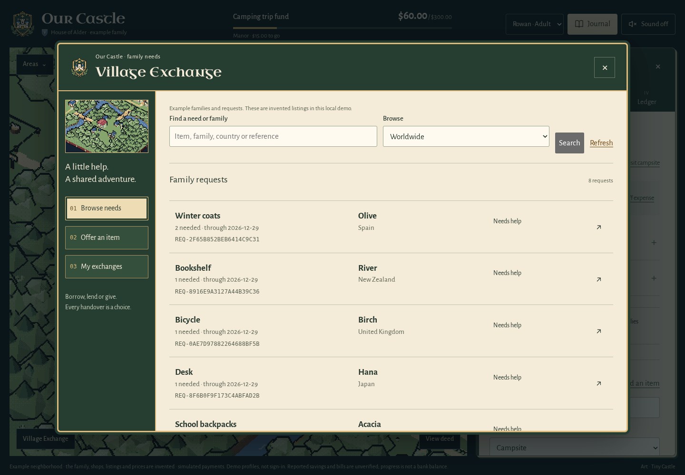
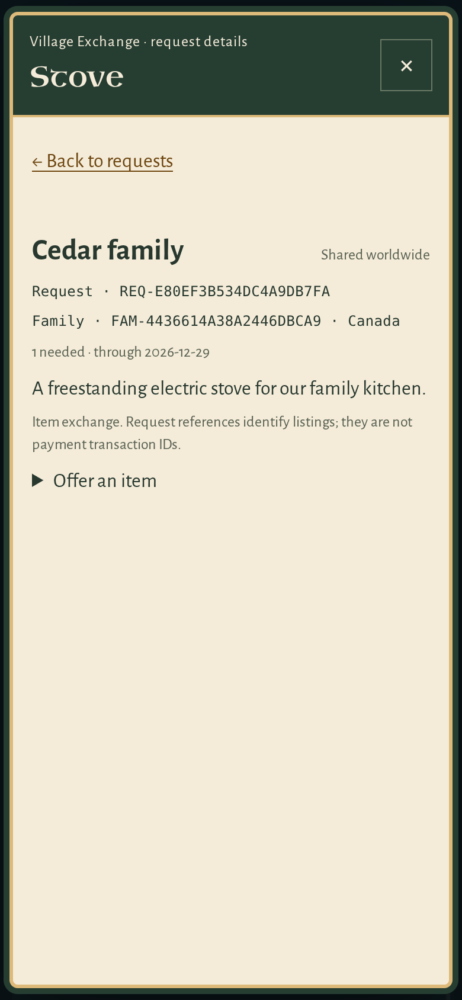
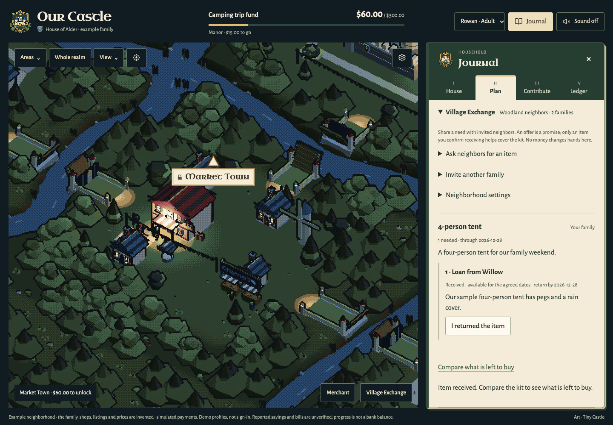
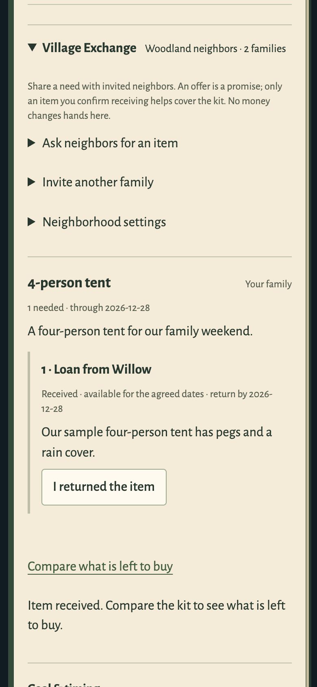

# Village Exchange

A family's unused equipment can help another family reach a goal. **Village Exchange** opens a trading-hall window over the map, with Browse needs, Offer an item and My exchanges sections. A compact shortcut remains in **Plan**. Received items connect to the existing complete-kit planner.

## Browse and open a request

Search by item, family, country or reference, then select a row to open a larger request window. Two families can both need a **Stove**: their stable `FAM-…` and `REQ-…` references distinguish them even if they choose the same display name. Offers have a separate `OFFER-…` reference. These references identify item-sharing records, not financial transactions.

The × button or Escape closes the detail and returns focus to its row; the directory keeps its search and scroll position. Closing the directory returns to the map without changing the camera. The native dialogs keep keyboard focus inside the active window.

**Invited neighborhoods** is the default. An adult can use **My exchanges → Your sharing & requests → Sharing settings** to opt into **Worldwide**. The unchecked consent names every field being published, including all existing open requests' notes and requirements. Worldwide means other signed-in families using this service; it is not an anonymous public endpoint. Country is optional and self-reported. Switching back removes open requests from the directory; families with an existing offer keep access to that handover record. Offer notes remain between the two participants. Private household records, bills, payment identifiers and amounts do not appear in listings.

The directory reads 30 rows at a time. It excludes private and closed requests before searching or paginating. Detail reads recheck current visibility; writes recheck household role, consent, request access and ownership on the server.

| Trading hall, desktop | Request window, phone |
| --- | --- |
|  |  |

[Capture steps and hashes](screenshots/exchange-directory-sources.json). Both windows close when the family's session ends.

Run `npm run demo -- --village-exchange` for a fresh, keyless local example. Alder has a four-person tent on its kit list; Willow has offered to lend one. Accepting the offer leaves the shopping requirement unchanged. **I received the item** makes the tent available, and **Compare what is left to buy** computes a new kit. In the authored sample, the lowest listed total drops from **$150 to $70**. Recorded progress remains $60; no money moves. Returning the item restores the shopping requirement.

The runner also contains seven invented international needs, including two different stove requests. All families, countries, offers, shops and prices shown are authored examples, not a claim of worldwide adoption. The regular `--family-trip` example stays available. Real local family-mode users can create and join neighborhoods or explicitly share needs worldwide through the same domain services.

| Earlier journal layout: confirmed neighbor item | Earlier phone layout: the same handover |
| --- | --- |
|  |  |

## With two families

1. Each family creates its own passkey household in the family runner. An adult saves the items it needs in **Kit list**.
2. In **Village Exchange**, an adult creates a neighborhood and chooses a shared family alias. The founding family creates a single-use invitation, expiring in 24 hours, and shares it themselves. The server stores only its hash; active invitations can be revoked.
3. The other adult previews the neighborhood and explicitly joins. This grants access to the board, not the other household's private records.
4. The requesting adult selects one saved kit line, a quantity, needed-through date and note, and confirms those fields will be shared.
5. The neighbor offers a loan or gift. A loan must cover the requested date. Offer details are visible only to the offering and receiving households.
6. The receiving adult accepts, then separately confirms physical receipt. Accepted promises reserve the request quantity but do not count as available equipment.
7. Received equipment reduces the remaining quantity used by kit comparison. The family still reviews any changed kit, goal and schedule through the existing approval flow.
8. The recipient confirms a return or stops counting a gift when it no longer covers the kit. Accepted items and received loans must be resolved before either family leaves. A giver can leave after a gift is received; the recipient keeps its availability. The receiving family must resolve received items before removing their kit line or leaving.

Children can browse; adults manage sharing and offers. Household IDs and roles come from the session. The server checks origin and CSRF on writes, membership or explicit publication, offer ownership, kit revision, current requirements, dates and reserved quantities. Acceptance and handover are transactional; a repeated handover cannot add stock twice. Live notices contain no other family's records. Worldwide discovery uses explicit refresh, while existing participants retain the household live-update path.

## Deliberate scope

This first version coordinates voluntary equipment. It does not charge cards, send money between families, trade debt, escrow funds, independently verify delivery or equipment condition, expose household addresses automatically, or send messages. Receipt is the adult's own report of an offline handover. A loan counts for the goal only while its return date covers the goal date; moving the goal later can make it ineligible. Neighborhoods are capped at 12 families and 24 open requests (200 total); one family belongs to one neighborhood at a time.

The current saved owner apps are separate from the new schema-14 source. The additive migration creates private profiles and stable references for existing neighbors, preserves all old request/offer fields, and adds an optional offer alias for cross-neighborhood sharing. Only disposable fixtures were migrated; this work does not migrate or restart saved apps. Browser evidence uses Chromium's virtual passkeys and an emulated phone, not human playtesting or physical-device evidence.

## Design references

The owner's game trading-kiosk reference supplies the framed parchment window and three clear actions; Our Castle's existing forest journal, generated crest and original Market Town image supply the identity. The searchable list takes its information order from [Nextdoor's marketplace reference](https://refero.design/pages/af23b9f6-99b0-4603-bd55-98a8b35d5888); the separate closable listing window follows the [Trulia detail reference](https://refero.design/pages/f71fec9c-f73a-4762-bc1c-734f15b712c0). No external game assets are copied. Mobile keeps the same three actions in a compact row, with a separately scrolling body.

## Payments, PYUSD and signed approval: separate decisions

This build does not pay utility companies or accept PYUSD. [PayPal describes PYUSD](https://www.paypal.com/us/digital-wallet/manage-money/crypto/pyusd) as its dollar-backed stablecoin; a transferable token does not restrict the recipient's spending to utilities. [PG&E's payment options](https://www.pge.com/en/account/billing-and-assistance/pay-my-bill.html) and [guest payment flow](https://www.pge.com/en/account/manage-my-account/guest-bill-pay.html) do not establish an API our app can use to route and confirm a third party's bill payment. [PayPal's utilities offering](https://www.paypal.com/us/enterprise/industry-solutions/utilities) describes merchant payment acceptance, not an enabled PG&E connection for Our Castle.

A future bill-support flow would need a supported biller/recipient integration, server-verified account and invoice reference, payment routed to that biller, and a provider-confirmed settlement/reversal record. An uploaded bill or a family's confirmation alone cannot establish this. There is no "fraud-free" claim or verified-biller badge in the current UI.

The proposed passkey payment approval would answer **which adult approved which exact payment**. It would not prove the need or where the recipient spent money. Before implementation, its intent must also bind the server-verified recipient, payment operation and expiry; approval must remain tied to the same order through retries and capture, with current access rechecked. Rechecking a saved signature later is an evidence check, not a new payment authorization. [WebAuthn](https://www.w3.org/TR/webauthn-3/) supports PINs and other user-verification methods as well as biometrics, so "only a parent's fingerprint can pay" would overstate it. No payment-approval or checkout behavior changes in this directory release.

Implementation: [exchange service](../server/exchange/index.mjs), [shared stock](../server/exchange/stock.mjs), [journal controls](../src/app/village-exchange.js), [authored example](../scripts/village-exchange.mjs), [architecture](ARCHITECTURE.md#village-exchange-lifecycle).
