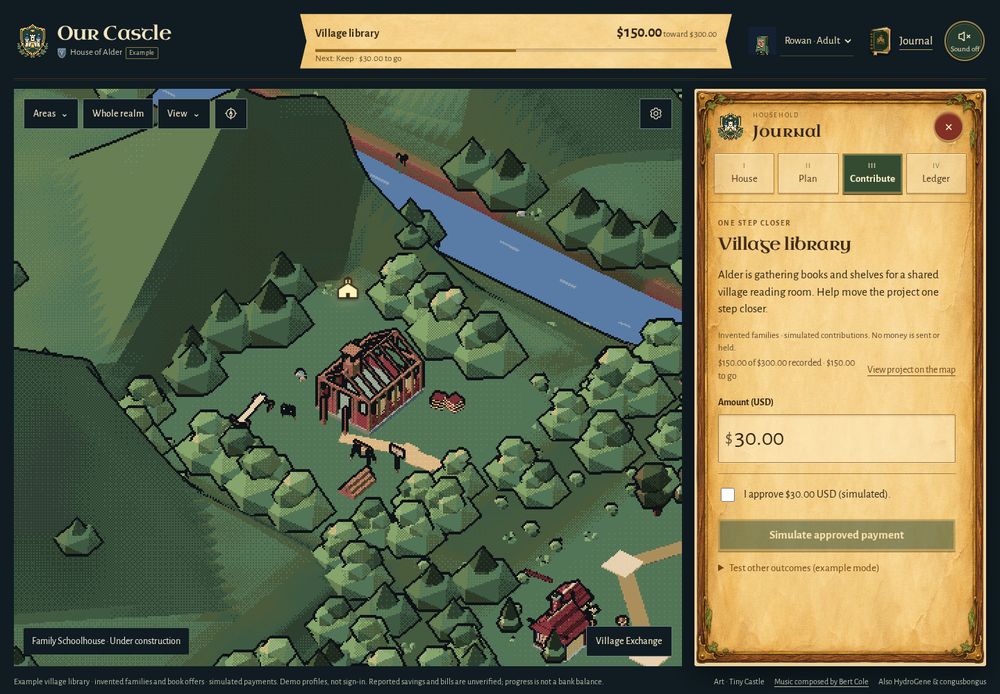

# The one-minute village opening

```sh
npm ci
npm run demo -- --village-story
```

Open the printed localhost URL. This is an invented **Village library** project in Alder's organizer household, with the schoolhouse artwork in the west meadow. It opens directly in **Contribute**, with **$150 of $300** in labeled simulated contributions. Ash's starting receipt is an authored fixture, not evidence of a real person paying. Rowan is ready to contribute; approval is unchecked.



On narrow screens, the first visit brings the library chapter into view; **View project on the map** returns to the schoolhouse. [390 px phone capture](screenshots/village-story-phone.png).

1. Read the project and the suggested **$30**. Approve that exact amount and choose **Simulate approved payment**.
2. Recorded progress becomes **$180 of $300**. The existing milestone rules furnish the schoolhouse and open the corresponding district. Dismiss or visit from the deed.
3. Choose **Review the receipt**. Treasury selects that exact $30 contribution. It says simulated, with no invented PayPal Match. Refresh keeps the records and the tab you chose.

The main route needs no kit comparison, tavern, photo reader or provider setup. Those features remain reachable in their usual places. **View project on the map** closes the journal and focuses the schoolhouse. Its construction represents progress, not a claim that a real library has been bought or built.

For an optional second scene, open Village Exchange. **Woodland library circle** contains two invented households, Alder and Willow. Alder requests ten books; Willow offers five as a gift. An offer alone supplies no books. Acceptance and handover use the existing Exchange rules, and never add money to the ledger. The board starts private to this invited neighborhood.

## What this does and does not demonstrate

This runner creates its own in-memory database, uses an unused loopback port, ignores `.env` and inherited provider settings, and contacts no provider. Closing it discards the example. Reset restores exactly the starting contribution, household and book offer. Do not combine story flags; the runner refuses an ambiguous choice. The plain demo, family-trip and village-exchange scenarios remain separate.

The contribution belongs to **one organizer household**. There is no live pooled fund, automatic credit across families, verified recipient, payout, subscription or PYUSD integration here. Shared-family passkey access is a separate runnable mode. This opening is a product demonstration, not a substitute for a PayPal sandbox demonstration or observed family feedback.

## Direct recipient routing: confirmed API shape, unverified account capability

PayPal's [Pay another account](https://developer.paypal.com/v5/checkout/pay-another-account) documentation supports `purchase_units[].payee.email_address` or `merchant_id`. It says the application owner is the default payee. Routing directly to a recipient can avoid holding funds in the application's account; it does **not** establish that the business model is approved, eliminate every legal obligation, or restrict what the recipient buys afterward. An organizer receiving money is not the same as directly paying a utility bill.

The [platform troubleshooting guide](https://developer.paypal.com/platforms/troubleshoot) documents capture/refund authorization failures and seller assertions. [Seller onboarding](https://developer.paypal.com/platforms/seller-onboarding/) describes permissions for platform integrations. These requirements must be checked against the intended integration and actual accounts; neither “any email works” nor “only the organizer can refund” has been demonstrated here.

Before activating recipient payments:

- Establish a supported recipient/account relationship and capture/refund permissions with PayPal. Prefer a stable merchant ID once verified.
- Bind the adult's approval and stored order to the server-owned goal, amount, currency **and recipient**. Reject stale or changed recipient settings.
- Check the returned payee as well as the existing amount/currency/reference/capture evidence. Keep retries idempotent and prior receipts tied to their original recipient.
- Demonstrate create → buyer approval → capture → same-order readback with a distinct authorized sandbox recipient, then verify the refund/reconciliation path. Fake-provider checks alone cannot establish these account capabilities.

No recipient routing code or provider call is introduced by this demo change. Payouts and a crypto vault are not needed for this direct-recipient design.

## Design and checks

The existing illustrated parchment journal and schoolhouse are the visual target. No new artwork, card system or navigation mode is added. Refero's [GoFundMe donation/receipt flow](https://refero.design/flows/11729) informs the sequence—project, amount, explicit confirmation, receipt, return—while [Franco Maria Ricci](https://francomariaricci.com) supplies only the principle of leaving the illustration dominant beside a compact title. Existing fonts, ink, parchment and gold retain their roles.

`test/unit/village-story.test.mjs` covers the seed, provider-off modes, adult approval, child rejection, duplicate credit and reset. `test/e2e/village-story.spec.mjs` exercises the opening, explicit contribution, selected receipt and refresh on desktop and phone, refusing outside browser requests. These are automated example-data checks, not real-family or physical-device evidence.

Local validation: **27 affected unit tests passed** (demo runners, journey and Exchange), both desktop and 390 px phone journeys passed, and the source/art guard passed. The initial phone capture revealed that the journal's edge could be on-screen while its title remained below it; the reveal now checks the title and the phone case passed again. Browser checks observed zero page errors and zero outside requests. Raw logs and review notes are ignored under `test-results/village-story/`. Hosted CI and main integration are separate review steps.
